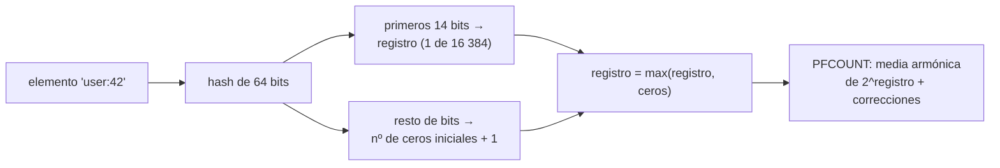

# Redis HyperLogLog

> [!abstract] En 30 segundos
> - **Qué es:** una estructura probabilística que estima **cuántos elementos distintos** has visto, con un máximo de ~12 KB por clave y un error estándar del 0,81 %.
> - **Para qué:** visitantes únicos, búsquedas únicas, IPs distintas… a cualquier escala.
> - **Recuerda:** cuenta, no recuerda: no puedes preguntar si un elemento concreto está ni listar los elementos. Se pueden fusionar (`PFMERGE`) para agregar periodos.

> [!info] Lección 2.3 · Nivel 2 — Estructuras de datos y operaciones avanzadas
> ⬅️ [[Redis Bitmaps y Bitfields]] · ➡️ [[Redis Geospatial]] · 🗺️ [[01 - Redis - Roadmap#Nivel 2 — Estructuras de datos y operaciones avanzadas|Roadmap]] · 📊 [[03 - Redis - Progreso|Progreso]]
> 🏷️ Core (desde 2.8.9). Redis 8.x incluye optimizaciones de rendimiento de HyperLogLog.

## 📌 Definición

**HyperLogLog** (HLL) es un algoritmo para estimar la **cardinalidad** (número de elementos distintos) de un conjunto usando memoria fija, sin guardar los elementos. En Redis:

| Comando | Qué hace | Complejidad |
|---|---|---|
| `PFADD k e1 e2 …` | Añade elementos; devuelve 1 si la estimación cambió | O(1) por elemento |
| `PFCOUNT k [k2 …]` | Cardinalidad estimada (de la unión, si hay varias claves) | O(1) con una clave; O(N) con varias |
| `PFMERGE destino k1 k2 …` | Fusiona varios HLL en uno | O(N) |

Un HLL es internamente un **string**, así que puedes copiarlo con `GET`/`SET` o `DUMP`/`RESTORE`.

## 🎯 ¿Qué problema resuelve?

Contar visitantes únicos diarios de una web con 30 millones de visitantes distintos:
- Con un **set**: 30 millones de miembros × decenas de bytes = varios cientos de MB… **por día**.
- Con un **HyperLogLog**: ~12 KB por día, con un error típico de menos del 1 %.

Para un dashboard de negocio, «≈ 30,2 millones» es tan útil como «30 157 284».

## 🧠 Conceptos fundamentales

1. **Error estándar del 0,81 %:** la mayoría de estimaciones quedan dentro de ±0,81 % del valor real; ocasionalmente algo más.
2. **Memoria fija:** como máximo 12 KB, sea cual sea la cardinalidad (hasta 2⁶⁴ elementos).
3. **Representación *sparse* y *dense*:** con pocos elementos usa una codificación dispersa mucho más pequeña; al crecer (`hll-sparse-max-bytes`, 3000 bytes por defecto) pasa a la densa de 12 KB.
4. **Fusionable sin pérdida adicional:** la unión de HLL diarios da el HLL de la semana con el mismo error. **No** existe intersección exacta (solo aproximaciones por inclusión-exclusión, con más error).
5. **Sin pertenencia:** no puede responder «¿estuvo el usuario 42?»; para eso, set, bitmap o Bloom filter.

### Analogía
Estimar cuánta gente distinta pasó por una puerta mirando solo **la racha más larga de caras con gafas** que has visto: con mucha gente distinta, es más probable haber visto rachas largas. Con muchas puertas independientes (registros) y promediando, la estimación es sorprendentemente precisa.
**Dónde se rompe:** el algoritmo real no mira caras, sino el número de ceros iniciales del hash de cada elemento, repartido en 16 384 registros.

## ⚙️ Funcionamiento interno



- 16 384 registros de 6 bits = 12 KB en la representación densa.
- `PFCOUNT` sobre una sola clave guarda en la cabecera la última cardinalidad calculada, y no la recalcula si no ha cambiado.
- `PFCOUNT` con varias claves fusiona en memoria temporal: más caro, úsalo con moderación en caliente.

## 💻 Ejemplos prácticos

```text
127.0.0.1:6379> PFADD unicos:2026-11-03 user:1 user:2 user:3 user:2
(integer) 1
127.0.0.1:6379> PFCOUNT unicos:2026-11-03
(integer) 3
127.0.0.1:6379> PFADD unicos:2026-11-04 user:3 user:4
(integer) 1
127.0.0.1:6379> PFCOUNT unicos:2026-11-03 unicos:2026-11-04
(integer) 4                     # únicos en los dos días (unión)
127.0.0.1:6379> PFMERGE unicos:semana:45 unicos:2026-11-03 unicos:2026-11-04
OK
127.0.0.1:6379> MEMORY USAGE unicos:semana:45
(integer) 104                   # valor orientativo: con pocos elementos usa la representación sparse
```

**Medir el error real** (laboratorio):

```text
EVAL "for i=1,1000000 do redis.call('PFADD', KEYS[1], 'u'..i) end return redis.call('PFCOUNT', KEYS[1])" 1 hll:prueba
```

Compara el resultado con 1 000 000: la diferencia debería ser del orden de unos pocos miles.

## 🔧 Implementación en .NET

```csharp
using StackExchange.Redis;

IDatabase db = mux.GetDatabase();
string day = $"unicos:{DateTime.UtcNow:yyyy-MM-dd}";

// Registrar visitante (se puede hacer FireAndForget en el camino caliente)
await db.HyperLogLogAddAsync(day, "user:42", CommandFlags.FireAndForget);
await db.KeyExpireAsync(day, TimeSpan.FromDays(400), ExpireWhen.HasNoExpiry);

// Únicos de hoy
long today = await db.HyperLogLogLengthAsync(day);

// Únicos de los últimos 7 días (unión al vuelo)
RedisKey[] week = Enumerable.Range(0, 7)
    .Select(i => (RedisKey)$"unicos:{DateTime.UtcNow.AddDays(-i):yyyy-MM-dd}")
    .ToArray();
long weekly = await db.HyperLogLogLengthAsync(week);

// O materializar el agregado semanal
await db.HyperLogLogMergeAsync("unicos:semana:actual", week);
```

## 🏗️ Casos de uso en arquitectura

| Caso | Diseño |
|---|---|
| Visitantes únicos por página y día | `PFADD page:{id}:uv:{fecha} visitorId` |
| DAU/WAU/MAU sin IDs densos | HLL diario + `PFMERGE` |
| IPs distintas por endpoint (seguridad) | HLL por endpoint y hora |
| Términos de búsqueda distintos | HLL por día |

### Cuándo NO usarlo
- Necesitas el número exacto (facturación, auditoría): set o bitmap.
- Necesitas saber si un elemento concreto está: set, bitmap o [[Estructuras probabilísticas en Redis|Bloom filter]].
- Necesitas intersecciones precisas («únicos de ayer que también vinieron hoy»): bitmaps o sets.

### Consideraciones de arquitectura

| Dimensión | Qué pensar |
|---|---|
| Precisión | Comunica el margen de error a negocio |
| Memoria | 12 KB × número de HLL: con millones de páginas × días, también suma |
| Rendimiento | `PFADD` es muy barato; `PFCOUNT` multi-clave, menos |
| Cluster | `PFCOUNT`/`PFMERGE` multi-clave exigen el mismo slot |

## ⚠️ Errores y anti-patterns

| Error | Por qué duele | Cómo evitarlo |
|---|---|---|
| Usar HLL para cifras que se facturan | Error inaceptable | Conteo exacto |
| Esperar poder listar o comprobar elementos | No los guarda | Otra estructura |
| Calcular intersecciones con inclusión-exclusión y presentarlas como exactas | Error grande cuando los conjuntos son muy distintos | Bitmaps o sets |
| HLL sin TTL por cada día y cada página | Memoria creciente | TTL según la retención de analítica |

## ✅ Buenas prácticas

1. Un HLL por dimensión y periodo, con TTL.
2. `PFMERGE` para materializar agregados que se consultan mucho.
3. Documenta que las cifras son aproximadas.
4. Elementos normalizados (mismo formato de ID) para no contar dos veces al mismo.

## 🎤 Preguntas de entrevista

> [!question]- 1. ¿Cómo contarías visitantes únicos de 100 millones de eventos al día con poca memoria?
> Con un HyperLogLog por día: `PFADD` por evento y `PFCOUNT` para la estimación, con ~12 KB y un error estándar del 0,81 %. Para semanas o meses, `PFMERGE` de los diarios.

> [!question]- 2. ¿Qué no puede hacer un HyperLogLog?
> Decir si un elemento concreto está, listar los elementos o dar intersecciones exactas. Solo estima la cardinalidad (y la de uniones).

> [!question]- 3. ¿Por qué ocupa siempre como mucho 12 KB?
> Porque no guarda elementos: guarda 16 384 registros de 6 bits con el máximo número de ceros iniciales observado en los hashes que caen en cada registro.

## 🧪 Ejercicios

### 🟢 Básicos
1. Añade elementos repetidos y comprueba que `PFCOUNT` no los cuenta dos veces.
2. Fusiona tres días con `PFMERGE`.

### 🟡 Intermedios
3. Mide el error real con 1, 10 y 100 millones de elementos (por lotes) y compara la memoria con un set de 1 millón.

### 🔴 Reto Senior
4. Negocio quiere «usuarios únicos por país, dispositivo y día» para 200 países, 5 dispositivos y 365 días de histórico. Calcula la memoria con HLL y propón cómo reducirla si fuese excesiva.

> [!success]- Soluciones
> **3.** El error relativo se mantiene en torno al 1 % o menos; la memoria del HLL no pasa de 12 KB, frente a decenas de MB del set con 1 millón.
> **4.** 200 × 5 × 365 = 365 000 HLL × 12 KB ≈ 4,4 GB en el peor caso (los poco poblados serán sparse y mucho menores). Reducciones: retención más corta del detalle diario y agregados semanales o mensuales con `PFMERGE` para el histórico; eliminar combinaciones sin tráfico; volcar el histórico a una base analítica.

### ✔️ Checklist de dominio
- [ ] Uso `PFADD`, `PFCOUNT` y `PFMERGE`.
- [ ] Explico el error estándar y la memoria fija.
- [ ] Sé cuándo HLL no sirve.

## 📝 Resumen

- HLL estima elementos distintos con ~12 KB y 0,81 % de error estándar.
- `PFADD`, `PFCOUNT` (unión con varias claves), `PFMERGE`.
- Sin pertenencia ni listado ni intersección exacta.
- Ideal para analítica a gran escala; no para cifras que se facturan.

## 🔗 Referencias

- [Redis HyperLogLog](https://redis.io/docs/latest/develop/data-types/probabilistic/hyperloglogs/)
- [PFADD](https://redis.io/docs/latest/commands/pfadd/)
- [PFCOUNT](https://redis.io/docs/latest/commands/pfcount/)

## 🔄 Notas relacionadas

- ⬅️ [[Redis Bitmaps y Bitfields]] · ➡️ [[Redis Geospatial]]
- Relacionadas: [[Estructuras probabilísticas en Redis]] · [[Redis Sets]] · [[Redis Bitmaps y Bitfields]]
