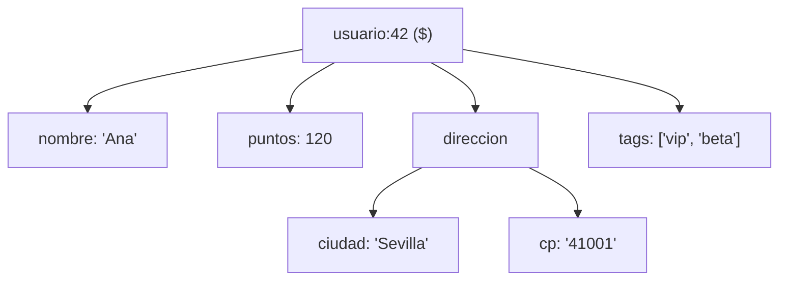

# Redis JSON

> [!abstract] En 30 segundos
> - **Qué es:** un tipo nativo que guarda **documentos JSON** como árbol y permite leer y modificar partes concretas con **JSONPath**, de forma atómica.
> - **Para qué:** objetos anidados (perfiles, catálogos, configuraciones) con actualizaciones parciales y, junto al Query Engine, consultas por campos.
> - **Recuerda:** frente a un string con JSON, no hay que reescribir el documento entero; frente a un hash, admite anidamiento y arrays. Requiere Redis 8+ o Redis Stack.

> [!info] Lección 2.7 · Nivel 2 — Estructuras de datos y operaciones avanzadas
> ⬅️ [[Estructuras probabilísticas en Redis]] · ➡️ [[Redis Query Engine]] · 🗺️ [[01 - Redis - Roadmap#Nivel 2 — Estructuras de datos y operaciones avanzadas|Roadmap]] · 📊 [[03 - Redis - Progreso|Progreso]]
> 🏷️ **R8** (en 7.x, RedisJSON / Redis Stack) · menos memoria en arrays homogéneos ≥8.4 · extensiones de JSONPath (funciones, operadores) ≥8.10. **Valkey≠**: módulo JSON propio, compatible solo en parte.

## 📌 Definición

| Comando | Qué hace |
|---|---|
| `JSON.SET k ruta json [NX/XX]` | Crea o sustituye el documento o un subárbol |
| `JSON.GET k [ruta …]` | Lee el documento o partes |
| `JSON.MGET k1 k2 … ruta` | La misma ruta en varios documentos |
| `JSON.MSET k ruta json [k ruta json …]` | Varias escrituras atómicas |
| `JSON.MERGE k ruta json` | Fusiona (estilo *JSON Merge Patch*) |
| `JSON.DEL k [ruta]` | Borra el documento o una parte |
| `JSON.NUMINCRBY k ruta n` | Incrementa un número |
| `JSON.STRAPPEND k ruta "texto"` | Concatena a un string |
| `JSON.ARRAPPEND` / `JSON.ARRINSERT` / `JSON.ARRPOP` / `JSON.ARRTRIM` / `JSON.ARRLEN` / `JSON.ARRINDEX` | Operaciones sobre arrays |
| `JSON.OBJKEYS` / `JSON.OBJLEN` / `JSON.TYPE` | Inspección |

**Rutas:** JSONPath empieza por `$` (`$.direccion.ciudad`, `$.pedidos[0]`, `$.tags[*]`, `$..precio`, filtros `$.items[?(@.precio > 10)]`) y devuelve siempre un array de coincidencias. La sintaxis heredada empieza por `.` y devuelve un único valor.

## 🎯 ¿Qué problema resuelve?

Con un string JSON, cambiar `direccion.ciudad` exige leer todo el documento, deserializarlo, modificarlo, serializarlo y reescribirlo, y dos escritores concurrentes se pisan. Con Redis JSON:

```text
JSON.SET usuario:42 $.direccion.ciudad '"Sevilla"'
JSON.NUMINCRBY usuario:42 $.puntos 10
```

Cada operación es atómica sobre el documento, sin transferir el resto.

## 🧠 Conceptos fundamentales

| Criterio | String con JSON | Hash | Redis JSON |
|---|---|---|---|
| Anidamiento y arrays | Sí (opaco para Redis) | No | Sí |
| Actualizar un campo | Reescribir todo | `HSET` campo | `JSON.SET` ruta |
| Incremento atómico | No | `HINCRBY` | `JSON.NUMINCRBY` |
| Tipos (número, bool, null) | No (texto) | No (todo string) | Sí |
| Indexable por el Query Engine | No | Sí | Sí |
| Memoria | La mínima | Muy baja si es pequeño | Mayor (árbol), mejorada en 8.4 |
| Disponibilidad | Core | Core | R8 / Stack |

### Analogía
Un string JSON es un **PDF**: para cambiar una coma hay que regenerarlo. Redis JSON es un **documento editable**: vas a la sección exacta y la cambias, mientras otros editan otra parte.
**Dónde se rompe:** dos ediciones de la misma ruta siguen siendo «la última gana»; para condiciones complejas, scripts o transacciones.

## ⚙️ Funcionamiento interno

- El documento se guarda parseado como un árbol binario de nodos (objetos, arrays, números, strings), no como texto. Por eso las rutas se resuelven sin reparsear.
- Al escribir se valida que el JSON sea correcto.
- Redis 8.4 redujo mucho la memoria de arrays homogéneos (por ejemplo, arrays de números) y 8.8 añadió opciones para elegir el tipo de coma flotante de esos arrays.



## 💻 Ejemplos prácticos

```text
127.0.0.1:6379> JSON.SET usuario:42 $ '{"nombre":"Ana","puntos":120,"direccion":{"ciudad":"Madrid","cp":"28013"},"tags":["vip"]}'
OK
127.0.0.1:6379> JSON.GET usuario:42 $.direccion.ciudad
"[\"Madrid\"]"
127.0.0.1:6379> JSON.SET usuario:42 $.direccion.ciudad '"Sevilla"'
OK
127.0.0.1:6379> JSON.NUMINCRBY usuario:42 $.puntos 10
"[130]"
127.0.0.1:6379> JSON.ARRAPPEND usuario:42 $.tags '"beta"'
1) (integer) 2
127.0.0.1:6379> JSON.GET usuario:42 $.nombre $.tags
"{\"$.nombre\":[\"Ana\"],\"$.tags\":[[\"vip\",\"beta\"]]}"
127.0.0.1:6379> JSON.MERGE usuario:42 $ '{"puntos":null,"plan":"pro"}'
OK
```

`JSON.MERGE` con `null` borra el campo `puntos` y añade `plan`.

**Filtro JSONPath:**

```text
JSON.SET carrito:42 $ '{"items":[{"sku":"A","precio":9.5},{"sku":"B","precio":25}]}'
JSON.GET carrito:42 '$.items[?(@.precio > 10)].sku'
"[\"B\"]"
```

## 🔧 Implementación en .NET

Con NRedisStack:

```csharp
using NRedisStack;
using NRedisStack.RedisStackCommands;
using StackExchange.Redis;

IDatabase db = mux.GetDatabase();
var json = db.JSON();

var user = new User("Ana", 120, new Address("Madrid", "28013"), new[] { "vip" });
await json.SetAsync("usuario:42", "$", user);

// Actualización parcial y atómica (el objeto se serializa: "Sevilla" se guarda como string JSON)
await json.SetAsync("usuario:42", "$.direccion.ciudad", "Sevilla");
await json.NumIncrbyAsync("usuario:42", "$.puntos", 10);

// Leer el documento entero deserializado
User? loaded = await json.GetAsync<User>("usuario:42");

record Address(string ciudad, string cp);
record User(string nombre, int puntos, Address direccion, string[] tags);
```

> [!tip] Nombres de propiedad
> NRedisStack serializa con System.Text.Json: alinea los nombres de propiedad (o configura `JsonSerializerOptions`) con las rutas que usarás en Redis.

**Redis OM .NET** ofrece además un mapeo objeto-documento con índices automáticos, útil si vas a consultar mucho por campos.

## 🏗️ Casos de uso en arquitectura

### Cuándo usarlo
- Documentos anidados que se actualizan por partes: perfiles, carritos con líneas, configuración jerárquica.
- Documentos que quieres **consultar por campos** con el [[Redis Query Engine]] (`ON JSON`).
- Modelos de lectura de CQRS con estructura rica ([[CQRS con Redis]]).

### Cuándo NO usarlo
- Objetos planos pequeños: un [[Redis Hashes|hash]] ocupa menos.
- Caché de respuestas que siempre se leen y escriben enteras: un string basta.
- Tu servicio no tiene Redis 8 ni módulos: comprueba antes.

### Consideraciones de arquitectura

| Dimensión | Qué pensar |
|---|---|
| Memoria | Mayor que string o hash para el mismo dato; mide con `MEMORY USAGE` |
| Rendimiento | Rutas con `..` (descenso recursivo) o filtros sobre arrays grandes son O(N) |
| Concurrencia | Cada comando es atómico; varios cambios condicionados → `MULTI`/`WATCH` o Lua |
| Portabilidad | Depende de la distribución (R8, Stack, servicios gestionados) |

## ⚠️ Errores y anti-patterns

| Error | Por qué duele | Cómo evitarlo |
|---|---|---|
| Documentos gigantes (MB) | Big keys, latencia | Trocear por entidad |
| `JSON.GET` del documento entero para leer un campo | Transferencia innecesaria | Rutas concretas |
| Confundir `$` (array de resultados) con `.` (valor único) | Deserialización incorrecta | Usar JSONPath de forma consistente |
| Elegir JSON para objetos planos | Más memoria sin beneficio | Hash |

## ✅ Buenas prácticas

1. JSONPath (`$`) en todo el código nuevo.
2. Lee y escribe solo las rutas necesarias.
3. Documentos acotados por entidad.
4. Índices del Query Engine para consultas por campos.

## 🎤 Preguntas de entrevista

> [!question]- 1. ¿Hash, string con JSON o Redis JSON?
> Hash para objetos planos con actualizaciones parciales (mínima memoria). String para blobs que se leen y escriben enteros. Redis JSON cuando hay anidamiento o arrays y necesito actualizar partes de forma atómica o consultarlas con el Query Engine.

> [!question]- 2. ¿Qué ventaja tiene `JSON.NUMINCRBY` frente a leer, sumar y escribir el JSON?
> Es atómico en el servidor: no hay condición de carrera entre escritores y no transfiere el documento.

> [!question]- 3. ¿Qué devuelve una ruta JSONPath?
> Siempre un array con todas las coincidencias (aunque solo haya una); la sintaxis heredada con `.` devuelve un único valor.

## 🧪 Ejercicios

### 🟢 Básicos
1. Crea un documento de usuario y modifica la ciudad y los puntos sin reescribirlo.
2. Usa `JSON.ARRAPPEND` y `JSON.ARRPOP` sobre una lista de etiquetas.

### 🟡 Intermedios
3. Compara la memoria del mismo usuario como string JSON, hash y Redis JSON.
4. Usa un filtro JSONPath para obtener las líneas de un carrito con precio mayor que 10.

### 🔴 Reto Senior
5. Un catálogo de 2 millones de productos con atributos variables se consulta por categoría, rango de precio y texto. Diseña el almacenamiento y las consultas con Redis JSON y el Query Engine, y explica qué harías si el servicio gestionado no tuviera módulos.

> [!success]- Soluciones
> **3.** Lo habitual: hash ≤ string < JSON en memoria; el JSON paga el árbol a cambio de las operaciones parciales.
> **5.** Un documento JSON por producto (`producto:{id}`) y un índice `FT.CREATE idx ON JSON PREFIX 1 producto: SCHEMA $.categoria AS categoria TAG $.precio AS precio NUMERIC SORTABLE $.nombre AS nombre TEXT`. Consultas con `FT.SEARCH`. Sin módulos: hashes por producto e índices manuales (sets por categoría, zset por precio) para los filtros, y la búsqueda de texto en un motor externo.

### ✔️ Checklist de dominio
- [ ] Uso `JSON.SET`/`GET`/`NUMINCRBY`/`ARRAPPEND`/`MERGE` con JSONPath.
- [ ] Comparo string, hash y Redis JSON.
- [ ] Sé su disponibilidad por versión y distribución.

## 📝 Resumen

- Redis JSON guarda documentos como árbol y opera por rutas JSONPath.
- Actualizaciones parciales atómicas e incrementos numéricos.
- Más memoria que hash/string; mejoras en 8.4.
- Pareja natural del Query Engine.
- R8 o Redis Stack: compruébalo en tu servicio.

## 🔗 Referencias

- [Redis JSON](https://redis.io/docs/latest/develop/data-types/json/)
- [JSON.SET](https://redis.io/docs/latest/commands/json.set/)
- [NRedisStack (.NET)](https://redis.io/docs/latest/develop/clients/dotnet/)

## 🔄 Notas relacionadas

- ⬅️ [[Estructuras probabilísticas en Redis]] · ➡️ [[Redis Query Engine]]
- Relacionadas: [[Redis Hashes]] · [[Redis Strings]] · [[Serialización de datos en Redis]] · [[CQRS con Redis]]
