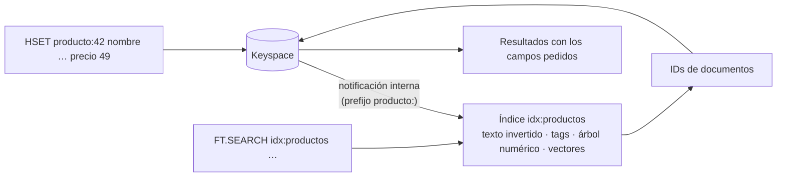

# Redis Query Engine

> [!abstract] En 30 segundos
> - **Qué es:** el motor de **índices secundarios, búsqueda full-text, agregaciones y búsqueda vectorial** de Redis, sobre hashes y documentos JSON.
> - **Para qué:** consultar por campos («categoría = teclados y precio < 100, ordenado por precio»), buscar texto y vectores sin mantener índices a mano.
> - **Recuerda:** los índices se actualizan automáticamente al escribir en las claves con el prefijo indexado, y ocupan memoria. Requiere Redis 8+ o Redis Stack.

> [!info] Lección 2.8 · Nivel 2 — Estructuras de datos y operaciones avanzadas
> ⬅️ [[Redis JSON]] · ➡️ [[Redis TimeSeries]] · 🗺️ [[01 - Redis - Roadmap#Nivel 2 — Estructuras de datos y operaciones avanzadas|Roadmap]] · 📊 [[03 - Redis - Progreso|Progreso]]
> 🏷️ **R8** (antes RediSearch / Redis Stack) · escalado vertical con hilos de consulta desde 8.0 · `FT.HYBRID` ≥8.4 · puntuación por defecto BM25STD desde 8.4 · `FT.ALIASLIST` ≥8.10. En Azure Managed Redis, RediSearch requiere la política de clustering Enterprise.

## 📌 Definición

El Query Engine (antes RediSearch) mantiene **índices** sobre las claves que empiezan por uno o varios prefijos. Cuando escribes un hash o un documento JSON con ese prefijo, Redis actualiza el índice; luego consultas con `FT.SEARCH` o `FT.AGGREGATE`.

| Comando | Qué hace |
|---|---|
| `FT.CREATE idx ON HASH/JSON PREFIX n p … SCHEMA campo tipo [opciones] …` | Crea un índice |
| `FT.SEARCH idx "consulta" [RETURN …] [SORTBY campo ASC/DESC] [LIMIT off n] [PARAMS …] [DIALECT 2]` | Busca documentos |
| `FT.AGGREGATE idx "consulta" GROUPBY … REDUCE … SORTBY … APPLY …` | Agregaciones |
| `FT.INFO idx` / `FT.DROPINDEX idx [DD]` / `FT.ALTER` | Gestión |
| `FT.EXPLAIN` / `FT.PROFILE` | Plan y perfil de una consulta |
| `FT.HYBRID` (≥8.4) | Búsqueda híbrida texto + vector con fusión de puntuaciones |

**Tipos de campo:** `TEXT` (full-text con stemming), `TAG` (valores exactos, como categorías), `NUMERIC` (rangos), `GEO`, `GEOSHAPE`, `VECTOR` (similitud: `FLAT`, `HNSW` y, desde 8.2, `SVS-VAMANA`).

## 🎯 ¿Qué problema resuelve?

Sin Query Engine, para consultar por algo que no sea la clave hay que mantener índices manuales: un set por categoría, un zset por precio… y actualizarlos en cada escritura (y desactualizarlos cuando falla algo). Con el Query Engine declaras el índice una vez y consultas:

```text
FT.SEARCH idx:productos "@categoria:{teclados} @precio:[0 100]" SORTBY precio ASC LIMIT 0 10
```

## 🧠 Conceptos fundamentales

### Sintaxis de consulta (resumen)

| Consulta | Significado |
|---|---|
| `teclado mecanico` | Documentos con ambas palabras (TEXT) |
| `teclado \| raton` | Cualquiera de las dos |
| `-inalambrico` | Excluir |
| `@nombre:(teclado)` | Solo en el campo `nombre` |
| `@categoria:{teclados \| ratones}` | TAG con varios valores |
| `@precio:[10 100]` / `@precio:[(10 +inf]` | Rango numérico (con exclusivo) |
| `@ubicacion:[-3.70 40.42 5 km]` | Radio geográfico |
| `*=>[KNN 10 @embedding $vec AS score]` | Los 10 vectores más similares (con `PARAMS` y `DIALECT 2`) |

### Ideas clave
1. **Indexación automática** sobre prefijos: no hay que «insertar en el índice».
2. **Índice ≠ datos:** el índice ocupa memoria adicional (a veces tanto como los datos).
3. **TAG frente a TEXT:** TAG para valores exactos (categorías, estados, IDs); TEXT para lenguaje natural.
4. **`SORTABLE`:** permite ordenar eficientemente por ese campo.
5. **Escalado:** horizontal (Redis Cluster, con un coordinador que reparte la consulta) y vertical (hilos de consulta, `search-workers`).
6. **Timeouts:** las consultas tienen un tiempo máximo (`search-on-timeout` decide si fallan o devuelven resultados parciales).

### Analogía
Es el **índice temático de una biblioteca** que se actualiza solo cada vez que entra un libro: puedes pedir «libros de historia, publicados entre 1990 y 2000, ordenados por año» sin recorrer todas las estanterías.
**Dónde se rompe:** el índice ocupa sitio en la biblioteca (memoria) y hay que decidir de antemano qué temas indexar.

## ⚙️ Funcionamiento interno



- **TEXT:** índice invertido (término → documentos), con stemming por idioma y puntuación (BM25STD por defecto desde 8.4).
- **NUMERIC:** árbol de rangos.
- **TAG:** índice invertido de valores exactos.
- **VECTOR:** HNSW (aproximado, rápido), FLAT (exacto, fuerza bruta) o SVS-VAMANA (con compresión).
- Al crear un índice sobre datos existentes, se indexan en segundo plano (`FT.INFO` muestra el progreso).

## 💻 Ejemplos prácticos

```text
127.0.0.1:6379> FT.CREATE idx:productos ON HASH PREFIX 1 producto: SCHEMA nombre TEXT WEIGHT 2 categoria TAG precio NUMERIC SORTABLE stock NUMERIC
OK
127.0.0.1:6379> HSET producto:1 nombre "Teclado mecánico" categoria teclados precio 89 stock 10
(integer) 4
127.0.0.1:6379> HSET producto:2 nombre "Teclado compacto" categoria teclados precio 45 stock 0
(integer) 4
127.0.0.1:6379> HSET producto:3 nombre "Ratón ergonómico" categoria ratones precio 39 stock 5
(integer) 4
127.0.0.1:6379> FT.SEARCH idx:productos "@categoria:{teclados} @precio:[0 100] @stock:[(0 +inf]" SORTBY precio ASC RETURN 2 nombre precio
1) (integer) 1
2) "producto:1"
3) 1) "nombre"
   2) "Teclado mecánico"
   3) "precio"
   4) "89"
127.0.0.1:6379> FT.AGGREGATE idx:productos "*" GROUPBY 1 @categoria REDUCE COUNT 0 AS total REDUCE AVG 1 @precio AS precio_medio
1) (integer) 2
2) 1) "categoria"
   2) "teclados"
   3) "total"
   4) "2"
   5) "precio_medio"
   6) "67"
…
```

**Índice sobre JSON:**

```text
FT.CREATE idx:usuarios ON JSON PREFIX 1 usuario: SCHEMA $.nombre AS nombre TEXT $.direccion.ciudad AS ciudad TAG $.puntos AS puntos NUMERIC SORTABLE
FT.SEARCH idx:usuarios "@ciudad:{Sevilla} @puntos:[100 +inf]"
```

## 🔧 Implementación en .NET

Con NRedisStack:

```csharp
using NRedisStack;
using NRedisStack.RedisStackCommands;
using NRedisStack.Search;
using NRedisStack.Search.Literals.Enums;
using StackExchange.Redis;

IDatabase db = mux.GetDatabase();
var ft = db.FT();

// Crear el índice (una vez, en el despliegue o al arrancar si no existe)
await ft.CreateAsync("idx:productos",
    new FTCreateParams().On(IndexDataType.HASH).Prefix("producto:"),
    new Schema()
        .AddTextField("nombre", weight: 2.0)
        .AddTagField("categoria")
        .AddNumericField("precio", sortable: true)
        .AddNumericField("stock"));

// Consultar
SearchResult result = await ft.SearchAsync("idx:productos",
    new Query("@categoria:{teclados} @precio:[0 100]")
        .SetSortBy("precio", ascending: true)
        .Limit(0, 10));

foreach (Document doc in result.Documents)
    Console.WriteLine($"{doc.Id}: {doc["nombre"]} — {doc["precio"]} €");
```

## 🏗️ Casos de uso en arquitectura

| Caso | Por qué el Query Engine |
|---|---|
| Catálogos con filtros y ordenación | TAG + NUMERIC + SORTABLE |
| Búsqueda de texto en productos o contenidos | TEXT con stemming |
| Modelos de lectura de CQRS consultables | Índices sobre JSON |
| RAG y búsqueda semántica | VECTOR (KNN, filtros híbridos, `FT.HYBRID`) |
| Geobúsqueda con filtros | GEO + otros campos |

### Cuándo NO usarlo
- Búsqueda empresarial con relevancia avanzada, facetas complejas, analizadores de idioma a medida y grandes volúmenes en disco: Elasticsearch, OpenSearch, Azure AI Search.
- Datos que no caben en RAM (índice incluido).
- Consultas relacionales con joins: base relacional.

### Consideraciones de arquitectura

| Dimensión | Qué pensar |
|---|---|
| Memoria | Datos + índices; mide con `FT.INFO` |
| Escrituras | Cada escritura actualiza el índice: más CPU por escritura |
| Cluster | El índice se reparte por shards y un coordinador fusiona resultados |
| Gestionados | Restricciones por nivel (en Azure Managed Redis: clustering Enterprise y `NoEviction` con geo-replicación) |
| Consistencia | Si borras claves, el índice se actualiza; si caducan por TTL, también |

## ⚠️ Errores y anti-patterns

| Error | Por qué duele | Cómo evitarlo |
|---|---|---|
| Indexar campos que nunca consultas | Memoria y CPU desperdiciadas | Índices mínimos |
| TEXT para categorías o estados | Resultados inexactos | TAG |
| Ordenar por campos no `SORTABLE` | Consultas más lentas | `SORTABLE` en los campos de ordenación |
| Consultas sin `LIMIT` | Respuestas enormes | Paginación |
| Asumir que existe en cualquier Redis | Falla en 7.x sin Stack o en algunos servicios | Verificar módulos |

## ✅ Buenas prácticas

1. Diseña el índice a partir de las consultas reales.
2. TAG para valores exactos; TEXT para lenguaje natural.
3. `LIMIT` siempre y `RETURN` solo con los campos necesarios.
4. Usa `FT.PROFILE` para optimizar consultas lentas.
5. Alias de índice (`FT.ALIASADD`) para recrear índices sin cambiar el código.

## 🎤 Preguntas de entrevista

> [!question]- 1. ¿Cómo consultarías productos por categoría y rango de precio en Redis?
> Con un índice del Query Engine sobre los hashes o documentos JSON (`categoria` como TAG, `precio` como NUMERIC SORTABLE) y `FT.SEARCH` con `@categoria:{…} @precio:[min max] SORTBY precio`. Sin Query Engine, con índices manuales: un set por categoría y un zset por precio, combinados en la aplicación o con `ZINTERSTORE`.

> [!question]- 2. ¿Qué coste tiene un índice?
> Memoria adicional y CPU en cada escritura de las claves indexadas; además, las consultas consumen CPU (en hilos propios desde Redis 8). Por eso se indexa solo lo que se consulta.

> [!question]- 3. ¿Cuándo usarías Elasticsearch en lugar del Query Engine?
> Con volúmenes que no caben en RAM, relevancia y análisis de texto avanzados, facetas complejas, o cuando la búsqueda es el producto en sí y necesita su propio ecosistema.

## 🧪 Ejercicios

### 🟢 Básicos
1. Crea el índice de productos del ejemplo, inserta 10 productos y prueba tres consultas distintas.
2. Haz una agregación del número de productos y precio medio por categoría.

### 🟡 Intermedios
3. Crea un índice sobre documentos JSON de usuarios y busca por ciudad y puntos.
4. Mide con `FT.INFO` la memoria del índice frente a la de los datos con 100 000 productos.

### 🔴 Reto Senior
5. Diseña la búsqueda de un marketplace: texto, filtros por categoría, precio y valoración, ordenación por relevancia o precio, y «productos similares» por vector. Decide qué campos indexar, cómo paginar y cómo recrear el índice sin downtime.

> [!success]- Soluciones
> **5.** Índice ON JSON con `titulo TEXT`, `categoria TAG`, `precio NUMERIC SORTABLE`, `valoracion NUMERIC SORTABLE` y `embedding VECTOR HNSW`; paginación con `LIMIT`; similares con KNN filtrado por categoría. Para recrear: crear `idx:v2`, esperar a que termine de indexar (`FT.INFO`), mover el alias `idx` a `idx:v2` y borrar `idx:v1`.

### ✔️ Checklist de dominio
- [ ] Creo índices sobre hashes y JSON con los tipos de campo adecuados.
- [ ] Escribo consultas con texto, TAG, rangos y ordenación.
- [ ] Hago agregaciones básicas.
- [ ] Conozco el coste y las alternativas.

## 📝 Resumen

- Índices secundarios automáticos sobre hashes y JSON por prefijo.
- TEXT, TAG, NUMERIC, GEO y VECTOR.
- `FT.SEARCH` para consultas, `FT.AGGREGATE` para agregaciones, `FT.HYBRID` (8.4) para híbridas.
- Los índices cuestan memoria y CPU de escritura.
- R8 o Redis Stack; restricciones en servicios gestionados.

## 🔗 Referencias

- [Search and query](https://redis.io/docs/latest/develop/ai/search-and-query/)
- [FT.CREATE](https://redis.io/docs/latest/commands/ft.create/)
- [FT.SEARCH](https://redis.io/docs/latest/commands/ft.search/)

## 🔄 Notas relacionadas

- ⬅️ [[Redis JSON]] · ➡️ [[Redis TimeSeries]]
- Relacionadas: [[Modelado de datos en Redis]] · [[Caché semántica y búsqueda vectorial con Redis]] · [[CQRS con Redis]]
