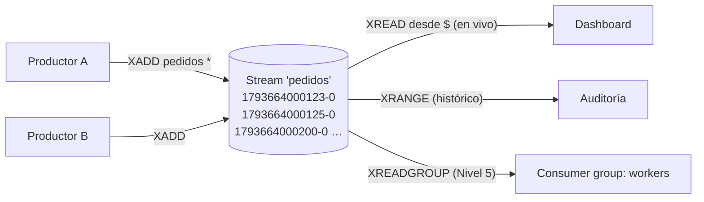

# Redis Streams

> [!abstract] En 30 segundos
> - **Qué es:** un **log append-only**: cada entrada tiene un ID creciente (`milisegundos-secuencia`) y un conjunto de pares campo → valor.
> - **Para qué:** eventos, actividad, telemetría, auditoría ligera y, con consumer groups (Nivel 5), mensajería con confirmación.
> - **Recuerda:** las entradas no se borran al leerlas; recorta el stream con `MAXLEN`/`MINID` para acotar memoria. Leer de un stream no lo «consume» (a diferencia de una lista).

> [!info] Lección 2.5 · Nivel 2 — Estructuras de datos y operaciones avanzadas
> ⬅️ [[Redis Geospatial]] · ➡️ [[Estructuras probabilísticas en Redis]] · 🗺️ [[01 - Redis - Roadmap#Nivel 2 — Estructuras de datos y operaciones avanzadas|Roadmap]] · 📊 [[03 - Redis - Progreso|Progreso]]
> 🏷️ Core (≥5.0) · `MINID` y `LIMIT` ≥6.2 · `KEEPREF/DELREF/ACKED`, `XDELEX`, `XACKDEL` ≥8.2 · `XADD IDMP/IDMPAUTO` ≥8.6 · `XREAD … MAXCOUNT/MAXSIZE` ≥8.10.

## 📌 Definición

Un **stream** es una secuencia ordenada e inmutable de entradas. Cada entrada:
- Tiene un **ID** con formato `<milisegundos>-<secuencia>` (por ejemplo `1793664000123-0`), estrictamente creciente.
- Contiene uno o más pares **campo → valor**, como un pequeño hash.

Se añade al final con `XADD` y se lee por rangos de ID (`XRANGE`) o esperando entradas nuevas (`XREAD … BLOCK`). Varios lectores pueden leer el mismo stream sin quitarse las entradas unos a otros.

## 🎯 ¿Qué problema resuelve?

- Las **listas** sirven como cola, pero un elemento leído desaparece: no hay histórico ni varios lectores independientes.
- **Pub/Sub** difunde mensajes, pero si un suscriptor está desconectado, los pierde.
- Un **stream** guarda los eventos ordenados, permite releerlos desde cualquier punto y, con consumer groups, repartir el trabajo entre consumidores con confirmación (ACK).

## 🧠 Conceptos fundamentales

| Comando | Qué hace | Complejidad |
|---|---|---|
| `XADD k [NOMKSTREAM] [KEEPREF/DELREF/ACKED] [IDMPAUTO pid / IDMP pid iid] [MAXLEN/MINID [=/~] umbral [LIMIT n]] */id campo valor …` | Añade una entrada (y opcionalmente recorta) | O(1) + recorte |
| `XRANGE k ini fin [COUNT n]` / `XREVRANGE` | Rango por ID (`-` y `+` = extremos) | O(log N + M) |
| `XREAD [COUNT n] [BLOCK ms] STREAMS k … id …` | Lee entradas posteriores a un ID; `$` = solo las nuevas | O(N) devueltas |
| `XLEN k` | Número de entradas | O(1) |
| `XTRIM k MAXLEN/MINID [=/~] umbral` | Recorta por longitud o por ID mínimo | O(N) eliminadas |
| `XDEL k id …` | Marca entradas como borradas | O(1) por ID |
| `XINFO STREAM k [FULL]` | Información del stream | O(1) |

**IDs:**
- `*` genera uno automático con la hora del servidor.
- Puedes dar IDs explícitos, pero deben ser mayores que el último.
- Como el ID lleva el instante, `XRANGE` por ID es también un rango temporal: `XRANGE eventos 1793664000000 1793664060000`.

**Recorte:**
- `MAXLEN ~ 100000`: deja aproximadamente las últimas 100 000 (el `~` permite recortar por bloques enteros, mucho más eficiente).
- `MINID ~ <id>`: elimina las entradas anteriores a un ID (retención por tiempo).
- Desde 8.2, `KEEPREF`/`DELREF`/`ACKED` deciden qué pasa con las referencias en los consumer groups al recortar.

**Idempotencia del productor** (🏷️ ≥8.6): `XADD … IDMP productor idEvento *` devuelve el ID de la entrada original si esa combinación ya se añadió, en lugar de duplicarla (útil cuando un productor reintenta).

### Analogía
Un stream es el **libro de registro de un hotel**: cada línea se escribe al final, con la hora, y no se arranca al leerla. Recepción, limpieza y seguridad pueden consultarlo, cada uno desde donde se quedó.
**Dónde se rompe:** el libro de Redis tiene un tamaño máximo razonable: hay que ir archivando las hojas antiguas (recorte), o se queda sin RAM.

## ⚙️ Funcionamiento interno

- Internamente es un **árbol radix** cuyos nodos son **listpacks** con varias entradas (`stream-node-max-bytes` 4096, `stream-node-max-entries` 100).
- Las entradas consecutivas con los mismos campos comparten los nombres de campo con la primera del nodo: un stream de eventos homogéneos ocupa poco.
- `XDEL` solo marca la entrada como borrada dentro del nodo; la memoria se recupera cuando el nodo entero queda vacío o se recorta.
- `XREAD … BLOCK` deja al cliente en espera sin bloquear el servidor, igual que `BLPOP`.



## 💻 Ejemplos prácticos

```text
127.0.0.1:6379> XADD pedidos * id 1001 cliente 42 total 59.90
"1793664000123-0"
127.0.0.1:6379> XADD pedidos MAXLEN ~ 100000 * id 1002 cliente 7 total 12.00
"1793664000125-0"
127.0.0.1:6379> XLEN pedidos
(integer) 2
127.0.0.1:6379> XRANGE pedidos - + COUNT 10
1) 1) "1793664000123-0"
   2) 1) "id"
      2) "1001"
      3) "cliente"
      4) "42"
      5) "total"
      6) "59.90"
2) 1) "1793664000125-0"
   2) …
127.0.0.1:6379> XREAD COUNT 10 BLOCK 5000 STREAMS pedidos $
(nil)                                  # nadie escribió en 5 s
```

**Lectura incremental** (guardando el último ID leído):

```text
XREAD COUNT 100 STREAMS pedidos 1793664000125-0
```

**Retención por tiempo** (eliminar lo anterior a hace 7 días):

```text
XTRIM pedidos MINID ~ 1793059200000
```

## 🔧 Implementación en .NET

```csharp
using StackExchange.Redis;

IDatabase db = mux.GetDatabase();

// Añadir con recorte aproximado
RedisValue id = await db.StreamAddAsync("pedidos", new NameValueEntry[]
{
    new("id", 1001), new("cliente", 42), new("total", "59.90"),
}, maxLength: 100_000, useApproximateMaxLength: true);

// Leer un rango
StreamEntry[] last10 = await db.StreamRangeAsync("pedidos", "-", "+", count: 10, messageOrder: Order.Descending);
foreach (StreamEntry e in last10)
    Console.WriteLine($"{e.Id}: pedido {e["id"]} total {e["total"]}");

// Lectura incremental desde el último ID procesado (sin bloquear: SE.Redis no usa BLOCK)
RedisValue lastId = "0-0";
StreamEntry[] batch = await db.StreamReadAsync("pedidos", lastId, count: 100);
if (batch.Length > 0) lastId = batch[^1].Id;
```

> [!info] Lectura bloqueante
> StackExchange.Redis no expone `XREAD BLOCK` (bloquearía la conexión multiplexada). Se consume con lecturas periódicas o, mejor, con consumer groups ([[Consumer Groups en Redis Streams]]).

## 🏗️ Casos de uso en arquitectura

| Caso | Por qué streams |
|---|---|
| Eventos de dominio entre servicios | Orden, histórico y varios consumidores |
| Telemetría e IoT | Escritura rápida, retención por `MINID` |
| Feed de actividad | Rango por tiempo con `XREVRANGE` |
| Auditoría ligera (días) | Inmutable y ordenado (con persistencia AOF) |
| Cola de trabajo con ACK | Consumer groups (Nivel 5) |

### Cuándo NO usarlo
- Retención de meses o años, replay masivo, particiones de alto volumen: Kafka, Azure Event Hubs.
- Solo necesitas difundir notificaciones efímeras: [[Redis Pub-Sub]].
- Event store de verdad para event sourcing: ver [[Event sourcing con Redis]] (normalmente no).

### Consideraciones de arquitectura

| Dimensión | Qué pensar |
|---|---|
| Memoria | Sin recorte, crece sin fin: `MAXLEN ~` o `MINID ~` siempre |
| Durabilidad | Para eventos que importan: AOF, réplicas y `noeviction` |
| Escalabilidad | Un stream vive en un shard: varios streams (por partición) para mucho volumen |
| Orden | Garantizado dentro de un stream, no entre streams |

## ⚠️ Errores y anti-patterns

| Error | Por qué duele | Cómo evitarlo |
|---|---|---|
| Streams sin recorte | Memoria agotada | `MAXLEN ~`/`MINID ~` en cada `XADD` o un job de `XTRIM` |
| Recorte exacto (`=`) en cada `XADD` | Más caro que el aproximado | `~` |
| Usar `XDEL` para «consumir» | No libera memoria hasta vaciar nodos | Recorte o consumer groups con ACK |
| Valores grandes en cada entrada | Memoria y red | Referencias a datos guardados aparte |
| Un único stream para todo el sistema | Hot key, sin paralelismo | Streams por tipo de evento o partición |

## ✅ Buenas prácticas

1. Recorta siempre, de forma aproximada.
2. Eventos pequeños y homogéneos (comparten nombres de campo).
3. Guarda el último ID procesado si lees con `XREAD` sin grupos.
4. Usa `IDMP` (≥8.6) cuando los productores reintentan.
5. Persistencia y `noeviction` si los eventos importan.

## 🎤 Preguntas de entrevista

> [!question]- 1. ¿En qué se diferencia un stream de una lista?
> Leer de un stream no elimina las entradas: varios lectores independientes pueden leer el mismo histórico, cada entrada tiene un ID temporal que permite rangos por tiempo, y con consumer groups hay confirmaciones y reprocesado. Una lista entrega cada elemento a un único consumidor que lo saca.

> [!question]- 2. ¿Cómo evitas que un stream agote la memoria?
> Con `MAXLEN ~ N` o `MINID ~ id` en cada `XADD`, o un `XTRIM` periódico. El `~` permite recortar por nodos completos, que es mucho más eficiente.

> [!question]- 3. ¿Qué garantiza el ID de una entrada?
> Que es único y estrictamente creciente dentro del stream; incluye los milisegundos del servidor, así que los rangos por ID equivalen a rangos temporales.

## 🧪 Ejercicios

### 🟢 Básicos
1. Añade 5 eventos y léelos con `XRANGE` y `XREVRANGE`.
2. Abre un `XREAD BLOCK 0 STREAMS eventos $` y escribe desde otra terminal.

### 🟡 Intermedios
3. Añade 1 millón de eventos con `MAXLEN ~ 100000` y comprueba `XLEN` y la memoria.
4. Implementa en .NET un lector incremental que procese lotes de 100 y guarde el último ID en una clave.

### 🔴 Reto Senior
5. Un productor reintenta tras timeouts y genera eventos duplicados. Propón una solución para Redis 8.6+ y otra para versiones anteriores.

> [!success]- Soluciones
> **3.** `XLEN` queda algo por encima de 100 000 (el recorte aproximado deja el nodo completo).
> **5.** En 8.6+: `XADD stream IDMP productor idEventoDeNegocio * …`, que devuelve el ID original si ya existía. Antes: guardar `SET evento:{id} 1 NX EX …` y hacer el `XADD` solo si el `SET` tuvo éxito, ambos en un script Lua para que sea atómico, o hacer idempotentes a los consumidores.

### ✔️ Checklist de dominio
- [ ] Uso `XADD`, `XRANGE`, `XREAD` y el recorte.
- [ ] Explico el formato del ID y su uso temporal.
- [ ] Sé por qué y cómo recortar.
- [ ] Distingo streams de listas y de Pub/Sub.

## 📝 Resumen

- Stream = log append-only con IDs temporales crecientes.
- Leer no consume; varios lectores independientes.
- Recorta con `MAXLEN ~` o `MINID ~`.
- `IDMP` (8.6) evita duplicados de productores que reintentan.
- Consumer groups para procesar con ACK (Nivel 5).

## 🔗 Referencias

- [Redis Streams](https://redis.io/docs/latest/develop/data-types/streams/)
- [XADD](https://redis.io/docs/latest/commands/xadd/)
- [XREAD](https://redis.io/docs/latest/commands/xread/)

## 🔄 Notas relacionadas

- ⬅️ [[Redis Geospatial]] · ➡️ [[Estructuras probabilísticas en Redis]]
- Más adelante: [[Consumer Groups en Redis Streams]] · [[Event-driven architecture con Redis]] · [[Redis Pub-Sub]] · [[Proyecto 08 - Procesamiento de eventos con Redis Streams]]
