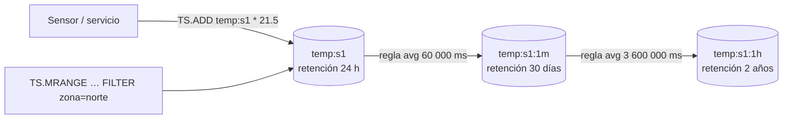

# Redis TimeSeries

> [!abstract] En 30 segundos
> - **Qué es:** un tipo para **series temporales**: pares (timestamp, valor) comprimidos, con retención, etiquetas, agregaciones y reglas de *downsampling*.
> - **Para qué:** métricas de aplicación, IoT, telemetría de negocio en tiempo real (ventas por minuto, temperatura de sensores).
> - **Recuerda:** define la **retención** y las **reglas de compactación** al crear la serie; consulta por etiquetas con `TS.MRANGE`. Lección opcional: requiere Redis 8+ o Redis Stack.

> [!info] Lección 2.9 · Nivel 2 — Estructuras de datos y operaciones avanzadas *(opcional)*
> ⬅️ [[Redis Query Engine]] · ➡️ [[Redis Arrays]] · 🗺️ [[01 - Redis - Roadmap#Nivel 2 — Estructuras de datos y operaciones avanzadas|Roadmap]] · 📊 [[03 - Redis - Progreso|Progreso]]
> 🏷️ **R8** (antes RedisTimeSeries / Redis Stack) · valores NaN y agregadores `COUNTNAN`/`COUNTALL` ≥8.6 · varios agregadores por consulta ≥8.8 · `TS.NRANGE`, `TS.NREVRANGE`, `TS.READ`, `TS.QUERYLABELS` ≥8.10. No disponible en el nivel Flash Optimized de Azure Managed Redis.

## 📌 Definición

Una **serie temporal** es una clave que guarda muestras ordenadas por timestamp (milisegundos), comprimidas en *chunks*, con metadatos (etiquetas) para consultar varias series a la vez.

| Comando | Qué hace |
|---|---|
| `TS.CREATE k [RETENTION ms] [DUPLICATE_POLICY p] [LABELS etiqueta valor …]` | Crea la serie |
| `TS.ADD k ts/* valor [RETENTION …] [ON_DUPLICATE p] [LABELS …]` | Añade una muestra (`*` = ahora) |
| `TS.MADD k1 ts v k2 ts v …` | Varias muestras |
| `TS.INCRBY` / `TS.DECRBY k v` | Contador sobre la última muestra |
| `TS.GET k` / `TS.MGET FILTER etiqueta=valor` | Última muestra |
| `TS.RANGE k desde hasta [AGGREGATION tipo bucket]` / `TS.REVRANGE` | Rango, opcionalmente agregado |
| `TS.MRANGE desde hasta [AGGREGATION …] FILTER etiqueta=valor … [GROUPBY etiqueta REDUCE r]` | Rango sobre todas las series que cumplen el filtro |
| `TS.CREATERULE origen destino AGGREGATION tipo bucket` | Regla de compactación (downsampling) |
| `TS.INFO k` / `TS.QUERYINDEX FILTER …` | Información / buscar series por etiquetas |

**Agregaciones:** `avg`, `sum`, `min`, `max`, `range`, `count`, `first`, `last`, `std.p`, `std.s`, `var.p`, `var.s`, `twa`.

## 🎯 ¿Qué problema resuelve?

Guardar métricas en sorted sets o listas obliga a programar a mano la retención, la agregación por minuto/hora y la búsqueda por dimensiones. TimeSeries lo trae hecho: retención automática, compresión, reglas que calculan medias por hora a medida que llegan datos, y consultas por etiquetas («todas las series de la región `eu-west` del servicio `orders`»).

## 🧠 Conceptos fundamentales

1. **Retención:** las muestras más antiguas que `RETENTION` se eliminan solas.
2. **Etiquetas:** pares clave-valor por serie; `FILTER region=eu servicio=orders` selecciona series.
3. **Compactación:** una regla agrega la serie de origen en buckets (por ejemplo, media por minuto) y escribe en otra serie con otra retención: datos crudos 24 h, medias por minuto 30 días, medias por hora 2 años.
4. **Política de duplicados:** qué hacer si llega otra muestra con el mismo timestamp (`BLOCK`, `FIRST`, `LAST`, `MIN`, `MAX`, `SUM`).
5. **Compresión:** las muestras se guardan comprimidas (técnicas tipo *Gorilla*), con muy pocos bytes por muestra en series regulares.

### Analogía
Un **registrador de temperatura** que anota cada minuto, tira las hojas de más de un día y, al final de cada hora, apunta la media en un cuaderno aparte que guarda durante años.
**Dónde se rompe:** el registrador de Redis puede llevar miles de cuadernos a la vez y buscarlos por etiqueta.

## ⚙️ Funcionamiento interno



- Las muestras se agrupan en *chunks* (por defecto comprimidos); `CHUNK_SIZE` ajusta su tamaño.
- Las reglas se aplican al cerrar cada bucket en la serie de origen.

## 💻 Ejemplos prácticos

```text
127.0.0.1:6379> TS.CREATE temp:s1 RETENTION 86400000 LABELS sensor s1 zona norte tipo temperatura
OK
127.0.0.1:6379> TS.CREATE temp:s1:1h RETENTION 63072000000 LABELS sensor s1 zona norte tipo temperatura agregado 1h
OK
127.0.0.1:6379> TS.CREATERULE temp:s1 temp:s1:1h AGGREGATION avg 3600000
OK
127.0.0.1:6379> TS.ADD temp:s1 * 21.5
(integer) 1793664000123
127.0.0.1:6379> TS.RANGE temp:s1 - + AGGREGATION max 600000
1) 1) (integer) 1793664000000
   2) "21.5"
127.0.0.1:6379> TS.MRANGE - + AGGREGATION avg 3600000 FILTER zona=norte tipo=temperatura
```

## 🔧 Implementación en .NET

Con el comando genérico (NRedisStack también ofrece una API tipada en `db.TS()`):

```csharp
using StackExchange.Redis;

IDatabase db = mux.GetDatabase();

// Crear la serie si no existe (idempotente con TS.CREATE + captura del error "key already exists")
try
{
    await db.ExecuteAsync("TS.CREATE", "ventas:minuto", "RETENTION", 7 * 24 * 3600 * 1000L,
        "DUPLICATE_POLICY", "SUM", "LABELS", "metrica", "ventas", "tienda", "online");
}
catch (RedisServerException ex) when (ex.Message.Contains("already exists"))
{
    // ya existía
}

// Registrar una venta: suma en el bucket del minuto actual
long minute = DateTimeOffset.UtcNow.ToUnixTimeMilliseconds() / 60_000 * 60_000;
await db.ExecuteAsync("TS.ADD", "ventas:minuto", minute, 59.90, "ON_DUPLICATE", "SUM");

// Ventas por hora de las últimas 24 h
long now = DateTimeOffset.UtcNow.ToUnixTimeMilliseconds();
RedisResult hours = await db.ExecuteAsync("TS.RANGE", "ventas:minuto", now - 86_400_000, now,
    "AGGREGATION", "sum", 3_600_000);
```

## 🏗️ Casos de uso en arquitectura

| Caso | Diseño |
|---|---|
| Métricas de negocio en tiempo real | Serie por métrica y dimensión, con reglas por minuto y hora |
| IoT | Serie por sensor con etiquetas de zona y tipo |
| Dashboards operativos | `TS.MRANGE` con `GROUPBY` por etiqueta |

### Cuándo NO usarlo
- Observabilidad de infraestructura completa (métricas de cientos de servicios, alertas, PromQL): Prometheus, Azure Monitor, un TSDB dedicado.
- Históricos de años a gran escala: base analítica o TSDB en disco.

### Consideraciones de arquitectura

| Dimensión | Qué pensar |
|---|---|
| Memoria | Retención y número de series (cardinalidad de etiquetas) determinan el coste |
| Cluster | Cada serie vive en un shard; `TS.MRANGE` consulta todos |
| Portabilidad | R8 o Stack; no en todos los niveles gestionados |

## ⚠️ Errores y anti-patterns

| Error | Por qué duele | Cómo evitarlo |
|---|---|---|
| Series sin retención | Crecen sin límite | `RETENTION` siempre |
| Etiquetas con alta cardinalidad (ID de usuario) | Millones de series | Etiquetas de baja cardinalidad |
| Consultar siempre los datos crudos | Lento y caro | Reglas de compactación |
| Usarlo como sustituto de Prometheus en toda la plataforma | Falta ecosistema de alertas y consultas | TSDB dedicado |

## ✅ Buenas prácticas

1. Retención y reglas definidas al crear la serie.
2. Etiquetas consistentes y de baja cardinalidad.
3. Política de duplicados explícita.
4. Consultas sobre series compactadas para rangos largos.

## 🎤 Preguntas de entrevista

> [!question]- 1. ¿Cómo guardarías métricas con detalle de 24 h y medias horarias de 2 años?
> Una serie cruda con `RETENTION` de 24 h y una regla `TS.CREATERULE` que calcule la media por hora en otra serie con retención de 2 años.

> [!question]- 2. ¿Por qué no usar un sorted set para series temporales?
> Se puede, pero tendrías que implementar retención, agregación, compactación y búsqueda por dimensiones, y ocuparía más memoria sin compresión.

## 🧪 Ejercicios

### 🟢 Básicos
1. Crea una serie con etiquetas, añade 20 muestras y consulta el máximo por bucket de 5 minutos.

### 🟡 Intermedios
2. Configura una regla de compactación por minuto y comprueba que la serie destino se rellena.

### 🔴 Reto Senior
3. Diseña las métricas de ventas por tienda, canal y minuto para 500 tiendas con 2 años de histórico agregado. Calcula el número de series y propone las retenciones.

> [!success]- Soluciones
> **3.** 500 tiendas × 3 canales = 1 500 series crudas (24-48 h), más 1 500 por hora (2 años) y quizá 1 500 por día. Etiquetas `tienda`, `canal`, `nivel`. `TS.MRANGE … GROUPBY canal REDUCE sum` para totales.

### ✔️ Checklist de dominio
- [ ] Creo series con retención, etiquetas y política de duplicados.
- [ ] Defino reglas de compactación.
- [ ] Consulto con `TS.RANGE` y `TS.MRANGE`.

## 📝 Resumen

- Series temporales comprimidas con retención y etiquetas.
- Reglas de compactación para downsampling automático.
- `TS.MRANGE` con filtros por etiqueta y `GROUPBY`.
- R8 o Redis Stack; para observabilidad completa, un TSDB dedicado.

## 🔗 Referencias

- [Redis time series](https://redis.io/docs/latest/develop/data-types/timeseries/)
- [TS.CREATE](https://redis.io/docs/latest/commands/ts.create/)

## 🔄 Notas relacionadas

- ⬅️ [[Redis Query Engine]] · ➡️ [[Redis Arrays]]
- Relacionadas: [[Observabilidad de Redis]] · [[Redis Sorted Sets]]
