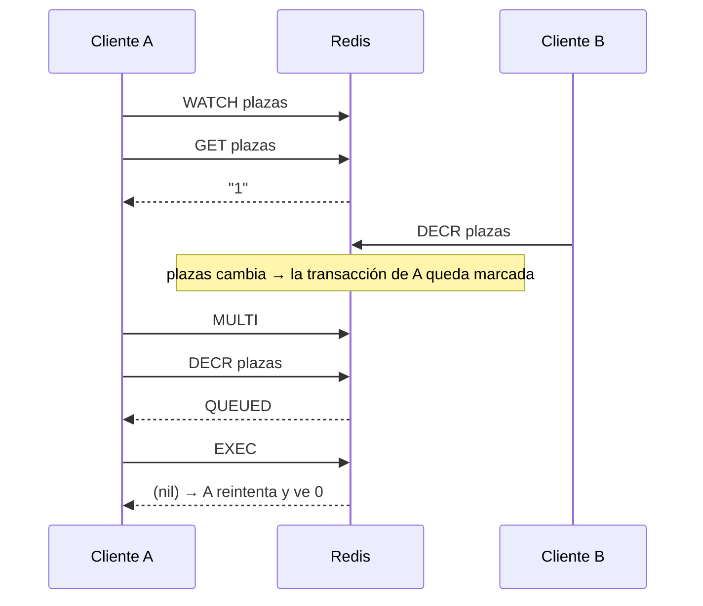

# Transacciones con MULTI, EXEC y WATCH

> [!abstract] En 30 segundos
> - **Qué es:** `MULTI` encola comandos y `EXEC` los ejecuta **todos seguidos, sin que nadie se intercale**. `WATCH` añade bloqueo optimista: `EXEC` se cancela si alguna clave vigilada cambió.
> - **Para qué:** aplicar varios cambios juntos (dato + índice) y hacer *compare-and-set* con reintento.
> - **Recuerda:** **no hay rollback**: si un comando falla en ejecución, los demás se aplican igual. Y no puedes tomar decisiones con resultados intermedios dentro de la transacción (para eso, Lua).

> [!info] Lección 2.11 · Nivel 2 — Estructuras de datos y operaciones avanzadas
> ⬅️ [[Redis Arrays]] · ➡️ [[Pipelining]] · 🗺️ [[01 - Redis - Roadmap#Nivel 2 — Estructuras de datos y operaciones avanzadas|Roadmap]] · 📊 [[03 - Redis - Progreso|Progreso]]
> 🏷️ Core · en Redis Cluster, todas las claves de la transacción deben estar en el mismo slot.

## 📌 Definición

| Comando | Qué hace |
|---|---|
| `MULTI` | Empieza una transacción: los comandos siguientes responden `QUEUED` |
| `EXEC` | Ejecuta la cola de forma atómica y devuelve un array con los resultados (o nil si `WATCH` la canceló) |
| `DISCARD` | Descarta la cola |
| `WATCH k …` | Vigila claves: si cambian antes de `EXEC`, la transacción no se ejecuta |
| `UNWATCH` | Deja de vigilar (`EXEC` y `DISCARD` también lo hacen) |

**Garantías:**
- **Aislamiento:** los comandos de `EXEC` se ejecutan seguidos; ningún otro cliente ve un estado intermedio.
- **Todo o nada ante errores de sintaxis:** si un comando encolado es inválido (aridad, comando inexistente), `EXEC` devuelve `EXECABORT` y no se ejecuta nada.
- **Sin rollback ante errores de ejecución:** si un comando falla al ejecutarse (por ejemplo, `INCR` sobre un string no numérico), devuelve un error en su posición del array y **el resto sí se aplica**.

## 🎯 ¿Qué problema resuelve?

1. **Cambios que deben ir juntos:** guardar un producto y actualizar su índice por categoría. Sin transacción, un lector podría ver el producto sin índice.
2. **Leer, decidir y escribir sin carreras:** «reserva la plaza si quedan libres». Con `WATCH` lees, decides en la aplicación y escribes en `MULTI`; si otro cliente modificó la clave entretanto, `EXEC` falla y reintentas.

## 🧠 Conceptos fundamentales

### El patrón de bloqueo optimista

```text
WATCH plazas:evento:7
GET plazas:evento:7            → "3"   (la aplicación decide: quedan plazas)
MULTI
DECR plazas:evento:7
SADD asistentes:evento:7 user:42
EXEC                           → [2, 1]  si nadie tocó la clave
                               → (nil)   si otro cliente la modificó: reintentar
```

- Optimista = no bloquea a nadie; asume que los conflictos son raros y reintenta cuando ocurren.
- Con mucha contención, los reintentos se disparan: mejor un script Lua.

### Transacciones frente a otras opciones

| Necesidad | Herramienta |
|---|---|
| Varios comandos sin intercalado, sin lógica intermedia | `MULTI`/`EXEC` |
| Leer, decidir en la aplicación y escribir, con poca contención | `WATCH` + `MULTI`/`EXEC` |
| Leer, decidir y escribir **en el servidor**, con mucha contención | [[Lua scripting en Redis]] o [[Redis Functions]] |
| Compare-and-set de un string | `SET … IFEQ` (🏷️ ≥8.4) |
| Solo rendimiento, sin atomicidad | [[Pipelining]] |

### Analogía
`MULTI`/`EXEC` es **entregar una lista de recados a un cajero** que los hace todos seguidos sin atender a nadie más entre medias. `WATCH` es decirle: «si alguien ha tocado mi cuenta desde que la miré, no hagas nada».
**Dónde se rompe:** si uno de los recados falla (por ejemplo, una cuenta que no admite la operación), el cajero hace los demás igualmente: no deshace nada.

## ⚙️ Funcionamiento interno



- Mientras se encolan los comandos, el servidor los valida pero no los ejecuta.
- `EXEC` los ejecuta en bloque; se propagan al AOF y a las réplicas como una unidad.
- En Redis Cluster, una transacción solo puede tocar claves del mismo slot (usa *hash tags*, [[Hash slots]]).

## 💻 Ejemplos prácticos

```text
127.0.0.1:6379> MULTI
OK
127.0.0.1:6379(TX)> HSET producto:1 nombre Teclado categoria teclados
QUEUED
127.0.0.1:6379(TX)> SADD categoria:teclados producto:1
QUEUED
127.0.0.1:6379(TX)> EXEC
1) (integer) 2
2) (integer) 1
```

**Error de ejecución sin rollback:**

```text
127.0.0.1:6379> SET nombre ana
OK
127.0.0.1:6379> MULTI
OK
127.0.0.1:6379(TX)> INCR nombre
QUEUED
127.0.0.1:6379(TX)> SET otra clave
QUEUED
127.0.0.1:6379(TX)> EXEC
1) (error) ERR value is not an integer or out of range
2) OK                                # se aplicó igualmente
```

**Error de sintaxis: no se ejecuta nada:**

```text
127.0.0.1:6379> MULTI
OK
127.0.0.1:6379(TX)> SET a
(error) ERR wrong number of arguments for 'set' command
127.0.0.1:6379(TX)> SET b 1
QUEUED
127.0.0.1:6379(TX)> EXEC
(error) EXECABORT Transaction discarded because of previous errors.
```

## 🔧 Implementación en .NET

StackExchange.Redis no expone `WATCH` directamente: lo implementa con **condiciones** en `ITransaction`.

```csharp
using StackExchange.Redis;

IDatabase db = mux.GetDatabase();

// 1) Dato + índice juntos (MULTI/EXEC sin condiciones)
ITransaction tx = db.CreateTransaction();
_ = tx.HashSetAsync("producto:1", new HashEntry[] { new("nombre", "Teclado"), new("categoria", "teclados") });
_ = tx.SetAddAsync("categoria:teclados", "producto:1");
bool committed = await tx.ExecuteAsync();

// 2) Compare-and-set con reintento: reservar plaza si quedan
static async Task<bool> ReserveSeatAsync(IDatabase db, string eventKey, string user, int maxRetries = 5)
{
    for (int attempt = 0; attempt < maxRetries; attempt++)
    {
        RedisValue current = await db.StringGetAsync(eventKey);
        if (!current.HasValue || (long)current <= 0)
            return false;                                   // agotado

        ITransaction tx = db.CreateTransaction();
        tx.AddCondition(Condition.StringEqual(eventKey, current));   // WATCH + comparación
        _ = tx.StringDecrementAsync(eventKey);
        _ = tx.SetAddAsync($"{eventKey}:asistentes", user);

        if (await tx.ExecuteAsync())
            return true;                                    // nadie se adelantó
        // otro cliente cambió el valor: reintentar con el nuevo
    }
    return false;
}
```

> [!warning] No hagas `await` de los comandos antes de `ExecuteAsync`
> Las tareas de los comandos de una transacción solo se completan cuando se ejecuta `EXEC`. Esperarlas antes provoca un bloqueo. Guárdalas y espéralas después de `ExecuteAsync`, o descártalas con `_ =` si no necesitas el resultado.

## 🏗️ Casos de uso en arquitectura

| Caso | Diseño |
|---|---|
| Entidad + índices secundarios | `MULTI`/`EXEC` |
| Reservas con poca contención | Condiciones (`WATCH`) con reintento |
| Mover un elemento entre estructuras | `MULTI` con `ZREM` + `SADD`, o comandos atómicos (`LMOVE`, `SMOVE`) |
| Operaciones con mucha contención | Lua/Functions o `INCREX` con límites |

### Cuándo NO usarlo
- Necesitas rollback: Redis no lo tiene; diseña operaciones que no fallen o compénsalas.
- Necesitas lógica con resultados intermedios: Lua.
- Solo quieres rendimiento: pipelining.

### Consideraciones de arquitectura

| Dimensión | Qué pensar |
|---|---|
| Contención | Optimista funciona con pocos conflictos; con muchos, Lua |
| Cluster | Todas las claves en el mismo slot |
| Rendimiento | La transacción bloquea el servidor mientras se ejecuta: mantenla corta |
| Errores | Valida en la aplicación lo que pueda fallar en ejecución (tipos, rangos) |

## ⚠️ Errores y anti-patterns

| Error | Por qué duele | Cómo evitarlo |
|---|---|---|
| Creer que hay rollback | Datos a medias tras un error de ejecución | Diseñar comandos que no fallen, o Lua con validación previa |
| `WATCH` con mucha contención | Reintentos en cascada | Lua |
| `await` de comandos antes de `ExecuteAsync` en .NET | Bloqueo | Esperar después |
| Transacciones que tocan claves de varios slots en Cluster | `CROSSSLOT` | Hash tags |
| Transacciones enormes | Bloquean el servidor | Lotes pequeños |

## ✅ Buenas prácticas

1. Usa `MULTI`/`EXEC` para cambios que deben verse juntos.
2. `WATCH` (condiciones en .NET) con reintentos limitados para compare-and-set de baja contención.
3. Lua o Functions cuando la lógica es condicional o hay contención.
4. En Redis 8.4+, `SET … IFEQ` para compare-and-set de strings.

## 🎤 Preguntas de entrevista

> [!question]- 1. ¿Las transacciones de Redis son ACID?
> No en el sentido relacional. Son aisladas (nadie se intercala) y, ante errores de sintaxis, todo o nada; pero no hay rollback si un comando falla en ejecución, y la durabilidad depende de la persistencia configurada.

> [!question]- 2. ¿Qué hace `WATCH`?
> Implementa bloqueo optimista: si alguna clave vigilada se modifica entre el `WATCH` y el `EXEC`, la transacción no se ejecuta y `EXEC` devuelve nil; el cliente vuelve a leer y reintenta.

> [!question]- 3. ¿Cuándo prefieres Lua a `MULTI`/`EXEC`?
> Cuando necesito tomar decisiones con valores leídos dentro de la operación (si queda stock, decrementa), sobre todo con mucha contención, porque el script se ejecuta entero en el servidor sin reintentos.

## 🧪 Ejercicios

### 🟢 Básicos
1. Reproduce los tres ejemplos (éxito, error de ejecución, error de sintaxis).
2. Haz un `WATCH`, modifica la clave desde otra terminal y comprueba que `EXEC` devuelve nil.

### 🟡 Intermedios
3. Lanza 200 reservas concurrentes de 10 plazas con `ReserveSeatAsync` y comprueba que nunca se reservan más de 10. Cuenta los reintentos.

### 🔴 Reto Senior
4. Repite el ejercicio 3 con 5 000 reservas concurrentes y compáralo con un script Lua. ¿En qué punto deja de ser razonable el bloqueo optimista?

> [!success]- Soluciones
> **3.** Nunca se superan las 10 plazas; habrá reintentos, más cuanto más concurrencia.
> **4.** Con miles de clientes compitiendo por la misma clave, la mayoría de `EXEC` fallan y los reintentos multiplican el tráfico y la latencia. El script Lua comprueba y decrementa en una sola ejecución atómica sin reintentos.

### ✔️ Checklist de dominio
- [ ] Explico las garantías y la ausencia de rollback.
- [ ] Implemento compare-and-set con `WATCH` / condiciones.
- [ ] Sé cuándo usar Lua, `SET IFEQ` o pipelining en su lugar.

## 📝 Resumen

- `MULTI`/`EXEC`: ejecución aislada de una cola de comandos.
- Error de sintaxis → nada se ejecuta; error de ejecución → el resto sí (sin rollback).
- `WATCH`: bloqueo optimista con reintento.
- En .NET, condiciones de `ITransaction`; no esperes los comandos antes de `ExecuteAsync`.
- Mucha contención o lógica condicional → Lua/Functions.

## 🔗 Referencias

- [Transactions](https://redis.io/docs/latest/develop/using-commands/transactions/)
- [WATCH](https://redis.io/docs/latest/commands/watch/)
- [StackExchange.Redis: Transactions](https://stackexchange.github.io/StackExchange.Redis/Transactions)

## 🔄 Notas relacionadas

- ⬅️ [[Redis Arrays]] · ➡️ [[Pipelining]]
- Relacionadas: [[Lua scripting en Redis]] · [[Control de concurrencia con Redis]] · [[Hash slots]]
