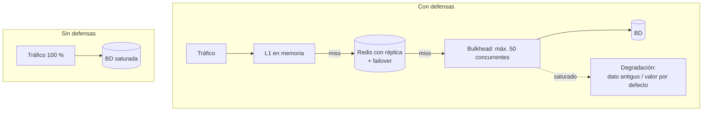

# Cache avalanche

> [!abstract] En 30 segundos
> - **Qué es:** **muchas claves expiran a la vez** o **la caché entera deja de estar disponible**, y toda la carga cae de golpe sobre la base de datos.
> - **Para qué estudiarlo:** es el modo de fallo más grave de un sistema con caché: la base de datos no está dimensionada para el 100 % del tráfico.
> - **Recuerda:** tres frentes: **evitar** la expiración simultánea (jitter, precalentamiento), **evitar** la caída (alta disponibilidad, L1) y **proteger** la base de datos (límite de concurrencia, degradación).

> [!info] Lección 3.13 · Nivel 3 — Redis como caché
> ⬅️ [[Cache penetration]] · ➡️ [[Distributed caching]] · 🗺️ [[01 - Redis - Roadmap#Nivel 3 — Redis como caché|Roadmap]] · 📊 [[03 - Redis - Progreso|Progreso]]
> 🏷️ Patrón de diseño; la alta disponibilidad usa [[Redis Sentinel]] o [[Redis Cluster]].

## 📌 Definición

Una **avalancha de caché** es la pérdida simultánea de muchas entradas, por dos causas:

1. **Expiración masiva:** una carga masiva con el mismo TTL, o un `FLUSHALL` accidental, o un reinicio sin persistencia.
2. **Caída de la caché:** el nodo Redis falla o es inalcanzable, y todas las lecturas pasan a la base de datos.

## 🎯 ¿Qué problema resuelve?

Si tu BD soporta 300 consultas/s pero el tráfico es de 3 000 y la caché absorbe el 90 %, el sistema parece sano… hasta el día que la caché desaparece. Esta lección te enseña a que ese día no sea un incidente.

## 🧠 Conceptos fundamentales

| Defensa | Evita |
|---|---|
| **TTL con jitter** | Expiraciones simultáneas |
| **Precalentamiento** (*warm-up*) al desplegar o reiniciar | Arrancar en frío |
| **Alta disponibilidad** (réplicas + failover, Cluster) | Caída del nodo único |
| **Persistencia** (RDB/AOF) en cachés críticas | Reinicio en blanco |
| **Caché L1 en proceso** | Que todo dependa de Redis |
| **Límite de concurrencia hacia la BD** (bulkhead) | Saturación |
| **Circuit breaker + degradación elegante** | Cascada de fallos |
| **Despliegues escalonados** | Vaciar todos los nodos a la vez |

### Dimensionamiento «caché fría»
Calcula el tráfico a la BD con **hit ratio = 0**: ¿lo soporta? Si no, necesitas **limitación + degradación** (servir datos antiguos, valores por defecto, respuestas parciales) para que el sistema rinda menos, no que se caiga.

### Analogía
Un **embalse**: la presa (caché) regula el caudal del río (tráfico) hacia la ciudad (BD). Si la presa se abre de golpe, la ciudad se inunda. Necesitas compuertas escalonadas (jitter), una presa de repuesto (HA) y diques en la ciudad (límites).
**Dónde se rompe:** un dique demasiado estricto causa sequía (errores para el usuario): equilibra con degradación inteligente.

## ⚙️ Funcionamiento interno



## 💻 Ejemplos prácticos

```text
# Distribución de TTL: comprobar que no vencen todos a la vez
127.0.0.1:6379> TTL shop:product:1
(integer) 543
127.0.0.1:6379> TTL shop:product:2
(integer) 611
127.0.0.1:6379> INFO keyspace
db0:keys=120000,expires=120000,avg_ttl=598000
```

Precalentamiento en el arranque: cargar las N claves más populares con TTL con jitter antes de aceptar tráfico (readiness).

## 🔧 Implementación en .NET

```csharp
using StackExchange.Redis;

public interface IProductRepository
{
    Task<IReadOnlyList<(int Id, string Json)>> TopAsync(int count, CancellationToken ct);
    Task<string?> FindJsonAsync(int id, CancellationToken ct);
}

// 1. Precalentamiento con jitter
public class CacheWarmer(IDatabase db, IProductRepository repo) : BackgroundService
{
    protected override async Task ExecuteAsync(CancellationToken ct)
    {
        var top = await repo.TopAsync(5_000, ct);
        foreach (var (id, json) in top)
        {
            TimeSpan ttl = TimeSpan.FromSeconds(600 * (0.8 + Random.Shared.NextDouble() * 0.4));
            await db.StringSetAsync($"shop:product:{id}", json, ttl);
        }
    }
}

// 2. Bulkhead hacia la BD + degradación
public class ProtectedProductService(IDatabase db, IProductRepository repo)
{
    private static readonly SemaphoreSlim DbBulkhead = new(50);

    public async Task<string?> GetAsync(int id, CancellationToken ct)
    {
        string key = $"shop:product:{id}";

        try
        {
            RedisValue cached = await db.StringGetAsync(key);
            if (cached.HasValue) return cached;
        }
        catch (RedisException)
        {
            // Redis caído: seguimos hacia la BD, pero protegida por el bulkhead
        }

        if (!await DbBulkhead.WaitAsync(TimeSpan.FromMilliseconds(200), ct))
            throw new InvalidOperationException("Servicio degradado: demasiadas consultas simultáneas a la BD.");

        try
        {
            string? json = await repo.FindJsonAsync(id, ct);
            if (json is not null)
            {
                try { await db.StringSetAsync(key, json, TimeSpan.FromMinutes(10)); }
                catch (RedisException) { /* no es crítico */ }
            }
            return json;
        }
        finally
        {
            DbBulkhead.Release();
        }
    }
}
```

> [!tip] Resiliencia
> Para *circuit breaker*, reintentos con *backoff* y timeouts, usa Polly / `Microsoft.Extensions.Resilience` ([[Redis con Polly y resiliencia]]).

## 🏗️ Casos de uso en arquitectura

| Escenario | Defensa |
|---|---|
| Carga masiva nocturna | Jitter |
| Despliegue de una nueva versión que cambia el formato de claves | Precalentamiento; despliegue gradual |
| Reinicio del nodo de caché | Persistencia + réplica + L1 |
| Pico por campaña | Bulkhead + degradación |

### Cuándo NO es tan crítico
- Datos baratos de recalcular y una BD con holgura: el riesgo es bajo.

### Consideraciones de arquitectura

| Dimensión | Qué pensar |
|---|---|
| Capacidad | Ensayar el escenario «caché fría» (game day, [[Laboratorio 10 - Game days de Redis]]) |
| HA | Réplicas + Sentinel o Cluster; L1 como amortiguador |
| Observabilidad | Alertas sobre hit ratio, errores de Redis y saturación de la BD |
| Operación | Evitar `FLUSHALL`; separar ACL para comandos destructivos |

## ⚠️ Errores y anti-patterns

| Error | Por qué duele | Cómo evitarlo |
|---|---|---|
| TTL idéntico tras carga masiva | Todo vence a la vez | Jitter |
| BD dimensionada solo para el tráfico «con caché» | Caída al perder la caché | Ensayar la caché fría |
| Un único nodo Redis sin réplica | Punto único de fallo | HA |
| Reiniciar todos los nodos a la vez | Caché vacía global | Escalonar |
| Sin degradación | Error 500 en cascada | Dato antiguo / valor por defecto |

## ✅ Buenas prácticas

1. Jitter siempre en cargas masivas.
2. Precalienta antes de recibir tráfico.
3. HA y L1.
4. Bulkhead y circuit breaker hacia la BD.
5. Ensaya la caché fría.

## 🎤 Preguntas de entrevista

> [!question]- 1. ¿Cómo evitas una avalancha de caché?
> Jitter en los TTL, precalentamiento, alta disponibilidad de Redis, caché L1, límite de concurrencia hacia la BD y degradación elegante; y ensayar el escenario con la caché vacía.

> [!question]- 2. ¿Diferencia entre stampede y avalanche?
> Stampede: una clave caliente expira y muchas peticiones la recalculan. Avalanche: muchas claves a la vez (o la caché entera) dejan de estar, y la BD recibe una carga masiva.

## 🧪 Ejercicios

### 🟢 Básicos
1. Carga 10 000 claves con el mismo TTL de 60 s y observa cuándo caen; repite con jitter.

### 🟡 Intermedios
2. Apaga Redis con tráfico simulado y mide el impacto en la BD con y sin bulkhead.

### 🔴 Reto Senior
3. Diseña el plan de recuperación para un reinicio en frío de un Redis con 20 GB de caché y una BD que soporta el 15 % del tráfico.

> [!success]- Soluciones
> **3.** Persistencia RDB para reiniciar con datos; réplica que asuma el rol (failover); L1 en las apps; admisión gradual de tráfico (rate limiting) mientras se precalientan las 5 000-50 000 claves más populares; bulkhead y degradación para no pasar del 15 % en la BD.

### ✔️ Checklist de dominio
- [ ] Calculo la carga en la BD con caché fría.
- [ ] Combino defensas preventivas y de contención.
- [ ] Preparo un plan de recuperación.

## 📝 Resumen

- Avalancha = expiración masiva o caída de la caché.
- Previene (jitter, warm-up, HA) y contén (bulkhead, degradación).
- La BD debe sobrevivir —degradada— sin caché.
- Ensaya el escenario.

## 🔗 Referencias

- [Caching best practices (Azure)](https://learn.microsoft.com/azure/architecture/best-practices/caching)
- [Resilience con Polly](https://learn.microsoft.com/dotnet/core/resilience/)

## 🔄 Notas relacionadas

- ⬅️ [[Cache penetration]] · ➡️ [[Distributed caching]]
- Relacionadas: [[Cache stampede]] · [[Estrategias de TTL en caché]] · [[Alta disponibilidad en Redis]] · [[Redis con Polly y resiliencia]]
