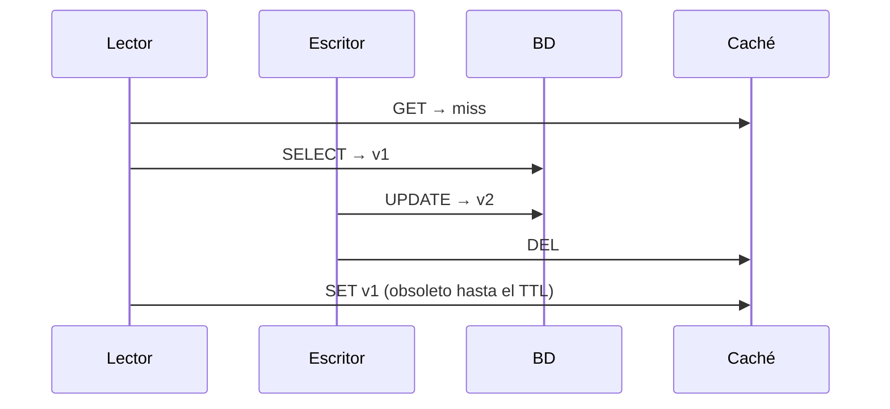
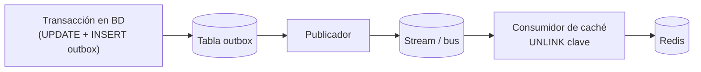

# Cache consistency

> [!abstract] En 30 segundos
> - **Qué es:** cuánto se parece lo que sirve la caché a lo que dice la fuente, y qué carreras lo rompen.
> - **Para qué:** diseñar con conciencia de la ventana de inconsistencia en lugar de descubrirla en producción.
> - **Recuerda:** **no hay transacción entre Redis y tu base de datos**. Aceptas consistencia eventual y la acotas con TTL, versionado y eventos fiables (outbox/CDC).

> [!info] Lección 3.8 · Nivel 3 — Redis como caché
> ⬅️ [[Cache invalidation]] · ➡️ [[Eviction policies]] · 🗺️ [[01 - Redis - Roadmap#Nivel 3 — Redis como caché|Roadmap]] · 📊 [[03 - Redis - Progreso|Progreso]]
> 🏷️ Conceptos de diseño, válidos con cualquier tecnología.

## 📌 Definición

Una caché y su fuente son **dos sistemas** sin transacción común. Entre ambos aparece una **ventana de inconsistencia**: el tiempo durante el que la caché puede devolver un dato distinto del vigente en la fuente. La **consistencia de caché** consiste en entender las carreras que alargan esa ventana y elegir técnicas para acotarla.

## 🎯 ¿Qué problema resuelve?

Evita bugs sutiles que solo ocurren bajo concurrencia: precios antiguos que persisten durante horas, usuarios que no ven su cambio recién guardado, listados con elementos eliminados. Son difíciles de reproducir, y por eso conviene razonarlos de antemano.

## 🧠 Conceptos fundamentales

### Carreras típicas

**1. Lector lento (cache-aside):** lee la fuente (v1), alguien actualiza (v2) e invalida, y el lector escribe v1 en la caché.



**2. Dos escritores que actualizan la caché (write-through):** A (v1) y B (v2) escriben en la BD en orden y en la caché en orden inverso: queda v1.

**3. Réplicas de Redis:** la replicación es **asíncrona**; leer de una réplica justo tras escribir puede devolver el valor antiguo.

**4. Fallo parcial:** la BD confirma y la invalidación de Redis falla (red, caída).

### Técnicas para acotar la ventana

| Técnica | Cómo ayuda | Coste |
|---|---|---|
| **TTL corto** | Acota el peor caso | Más misses |
| **Escribir en la BD y luego invalidar** | Evita datos fantasma | — |
| **Doble borrado diferido** | Un segundo `DEL` unos cientos de ms después limpia lo que escribió un lector lento | Retardo y un job |
| **Versionado de valores** | La caché ignora escrituras con versión menor (script Lua) | Columna de versión |
| **Claves con versión** (`product:42:v8`) | Lo antiguo nunca se lee | Gestión de la versión actual |
| **Outbox + consumidor** | La invalidación no se pierde aunque Redis falle | Infraestructura de eventos |
| **CDC** (Debezium, etc.) | Invalida a partir del log de la BD, también para escrituras de otros sistemas | Más piezas |
| **Leer del primario tras escribir** | *Read-your-writes* | Más carga en el primario |

### Modelos prácticos

| Modelo | Garantía | Cuándo |
|---|---|---|
| TTL puro | Eventual, hasta N segundos | Datos tolerantes |
| Invalidación explícita | Eventual, ventana pequeña | Lo habitual |
| Versionado + eventos fiables | Eventual con convergencia garantizada | Datos importantes |
| Sin caché (leer de la fuente) | Fuerte | Saldos, stock final, permisos críticos |

### Analogía
Un **tablón de precios** en la entrada del supermercado y los precios reales en caja: pueden diferir unos minutos. Para cosas críticas (la cuenta final), manda la caja.
**Dónde se rompe:** si el cliente exige el precio del tablón, hay una discusión: por eso el dato crítico se lee siempre de la fuente.

## ⚙️ Funcionamiento interno



- La escritura en la BD y el evento de la outbox son **atómicos** (misma transacción local).
- La invalidación es **at-least-once** y debe ser idempotente: borrar dos veces no hace daño.

## 💻 Ejemplos prácticos

Doble borrado con un segundo borrado diferido:

```text
t=0 ms    UPDATE producto → BD
t=1 ms    DEL shop:product:42
t=500 ms  DEL shop:product:42      # limpia lo que un lector lento haya escrito entre medias
```

Escritura condicional por versión (ver [[Write-through]]): solo se acepta si `versión > actual`.

## 🔧 Implementación en .NET

```csharp
using StackExchange.Redis;

public interface IProductRepository
{
    Task UpdateAsync(int id, string name);
}

public class ProductWriter(IDatabase redis, IProductRepository repo, ILogger<ProductWriter> logger)
{
    public async Task UpdateAsync(int id, string name)
    {
        string key = $"shop:product:{id}";

        await repo.UpdateAsync(id, name);       // 1. fuente de verdad
        await TryDeleteAsync(key);              // 2. primera invalidación

        // 3. segundo borrado diferido (en producción: en un servicio en segundo plano o cola)
        _ = Task.Run(async () =>
        {
            await Task.Delay(TimeSpan.FromMilliseconds(500));
            await TryDeleteAsync(key);
        });
    }

    private async Task TryDeleteAsync(string key)
    {
        try { await redis.KeyDeleteAsync(key); }
        catch (RedisException ex)
        {
            // No podemos confiar solo en esto: el TTL y/o un evento fiable acotarán el daño
            logger.LogWarning(ex, "No se pudo invalidar {Key}", key);
        }
    }
}
```

> [!tip] Cuando la invalidación no puede perderse
> Registra el evento de invalidación en la **misma transacción** que la escritura (outbox) y procésalo con reintentos. El patrón se desarrolla en [[Event-driven architecture con Redis]] y [[Idempotencia con Redis]].

## 🏗️ Casos de uso en arquitectura

| Escenario | Estrategia |
|---|---|
| Catálogo (el negocio tolera 1-5 min) | TTL + borrado explícito |
| Perfil recién editado | Borrar y leer del primario/fuente durante unos segundos |
| Precio mostrado vs precio cobrado | Mostrar desde caché; **validar siempre en la fuente al cobrar** |
| Varios sistemas escriben en la BD | CDC para invalidar |

### Cuándo NO cachear
- Datos que deben ser fuertemente consistentes y se usan para decidir (autorización crítica, saldo disponible, stock en el pago).

### Consideraciones de arquitectura

| Dimensión | Qué pensar |
|---|---|
| Negocio | Acordar la obsolescencia máxima por tipo de dato |
| Réplicas | Lecturas desde réplicas = posible retraso de replicación |
| Observabilidad | Mide la antigüedad de lo servido (diferencia con la fuente en una muestra) |
| Pruebas | Pruebas de concurrencia con intercalados forzados |

## ⚠️ Errores y anti-patterns

| Error | Por qué duele | Cómo evitarlo |
|---|---|---|
| Suponer atomicidad BD + Redis | Fallos parciales ocasionales | Diseñar para ello: TTL, outbox |
| Actualizar caché y BD sin orden ni versión | Valor antiguo permanente | Versionado |
| Decidir pagos con datos de caché | Cobros incorrectos | Validar en la fuente |
| Leer de réplica tras escribir | Datos antiguos | Primario para read-your-writes |
| No probar concurrencia | Bugs raros en producción | Tests con intercalados |

## ✅ Buenas prácticas

1. Define la obsolescencia aceptable por dato.
2. Fuente primero; invalidación después; TTL siempre.
3. Versiona si hay actualización de caché.
4. Eventos fiables (outbox) para lo que no puede perderse.
5. Para decisiones críticas, lee de la fuente.

## 🎤 Preguntas de entrevista

> [!question]- 1. Describe una carrera en cache-aside que deja datos obsoletos.
> Un lector lee v1 de la BD, un escritor actualiza a v2 e invalida, y el lector escribe v1 en la caché. Se acota con TTL, doble borrado diferido o claves/valores versionados.

> [!question]- 2. ¿Por qué no hay una transacción entre Redis y la BD?
> Son sistemas independientes sin protocolo de commit común. Se usa consistencia eventual con técnicas como outbox, reintentos idempotentes y TTL.

> [!question]- 3. ¿Qué pasa si lees de una réplica justo después de escribir?
> Puedes obtener el valor antiguo porque la replicación es asíncrona; para *read-your-writes* lee del primario o acepta el retraso.

## 🧪 Ejercicios

### 🟢 Básicos
1. Dibuja la secuencia de la carrera del lector lento.

### 🟡 Intermedios
2. Reproduce la carrera en un test con `TaskCompletionSource` para forzar el intercalado, y verifica que el doble borrado la corrige.

### 🔴 Reto Senior
3. Un producto cuesta 100 en la BD y 90 en la caché desde hace 3 h. Lista las posibles causas y cómo las detectarías y corregirías.

> [!success]- Soluciones
> **3.** Causas: invalidación perdida (error de red), lector lento que repuebla v1, TTL excesivo o inexistente, escritura directa en la BD por otro sistema (sin invalidar), actualización desordenada de caché. Detección: log de invalidaciones fallidas, muestreo comparando BD y caché. Corrección: TTL acotado, outbox/CDC, versionado.

### ✔️ Checklist de dominio
- [ ] Explico al menos tres carreras de caché.
- [ ] Elijo técnicas por tipo de dato.
- [ ] Sé cuándo no usar la caché para decidir.

## 📝 Resumen

- Caché y fuente no comparten transacción: hay una ventana de inconsistencia.
- Carreras: lector lento, escritores desordenados, réplicas, fallos parciales.
- Acota con TTL, versionado, doble borrado, outbox o CDC.
- Lo crítico se lee de la fuente.

## 🔗 Referencias

- [Caching best practices (Azure)](https://learn.microsoft.com/azure/architecture/best-practices/caching)
- [Replicación de Redis](https://redis.io/docs/latest/operate/oss_and_stack/management/replication/)

## 🔄 Notas relacionadas

- ⬅️ [[Cache invalidation]] · ➡️ [[Eviction policies]]
- Relacionadas: [[Cache-aside]] · [[Write-through]] · [[Replicación en Redis]] · [[Idempotencia con Redis]]
