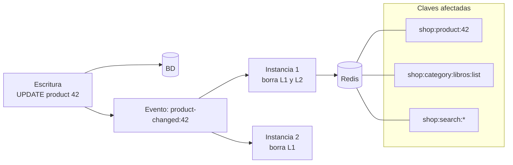

# Cache invalidation

> [!abstract] En 30 segundos
> - **Qué es:** retirar o sustituir entradas de la caché cuando el dato original cambia.
> - **Para qué:** reducir la ventana en la que se sirven datos obsoletos más allá del TTL.
> - **Recuerda:** **borra, no actualices**; usa `UNLINK` para claves grandes; evita `KEYS patrón`; y cuando una entidad aparece en muchas claves, usa **versionado de espacio de nombres** o **tags**.

> [!info] Lección 3.7 · Nivel 3 — Redis como caché
> ⬅️ [[Estrategias de TTL en caché]] · ➡️ [[Cache consistency]] · 🗺️ [[01 - Redis - Roadmap#Nivel 3 — Redis como caché|Roadmap]] · 📊 [[03 - Redis - Progreso|Progreso]]
> 🏷️ Core · `UNLINK` ≥4.0 · tags en `HybridCache` (.NET 9+).

## 📌 Definición

La **invalidación** es el mecanismo que mantiene la caché coherente con la fuente. Hay cuatro familias:

| Técnica | Cómo | Pros | Contras |
|---|---|---|---|
| **Solo TTL** | Esperar a que caduque | Trivial | Obsolescencia hasta el TTL |
| **Borrado explícito** | `DEL`/`UNLINK` tras escribir en la fuente | Rápida y simple | Debes conocer todas las claves afectadas |
| **Por eventos** | Evento de cambio → los suscriptores invalidan | Desacopla; sirve a múltiples cachés | Entrega no garantizada (Pub/Sub) o más infraestructura |
| **Versionado / tags** | Cambias la versión del espacio o marcas por etiqueta | Invalida grupos enteros sin recorrer claves | Entradas viejas esperan al TTL |

## 🎯 ¿Qué problema resuelve?

«Hay solo dos cosas difíciles en informática: invalidar cachés y nombrar cosas.» Una entidad (un producto) suele aparecer en varias claves: su detalle, el listado de su categoría, resultados de búsqueda, el carrito. Al cambiarla hay que invalidarlas todas sin recorrer el keyspace.

## 🧠 Conceptos fundamentales

1. **Borrar vs actualizar:** borrar es idempotente y evita carreras de orden ([[Cache-aside]]).
2. **`DEL` vs `UNLINK`:** `UNLINK` libera la memoria en otro hilo; úsalo con valores grandes para no bloquear el hilo principal.
3. **No uses `KEYS` ni `SCAN` para invalidar en el camino crítico:** O(N) sobre todo el keyspace.
4. **Claves derivadas:** mantén un índice «entidad → claves» (un set) o usa versión:
   - **Versionado de espacio de nombres:** `shop:products:v{n}:list`; para invalidar todo el espacio, `INCR shop:ver:products`. Las claves antiguas se pierden por TTL.
   - **Tags:** `tag:category:libros` = set de claves; invalidar = borrar todas las del set.
5. **Invalidación entre instancias (L1):** con una caché local en cada instancia, publica un mensaje de invalidación (Pub/Sub o Streams) y deja el TTL de L1 como red de seguridad. Pub/Sub no garantiza la entrega.
6. **Orden:** escribe en la fuente **y luego** invalida.

### Analogía
Un **menú del día** impreso en cada mesa: si cambia el plato, tienes que retirar todas las copias. Con *versionado*, imprimes un menú nuevo con otro número y las copias antiguas dejan de valer.
**Dónde se rompe:** el camarero que no se enteró del cambio sigue entregando el menú antiguo hasta que se retire (por eso el TTL).

## ⚙️ Funcionamiento interno



## 💻 Ejemplos prácticos

```text
# Borrado explícito (UNLINK = DEL con liberación en segundo plano)
127.0.0.1:6379> UNLINK shop:product:42 shop:category:libros:list
(integer) 2

# Versionado de espacio de nombres
127.0.0.1:6379> GET shop:ver:products
(nil)
127.0.0.1:6379> INCR shop:ver:products
(integer) 1
# Las claves se leen como shop:products:v1:list — tras otro INCR se leerán como v2

# Tags: índice etiqueta → claves
127.0.0.1:6379> SADD tag:category:libros shop:product:42 shop:category:libros:list
(integer) 2
127.0.0.1:6379> SMEMBERS tag:category:libros
```

## 🔧 Implementación en .NET

```csharp
using StackExchange.Redis;

public class CacheInvalidator(IDatabase db, ISubscriber subscriber)
{
    private static readonly RedisChannel Channel = RedisChannel.Literal("cache:invalidate");

    // 1. Invalidación explícita de varias claves (UNLINK, una por clave para ser compatible con Cluster)
    public Task InvalidateAsync(params string[] keys) =>
        Task.WhenAll(keys.Select(k => db.ExecuteAsync("UNLINK", k)));

    // 2. Versionado de espacio de nombres
    public async Task<string> VersionedKeyAsync(string space, string suffix)
    {
        long version = (long?)await db.StringGetAsync($"cache:ver:{space}") ?? 0;
        return $"{space}:v{version}:{suffix}";
    }

    public Task InvalidateNamespaceAsync(string space) =>
        db.StringIncrementAsync($"cache:ver:{space}");

    // 3. Tags: registrar y purgar
    public async Task TagAsync(string key, string tag) =>
        await db.SetAddAsync($"cache:tag:{tag}", key);

    public async Task InvalidateTagAsync(string tag)
    {
        RedisValue[] keys = await db.SetMembersAsync($"cache:tag:{tag}");
        await Task.WhenAll(keys.Select(k => db.ExecuteAsync("UNLINK", k.ToString())));
        await db.KeyDeleteAsync($"cache:tag:{tag}");
    }

    // 4. Aviso a otras instancias para vaciar su L1
    public Task BroadcastAsync(string key) => subscriber.PublishAsync(Channel, key);

    public Task ListenAsync(Action<string> removeFromLocalCache) =>
        subscriber.SubscribeAsync(Channel, (_, message) => removeFromLocalCache(message.ToString()));
}
```

> [!warning] Pub/Sub es *fire-and-forget*
> Si una instancia está desconectada cuando se publica el mensaje, no lo recibe después. Por eso L1 necesita un TTL corto como red de seguridad. Para entrega fiable usa Streams ([[Consumer Groups en Redis Streams]]). Los detalles de Pub/Sub están en [[Redis Pub-Sub]].

## 🏗️ Casos de uso en arquitectura

| Caso | Técnica |
|---|---|
| Edición de un producto | Borrar detalle + versionar listados |
| Cambio de configuración global | Incrementar versión del espacio |
| Varias instancias con L1 | Pub/Sub + TTL corto |
| Invalidación desde la BD (otro sistema escribe) | CDC / eventos ([[Cache consistency]]) |

### Cuándo NO invalidar a mano
- Si el TTL corto cubre la tolerancia del negocio: no añadas complejidad.

### Consideraciones de arquitectura

| Dimensión | Qué pensar |
|---|---|
| Cluster | Una clave por llamada o claves en el mismo slot (hash tag) para borrados multi-clave |
| Atomicidad | El índice de tags y las claves pueden desfasarse: TTL en todo |
| Coste | Versionado = lectura extra de la versión (cacheable en L1 unos segundos) |

## ⚠️ Errores y anti-patterns

| Error | Por qué duele | Cómo evitarlo |
|---|---|---|
| `KEYS producto:*` y borrar | Bloquea el servidor | Tags o versionado |
| Invalidar antes de escribir | Se repuebla con el dato antiguo | Fuente primero |
| Olvidar claves derivadas | Listados obsoletos | Mapa entidad → claves |
| `DEL` de un valor de MB | Bloqueo | `UNLINK` |
| Confiar solo en Pub/Sub | Mensajes perdidos | TTL de L1 y reconciliación |

## ✅ Buenas prácticas

1. Primero la fuente, luego la invalidación.
2. Cada entrada con TTL, aunque la invalides.
3. Centraliza las reglas de invalidación en un servicio.
4. Versionado o tags para grupos.
5. Pruébalo: escribir, leer y comprobar que el dato nuevo aparece.

## 🎤 Preguntas de entrevista

> [!question]- 1. ¿Cómo invalidarías todas las claves de una categoría?
> Con un índice por etiqueta (set de claves de la categoría) que se recorre y borra con `UNLINK`, o con versionado de espacio de nombres para que las claves antiguas dejen de leerse y mueran por TTL.

> [!question]- 2. ¿Por qué evitas `KEYS`?
> Recorre todo el keyspace de forma bloqueante, O(N); en producción detiene a todos los clientes.

> [!question]- 3. ¿Qué limitación tiene invalidar con Pub/Sub?
> No hay garantía de entrega: un suscriptor desconectado pierde el mensaje. Se mitiga con TTL cortos en L1 o con Streams.

## 🧪 Ejercicios

### 🟢 Básicos
1. Crea 5 claves con un tag común y purga el tag.

### 🟡 Intermedios
2. Implementa el versionado de espacio y comprueba que tras `INCR` las lecturas dejan de acertar con las claves viejas.

### 🔴 Reto Senior
3. Diseña la invalidación de «producto» que aparece en: detalle, listado por categoría, resultados de búsqueda y recomendaciones, con 3 instancias de API con L1. Elige técnicas y justifícalas.

> [!success]- Soluciones
> **3.** Detalle: `UNLINK` de la clave. Listado por categoría y recomendaciones: versionado de espacio (`INCR`). Búsqueda: TTL corto (60 s) sin invalidar. L1: Pub/Sub para vaciar la entrada local + TTL de L1 de 30-60 s como red de seguridad.

### ✔️ Checklist de dominio
- [ ] Elijo técnica de invalidación según el caso.
- [ ] Uso `UNLINK` y evito `KEYS`.
- [ ] Combino eventos con TTL como seguridad.

## 📝 Resumen

- Borra, no actualices; primero la fuente.
- `UNLINK` para valores grandes; nunca `KEYS` en producción.
- Versionado o tags para grupos de claves.
- Pub/Sub para L1 con TTL como red de seguridad.

## 🔗 Referencias

- [UNLINK](https://redis.io/docs/latest/commands/unlink/)
- [HybridCache: tags](https://learn.microsoft.com/aspnet/core/performance/caching/hybrid)

## 🔄 Notas relacionadas

- ⬅️ [[Estrategias de TTL en caché]] · ➡️ [[Cache consistency]]
- Relacionadas: [[Cache-aside]] · [[Redis Pub-Sub]] · [[HybridCache]] · [[Distributed caching]]
