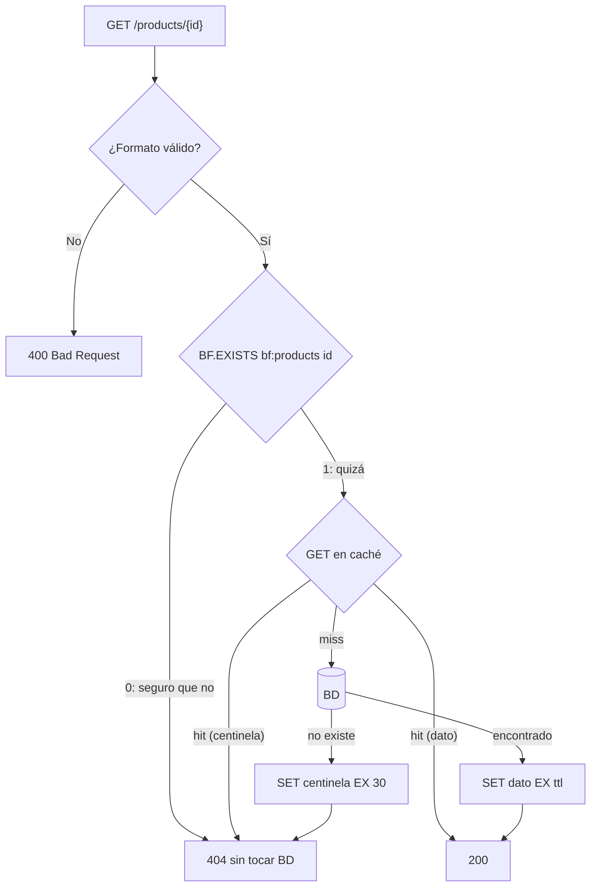

# Cache penetration

> [!abstract] En 30 segundos
> - **Qué es:** peticiones a datos que **no existen** (ids inventados, ataques, bugs). Nunca hay *hit*, así que **todas atraviesan la caché** y llegan a la base de datos.
> - **Para qué estudiarlo:** una caché normal no te protege: no hay nada que cachear.
> - **Recuerda:** tres capas de defensa: **validar la entrada**, **caché negativa** (TTL corto) y, si el espacio de ids es grande, un **Bloom filter** que descarta lo que seguro no existe.

> [!info] Lección 3.12 · Nivel 3 — Redis como caché
> ⬅️ [[Cache stampede]] · ➡️ [[Cache avalanche]] · 🗺️ [[01 - Redis - Roadmap#Nivel 3 — Redis como caché|Roadmap]] · 📊 [[03 - Redis - Progreso|Progreso]]
> 🏷️ Core · Bloom filter **R8** (Redis 8+ o Redis Stack; paquete NRedisStack) · Valkey: módulo valkey-bloom, comprueba disponibilidad.

## 📌 Definición

La **cache penetration** ocurre cuando las consultas piden claves que no existen ni en la caché ni en la fuente. Como la fuente devuelve «no encontrado», **no hay nada que guardar**, y cada petición vuelve a costar una consulta. Es la variante «hostil» de los *misses*: se puede aprovechar para atacar la base de datos con ids aleatorios.

## 🎯 ¿Qué problema resuelve?

Mantiene la base de datos a salvo de tráfico que nunca debería llegar a ella: bots que prueban ids secuenciales, enlaces rotos con millones de visitas, errores de cliente que piden recursos borrados.

## 🧠 Conceptos fundamentales

| Defensa | Cómo | Pros | Contras |
|---|---|---|---|
| **Validación de la entrada** | Rechazar ids con formato o rango imposible antes de tocar Redis o la BD | Gratis | Solo detecta lo evidente |
| **Caché negativa** | Guardar un valor centinela («no existe») con TTL corto (15-60 s) | Simple; absorbe repeticiones | Ids distintos cada vez no se benefician; si luego el dato se crea, hay retraso hasta el TTL |
| **Bloom filter** | Estructura probabilística con todos los ids válidos: `BF.EXISTS` = «seguro que no» o «quizá» | Descarta inexistentes con memoria mínima | Falsos positivos (poco frecuentes); mantenerlo al día; no borra elementos |
| **Rate limiting por cliente** | Limitar peticiones fallidas | Frena el ataque | No evita el coste por petición aceptada |
| **Cuckoo filter** | Como el Bloom, con borrado | Permite `CF.DEL` | Algo más de memoria |

### Bloom filter en una línea
Tamaño: con un 1 % de falsos positivos se necesitan ~9,6 bits por elemento: **10 millones de ids ≈ 12 MB**. Responde «**seguro que no está**» (sin falsos negativos) o «**quizá está**» (con probabilidad de error configurable).

### Analogía
Un **portero con una lista de invitados**: si no estás en la lista, no entras y no molestas a los organizadores. La lista puede dejar pasar a un intruso muy de vez en cuando (falso positivo), pero nunca rechaza a un invitado.
**Dónde se rompe:** si la lista no se actualiza con los nuevos invitados, el portero los rechaza (falso negativo operativo, por no haber añadido el id).

## ⚙️ Funcionamiento interno



## 💻 Ejemplos prácticos

```text
# Bloom filter con 1 % de error para 10 M de elementos
127.0.0.1:6379> BF.RESERVE bf:products 0.01 10000000
OK
127.0.0.1:6379> BF.ADD bf:products 42
(integer) 1
127.0.0.1:6379> BF.EXISTS bf:products 42
(integer) 1
127.0.0.1:6379> BF.EXISTS bf:products 99999
(integer) 0

# Caché negativa
127.0.0.1:6379> SET shop:product:99999 "__null__" EX 30
OK
```

## 🔧 Implementación en .NET

```csharp
using System.Text.Json;
using NRedisStack;
using NRedisStack.RedisStackCommands;
using StackExchange.Redis;

public record Product(int Id, string Name);

public interface IProductRepository
{
    Task<Product?> FindAsync(int id);
    IAsyncEnumerable<int> AllIdsAsync();
}

public class ProductLookup(IDatabase db, IProductRepository repo)
{
    private const string NotFound = "__null__";
    private const string BloomKey = "bf:products";

    // Al arrancar o en una tarea de mantenimiento: crear y cargar el filtro
    public async Task BuildBloomAsync()
    {
        var bf = db.BF();
        await bf.ReserveAsync(BloomKey, 0.01, 10_000_000);
        await foreach (int id in repo.AllIdsAsync())
            await bf.AddAsync(BloomKey, id.ToString());
    }

    // Al crear un producto nuevo, añadirlo también al filtro
    public Task RegisterAsync(int id) => db.BF().AddAsync(BloomKey, id.ToString());

    public async Task<Product?> GetAsync(int id)
    {
        if (id <= 0) return null;                                  // 1. validación

        if (!await db.BF().ExistsAsync(BloomKey, id.ToString()))   // 2. Bloom: seguro que no existe
            return null;

        string key = $"shop:product:{id}";
        RedisValue cached = await db.StringGetAsync(key);          // 3. caché (dato o centinela)
        if (cached.HasValue)
            return cached == NotFound ? null : JsonSerializer.Deserialize<Product>(cached.ToString());

        Product? product = await repo.FindAsync(id);               // 4. fuente
        if (product is null)
            await db.StringSetAsync(key, NotFound, TimeSpan.FromSeconds(30));   // caché negativa
        else
            await db.StringSetAsync(key, JsonSerializer.Serialize(product), TimeSpan.FromMinutes(10));
        return product;
    }
}
```

> [!warning] Mantener el filtro al día
> Cada alta debe añadirse al filtro; las bajas no se pueden quitar de un Bloom clásico (se queda un falso positivo inofensivo, y la caché negativa lo cubre). Reconstruye el filtro periódicamente en una clave nueva y cambia con `RENAME`. Si necesitas borrar, valora un Cuckoo filter ([[Estructuras probabilísticas en Redis]]).

## 🏗️ Casos de uso en arquitectura

| Caso | Defensa |
|---|---|
| API pública con ids numéricos | Validación + Bloom + rate limiting |
| Enlaces cortos, códigos de cupón | Bloom con todos los códigos válidos |
| Búsqueda por email o username (alta tasa de inexistentes) | Bloom o caché negativa |
| Fallos puntuales de clientes | Caché negativa con TTL corto |

### Cuándo NO hace falta
- El espacio de ids es pequeño y las peticiones a inexistentes son raras: la caché negativa basta.

### Consideraciones de arquitectura

| Dimensión | Qué pensar |
|---|---|
| Memoria | ~1,2 bytes por elemento con 1 % de error |
| Consistencia | Alta en el filtro antes de publicar el recurso |
| Seguridad | Un atacante con ids aleatorios no puede agotar la BD |
| Disponibilidad | Si el filtro falla, se degrada a caché negativa (fail-open) |

## ⚠️ Errores y anti-patterns

| Error | Por qué duele | Cómo evitarlo |
|---|---|---|
| No cachear los «no encontrados» | Cada petición golpea la BD | Centinela con TTL corto |
| TTL largo en la caché negativa | El recurso creado después no aparece | 15-60 s |
| Bloom sin alta de nuevos elementos | 404 falsos para recursos nuevos | Añadir al crear |
| Usar `null` como valor en la caché | No distingue «no cacheado» de «no existe» | Centinela explícito |
| Bloom sin dimensionar | Falsos positivos altos | `BF.RESERVE` con capacidad real |

## ✅ Buenas prácticas

1. Validar → Bloom → caché → fuente.
2. Centinela con TTL corto.
3. Alta en el filtro en la misma operación de creación (o con evento).
4. Rate limiting por IP/cliente para ids inexistentes.
5. Métrica de «inexistentes» por minuto: es un indicador de ataque o bug.

## 🎤 Preguntas de entrevista

> [!question]- 1. ¿Qué diferencia hay entre stampede y penetration?
> Stampede: muchas peticiones concurrentes por una clave **existente** que acaba de expirar. Penetration: peticiones por claves que **no existen** y que, por tanto, nunca se pueden cachear con un hit.

> [!question]- 2. ¿Qué garantías da un Bloom filter?
> Sin falsos negativos: si dice «no», es seguro. Con falsos positivos: si dice «sí», puede no existir; la tasa se configura.

> [!question]- 3. ¿Por qué el TTL de la caché negativa debe ser corto?
> Porque si el recurso se crea después, seguiría apareciendo como inexistente hasta que caduque el centinela.

## 🧪 Ejercicios

### 🟢 Básicos
1. Crea un Bloom filter, añade 1 000 ids y comprueba `BF.EXISTS` con ids existentes y no existentes.

### 🟡 Intermedios
2. Lanza 10 000 peticiones con ids aleatorios inexistentes y compara el número de consultas a la BD con y sin caché negativa y con Bloom.

### 🔴 Reto Senior
3. Un atacante pide `/products/{id}` con ids aleatorios hasta 10⁹ a 5 000 req/s. Diseña la defensa en capas.

> [!success]- Soluciones
> **3.** WAF/rate limiting en el borde por IP; validación de rango; Bloom filter con los ids reales (12 MB para 10 M); caché negativa de 30 s para los falsos positivos; métricas y alerta por tasa de 404; bloqueo de clientes abusivos.

### ✔️ Checklist de dominio
- [ ] Distingo penetration de stampede y avalanche.
- [ ] Implemento caché negativa con centinela.
- [ ] Dimensiono y mantengo un Bloom filter.

## 📝 Resumen

- Penetration = consultas a datos inexistentes que atraviesan la caché.
- Capas: validación, Bloom, caché negativa (TTL corto), rate limiting.
- Bloom: «seguro que no» o «quizá»; hay que mantenerlo al día.
- Mide la tasa de inexistentes.

## 🔗 Referencias

- [Bloom filter](https://redis.io/docs/latest/develop/data-types/probabilistic/bloom-filter/)
- [NRedisStack](https://github.com/redis/NRedisStack)

## 🔄 Notas relacionadas

- ⬅️ [[Cache stampede]] · ➡️ [[Cache avalanche]]
- Relacionadas: [[Estructuras probabilísticas en Redis]] · [[Cache-aside]] · [[Rate limiting con Redis]]
