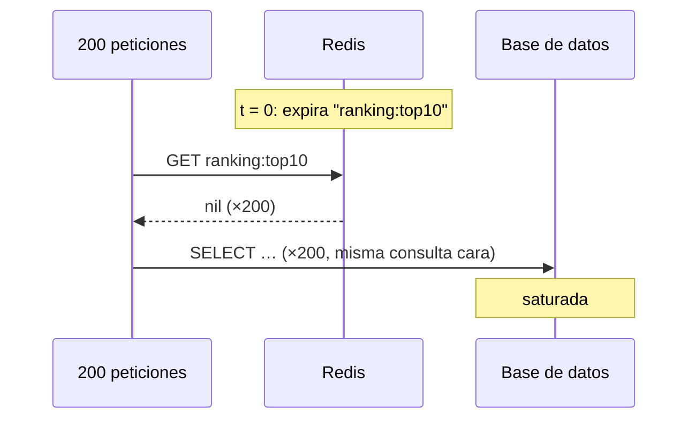
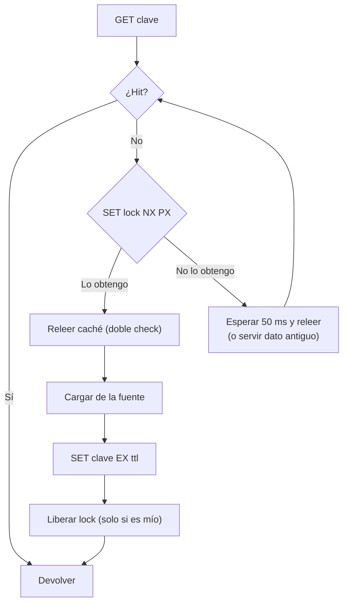

# Cache stampede

> [!abstract] En 30 segundos
> - **Qué es:** una clave **muy popular** expira y cientos de peticiones concurrentes encuentran el *miss* a la vez y **todas** van a la base de datos a recalcular lo mismo.
> - **Para qué estudiarlo:** es la causa más común de caídas de bases de datos «protegidas» por una caché.
> - **Recuerda:** cuatro defensas: **mutex** (un solo recalculador), **single-flight** (en proceso), **expiración anticipada probabilística** y **stale-while-revalidate**. `HybridCache` ya incluye single-flight por proceso.

> [!info] Lección 3.11 · Nivel 3 — Redis como caché
> ⬅️ [[LRU y LFU en Redis]] · ➡️ [[Cache penetration]] · 🗺️ [[01 - Redis - Roadmap#Nivel 3 — Redis como caché|Roadmap]] · 📊 [[03 - Redis - Progreso|Progreso]]
> 🏷️ Core · `SET … NX PX` · `DELEX … IFEQ` ≥8.4 para liberar el mutex.

## 📌 Definición

Un **cache stampede** (o *thundering herd*, *dogpile*) ocurre cuando muchas peticiones piden a la vez una entrada que acaba de expirar (o que no existe). Todas hacen *miss*, todas ejecutan la consulta costosa y la base de datos recibe una avalancha de trabajo idéntico.



## 🎯 ¿Qué problema resuelve?

Proteger la fuente cuando una entrada **muy leída** es **muy cara** de recalcular. Si la consulta tarda 2 s y recibes 500 req/s, durante esos 2 s se lanzan ~1 000 ejecuciones idénticas en lugar de 1.

## 🧠 Conceptos fundamentales

| Defensa | Idea | Pros | Contras |
|---|---|---|---|
| **Mutex distribuido** | Un único proceso recalcula (`SET lock NX PX`); el resto espera o sirve el dato antiguo | Garantiza una sola carga entre instancias | Gestión del lock, del timeout y de los reintentos |
| **Single-flight (en proceso)** | Las peticiones de la misma instancia por una clave comparten una sola tarea | Simple, sin red | No coordina entre instancias (N instancias = N cargas) |
| **Expiración anticipada probabilística (XFetch)** | Cada lector puede recalcular *antes* de que expire, con probabilidad creciente según se acerca el vencimiento | Sin locks; evita el pico | Más cargas totales; necesita guardar el coste del cálculo |
| **Stale-while-revalidate** | Se sirve el valor caducado mientras **uno** lo refresca en segundo plano | Latencia constante para los usuarios | Sirve datos obsoletos un tiempo |
| **Refresco proactivo** | Un job refresca las claves calientes antes de que expiren | La caché nunca se enfría | Hay que conocer las claves calientes |

### XFetch (expiración anticipada)
Recalcula si:

$$ -\,\delta \cdot \beta \cdot \ln(\text{rand}) \;\ge\; \text{tiempo restante hasta expirar} $$

donde `δ` = tiempo que tarda el recálculo, `β` = 1 por defecto y `rand` ∈ (0,1]. Cuanto más cara es la carga y más cerca está la expiración, más probable es que alguien la refresque antes; con muchos lectores, uno de ellos lo hará pronto.

### Reglas del mutex
1. `SET lock:clave token NX PX 10000`: **TTL siempre**, por si el proceso cae.
2. Liberar **solo si el token es el tuyo** (script Lua, o `DELEX … IFEQ` en ≥8.4).
3. Tras obtener el lock, **vuelve a comprobar la caché** (alguien pudo rellenarla).
4. Quien no obtiene el lock: espera brevemente y relee, o sirve el dato antiguo.

### Analogía
Un **concierto con una sola taquilla**: cuando se abre la venta de una entrada agotada, 200 personas corren a la taquilla. Con un *mutex*, una persona pregunta y avisa a las demás; con *stale-while-revalidate*, se enseña el cartel antiguo mientras alguien comprueba el aforo.
**Dónde se rompe:** si quien tiene el turno desaparece (proceso caído), el resto espera en vano: por eso el lock lleva TTL.

## ⚙️ Funcionamiento interno



## 💻 Ejemplos prácticos

```text
# Obtener el mutex (NX = solo si no existe; PX = TTL en ms)
127.0.0.1:6379> SET lock:ranking:top10 3f9a... NX PX 10000
OK
# Otro proceso lo intenta
127.0.0.1:6379> SET lock:ranking:top10 b71c... NX PX 10000
(nil)
# Liberar solo si el valor coincide (≥8.4: comando nativo)
127.0.0.1:6379> DELEX lock:ranking:top10 IFEQ 3f9a...
(integer) 1
```

## 🔧 Implementación en .NET

**Mutex distribuido + doble comprobación:**

```csharp
using StackExchange.Redis;

public class StampedeSafeCache(IDatabase db)
{
    private static readonly LuaScript Unlock = LuaScript.Prepare("""
        if redis.call('GET', @key) == @token then
            return redis.call('DEL', @key)
        end
        return 0
        """);

    public async Task<string?> GetOrLoadAsync(string key, Func<Task<string?>> loader, TimeSpan ttl)
    {
        RedisValue cached = await db.StringGetAsync(key);
        if (cached.HasValue) return cached;

        string lockKey = $"lock:{key}";
        string token = Guid.NewGuid().ToString("N");

        if (await db.StringSetAsync(lockKey, token, TimeSpan.FromSeconds(10), When.NotExists))
        {
            try
            {
                cached = await db.StringGetAsync(key);          // doble comprobación
                if (cached.HasValue) return cached;

                string? value = await loader();
                if (value is not null)
                    await db.StringSetAsync(key, value, CacheTtl.WithJitter(ttl));
                return value;
            }
            finally
            {
                await db.ScriptEvaluateAsync(Unlock, new { key = (RedisKey)lockKey, token });
            }
        }

        // No tengo el lock: esperar a que otro rellene la caché (con tope)
        for (int i = 0; i < 40; i++)
        {
            await Task.Delay(50);
            cached = await db.StringGetAsync(key);
            if (cached.HasValue) return cached;
        }
        return await loader();   // último recurso: no dejar al usuario sin respuesta
    }
}

public static class CacheTtl
{
    public static TimeSpan WithJitter(TimeSpan baseTtl, double fraction = 0.2) =>
        TimeSpan.FromSeconds(baseTtl.TotalSeconds * (1 + (Random.Shared.NextDouble() * 2 - 1) * fraction));
}
```

**Single-flight en proceso** (una carga por clave y por instancia):

```csharp
using System.Collections.Concurrent;

public class SingleFlight<T>
{
    private readonly ConcurrentDictionary<string, Lazy<Task<T>>> _inFlight = new();

    public async Task<T> RunAsync(string key, Func<Task<T>> factory)
    {
        var lazy = _inFlight.GetOrAdd(key, _ => new Lazy<Task<T>>(factory));
        try { return await lazy.Value; }
        finally { _inFlight.TryRemove(key, out _); }
    }
}
```

**Expiración anticipada (XFetch):**

```csharp
public static bool ShouldRecomputeEarly(TimeSpan recomputeCost, TimeSpan? remainingTtl, double beta = 1.0)
{
    if (remainingTtl is null) return true;
    double early = -recomputeCost.TotalMilliseconds * beta * Math.Log(Random.Shared.NextDouble());
    return early >= remainingTtl.Value.TotalMilliseconds;
}

// Uso: TimeSpan? ttl = await db.KeyTimeToLiveAsync(key);
//      if (ShouldRecomputeEarly(TimeSpan.FromMilliseconds(800), ttl)) { /* refrescar */ }
```

> [!tip] `HybridCache`
> `HybridCache.GetOrCreateAsync` combina las peticiones concurrentes de **un mismo proceso** por la misma clave (single-flight) y además tiene L1. Entre instancias distintas sigue habiendo una carga por instancia; si eso es demasiado, añade un mutex distribuido o refresco proactivo ([[HybridCache]]).

## 🏗️ Casos de uso en arquitectura

| Caso | Defensa |
|---|---|
| Página de inicio, *top 10*, ranking | Stale-while-revalidate o refresco proactivo |
| Consulta agregada cara y muy leída | Mutex distribuido + TTL con jitter |
| Muchas claves distintas, cada una con poca concurrencia | Single-flight en proceso basta |
| Lanzamiento de producto (tráfico súbito) | Precalentamiento + mutex |

### Cuándo NO hace falta
- Claves con poca concurrencia o recálculo barato.

### Consideraciones de arquitectura

| Dimensión | Qué pensar |
|---|---|
| Latencia | El que espera el mutex paga la espera: acota el tiempo |
| Fallos | Si el que tiene el lock falla, el TTL lo libera; el siguiente reintenta |
| Capacidad | Aun con defensa, dimensiona la BD para una carga por clave |
| Medición | Cuenta cargas concurrentes por clave y la profundidad de espera |

## ⚠️ Errores y anti-patterns

| Error | Por qué duele | Cómo evitarlo |
|---|---|---|
| Mutex sin TTL | Un fallo deja la clave bloqueada para siempre | `PX` siempre |
| Liberar con `DEL` sin comprobar el token | Borras el lock de otro | Script de comparar-y-borrar o `DELEX IFEQ` |
| No releer tras obtener el lock | Cargas duplicadas | Doble comprobación |
| Esperar sin límite | Latencia infinita | Tope de reintentos y *fallback* |
| TTL idéntico en claves calientes | Expiraciones simultáneas | Jitter |

## ✅ Buenas prácticas

1. Single-flight en proceso (`HybridCache`) + mutex distribuido para claves críticas.
2. TTL con jitter y refresco proactivo de las claves calientes.
3. Tiempo máximo de espera y degradación elegante (dato antiguo).
4. Pruebas de carga con concurrencia real (k6, NBomber).

## 🎤 Preguntas de entrevista

> [!question]- 1. ¿Qué es un cache stampede y cómo lo evitas?
> Muchas peticiones concurrentes recalculan a la vez una clave popular recién expirada. Se evita con un mutex (una sola recarga), single-flight, expiración anticipada probabilística o stale-while-revalidate.

> [!question]- 2. ¿Por qué el mutex lleva TTL y se libera con comparación de token?
> El TTL evita bloqueos permanentes si el proceso muere; la comparación evita liberar el lock de otro proceso (si el tuyo expiró y otro lo tomó).

> [!question]- 3. ¿Qué ventaja tiene la expiración anticipada frente al mutex?
> No necesita coordinación: cada lector decide probabilísticamente, y uno refresca antes de la expiración, sin esperas.

## 🧪 Ejercicios

### 🟢 Básicos
1. Con `redis-cli`, adquiere el lock con `SET … NX PX` desde dos terminales y observa que solo una lo consigue.

### 🟡 Intermedios
2. Provoca un stampede con 200 peticiones concurrentes (NBomber o k6) sobre una consulta de 500 ms, cuenta las ejecuciones en la BD, aplica el mutex y compara.

### 🔴 Reto Senior
3. Diseña la protección del *top 10* de la home (2 000 req/s, recálculo de 3 s, 10 instancias). Combina técnicas y justifica.

> [!success]- Soluciones
> **3.** Refresco proactivo cada 30 s con un único *leader* (lock distribuido) + TTL de 90 s (red de seguridad) + stale-while-revalidate para que nadie espere + single-flight en proceso. La BD recibe una consulta cada 30 s, independientemente del tráfico.

### ✔️ Checklist de dominio
- [ ] Diagnostico un stampede en métricas.
- [ ] Implemento mutex con token y TTL.
- [ ] Elijo entre mutex, single-flight, XFetch y SWR.

## 📝 Resumen

- Stampede = muchos *misses* simultáneos sobre una clave cara.
- Defensas: mutex, single-flight, XFetch, stale-while-revalidate, refresco proactivo.
- Lock con TTL y liberación por token; doble comprobación.
- `HybridCache` cubre el caso de un solo proceso.

## 🔗 Referencias

- [SET](https://redis.io/docs/latest/commands/set/)
- [Optimal probabilistic cache stampede prevention (VLDB 2015)](https://www.vldb.org/pvldb/vol8/p886-vattani.pdf)
- [HybridCache](https://learn.microsoft.com/aspnet/core/performance/caching/hybrid)

## 🔄 Notas relacionadas

- ⬅️ [[LRU y LFU en Redis]] · ➡️ [[Cache penetration]]
- Relacionadas: [[Distributed locks con Redis]] · [[Cache avalanche]] · [[Estrategias de TTL en caché]] · [[Cache-aside]]
