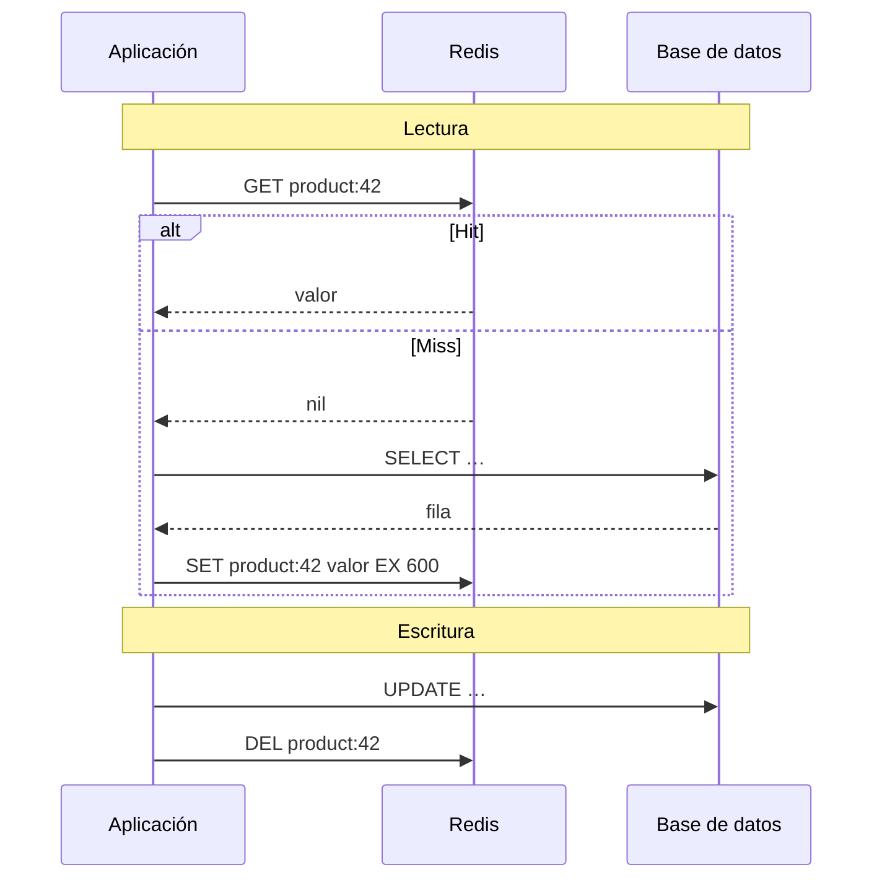

# Cache-aside

> [!abstract] En 30 segundos
> - **Qué es:** la aplicación consulta primero la caché; si falla, lee de la fuente, **rellena la caché** y devuelve el dato. Al escribir, **actualiza la fuente e invalida** la clave.
> - **Para qué:** es el patrón más usado: simple, tolerante a caídas de la caché y con datos cargados solo cuando se piden.
> - **Recuerda:** al actualizar, **borra** la clave en lugar de reescribirla (menos carreras); y pon TTL siempre.

> [!info] Lección 3.2 · Nivel 3 — Redis como caché
> ⬅️ [[Fundamentos de caching]] · ➡️ [[Read-through]] · 🗺️ [[01 - Redis - Roadmap#Nivel 3 — Redis como caché|Roadmap]] · 📊 [[03 - Redis - Progreso|Progreso]]
> 🏷️ Core.

## 📌 Definición

En **cache-aside** (o *lazy loading*) la lógica de la caché vive en la aplicación; la caché es «pasiva»:

- **Lectura:** `GET` en Redis → si hay valor, devolver; si no, leer de la base de datos, `SET … EX ttl` y devolver.
- **Escritura:** escribir en la base de datos y **eliminar** (invalidar) la clave de la caché; la siguiente lectura la repoblará.

## 🎯 ¿Qué problema resuelve?

Quieres acelerar lecturas sin acoplar la base de datos a la caché ni cargar datos que nadie pide. Si Redis cae, la aplicación sigue funcionando contra la base de datos (más lenta). No hay carga masiva inicial: la caché se calienta sola con el uso.

## 🧠 Conceptos fundamentales

1. **Carga perezosa:** solo se cachea lo que se pide.
2. **Primera lectura lenta:** cada clave tiene un *miss* inicial (y tras cada expiración).
3. **Invalidar mejor que actualizar:** si escribes el nuevo valor en la caché en cada actualización, dos escritores concurrentes pueden dejar el dato antiguo ([[Cache consistency]]). Borrar es idempotente y simple.
4. **Serialización:** el valor se guarda como bytes/JSON; define el formato y su versión.
5. **Caché negativa:** guardar también «no existe» (con TTL corto) para no golpear la base de datos con ids inexistentes ([[Cache penetration]]).
6. **Riesgos conocidos:** *stampede* en expiraciones de claves populares ([[Cache stampede]]) y datos obsoletos hasta el TTL.

### Analogía
Un **bibliotecario** que, cuando le piden un libro del almacén, deja una copia en el mostrador; la próxima vez lo entrega al instante. Si el libro cambia, retira la copia del mostrador.
**Dónde se rompe:** si dos personas piden el mismo libro nuevo justo a la vez, ambas van al almacén (stampede).

## ⚙️ Funcionamiento interno



## 💻 Ejemplos prácticos

```text
127.0.0.1:6379> GET product:42
(nil)
127.0.0.1:6379> SET product:42 "{\"id\":42,\"name\":\"Teclado\",\"price\":59.9}" EX 600
OK
127.0.0.1:6379> TTL product:42
(integer) 598
127.0.0.1:6379> DEL product:42
(integer) 1
```

## 🔧 Implementación en .NET

```csharp
using System.Text.Json;
using StackExchange.Redis;

public record Product(int Id, string Name, decimal Price);

public interface IProductRepository
{
    Task<Product?> FindAsync(int id);
    Task UpdateAsync(Product product);
}

public class CachedProductService(IDatabase redis, IProductRepository repo)
{
    private static readonly TimeSpan Ttl = TimeSpan.FromMinutes(10);
    private static string Key(int id) => $"shop:product:{id}";

    public async Task<Product?> GetAsync(int id)
    {
        RedisValue cached = await redis.StringGetAsync(Key(id));
        if (cached.HasValue)
            return JsonSerializer.Deserialize<Product>(cached.ToString());

        Product? product = await repo.FindAsync(id);
        if (product is not null)
            await redis.StringSetAsync(Key(id), JsonSerializer.Serialize(product), Ttl);

        return product;
    }

    public async Task UpdateAsync(Product product)
    {
        await repo.UpdateAsync(product);            // 1. fuente de verdad
        await redis.KeyDeleteAsync(Key(product.Id)); // 2. invalidar
    }
}
```

> [!tip] Tolerar fallos de Redis
> Envuelve las llamadas a Redis en `try/catch (RedisException)` y trata el error como un *miss*: la caché no debe tumbar tu API. Con [[Redis con Polly y resiliencia]] puedes añadir timeouts y *circuit breaker*.

## 🏗️ Casos de uso en arquitectura

| Caso | Notas |
|---|---|
| Detalle de producto, perfil de usuario | TTL de minutos; invalidar en la actualización |
| Resultados de consultas pesadas | TTL corto y clave derivada de los parámetros |
| Datos de referencia (países, monedas) | TTL largo o invalidación por evento |

### Cuándo NO usarlo
- Necesitas que la caché siempre esté caliente y sincronizada: considera [[Write-through]] o precalentamiento.
- Muchas claves calientes con expiración simultánea sin protección: añade [[Cache stampede|mutex o single-flight]].

### Consideraciones de arquitectura

| Dimensión | Qué pensar |
|---|---|
| Consistencia | Ventana de obsolescencia ≤ TTL; invalidación reduce la ventana |
| Disponibilidad | Degradación elegante si Redis falla |
| Seguridad | Claves con tenant/usuario si hay datos privados |
| Serialización | Formato estable y versionado ([[Serialización de datos en Redis]]) |

## ⚠️ Errores y anti-patterns

| Error | Por qué duele | Cómo evitarlo |
|---|---|---|
| Actualizar la caché en cada escritura | Carreras que dejan datos viejos | Invalidar (borrar) |
| Olvidar el TTL | Datos obsoletos permanentes y memoria infinita | `SET … EX` siempre |
| Invalidar antes de escribir en la BD | Una lectura intermedia repuebla el dato antiguo | Escribir en la BD primero, luego invalidar |
| No manejar fallos de Redis | La API cae con la caché | `try/catch` y fallback |
| No cachear los «no encontrados» | Penetration | Caché negativa con TTL corto |

## ✅ Buenas prácticas

1. Escritura en la fuente → invalidación.
2. TTL con *jitter* ([[Estrategias de TTL en caché]]).
3. Degradar a la fuente si Redis falla.
4. Claves con prefijo, versión y, si procede, tenant.
5. Medir hits, misses y latencia.

## 🎤 Preguntas de entrevista

> [!question]- 1. ¿Cómo invalidarías la caché al actualizar un producto?
> Actualizo la base de datos y después elimino la clave (o claves) afectadas; la siguiente lectura la repuebla. Si hay varias claves derivadas, las agrupo con versión o tags ([[Cache invalidation]]).

> [!question]- 2. ¿Por qué borrar en lugar de actualizar la clave?
> Porque dos actualizaciones concurrentes pueden escribir en la caché en orden distinto al de la base de datos y dejar un valor antiguo. Borrar no depende del orden y además evita cachear datos que quizá nadie vuelva a leer.

> [!question]- 3. ¿Qué pasa si Redis cae?
> En cache-aside la aplicación sigue funcionando contra la base de datos, con más latencia y más carga; hay que dimensionarla para ese escenario.

## 🧪 Ejercicios

### 🟢 Básicos
1. Implementa `GetAsync` con cache-aside sobre un repositorio en memoria que simule 50 ms de latencia y mide el antes y el después.

### 🟡 Intermedios
2. Añade caché negativa con TTL de 30 s y comprueba que ids inexistentes no llegan a la base de datos.

### 🔴 Reto Senior
3. Dibuja una secuencia en la que un lector deja un valor antiguo en la caché **después** de la invalidación. Propón dos soluciones.

> [!success]- Soluciones
> **3.** Lector R lee la BD (valor v1) → escritor W actualiza la BD (v2) y borra la clave → R escribe v1 en la caché. Soluciones: TTL corto que acote la ventana; claves versionadas (el escritor incrementa la versión y R escribe en la clave de la versión antigua); `SET` condicional con versión mediante Lua; doble borrado diferido.

### ✔️ Checklist de dominio
- [ ] Implemento lectura y escritura con cache-aside.
- [ ] Explico por qué se invalida en vez de actualizar.
- [ ] Degrado correctamente si Redis falla.

## 📝 Resumen

- Leer: caché → si falla, fuente → rellenar con TTL.
- Escribir: fuente → invalidar.
- Tolerante a la caída de Redis; vulnerable a stampede y obsolescencia limitada por el TTL.
- Es el patrón por defecto.

## 🔗 Referencias

- [Caching patterns](https://redis.io/docs/latest/develop/use-cases/)
- [Cache-aside pattern (Azure Architecture Center)](https://learn.microsoft.com/azure/architecture/patterns/cache-aside)

## 🔄 Notas relacionadas

- ⬅️ [[Fundamentos de caching]] · ➡️ [[Read-through]]
- Relacionadas: [[Redis Strings]] · [[Cache invalidation]] · [[Cache stampede]] · [[Proyecto 03 - Caché de productos]]
