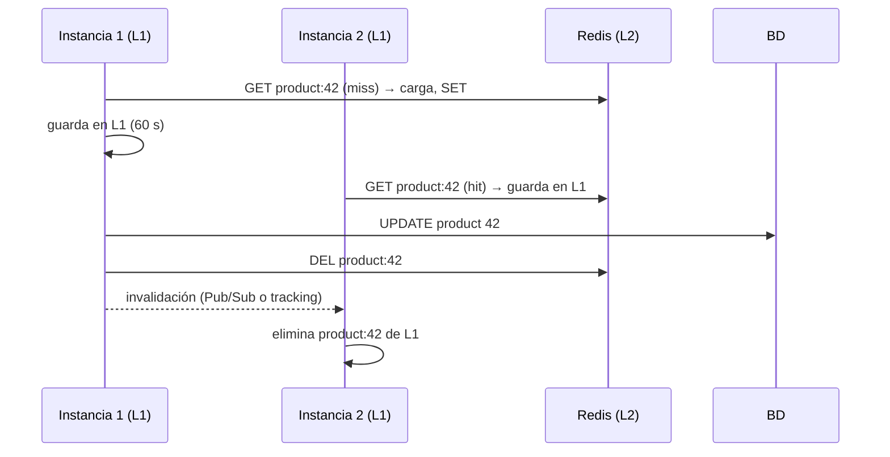

# Distributed caching

> [!abstract] En 30 segundos
> - **Qué es:** una caché **compartida entre instancias** de la aplicación (Redis), normalmente combinada con una **caché local (L1)** por instancia.
> - **Para qué:** que todas las instancias vean los mismos datos cacheados, sin duplicar cargas, y ganar la latencia de la memoria local.
> - **Recuerda:** L1 es muy rápida pero **divergente** entre instancias; la invalidación entre ellas (Pub/Sub, *client-side caching* de Redis) es lo difícil. Redis 6+ ofrece `CLIENT TRACKING` para invalidaciones asistidas por el servidor.

> [!info] Lección 3.14 · Nivel 3 — Redis como caché
> ⬅️ [[Cache avalanche]] · ➡️ [[StackExchange.Redis]] · 🗺️ [[01 - Redis - Roadmap#Nivel 3 — Redis como caché|Roadmap]] · 📊 [[03 - Redis - Progreso|Progreso]]
> 🏷️ Core · `CLIENT TRACKING` ≥6.0 (RESP3 recomendado) · StackExchange.Redis 3.x **no** lo expone como funcionalidad de alto nivel: el soporte de *client-side caching* se está desarrollando para la rama 4.0 (comprueba el estado en sus notas de versión).
> 📌 **Cierra el nivel 3**: sigue con [[Proyecto 03 - Caché de productos]].

## 📌 Definición

| Tipo | Dónde vive | Latencia | Coherencia entre instancias |
|---|---|---|---|
| **Local (L1)** | Memoria del proceso (`IMemoryCache`) | ns-µs | Ninguna: cada instancia la suya |
| **Distribuida (L2)** | Redis | ~0,5-2 ms | Una sola copia compartida |
| **Híbrida (L1 + L2)** | Ambas | Casi local si hay hit en L1 | L2 + invalidación hacia L1 |

## 🎯 ¿Qué problema resuelve?

Con 20 instancias, una caché solo local calcula cada dato 20 veces y cada instancia ve datos distintos durante un tiempo. Con solo Redis, cada lectura paga un round-trip. L1 + L2 combina lo mejor: Redis garantiza una sola carga compartida; L1 evita el viaje.

## 🧠 Conceptos fundamentales

1. **`IDistributedCache`** (abstracción de ASP.NET Core): `Get/Set` de `byte[]` con expiración; la implementación Redis es `Microsoft.Extensions.Caching.StackExchangeRedis` ([[IDistributedCache]]).
2. **`HybridCache`** (.NET 9+): L1 + L2, single-flight, tags y serialización integrada ([[HybridCache]]).
3. **Invalidación entre instancias (L1):**

| Mecanismo | Cómo | Garantía |
|---|---|---|
| **TTL corto de L1** | Acotar la divergencia | Siempre, es la red de seguridad |
| **Pub/Sub** | Mensaje «invalidar clave X» | Sin entrega garantizada |
| **Streams** | Eventos con consumer group | At-least-once |
| **Client-side caching de Redis** | El servidor avisa al cliente cuando cambia una clave que lleva en caché | Notificaciones *push* (según modo y desconexiones) |

4. **`CLIENT TRACKING`** (Redis 6+):
   - **Modo por defecto:** el servidor recuerda qué claves ha leído cada cliente y le envía un mensaje de invalidación cuando cambian (requiere RESP3, o RESP2 con `REDIRECT` a otra conexión).
   - **`BCAST`:** el cliente se suscribe a prefijos de claves y recibe invalidaciones de todo lo que cambie bajo ellos, sin que el servidor guarde estado por cliente.
   - **`OPTIN`/`OPTOUT`:** controlan qué lecturas se rastrean. **`NOLOOP`:** no avisa de las modificaciones del propio cliente.
   - Limitaciones: consume memoria en el servidor (tabla de claves rastreadas) y exige tratar las invalidaciones tras una reconexión (vaciar la caché local).
5. **Coherencia aceptable:** L1 con TTL de 5-60 s para datos poco críticos; sin L1 para los que necesitan inmediatez.
6. **Serialización y tamaño:** lo que se guarda en L2 se serializa; elige formato compacto y versionado ([[Serialización de datos en Redis]]).

### Analogía
Cada **empleado** tiene su libreta con las extensiones más usadas (L1) y existe una **guía telefónica central** (L2). Cuando el servicio de recepción cambia una extensión, avisa por megafonía (invalidación); quien no oyó el aviso corrige su libreta al renovarla (TTL).
**Dónde se rompe:** si la megafonía falla, algunos empleados llaman a un número obsoleto durante un rato.

## ⚙️ Funcionamiento interno



## 💻 Ejemplos prácticos

```text
# Client-side caching con tracking (RESP3)
127.0.0.1:6379> HELLO 3
127.0.0.1:6379> CLIENT TRACKING on
OK
127.0.0.1:6379> GET shop:product:42
"..."
# Otro cliente modifica la clave:
127.0.0.1:6379> SET shop:product:42 nuevo
# El primer cliente recibe un mensaje push: invalidate shop:product:42

# Modo BCAST por prefijo
127.0.0.1:6379> CLIENT TRACKING on BCAST PREFIX shop:product:
OK
```

```bash
# Ver el estado del seguimiento de claves del servidor
redis-cli INFO stats | grep tracking
redis-cli CLIENT TRACKINGINFO
```

## 🔧 Implementación en .NET

**L1 + L2 con `HybridCache` (la vía recomendada):**

```csharp
// Program.cs
builder.Services.AddStackExchangeRedisCache(o => o.Configuration = "localhost:6379");
builder.Services.AddHybridCache(o =>
{
    o.DefaultEntryOptions = new HybridCacheEntryOptions
    {
        Expiration = TimeSpan.FromMinutes(10),            // L2
        LocalCacheExpiration = TimeSpan.FromSeconds(30)   // L1: ventana máxima de divergencia
    };
});
```

**Invalidación entre instancias con Pub/Sub** (cuando L1 es una `IMemoryCache` propia):

```csharp
using Microsoft.Extensions.Caching.Memory;
using StackExchange.Redis;

public class TwoLevelCache(IMemoryCache l1, IDatabase l2, ISubscriber bus)
{
    private static readonly RedisChannel Channel = RedisChannel.Literal("cache:invalidate");

    public Task StartAsync() =>
        bus.SubscribeAsync(Channel, (_, key) => l1.Remove(key.ToString()));

    public async Task<string?> GetAsync(string key, Func<Task<string?>> loader)
    {
        if (l1.TryGetValue(key, out string? local)) return local;           // L1

        RedisValue remote = await l2.StringGetAsync(key);                   // L2
        string? value = remote.HasValue ? (string?)remote : await loader();
        if (!remote.HasValue && value is not null)
            await l2.StringSetAsync(key, value, TimeSpan.FromMinutes(10));

        if (value is not null)
            l1.Set(key, value, TimeSpan.FromSeconds(30));                   // TTL corto = red de seguridad
        return value;
    }

    public async Task InvalidateAsync(string key)
    {
        await l2.KeyDeleteAsync(key);
        l1.Remove(key);
        await bus.PublishAsync(Channel, key);    // avisa a las demás instancias
    }
}
```

> [!warning] Tras una reconexión
> Si una instancia pierde la suscripción Pub/Sub durante unos segundos, puede quedarse con valores antiguos en L1 hasta que venza su TTL. Por eso L1 lleva **siempre** TTL corto y, si necesitas más garantías, vacíala al detectar la reconexión (`ConnectionRestored`).

## 🏗️ Casos de uso en arquitectura

| Caso | Diseño |
|---|---|
| API con 10-50 instancias y datos leídos mucho | HybridCache (L1 30 s + L2 10 min) |
| Datos de referencia casi estáticos | L1 larga + invalidación por evento |
| Datos que exigen inmediatez | Solo L2 (sin L1) o L1 de 1-2 s |
| Sesiones | Solo Redis (no L1) |

### Cuándo NO usar L1
- Cuando la divergencia de segundos entre instancias es inaceptable (inventario, permisos críticos).

### Consideraciones de arquitectura

| Dimensión | Qué pensar |
|---|---|
| Memoria | L1 × número de instancias: acota tamaño y TTL |
| Coherencia | Ventana = TTL de L1 + retraso de la invalidación |
| Seguridad | Los valores en L1 están en la memoria del proceso |
| Observabilidad | Hit ratio por capa (L1, L2) |

## ⚠️ Errores y anti-patterns

| Error | Por qué duele | Cómo evitarlo |
|---|---|---|
| L1 sin TTL o con TTL largo | Datos obsoletos indefinidos si falla la invalidación | TTL corto |
| Confiar solo en Pub/Sub | Mensajes perdidos | TTL de L1 + reconciliación |
| Cachear en L1 objetos gigantes | Presión en el GC y la memoria | Límite de tamaño |
| Mezclar formatos de serialización entre versiones | Errores al desplegar | Versionar el formato/clave |
| Usar `IMemoryCache` mutable compartida | Efectos colaterales | Valores inmutables |

## ✅ Buenas prácticas

1. `HybridCache` como punto de partida en .NET 9+.
2. TTL de L1 corto (segundos); L2 más largo.
3. Invalidación por evento + TTL como red de seguridad.
4. Métricas por capa.
5. Pruebas con varias instancias.

## 🎤 Preguntas de entrevista

> [!question]- 1. ¿Por qué combinar L1 y L2?
> L2 (Redis) evita cargas duplicadas y da una vista compartida; L1 evita el round-trip. Juntas dan latencia casi local con coherencia razonable.

> [!question]- 2. ¿Cómo invalidas L1 en todas las instancias?
> Con un mensaje (Pub/Sub o Streams) que cada instancia procesa para eliminar la entrada local, o con `CLIENT TRACKING` si el cliente lo soporta; siempre con TTL corto como red de seguridad.

> [!question]- 3. ¿Qué es `CLIENT TRACKING`?
> Un mecanismo de Redis 6+ por el que el servidor notifica al cliente cuando cambian claves que este tiene cacheadas localmente (por claves leídas o por prefijos con `BCAST`).

## 🧪 Ejercicios

### 🟢 Básicos
1. Abre dos `redis-cli` con `HELLO 3` y `CLIENT TRACKING on`; modifica una clave desde uno y observa el mensaje de invalidación en el otro.

### 🟡 Intermedios
2. Implementa `TwoLevelCache` y comprueba con dos instancias de tu API que la invalidación llega a ambas.

### 🔴 Reto Senior
3. Diseña la caché de una API con 30 instancias, 5 000 req/s, datos de catálogo y precios. Define capas, TTL e invalidación, y justifica qué datos van sin L1.

> [!success]- Soluciones
> **3.** Catálogo: L1 30-60 s + L2 10-30 min + invalidación por evento. Precios: L1 de 5 s o ninguna; invalidación por evento obligatoria y validación del precio en la fuente al cobrar. Sesiones/carrito: solo Redis. Observabilidad: hit ratio de cada capa y latencia de propagación de la invalidación.

### ✔️ Checklist de dominio
- [ ] Explico L1, L2 e híbrida con sus compromisos.
- [ ] Diseño la invalidación entre instancias.
- [ ] Sé qué ofrece `CLIENT TRACKING` y qué limitaciones tiene en .NET.

## 📝 Resumen

- Distribuida = compartida (Redis); local = rápida (L1); híbrida combina ambas.
- La invalidación entre instancias es el punto difícil: eventos + TTL corto.
- `CLIENT TRACKING` da invalidaciones asistidas por el servidor; en .NET, `HybridCache` y Pub/Sub son la vía práctica hoy.
- Lo crítico, sin L1.

## 🔗 Referencias

- [Client-side caching en Redis](https://redis.io/docs/latest/develop/reference/client-side-caching/)
- [Distributed caching en ASP.NET Core](https://learn.microsoft.com/aspnet/core/performance/caching/distributed)
- [HybridCache](https://learn.microsoft.com/aspnet/core/performance/caching/hybrid)

## 🔄 Notas relacionadas

- ⬅️ [[Cache avalanche]] · ➡️ [[StackExchange.Redis]]
- Relacionadas: [[HybridCache]] · [[IDistributedCache]] · [[Redis Pub-Sub]] · [[Cache invalidation]] · [[Proyecto 03 - Caché de productos]]
