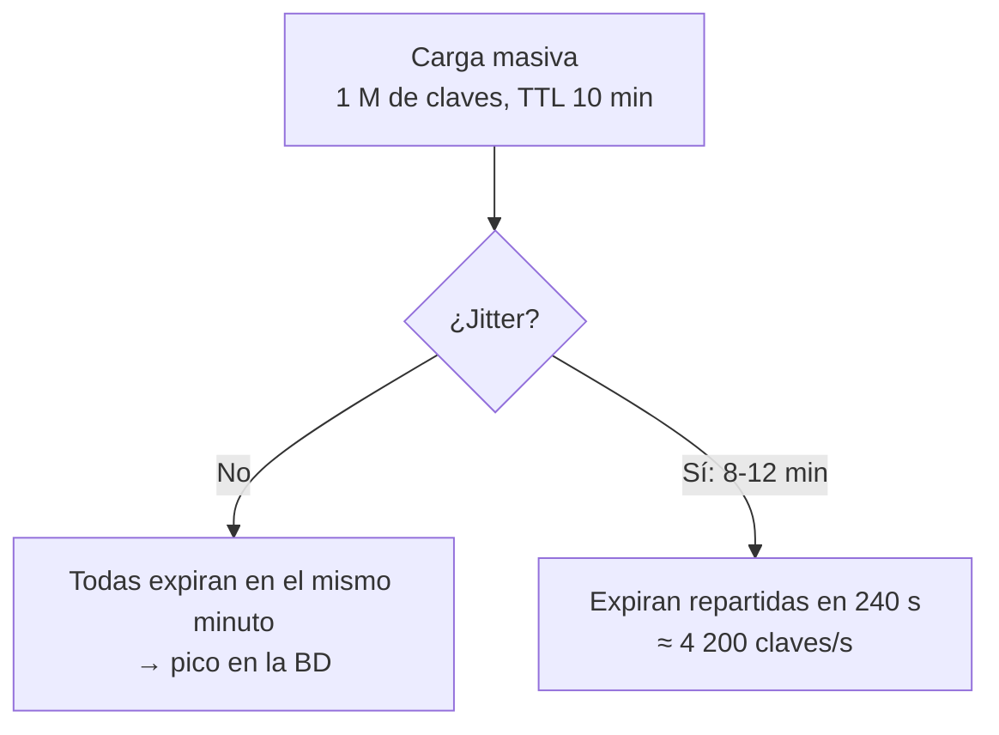

# Estrategias de TTL en caché

> [!abstract] En 30 segundos
> - **Qué es:** elegir **cuánto vive** cada entrada: TTL absoluto, deslizante, según la volatilidad del dato y con **jitter** (aleatoriedad) para no expirar todo a la vez.
> - **Para qué:** acotar la obsolescencia, liberar memoria y evitar avalanchas de expiración.
> - **Recuerda:** el TTL es tu **límite máximo de inconsistencia**. Un TTL deslizante sin tope absoluto puede mantener un dato vivo para siempre.

> [!info] Lección 3.6 · Nivel 3 — Redis como caché
> ⬅️ [[Write-behind]] · ➡️ [[Cache invalidation]] · 🗺️ [[01 - Redis - Roadmap#Nivel 3 — Redis como caché|Roadmap]] · 📊 [[03 - Redis - Progreso|Progreso]]
> 🏷️ Core · `GETEX` ≥6.2 · `EXPIRE … NX/XX/GT/LT` ≥7.0.

## 📌 Definición

El **TTL** (*time to live*) es el tiempo tras el cual Redis elimina una clave. Una **estrategia de TTL** decide ese valor y cómo se renueva:

| Estrategia | Cómo funciona | Uso típico |
|---|---|---|
| **Absoluto** | Vive N segundos desde que se escribe | Datos de catálogo, resultados de consulta |
| **Deslizante** (*sliding*) | Cada lectura renueva el TTL | Sesiones, caches de «usados recientemente» |
| **Absoluto + deslizante** | Se renueva al leer, pero nunca pasa de un tope | Sesiones con caducidad máxima |
| **Por volatilidad** | TTL distinto según lo que cambia el dato | Referencia: horas; stock: segundos |
| **Con jitter** | TTL base ± variación aleatoria | Cargas masivas simultáneas |

## 🎯 ¿Qué problema resuelve?

- **Obsolescencia:** sin TTL, un fallo de invalidación deja el dato viejo para siempre.
- **Memoria:** sin TTL, la caché solo crece hasta chocar con `maxmemory`.
- **Avalancha:** si 1 millón de claves se cargan a la vez con el mismo TTL, expiran a la vez y la base de datos recibe todo el tráfico ([[Cache avalanche]]).

## 🧠 Conceptos fundamentales

1. **Elige el TTL por lo que tolera el negocio**, no por intuición: «¿cuánto tiempo es aceptable que se vea el precio antiguo?».
2. **Orientación:**

| Dato | TTL orientativo |
|---|---|
| Datos de referencia (países, monedas) | Horas a días, más invalidación por evento |
| Catálogo de productos | 5-60 min |
| Resultados de búsqueda o agregados | 30-120 s |
| Sesiones | 20-30 min deslizante + tope absoluto |
| Caché negativa («no existe») | 15-60 s |
| Tokens de un solo uso | Minutos, absoluto |

3. **Jitter:** `ttl = base × (1 ± 20 %)` aleatorio. Reparte las expiraciones en el tiempo.
4. **Deslizante:** `GETEX clave EX n` lee y renueva el TTL en una operación (≥6.2). Cuidado: sin tope, un dato muy leído nunca caduca.
5. **`EXPIRE` con condiciones (≥7.0):** `NX` (solo si no tiene TTL), `XX` (solo si ya tiene), `GT` (solo si el nuevo es mayor), `LT` (solo si es menor). Sirven para «renovar sin pasar del tope».
6. **Cómo expira Redis:** perezosamente al acceder y con un ciclo activo que muestrea claves con TTL ([[Expiración y TTL]]). Una clave expirada puede seguir ocupando memoria unos instantes.

### Analogía
Los **yogures de la nevera** tienen fecha de caducidad distinta según el producto (leche, queso, conserva). Si compras 100 yogures el mismo día, caducan todos el mismo día: mejor que no sea así (jitter).
**Dónde se rompe:** a diferencia de la nevera, Redis tira solo los caducados, pero puede tardar un poco en hacerlo.

## ⚙️ Funcionamiento interno



## 💻 Ejemplos prácticos

```text
127.0.0.1:6379> SET shop:product:42 "..." EX 600
OK
127.0.0.1:6379> GETEX shop:product:42 EX 600        # lee y renueva (deslizante)
"..."
127.0.0.1:6379> EXPIRE shop:product:42 900 GT        # solo si el nuevo TTL es mayor (≥7.0)
(integer) 1
127.0.0.1:6379> EXPIRE shop:product:42 60 NX         # solo si no tiene TTL
(integer) 0
127.0.0.1:6379> TTL shop:product:42
(integer) 899
```

## 🔧 Implementación en .NET

```csharp
using StackExchange.Redis;

public static class CacheTtl
{
    // TTL con jitter ±20 %: factor en [0,8 ; 1,2]
    public static TimeSpan WithJitter(TimeSpan baseTtl, double fraction = 0.2)
    {
        double factor = 1 + (Random.Shared.NextDouble() * 2 - 1) * fraction;
        return TimeSpan.FromSeconds(baseTtl.TotalSeconds * factor);
    }
}

IDatabase db = mux.GetDatabase();

// Absoluto con jitter
await db.StringSetAsync("shop:product:42", "...", CacheTtl.WithJitter(TimeSpan.FromMinutes(10)));

// Deslizante: leer y renovar en un comando (GETEX)
RedisValue value = await db.StringGetSetExpiryAsync("shop:session:abc", TimeSpan.FromMinutes(20));

// Renovar sin sobrepasar un tope: EXPIRE con GT solo si el nuevo valor es mayor
await db.KeyExpireAsync("shop:session:abc", TimeSpan.FromMinutes(20), ExpireWhen.GreaterThanCurrentExpiry);
```

> [!note] Sesiones con tope absoluto
> `Microsoft.Extensions.Caching.StackExchangeRedis` implementa `IDistributedCache` con ambas ventanas: `AbsoluteExpirationRelativeToNow` (tope) y `SlidingExpiration` (renovación). Almacena las dos en el valor y las gestiona con un script, así que no tienes que programarlo ([[IDistributedCache]]).

## 🏗️ Casos de uso en arquitectura

| Caso | Estrategia |
|---|---|
| Catálogo precargado de madrugada | Jitter amplio (±30 %) |
| Sesión de usuario | Deslizante 20 min + tope 8 h |
| Resultado de búsqueda | Absoluto corto (60 s) |
| Datos de referencia | TTL largo + invalidación por evento |
| Caché negativa | TTL corto (30 s) |

### Cuándo NO usar TTL deslizante
- Cuando el dato debe caducar sí o sí (tokens, permisos): absoluto.

### Consideraciones de arquitectura

| Dimensión | Qué pensar |
|---|---|
| Consistencia | TTL = peor caso de obsolescencia |
| Carga en la fuente | Un TTL más corto = más misses |
| Memoria | TTL corto libera antes; el desalojo es la red de seguridad |
| Operación | `TTL`, `OBJECT`, y `INFO keyspace` (`expires`, `avg_ttl`) |

## ⚠️ Errores y anti-patterns

| Error | Por qué duele | Cómo evitarlo |
|---|---|---|
| Mismo TTL fijo para una carga masiva | Avalancha de expiración | Jitter |
| Deslizante sin tope | Datos que no caducan nunca | Tope absoluto |
| `SET` sin TTL por olvido | Claves inmortales | Helper único que exige TTL |
| `SET` sin `KEEPTTL` al actualizar | Una actualización borra el TTL | `SET … KEEPTTL` o fijar TTL de nuevo |
| TTL por intuición | Obsolescencia no aceptable | Acordarlo con el negocio |

## ✅ Buenas prácticas

1. Un helper central de TTL que exija caducidad y aplique jitter.
2. Acuerda con el negocio la obsolescencia aceptable.
3. Deslizante siempre con tope absoluto.
4. Vigila `avg_ttl` y claves sin TTL (`INFO keyspace`).

## 🎤 Preguntas de entrevista

> [!question]- 1. ¿Por qué añadir jitter?
> Para que las claves cargadas a la vez no expiren a la vez y no provoquen un pico de misses (avalancha).

> [!question]- 2. ¿Qué ocurre con el TTL cuando haces `SET` sobre una clave existente?
> Se elimina, salvo que uses `KEEPTTL` o fijes uno nuevo. Es una fuente típica de claves inmortales.

> [!question]- 3. ¿Cómo implementas una sesión de 20 minutos deslizantes con máximo de 8 horas?
> Guardando el instante de creación y renovando con `GETEX`/`EXPIRE` solo si no se supera el tope; o con `IDistributedCache` y sus dos opciones de expiración.

## 🧪 Ejercicios

### 🟢 Básicos
1. Crea una clave con TTL de 60 s, léela con `GETEX … EX 60` y observa cómo se renueva.

### 🟡 Intermedios
2. Calcula el reparto de expiraciones de 1 millón de claves con TTL de 10 min y jitter ±20 %.
3. Escribe un helper que lance una excepción si se intenta guardar sin TTL.

### 🔴 Reto Senior
4. Define la política de TTL de una tienda online: catálogo, precios, stock, carrito, sesión y resultados de búsqueda. Justifica cada uno.

> [!success]- Soluciones
> **2.** Rango 8-12 min = 240 s → ~4 200 claves/s en promedio frente a 1 M en un instante.
> **4.** Catálogo: 30 min + invalidación al editar. Precios: 5 min + invalidación. Stock: no cachear o 1-5 s (el dato crítico vive en la fuente). Carrito: deslizante 7 días en Redis como dato principal. Sesión: 20 min deslizante + 8 h absoluto. Búsqueda: 60 s.

### ✔️ Checklist de dominio
- [ ] Elijo TTL por obsolescencia tolerable.
- [ ] Aplico jitter y tope absoluto.
- [ ] Evito claves inmortales.

## 📝 Resumen

- TTL = límite máximo de inconsistencia y control de memoria.
- Absoluto, deslizante (con tope) y por volatilidad; jitter en cargas masivas.
- `GETEX`, `EXPIRE NX/XX/GT/LT`, `SET … KEEPTTL`.
- Un helper único evita claves sin caducidad.

## 🔗 Referencias

- [EXPIRE](https://redis.io/docs/latest/commands/expire/)
- [GETEX](https://redis.io/docs/latest/commands/getex/)
- [Distributed caching en ASP.NET Core](https://learn.microsoft.com/aspnet/core/performance/caching/distributed)

## 🔄 Notas relacionadas

- ⬅️ [[Write-behind]] · ➡️ [[Cache invalidation]]
- Relacionadas: [[Expiración y TTL]] · [[Cache avalanche]] · [[Eviction policies]] · [[Sesiones distribuidas con Redis]]
