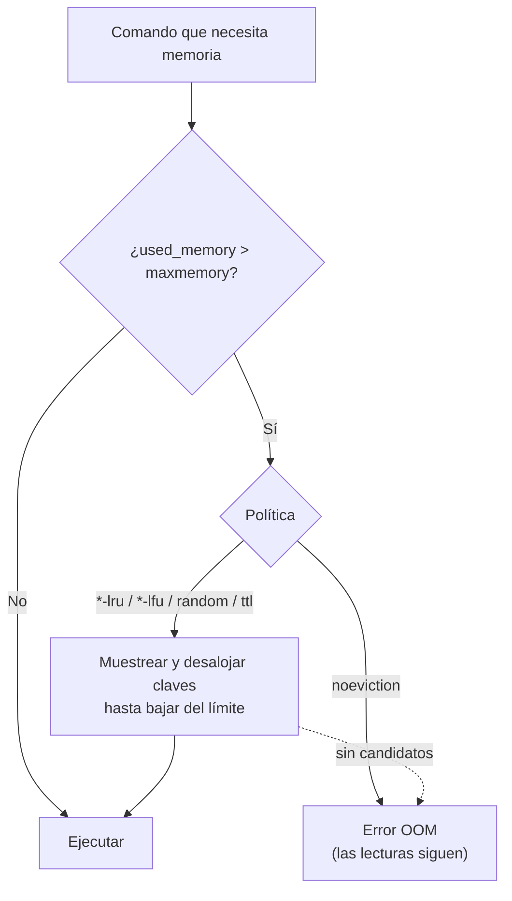

# Eviction policies

> [!abstract] En 30 segundos
> - **Qué es:** lo que hace Redis cuando la memoria llega a `maxmemory`: **desalojar claves** según una política, o rechazar escrituras (`noeviction`).
> - **Para qué:** que una caché se autogestione; o que una instancia de datos falle de forma controlada en vez de borrar lo que no debe.
> - **Recuerda:** caché → `allkeys-lru` o `allkeys-lfu`. Datos que no se pueden perder → `noeviction`. **No mezcles ambos roles en la misma instancia.**

> [!info] Lección 3.9 · Nivel 3 — Redis como caché
> ⬅️ [[Cache consistency]] · ➡️ [[LRU y LFU en Redis]] · 🗺️ [[01 - Redis - Roadmap#Nivel 3 — Redis como caché|Roadmap]] · 📊 [[03 - Redis - Progreso|Progreso]]
> 🏷️ Core · `*-lfu` ≥4.0 · `volatile-lrm`/`allkeys-lrm` ≥8.6 (R8) · los servicios gestionados pueden traer otra política por defecto: compruébala.

## 📌 Definición

`maxmemory` limita la memoria de datos de la instancia (por defecto **0 = sin límite**). Al alcanzarlo, Redis aplica `maxmemory-policy` **antes de ejecutar cada comando** que necesita memoria:

| Política | Qué hace |
|---|---|
| `noeviction` **(por defecto)** | No desaloja; las escrituras que necesitan memoria devuelven error `OOM`. Las lecturas siguen funcionando |
| `allkeys-lru` | Desaloja cualquier clave, la menos recientemente usada (aproximado) |
| `volatile-lru` | Igual, pero solo entre claves **con TTL** |
| `allkeys-lfu` | Desaloja la menos frecuentemente usada (aproximado) |
| `volatile-lfu` | Igual, solo entre claves con TTL |
| `allkeys-random` / `volatile-random` | Desaloja al azar |
| `volatile-ttl` | Desaloja las claves con TTL más próximo a caducar |
| `allkeys-lrm` / `volatile-lrm` 🏷️ ≥8.6 | Desaloja la **menos recientemente modificada** (las lecturas no actualizan la marca) |

## 🎯 ¿Qué problema resuelve?

Una caché que no se limpia termina llenando la memoria; sin límite, el sistema operativo mata el proceso (OOM killer) o empieza a usar *swap*. Con `maxmemory` y una política, Redis decide qué sacrificar para seguir aceptando datos nuevos.

## 🧠 Conceptos fundamentales

1. **Si no hay candidatos:** con políticas `volatile-*` y ninguna clave con TTL, Redis se comporta como `noeviction`.
2. **Cuándo se desaloja:** al llegar al límite, cada comando que añade o crece datos provoca desalojos hasta bajar de nuevo. `maxmemory-eviction-tenacity` (10 por defecto) regula cuánto esfuerzo se dedica.
3. **Los algoritmos son aproximados:** muestrean `maxmemory-samples` claves (5 por defecto, máximo 64) para ahorrar memoria y CPU ([[LRU y LFU en Redis]]).
4. **Réplicas:** por defecto ignoran `maxmemory` (`replica-ignore-maxmemory yes`); el primario desaloja y envía `DEL` a las réplicas. Los buffers de salida de las réplicas se restan del cómputo para evitar bucles de desalojo. Deja margen de RAM en el servidor.
5. **Margen real:** la memoria del proceso supera a la de datos por fragmentación, buffers y *fork* para RDB/AOF; no pongas `maxmemory` al 100 % de la RAM.
6. **Roles por instancia:**

| Rol | Política | Ejemplo |
|---|---|---|
| **Caché** (puede perder datos) | `allkeys-lru` / `allkeys-lfu` | Caché de productos |
| **Datos** (no se pueden perder) | `noeviction` + persistencia | Sesiones, colas, locks, contadores |
| **Mixta con TTL en lo desechable** | `volatile-*` | Se desaloja solo lo que tiene TTL; riesgoso si falta TTL |

### Analogía
Un **armario lleno**: ¿tiras la ropa que llevas más tiempo sin usar (LRU), la que menos usas (LFU), una al azar, o dejas de comprar (`noeviction`)? Depende de si el armario es un trastero (caché) o la caja fuerte (datos).
**Dónde se rompe:** tirar una prenda no cuesta nada en un trastero; en la caja fuerte, perder un documento es un desastre.

## ⚙️ Funcionamiento interno



## 💻 Ejemplos prácticos

```text
127.0.0.1:6379> CONFIG SET maxmemory 50mb
OK
127.0.0.1:6379> CONFIG SET maxmemory-policy allkeys-lfu
OK
127.0.0.1:6379> INFO memory
used_memory:52428800
maxmemory:52428800
maxmemory_policy:allkeys-lfu
127.0.0.1:6379> INFO stats
evicted_keys:18234
```

Con `noeviction` y la memoria llena:

```text
127.0.0.1:6379> SET k v
(error) OOM command not allowed when used memory > 'maxmemory'.
```

Para observar el efecto en laboratorio:

```bash
redis-benchmark -q -n 500000 -r 1000000 -d 100 -t set
redis-cli INFO stats | grep evicted_keys
```

## 🔧 Implementación en .NET

```csharp
using StackExchange.Redis;

// Los comandos de administración (CONFIG) exigen AllowAdmin=true en las opciones de conexión
ConfigurationOptions options = ConfigurationOptions.Parse("localhost:6379");
options.AllowAdmin = true;
using ConnectionMultiplexer mux = await ConnectionMultiplexer.ConnectAsync(options);

IServer server = mux.GetServer(mux.GetEndPoints()[0]);

// Leer la configuración actual
KeyValuePair<string, string>[] cfg = await server.ConfigGetAsync("maxmemory*");
foreach (var kv in cfg) Console.WriteLine($"{kv.Key} = {kv.Value}");

// Cambiar en caliente (no persiste tras un reinicio salvo CONFIG REWRITE)
await server.ConfigSetAsync("maxmemory", "52428800");
await server.ConfigSetAsync("maxmemory-policy", "allkeys-lfu");

// Observar evicted_keys
var stats = (await server.InfoAsync("stats")).SelectMany(g => g).ToDictionary(k => k.Key, k => k.Value);
Console.WriteLine($"evicted_keys = {stats["evicted_keys"]}");
```

Detectar el error de memoria llena en la aplicación:

```csharp
try
{
    await db.StringSetAsync("k", "v");
}
catch (RedisServerException ex) when (ex.Message.StartsWith("OOM"))
{
    // Instancia de datos llena: alertar y degradar; no es un error transitorio
}
```

## 🏗️ Casos de uso en arquitectura

| Caso | Política |
|---|---|
| Caché de productos con patrón de acceso sesgado (pocos muy populares) | `allkeys-lfu` |
| Caché con acceso reciente determinante | `allkeys-lru` |
| Instancia con colas, locks y sesiones | `noeviction` + AOF |
| Caché que solo debe vaciar entradas con TTL | `volatile-lru`/`volatile-lfu` (con cuidado) |
| Evicción por antigüedad de escritura (≥8.6) | `allkeys-lrm` / `volatile-lrm` |

### Cuándo NO usar desalojo
- En instancias que guardan **datos únicos**: usa `noeviction` y alerta al 80 % de memoria.

### Consideraciones de arquitectura

| Dimensión | Qué pensar |
|---|---|
| Separación | Una instancia de caché y otra de datos |
| Capacidad | Hit ratio y `evicted_keys` determinan el tamaño de la caché |
| Alertas | Memoria > 80 %, `evicted_keys` creciente, errores OOM |
| Gestionados | Revisa la política por defecto del servicio |

## ⚠️ Errores y anti-patterns

| Error | Por qué duele | Cómo evitarlo |
|---|---|---|
| Sin `maxmemory` en producción | OOM killer o swap | Fijar un límite con margen |
| `allkeys-*` en una instancia con colas o locks | Se pierden elementos críticos | Instancias separadas |
| `volatile-*` y claves sin TTL | Nada que desalojar → errores OOM | Garantizar TTL o usar `allkeys-*` |
| `maxmemory` = 100 % de la RAM | Fragmentación, fork y buffers lo superan | Dejar 20-30 % libre |
| Ignorar `evicted_keys` | Una caché que desaloja mucho tiene pocos hits | Dimensionar |

## ✅ Buenas prácticas

1. Una instancia, un rol.
2. `maxmemory` con margen de RAM.
3. Alertas de `evicted_keys` y de memoria.
4. Pruebas de carga con la política elegida.
5. Documenta la política en el runbook.

## 🎤 Preguntas de entrevista

> [!question]- 1. ¿Qué política usarías para una caché y cuál para una instancia de datos?
> Caché: `allkeys-lru` o `allkeys-lfu`. Datos: `noeviction`, con persistencia, para que falle de forma explícita antes que perder información.

> [!question]- 2. ¿Qué ocurre con `volatile-lru` si ninguna clave tiene TTL?
> Redis no tiene candidatos y se comporta como `noeviction`: las escrituras que necesitan memoria fallan con OOM.

> [!question]- 3. ¿Por qué no fijar `maxmemory` al total de RAM?
> Porque la memoria real incluye fragmentación, buffers y el proceso hijo de RDB/AOF (copy-on-write); se necesita margen.

## 🧪 Ejercicios

### 🟢 Básicos
1. Fija `maxmemory 50mb`, rellena con claves y observa `evicted_keys` con `allkeys-lru` y con `noeviction`.

### 🟡 Intermedios
2. Repite el ejercicio con `volatile-lru` sin TTL y con TTL, y explica la diferencia.

### 🔴 Reto Senior
3. Una instancia con sesiones, colas y caché de catálogo empieza a perder sesiones. Diagnóstica y propón la arquitectura corregida.

> [!success]- Soluciones
> **3.** Probablemente `allkeys-*` con `maxmemory` alcanzado: la caché de catálogo expulsa sesiones y mensajes. Separar en dos instancias: datos (sesiones y colas) con `noeviction` + AOF y alertas; caché (catálogo) con `allkeys-lfu` y `maxmemory` dimensionado por hit ratio.

### ✔️ Checklist de dominio
- [ ] Explico las políticas y cuándo aplicar cada una.
- [ ] Separo instancias por rol.
- [ ] Monitorizo memoria y desalojos.

## 📝 Resumen

- `maxmemory` + `maxmemory-policy` deciden qué pasa al llenarse.
- Caché: LRU/LFU. Datos: `noeviction`.
- Los algoritmos son aproximados; deja margen de RAM.
- Una instancia, un rol.

## 🔗 Referencias

- [Key eviction](https://redis.io/docs/latest/develop/reference/eviction/)
- [redis.conf (maxmemory)](https://github.com/redis/redis/blob/unstable/redis.conf)

## 🔄 Notas relacionadas

- ⬅️ [[Cache consistency]] · ➡️ [[LRU y LFU en Redis]]
- Relacionadas: [[Gestión de memoria en Redis]] · [[Fundamentos de caching]] · [[Persistencia AOF]]
