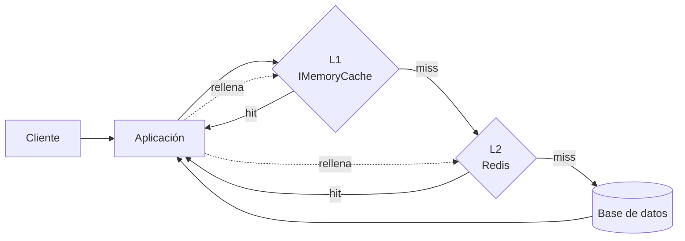

# Fundamentos de caching

> [!abstract] En 30 segundos
> - **Qué es:** guardar una copia de datos caros de obtener en un medio más rápido y cercano.
> - **Para qué:** bajar latencia y proteger la fuente (base de datos, API externa) del exceso de lecturas.
> - **Recuerda:** una caché es una **optimización prescindible**, no una fuente de verdad. Si la vacías, el sistema debe seguir funcionando (más lento). Mide siempre el **hit ratio**.

> [!info] Lección 3.1 · Nivel 3 — Redis como caché
> ⬅️ [[Rate limiting con Redis]] · ➡️ [[Cache-aside]] · 🗺️ [[01 - Redis - Roadmap#Nivel 3 — Redis como caché|Roadmap]] · 📊 [[03 - Redis - Progreso|Progreso]]
> 🏷️ Conceptos generales, válidos con cualquier tecnología.

## 📌 Definición

Una **caché** es una capa de almacenamiento intermedia que sirve copias de datos que son costosos de calcular u obtener. Cuando la copia existe es un **hit**; cuando no, un **miss** y se acude a la fuente.

$$\text{hit ratio} = \frac{\text{hits}}{\text{hits} + \text{misses}}$$

## 🎯 ¿Qué problema resuelve?

- **Latencia:** una consulta SQL de 20 ms frente a una lectura de Redis de 0,5 ms.
- **Carga en la fuente:** la base de datos atiende una fracción de las lecturas.
- **Coste:** menos peticiones a APIs de pago o con cuota.
- **Picos:** absorbe tráfico repetitivo (productos populares, configuración, perfiles).

## 🧠 Conceptos fundamentales

### 1. Latencia efectiva

Con `T_c` = coste de leer de la caché, `T_s` = coste de la fuente y `h` = hit ratio:

$$T = T_c + (1 - h) \cdot T_s$$

| Hit ratio | Con T_c = 1 ms y T_s = 20 ms |
|---|---|
| 50 % | 11 ms |
| 90 % | 3 ms |
| 99 % | 1,2 ms |

Pasar de 90 % a 99 % reduce **10 veces** las lecturas a la base de datos (de 10 % a 1 %): el hit ratio importa más de lo que parece.

### 2. Qué cachear

| Sí | No |
|---|---|
| Lecturas frecuentes y repetidas | Datos que casi nunca se vuelven a pedir |
| Cálculos o consultas caras | Consultas baratas con índice |
| Datos que toleran cierta antigüedad | Datos que exigen consistencia inmediata (saldos, stock final) |
| Resultados idénticos para muchos usuarios | Información sensible sin cifrar ni aislar |

### 3. Capas de caché

| Capa | Ejemplo | Latencia | Compartida |
|---|---|---|---|
| Navegador | `Cache-Control` | 0 | No |
| CDN | Azure Front Door, CloudFront | Decenas de ms | Sí |
| **L1** (en proceso) | `IMemoryCache` | ns-µs | No |
| **L2** (distribuida) | **Redis** | ~0,5-2 ms | Sí |
| Base de datos | Buffer pool | ms | Sí |

### 4. Reglas de oro
1. **La caché nunca es la fuente de verdad** (salvo que la hayas diseñado así, con persistencia: ver [[Persistencia en Redis]]).
2. **Prevé la caché fría:** al reiniciar, desplegar o fallar, la base de datos recibirá todo el tráfico. ¿Lo aguanta? (ver [[Cache avalanche]]).
3. **Toda entrada tiene TTL** y un plan de invalidación.
4. **Mide:** hit ratio, latencia y memoria, por tipo de clave.

### Analogía
Una **nevera** en casa frente al supermercado: guardas lo que consumes a menudo para no ir a la tienda, pero si se estropea sigues pudiendo comer (más despacio).
**Dónde se rompe:** si dejas de poder comer cuando la nevera falla, ya no es una nevera, es tu despensa.

## ⚙️ Funcionamiento interno



- Redis cuenta `keyspace_hits` y `keyspace_misses` para **todo el servidor**, no solo para tu patrón de caché: úsalos como indicador general y mide por tipo de dato en la aplicación.
- La memoria de la caché es finita: cuando se llena entra en juego el desalojo ([[Eviction policies]]).

## 💻 Ejemplos prácticos

```text
127.0.0.1:6379> INFO stats
# Stats
keyspace_hits:182340
keyspace_misses:20211
evicted_keys:0
127.0.0.1:6379> CONFIG RESETSTAT
OK
```

Hit ratio = 182 340 / (182 340 + 20 211) ≈ **90 %**.

## 🔧 Implementación en .NET

```csharp
using StackExchange.Redis;

IServer server = mux.GetServer(mux.GetEndPoints()[0]);
var stats = (await server.InfoAsync("stats"))
    .SelectMany(group => group)
    .ToDictionary(kv => kv.Key, kv => kv.Value);

long hits = long.Parse(stats["keyspace_hits"]);
long misses = long.Parse(stats["keyspace_misses"]);
double hitRatio = hits + misses == 0 ? 0 : (double)hits / (hits + misses);
Console.WriteLine($"Hit ratio del servidor: {hitRatio:P1}");
```

Para métricas por tipo de dato, cuenta hits y misses en tu código con `System.Diagnostics.Metrics`:

```csharp
using System.Diagnostics.Metrics;

public sealed class CacheMetrics
{
    private readonly Counter<long> _hits;
    private readonly Counter<long> _misses;

    public CacheMetrics(IMeterFactory factory)
    {
        Meter meter = factory.Create("MiApp.Cache");
        _hits = meter.CreateCounter<long>("cache.hits");
        _misses = meter.CreateCounter<long>("cache.misses");
    }

    public void Hit(string cache) => _hits.Add(1, new KeyValuePair<string, object?>("cache", cache));
    public void Miss(string cache) => _misses.Add(1, new KeyValuePair<string, object?>("cache", cache));
}
```

## 🏗️ Casos de uso en arquitectura

| Caso | Capa |
|---|---|
| Catálogo de productos | L1 + L2 |
| Configuración y feature flags | L1 con invalidación |
| Sesiones | Redis (L2) como almacén principal ([[Sesiones distribuidas con Redis]]) |
| Contenido estático | CDN |
| Resultados de consultas agregadas | L2 con TTL |

### Cuándo NO cachear
- Datos con **escritura intensiva** y lectura rara.
- Cuando la **consistencia fuerte** es obligatoria y no sabes invalidar bien.
- Cuando el problema real es una consulta lenta: arréglala primero (índices, diseño).

### Consideraciones de arquitectura

| Dimensión | Qué pensar |
|---|---|
| Consistencia | ¿Cuánta antigüedad tolera el negocio? |
| Capacidad | ¿Aguanta la fuente una caché fría? |
| Seguridad | Aísla la caché por tenant o usuario si el dato es privado |
| Observabilidad | Hit ratio, evictions, latencia y tamaño por prefijo |

## ⚠️ Errores y anti-patterns

| Error | Por qué duele | Cómo evitarlo |
|---|---|---|
| Cachear todo | Memoria desperdiciada y complejidad | Cachear lo que da hit ratio alto |
| Caché sin TTL ni invalidación | Datos obsoletos para siempre | TTL siempre |
| Depender de la caché para funcionar | Si cae, cae el sistema | Diseñar para caché fría |
| No medir | No sabes si ayuda | Métricas por tipo de dato |
| Claves sin aislamiento por usuario | Fuga de datos entre usuarios | Incluir el tenant o usuario en la clave |

## ✅ Buenas prácticas

1. Decide con datos: perfila primero y cachea lo que más duele.
2. TTL en toda entrada; invalidación pensada desde el diseño.
3. Prueba el sistema con la caché vacía.
4. Mide hit ratio y latencia por tipo de dato.
5. Una caché con eviction es una instancia distinta de una con datos que no se pueden perder.

## 🎤 Preguntas de entrevista

> [!question]- 1. ¿Cómo decides si algo merece cachearse?
> Por su frecuencia de lectura, coste de obtención, tolerancia a datos obsoletos y número de usuarios que comparten el resultado. Con un hit ratio previsto alto y un coste de la fuente significativo, compensa.

> [!question]- 2. ¿Por qué un hit ratio del 99 % es mucho mejor que el 90 %?
> Porque lo que importa es la fracción de misses: del 10 % al 1 %, la fuente recibe 10 veces menos lecturas.

> [!question]- 3. ¿Qué pasa si se vacía la caché en producción?
> Todo el tráfico va a la fuente. Si no está dimensionada para ello, se satura: es el escenario de la *cache avalanche*.

## 🧪 Ejercicios

### 🟢 Básicos
1. Calcula el hit ratio de tu Redis local con `INFO stats` tras hacer varias lecturas existentes y no existentes.

### 🟡 Intermedios
2. Para una consulta de 30 ms con T_c = 1 ms, calcula la latencia efectiva con h = 80 %, 95 % y 99 %.

### 🔴 Reto Senior
3. Un endpoint recibe 2 000 req/s, la base de datos soporta 300 consultas/s y la caché tiene un hit ratio del 92 %. ¿Se cae al vaciar la caché? ¿Qué hit ratio mínimo necesitas?

> [!success]- Soluciones
> **3.** Con 92 %: 160 consultas/s a la base de datos, bien. Con caché fría: 2 000/s frente a 300 → se satura. Hit ratio mínimo en régimen normal: 1 − 300/2 000 = 85 %, sin margen. Con margen de seguridad del 30 % necesitas un 90 % o más y un plan de caché fría (precalentamiento, limitación de tasa, protección).

### ✔️ Checklist de dominio
- [ ] Calculo la latencia efectiva con el hit ratio.
- [ ] Decido qué cachear y qué no.
- [ ] Diseño para caché fría.

## 📝 Resumen

- La caché es una copia rápida y prescindible de datos caros.
- El hit ratio define el beneficio; mídelo por tipo de dato.
- TTL e invalidación desde el diseño; capas L1/L2.
- Prevé siempre la caché fría.

## 🔗 Referencias

- [Caching en Redis](https://redis.io/solutions/caching/)
- [Caching en ASP.NET Core](https://learn.microsoft.com/aspnet/core/performance/caching/overview)

## 🔄 Notas relacionadas

- ⬅️ [[Rate limiting con Redis]] · ➡️ [[Cache-aside]]
- Relacionadas: [[Redis como almacenamiento en memoria]] · [[Eviction policies]] · [[Distributed caching]] · [[Proyecto 03 - Caché de productos]]
