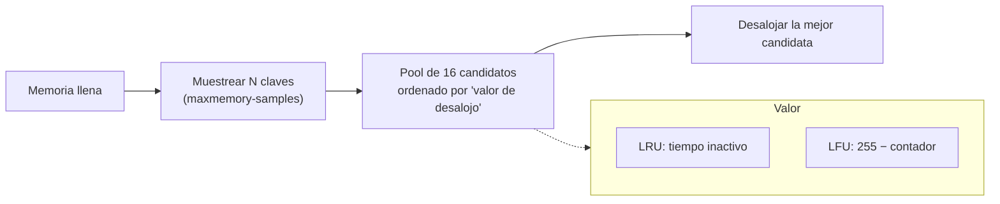

# LRU y LFU en Redis

> [!abstract] En 30 segundos
> - **LRU** (*least recently used*) desaloja lo que lleva más tiempo sin usarse; **LFU** (*least frequently used*) lo que se usa menos veces.
> - En Redis ambos son **aproximados**: muestrean unas pocas claves en lugar de ordenar todo el keyspace.
> - **Recuerda:** LFU resiste mejor un recorrido masivo (*scan*) que «contamina» la caché y protege a las claves realmente populares; LRU es un buen valor por defecto.

> [!info] Lección 3.10 · Nivel 3 — Redis como caché
> ⬅️ [[Eviction policies]] · ➡️ [[Cache stampede]] · 🗺️ [[01 - Redis - Roadmap#Nivel 3 — Redis como caché|Roadmap]] · 📊 [[03 - Redis - Progreso|Progreso]]
> 🏷️ Core · LFU ≥4.0.

## 📌 Definición

| | LRU | LFU |
|---|---|---|
| Criterio | **Cuándo** se usó por última vez | **Cuánto** se usa |
| Información por clave | Reloj de 24 bits (resolución de segundos) | 24 bits: 16 de «último decremento» + 8 de contador logarítmico |
| Comando de inspección | `OBJECT IDLETIME clave` | `OBJECT FREQ clave` |
| Política | `allkeys-lru` / `volatile-lru` | `allkeys-lfu` / `volatile-lfu` |

`OBJECT FREQ` solo funciona con una política LFU activa y `OBJECT IDLETIME` solo con una que no sea LFU.

## 🎯 ¿Qué problema resuelve?

Un LRU exacto necesitaría una lista enlazada con todas las claves y actualizarla en cada acceso: memoria y CPU que Redis no quiere gastar. Con aproximaciones por muestreo obtiene resultados casi iguales con coste mínimo. Y LFU resuelve el punto débil de LRU: **un recorrido único de millones de claves** (un informe, un *crawler*) las convierte en «recientes» y expulsa las realmente populares.

## 🧠 Conceptos fundamentales

### LRU aproximado
1. Cada objeto guarda su último instante de acceso.
2. Al necesitar memoria, Redis **muestrea `maxmemory-samples` claves** (5 por defecto, hasta 64) y desaloja la más antigua del muestreo (con un *pool* de candidatos que mejora la elección).
3. Con 10 muestras se aproxima mucho al LRU real; con 3 es más rápido y menos preciso.

### LFU aproximado
1. Cada clave tiene un contador de **8 bits** (máximo 255) con **incremento probabilístico logarítmico**: con un contador `c`, la probabilidad de incrementarlo en un acceso es `1 / (c × lfu-log-factor + 1)`.
2. Las claves nuevas empiezan en **5**, para darles una oportunidad de acumular accesos.
3. **Decaimiento:** el contador baja una unidad por cada `lfu-decay-time` minutos sin accesos (1 por defecto; 0 = nunca decae).
4. `lfu-log-factor` (10 por defecto) controla la saturación del contador:

| factor | 100 accesos | 1 000 | 100 K | 1 M | 10 M |
|---|---|---|---|---|---|
| 0 | 104 | 255 | 255 | 255 | 255 |
| 1 | 18 | 49 | 255 | 255 | 255 |
| 10 | 10 | 18 | 142 | 255 | 255 |
| 100 | 8 | 11 | 49 | 143 | 255 |

(Valores de referencia del fichero `redis.conf`, obtenidos con `redis-benchmark -n 1000000 incr foo` y `OBJECT FREQ foo`.)

### ¿Cuál elegir?

| Patrón de acceso | Política |
|---|---|
| Acceso reciente ≈ acceso futuro (sesiones, trabajo activo) | `allkeys-lru` |
| Popularidad estable, pocos elementos muy accedidos (catálogo, *top* de contenido) | `allkeys-lfu` |
| Recorridos masivos ocasionales | `allkeys-lfu` |
| No lo sabes | Empieza con `allkeys-lru`; mide hit ratio y prueba LFU |

### Analogía
LRU es **«saca de la nevera lo que no has tocado en más tiempo»**; LFU, **«lo que casi nunca comes»**. Si un día invitas a 200 personas (recorrido masivo), LRU pensará que todo lo de ese día es importante; LFU recordará qué comes de verdad.
**Dónde se rompe:** LFU tarda en reaccionar si tus gustos cambian de repente (por eso el decaimiento).

## ⚙️ Funcionamiento interno



- Un acceso actualiza la marca de LRU o el contador de LFU, no hay estructuras globales ordenadas.
- La precisión depende de la muestra: más muestras, más CPU.

## 💻 Ejemplos prácticos

```text
127.0.0.1:6379> CONFIG SET maxmemory-policy allkeys-lfu
OK
127.0.0.1:6379> SET producto:42 x
OK
127.0.0.1:6379> OBJECT FREQ producto:42
(integer) 5
127.0.0.1:6379> GET producto:42      # …repite muchas veces
127.0.0.1:6379> OBJECT FREQ producto:42
(integer) 12

127.0.0.1:6379> CONFIG SET maxmemory-policy allkeys-lru
OK
127.0.0.1:6379> OBJECT IDLETIME producto:42
(integer) 3
```

Experimento: limita la memoria a 50 MB y compara hit ratio y desalojos.

```bash
redis-cli CONFIG SET maxmemory 50mb
redis-cli CONFIG SET maxmemory-policy allkeys-lru
# carga con distribución sesgada (p. ej. con un script o NBomber) y anota hit ratio y evicted_keys
redis-cli CONFIG SET maxmemory-policy allkeys-lfu
redis-cli CONFIG RESETSTAT
# repite la carga y compara
```

## 🔧 Implementación en .NET

```csharp
using StackExchange.Redis;

IServer server = mux.GetServer(mux.GetEndPoints()[0]);
IDatabase db = mux.GetDatabase();

await server.ConfigSetAsync("maxmemory-policy", "allkeys-lfu");
await server.ConfigSetAsync("lfu-log-factor", "10");
await server.ConfigSetAsync("lfu-decay-time", "1");

// Inspeccionar la frecuencia de una clave (solo con política LFU)
RedisResult freq = await db.ExecuteAsync("OBJECT", "FREQ", "producto:42");
Console.WriteLine($"Frecuencia aproximada: {(int)freq}");

// Con LRU: tiempo inactivo (TimeSpan?)
TimeSpan? idle = await db.KeyIdleTimeAsync("producto:42");
```

> [!note]
> `KeyIdleTime` usa `OBJECT IDLETIME` y devolverá un error si la política activa es LFU. Cambia la política antes de inspeccionar.

## 🏗️ Casos de uso en arquitectura

| Caso | Política |
|---|---|
| Catálogo con 5 % de productos que reciben el 80 % del tráfico | `allkeys-lfu` |
| Caché de sesiones/usuarios activos | `allkeys-lru` |
| Caché que sufre *scans* o crawlers | `allkeys-lfu` |

### Cuándo NO importa
- Si el conjunto de trabajo cabe en memoria, no hay desalojo y la política es irrelevante: dimensiona antes de optimizar el algoritmo.

### Consideraciones de arquitectura

| Dimensión | Qué pensar |
|---|---|
| Medir | Hit ratio y `evicted_keys` bajo carga realista, no con datos sintéticos uniformes |
| CPU | Más `maxmemory-samples` = más CPU por desalojo |
| Cambio de política | En caliente con `CONFIG SET`, pero los contadores LFU de claves antiguas no existían bajo LRU: deja que se estabilice |

## ⚠️ Errores y anti-patterns

| Error | Por qué duele | Cómo evitarlo |
|---|---|---|
| Elegir sin medir | Hit ratio peor del posible | Experimentar con tráfico real |
| `maxmemory-samples` muy alto | CPU en picos de escritura | Mantener 5-10 |
| Usar `OBJECT FREQ` sin política LFU | Error | Activar LFU antes |
| Esperar un LRU perfecto | Es aproximado | Entender la tolerancia |
| Cambiar de política en pico de tráfico | Comportamiento imprevisible | Hacerlo en ventana controlada |

## ✅ Buenas prácticas

1. Empieza por `allkeys-lru`; prueba `allkeys-lfu` si la popularidad es sesgada y estable.
2. Compara con la misma carga y `CONFIG RESETSTAT`.
3. Deja `lfu-log-factor` y `lfu-decay-time` por defecto salvo que midas una mejora.
4. Dimensiona primero la memoria.

## 🎤 Preguntas de entrevista

> [!question]- 1. ¿Por qué Redis usa LRU aproximado?
> Un LRU exacto necesita una estructura ordenada global y actualizarla en cada acceso: memoria y CPU. Con muestreo se obtiene casi el mismo resultado con un coste mínimo.

> [!question]- 2. ¿Qué ventaja tiene LFU frente a LRU?
> Es más resistente a recorridos masivos que «ensucian» la caché con claves de un solo uso, porque cuenta la frecuencia en lugar de la recencia; protege a las claves realmente populares.

> [!question]- 3. ¿Cómo funciona el contador LFU?
> Es de 8 bits, con incremento probabilístico logarítmico (cada vez más difícil de incrementar) y decaimiento por inactividad; las claves nuevas parten de 5.

## 🧪 Ejercicios

### 🟢 Básicos
1. Activa LFU, haz 1 000 `GET` sobre una clave y observa `OBJECT FREQ`.

### 🟡 Intermedios
2. Con `maxmemory 50mb`, compara hit ratio y `evicted_keys` entre `allkeys-lru` y `allkeys-lfu` con una carga zipfiana (pocos elementos muy populares).

### 🔴 Reto Senior
3. Una caché con LRU pierde su hit ratio cada noche durante un informe que lee 5 millones de claves una vez. Explica por qué y propón la solución.

> [!success]- Soluciones
> **3.** El informe «refresca» la recencia de millones de claves de un solo uso y el LRU desaloja las populares. Soluciones: `allkeys-lfu`, ejecutar el informe contra una réplica o instancia distinta, o evitar cachear esas lecturas.

### ✔️ Checklist de dominio
- [ ] Explico LRU y LFU aproximados.
- [ ] Elijo según el patrón de acceso.
- [ ] Mido el efecto con `evicted_keys` y el hit ratio.

## 📝 Resumen

- LRU = recencia; LFU = frecuencia. Ambos aproximados por muestreo.
- `maxmemory-samples` ajusta precisión/CPU; `lfu-log-factor` y `lfu-decay-time`, el contador.
- LFU resiste recorridos masivos; LRU es un buen punto de partida.
- Elige con medidas.

## 🔗 Referencias

- [Key eviction (LRU/LFU)](https://redis.io/docs/latest/develop/reference/eviction/)
- [OBJECT FREQ](https://redis.io/docs/latest/commands/object-freq/)

## 🔄 Notas relacionadas

- ⬅️ [[Eviction policies]] · ➡️ [[Cache stampede]]
- Relacionadas: [[Gestión de memoria en Redis]] · [[Fundamentos de caching]] · [[Redis INFO]]
