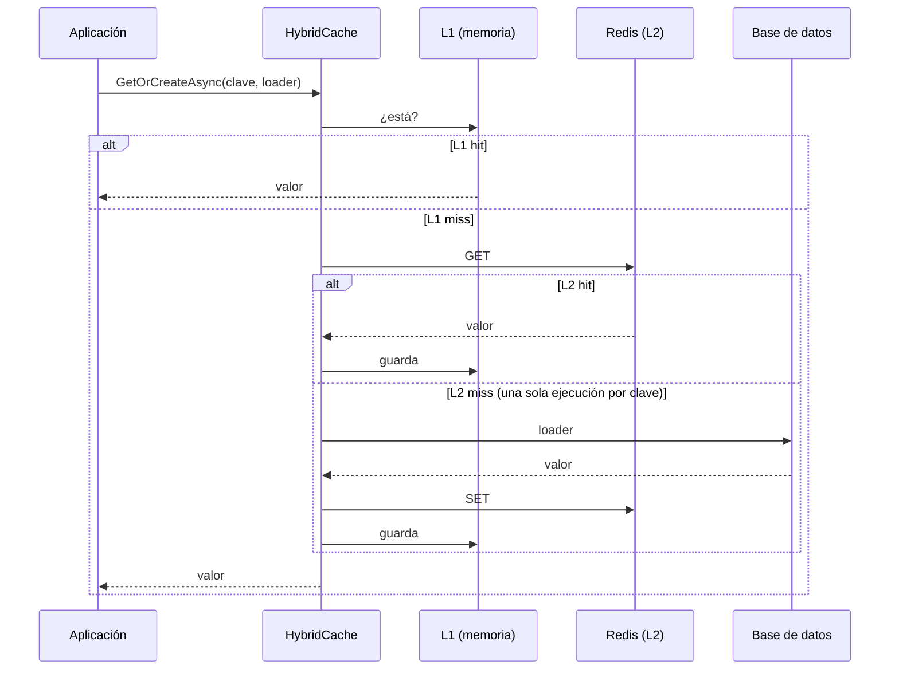

# Read-through

> [!abstract] En 30 segundos
> - **Qué es:** la aplicación pide a la **capa de caché** y esta, si no tiene el dato, lo carga de la fuente por su cuenta con un *loader*.
> - **Para qué:** quitar la lógica «mira en caché → carga → guarda» del código de negocio y centralizarla (con protección contra stampede incluida).
> - **Recuerda:** **Redis no lo hace solo**: la capa read-through es una librería de tu lado (`HybridCache`, FusionCache…). Es cache-aside con un envoltorio.

> [!info] Lección 3.3 · Nivel 3 — Redis como caché
> ⬅️ [[Cache-aside]] · ➡️ [[Write-through]] · 🗺️ [[01 - Redis - Roadmap#Nivel 3 — Redis como caché|Roadmap]] · 📊 [[03 - Redis - Progreso|Progreso]]
> 🏷️ `HybridCache` requiere .NET 9+ (paquete `Microsoft.Extensions.Caching.Hybrid`).

## 📌 Definición

En **read-through** el consumidor nunca habla directamente con la fuente: solo con la caché. La caché conoce una función de carga (`loader`) y, ante un *miss*, la invoca, guarda el resultado y lo devuelve. Visto desde fuera es una única llamada: `GetOrCreate(key, loader)`.

## 🎯 ¿Qué problema resuelve?

Con cache-aside, cada servicio repite el mismo código «get → miss → load → set» y cada uno se equivoca a su manera (sin TTL, sin protección frente a stampede, con serialización distinta). Un read-through lo centraliza: un solo punto donde se implementan TTL, serialización, métricas y protección de cargas concurrentes.

## 🧠 Conceptos fundamentales

| | Cache-aside | Read-through |
|---|---|---|
| ¿Quién carga de la fuente? | La aplicación | La capa de caché con un loader |
| Código de negocio | Repetido | Una llamada |
| Protección frente a stampede | La implementas tú | Suele venir incluida |
| Acoplamiento | Bajo | La capa debe conocer el loader |

1. **Dónde vive la lógica:** en Redis OSS no hay un *loader* en el servidor; la «caché» es una librería cliente. (Productos de datos como Redis Data Integration sincronizan bases de datos con Redis, un enfoque distinto).
2. **`HybridCache` (.NET 9+):** combina L1 en memoria + L2 distribuida (Redis mediante `IDistributedCache`), con **protección contra stampede** (las peticiones concurrentes por la misma clave comparten una sola ejecución del loader), serialización configurable y **tags** para invalidación.
3. **Invalidación:** sigue siendo tu responsabilidad (`RemoveAsync`, `RemoveByTagAsync`).

### Analogía
Un **camarero** que va a la cocina cuando falta un plato: el cliente solo pide, no sabe de dónde sale.
**Dónde se rompe:** si dos clientes piden el mismo plato nuevo, el buen camarero cocina uno solo y sirve a ambos.

## ⚙️ Funcionamiento interno



## 💻 Ejemplos prácticos

Con Redis puro no hay un equivalente de un comando; el «read-through» es un patrón de la aplicación. Lo que sí ves en Redis son las claves que `HybridCache` crea en L2:

```text
127.0.0.1:6379> KEYS shop:product:*      # solo en laboratorio; en producción usa SCAN
1) "shop:product:42"
127.0.0.1:6379> TTL shop:product:42
(integer) 548
```

## 🔧 Implementación en .NET

```csharp
// Program.cs  — paquetes: Microsoft.Extensions.Caching.StackExchangeRedis y Microsoft.Extensions.Caching.Hybrid
builder.Services.AddStackExchangeRedisCache(o => o.Configuration = "localhost:6379");

builder.Services.AddHybridCache(options =>
{
    options.DefaultEntryOptions = new HybridCacheEntryOptions
    {
        Expiration = TimeSpan.FromMinutes(10),            // L2 (Redis)
        LocalCacheExpiration = TimeSpan.FromMinutes(2)    // L1 (memoria)
    };
});
```

```csharp
using Microsoft.Extensions.Caching.Hybrid;

public record Product(int Id, string Name, decimal Price);

public interface IProductRepository
{
    Task<Product?> FindAsync(int id, CancellationToken ct);
}

public class ProductService(HybridCache cache, IProductRepository repo)
{
    public ValueTask<Product?> GetAsync(int id, CancellationToken ct = default) =>
        cache.GetOrCreateAsync(
            $"shop:product:{id}",
            async token => await repo.FindAsync(id, token),
            tags: ["products", $"product:{id}"],
            cancellationToken: ct);

    public ValueTask InvalidateAsync(int id, CancellationToken ct = default) =>
        cache.RemoveAsync($"shop:product:{id}", ct);

    public ValueTask InvalidateAllProductsAsync(CancellationToken ct = default) =>
        cache.RemoveByTagAsync("products", ct);
}
```

> [!info] Más detalle
> La configuración completa (serializadores, tamaño máximo, invalidación entre instancias) está en [[HybridCache]]. Aquí lo importante es el **patrón**.

## 🏗️ Casos de uso en arquitectura

| Caso | Por qué read-through |
|---|---|
| Muchos servicios cachean lo mismo con código distinto | Una sola implementación |
| Endpoints con alto riesgo de stampede | Protección incluida |
| Equipos con distintos niveles de experiencia | Menos errores por copiar y pegar |

### Cuándo NO usarlo
- Cargas muy distintas por clave que requieren lógica de caché específica.
- Si necesitas control fino del formato de las claves y los TTL por tipo: puede ser más claro un cache-aside explícito.

### Consideraciones de arquitectura

| Dimensión | Qué pensar |
|---|---|
| Acoplamiento | El loader es parte de la llamada: usa funciones puras, sin estado |
| Observabilidad | Mide misses por clave/tag, no solo por total |
| Consistencia | Misma que cache-aside; invalida con tags o claves |

## ⚠️ Errores y anti-patterns

| Error | Por qué duele | Cómo evitarlo |
|---|---|---|
| Loader con efectos secundarios | Se ejecuta de forma impredecible | Loaders puros y de solo lectura |
| Capturar objetos con estado en el lambda | Resultados incorrectos entre peticiones | Pasar el estado explícito (`GetOrCreateAsync<TState,T>`) |
| Cachear errores o `null` sin TTL corto | Fallos persistentes | Excepciones no se cachean; `null` con TTL bajo o caché negativa |
| Creer que Redis hace read-through solo | Código que no existe | Usa una librería o implementa el patrón |

## ✅ Buenas prácticas

1. Un único punto de acceso a la caché por tipo de dato.
2. Tags coherentes para invalidar grupos.
3. TTL de L1 más corto que el de L2.
4. Loaders idempotentes y con timeout.

## 🎤 Preguntas de entrevista

> [!question]- 1. ¿Diferencia entre cache-aside y read-through?
> En cache-aside la aplicación orquesta la lectura y carga. En read-through se delega en la capa de caché, que ejecuta el loader. En la práctica, es el mismo flujo encapsulado en una librería.

> [!question]- 2. ¿Redis implementa read-through?
> No. Redis es un almacén; el patrón se implementa en el cliente (HybridCache, FusionCache) o con un servicio intermedio.

## 🧪 Ejercicios

### 🟢 Básicos
1. Sustituye tu cache-aside manual por `HybridCache.GetOrCreateAsync` y comprueba que la lógica de negocio se simplifica.

### 🟡 Intermedios
2. Lanza 100 peticiones concurrentes por la misma clave con una BD simulada y cuenta cuántas veces se ejecuta el loader.

### 🔴 Reto Senior
3. Elige entre cache-aside manual y `HybridCache` para un servicio con 30 tipos de dato cacheados y 4 equipos. Justifica.

> [!success]- Soluciones
> **3.** `HybridCache` como estándar corporativo: una sola implementación de TTL, serialización, stampede y métricas; tags por tipo de dato. Cache-aside manual solo para casos específicos (claves con lógica de versión propia, estructuras Redis nativas como hashes o sorted sets).

### ✔️ Checklist de dominio
- [ ] Distingo cache-aside y read-through.
- [ ] Uso `GetOrCreateAsync` con tags.
- [ ] Sé qué no resuelve (invalidación y consistencia).

## 📝 Resumen

- Read-through = la capa de caché ejecuta el loader.
- Redis no lo hace por sí solo: lo aporta una librería (HybridCache).
- Centraliza TTL, serialización y stampede; la invalidación sigue siendo tuya.

## 🔗 Referencias

- [HybridCache en ASP.NET Core](https://learn.microsoft.com/aspnet/core/performance/caching/hybrid)
- [Read-through (Redis glossary)](https://redis.io/docs/latest/develop/use-cases/)

## 🔄 Notas relacionadas

- ⬅️ [[Cache-aside]] · ➡️ [[Write-through]]
- Relacionadas: [[HybridCache]] · [[IDistributedCache]] · [[Cache stampede]]
