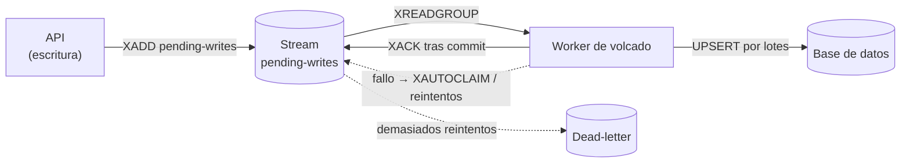

# Write-behind

> [!abstract] En 30 segundos
> - **Qué es:** la aplicación escribe **solo en Redis** y confirma; un proceso en segundo plano vuelca los cambios a la base de datos **más tarde, por lotes**.
> - **Para qué:** absorber ráfagas de escritura y bajar la latencia de escritura.
> - **Recuerda:** Redis pasa a ser **el único sitio donde vive el dato durante un tiempo**. Si Redis falla antes del volcado, **pierdes datos**. Necesitas persistencia (AOF), idempotencia y monitorización del retraso.

> [!info] Lección 3.5 · Nivel 3 — Redis como caché
> ⬅️ [[Write-through]] · ➡️ [[Estrategias de TTL en caché]] · 🗺️ [[01 - Redis - Roadmap#Nivel 3 — Redis como caché|Roadmap]] · 📊 [[03 - Redis - Progreso|Progreso]]
> 🏷️ Patrón de aplicación (Streams ≥5.0), implementable con Redis Open Source. Las ofertas comerciales de Redis (Redis Data Integration) cubren la sincronización con bases de datos: comprueba qué modos soportan antes de construir el tuyo.

## 📌 Definición

En **write-behind** (o *write-back*) la escritura se confirma en cuanto llega a Redis. Los cambios se acumulan en una estructura de cola (un **Stream** o una **List**) y un *worker* los aplica a la base de datos de forma asíncrona, normalmente agrupados.

## 🎯 ¿Qué problema resuelve?

- La base de datos no aguanta el ritmo de escrituras (contadores, telemetría, *likes*, posiciones GPS).
- Muchas escrituras sobre la misma entidad se pueden **fusionar** (solo importa el último valor).
- Quieres desacoplar la latencia del usuario de la latencia de la base de datos.

## 🧠 Conceptos fundamentales

1. **Cola duradera:** usa un **Stream con consumer group** (con confirmación y reintentos), no una lista simple si no puedes perder mensajes.
2. **Volcado por lotes:** el worker lee N entradas, hace un `UPSERT`/`MERGE` por lotes y **confirma (`XACK`)** solo tras el *commit* en la BD.
3. **Idempotencia:** el volcado puede repetirse (fallo tras el commit y antes del `XACK`); las operaciones deben ser idempotentes (por id de evento o por versión).
4. **Orden:** si importa el orden por entidad, asegúrate de que las entradas de una misma clave se procesan en secuencia (una partición por clave, o fusiona por clave).
5. **Durabilidad:** con `appendonly yes` y `appendfsync everysec`, una caída puede perder hasta ~1 s de escrituras; con `always` pierdes menos y rindes menos ([[Persistencia AOF]]).
6. **Retraso (lag):** la métrica clave es cuántos eventos pendientes hay y cuánto tiempo llevan sin volcarse.

### Analogía
Un **camarero que apunta pedidos en una libreta** y los pasa a cocina cada pocos minutos: es rápido para el cliente, pero si pierde la libreta, pierdes los pedidos.
**Dónde se rompe:** si el camarero apunta el mismo pedido dos veces por reintento y cocina lo hace dos veces (falta de idempotencia).

## ⚙️ Funcionamiento interno



- La API responde cuando `XADD` termina; el dato ya es visible para lecturas desde Redis.
- Si el worker cae, las entradas siguen pendientes en el consumer group y otro worker las reclama.

## 💻 Ejemplos prácticos

```text
127.0.0.1:6379> XGROUP CREATE pending-writes flushers $ MKSTREAM
OK
127.0.0.1:6379> XADD pending-writes * entity product:42 stock 11 version 8
"1793664000123-0"
127.0.0.1:6379> XREADGROUP GROUP flushers worker-1 COUNT 100 STREAMS pending-writes >
1) 1) "pending-writes"
   2) 1) 1) "1793664000123-0"
         2) 1) "entity" 2) "product:42" 3) "stock" 4) "11" 5) "version" 6) "8"
127.0.0.1:6379> XACK pending-writes flushers 1793664000123-0
(integer) 1
127.0.0.1:6379> XPENDING pending-writes flushers
```

## 🔧 Implementación en .NET

```csharp
using StackExchange.Redis;

public class WriteBehindFlusher(IDatabase redis, IStockStore store) : BackgroundService
{
    private const string Stream = "pending-writes";
    private const string Group = "flushers";
    private readonly string _consumer = $"worker-{Environment.MachineName}-{Environment.ProcessId}";

    protected override async Task ExecuteAsync(CancellationToken ct)
    {
        try { await redis.StreamCreateConsumerGroupAsync(Stream, Group, "$", createStream: true); }
        catch (RedisServerException ex) when (ex.Message.StartsWith("BUSYGROUP")) { /* ya existe */ }

        while (!ct.IsCancellationRequested)
        {
            // StackExchange.Redis no expone XREADGROUP BLOCK: sondeo con pausa corta
            StreamEntry[] entries = await redis.StreamReadGroupAsync(Stream, Group, _consumer, ">", count: 200);
            if (entries.Length == 0) { await Task.Delay(200, ct); continue; }

            // Fusionar: solo importa la última versión de cada entidad
            var latest = entries
                .Select(e => (e.Id, Entity: e["entity"].ToString(), Stock: (int)e["stock"], Version: (long)e["version"]))
                .GroupBy(x => x.Entity)
                .Select(g => g.OrderBy(x => x.Version).Last());

            await store.UpsertStockBatchAsync(latest.Select(x => (x.Entity, x.Stock, x.Version)), ct);

            // Confirmar solo tras el commit en la BD
            await redis.StreamAcknowledgeAsync(Stream, Group, entries.Select(e => e.Id).ToArray());
        }
    }
}

public interface IStockStore
{
    // UPSERT idempotente: aplica solo si la versión recibida es mayor que la guardada
    Task UpsertStockBatchAsync(IEnumerable<(string Entity, int Stock, long Version)> batch, CancellationToken ct);
}
```

Escritura desde la API:

```csharp
await db.StreamAddAsync("pending-writes", new NameValueEntry[]
{
    new("entity", "product:42"), new("stock", 11), new("version", 8)
});
await db.HashSetAsync("shop:product:42", "stock", 11);   // el dato ya es visible desde Redis
```

## 🏗️ Casos de uso en arquitectura

| Caso | Por qué write-behind |
|---|---|
| Contadores de visitas o *likes* | Fusión de miles de escrituras en una |
| Telemetría y métricas | Ráfagas altas, pérdida mínima tolerable |
| Posiciones o estados que cambian continuamente | Solo importa el último valor |

### Cuándo NO usarlo
- Datos financieros o críticos donde **no puedes perder** ni un cambio: escribe en la BD (o usa una cola con garantías fuertes y outbox).
- Si no puedes garantizar idempotencia en el volcado.
- Cuando necesitas consultar en la BD lo recién escrito de inmediato.

### Consideraciones de arquitectura

| Dimensión | Qué pensar |
|---|---|
| Durabilidad | AOF; `appendfsync` según la pérdida tolerable; réplicas |
| Consistencia | La BD va **por detrás**; lecturas desde Redis o aceptar el retraso |
| Operación | Alertas por retraso del stream y por mensajes pendientes antiguos |
| Fallos | Dead-letter para entradas que fallan siempre |

## ⚠️ Errores y anti-patterns

| Error | Por qué duele | Cómo evitarlo |
|---|---|---|
| Sin persistencia en Redis | Un reinicio pierde todo lo pendiente | AOF + réplica |
| `XACK` antes del commit | Pérdida si el worker cae | Confirmar tras confirmar la BD |
| Volcado no idempotente | Duplicados en reintentos | `UPSERT` con versión o id de evento |
| Stream sin límite | Memoria sin control | `MAXLEN`/`MINID` y alertas de retraso |
| Usar `LPOP` en una lista | Pierdes el mensaje si el worker cae | Streams con consumer group |

## ✅ Buenas prácticas

1. Stream con consumer group, `XACK` tras el commit.
2. Fusiona por clave para reducir escrituras.
3. Idempotencia por versión o id.
4. Monitoriza el retraso y los pendientes (`XPENDING`, `XLEN`).
5. Documenta la pérdida máxima aceptada (RPO).

## 🎤 Preguntas de entrevista

> [!question]- 1. ¿Qué riesgo introduce write-behind?
> Durante el retraso, Redis es la única copia del dato. Si Redis falla (o se pierde un `fsync`), se pierden escrituras no volcadas. Se mitiga con AOF, réplicas y aceptando un RPO explícito.

> [!question]- 2. ¿Por qué usar Streams y no una lista?
> Con una lista, `LPOP`/`BRPOP` quita el mensaje: si el worker cae antes de procesarlo, se pierde. Un Stream con consumer group mantiene los pendientes hasta el `XACK` y permite reclamarlos.

## 🧪 Ejercicios

### 🟢 Básicos
1. Haz 1 000 `XADD`, lee con un grupo y confirma; observa `XPENDING` antes y después.

### 🟡 Intermedios
2. Implementa el worker con fusión por entidad y comprueba que 1 000 escrituras sobre 10 entidades producen 10 `UPSERT`.

### 🔴 Reto Senior
3. Mata el worker a mitad de un lote y reinícialo. ¿Qué ocurre con las entradas pendientes? ¿Cómo garantizas que no se duplican en la BD?

> [!success]- Soluciones
> **3.** Las entradas no confirmadas quedan pendientes y las reclama otro consumidor (`XAUTOCLAIM`) o el mismo tras reiniciar. Para evitar duplicados, el `UPSERT` se condiciona a la versión (`WHERE version < @v`) o al id del evento, de modo que reprocesar el mismo lote no cambia el resultado.

### ✔️ Checklist de dominio
- [ ] Explico el riesgo y los requisitos de write-behind.
- [ ] Implemento un volcado idempotente con consumer group.
- [ ] Defino el RPO y las alertas.

## 📝 Resumen

- Escribir en Redis, volcar a la BD después y por lotes.
- Ganas rendimiento; asumes riesgo de pérdida y complejidad.
- Streams + consumer group + idempotencia + AOF.
- Monitoriza el retraso del volcado.

## 🔗 Referencias

- [Redis Streams](https://redis.io/docs/latest/develop/data-types/streams/)
- [Redis Data Integration](https://redis.io/docs/latest/integrate/redis-data-integration/)

## 🔄 Notas relacionadas

- ⬅️ [[Write-through]] · ➡️ [[Estrategias de TTL en caché]]
- Relacionadas: [[Redis Streams]] · [[Consumer Groups en Redis Streams]] · [[Persistencia AOF]] · [[Background jobs con Redis]]
