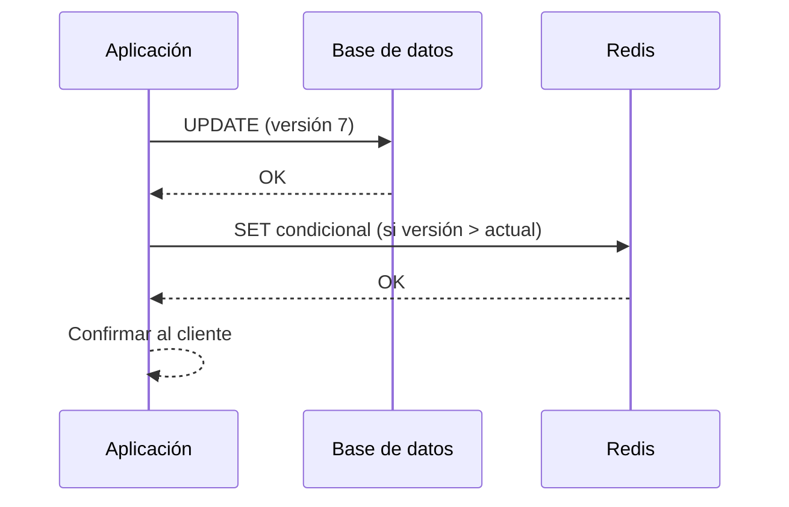

# Write-through

> [!abstract] En 30 segundos
> - **Qué es:** cada escritura va **a la caché y a la fuente en la misma operación**, antes de confirmar al cliente.
> - **Para qué:** que la caché esté siempre al día para los datos que se escriben y se leen enseguida.
> - **Recuerda:** duplicas escrituras (más latencia y más fallos posibles) y **dos escritores concurrentes pueden dejar la caché con un valor antiguo** si no versionas.

> [!info] Lección 3.4 · Nivel 3 — Redis como caché
> ⬅️ [[Read-through]] · ➡️ [[Write-behind]] · 🗺️ [[01 - Redis - Roadmap#Nivel 3 — Redis como caché|Roadmap]] · 📊 [[03 - Redis - Progreso|Progreso]]
> 🏷️ Patrón de aplicación, válido con cualquier edición.

## 📌 Definición

En **write-through**, la aplicación (o la capa de caché) escribe el dato en la caché y en la fuente de forma síncrona; la operación solo termina cuando ambas confirman. Combinado con read-through, la caché siempre contiene la última versión de lo escrito.

## 🎯 ¿Qué problema resuelve?

En cache-aside, tras una escritura la caché se invalida y el siguiente lector paga el *miss*. Si lo escrito se va a leer enseguida (perfil recién editado, estado de pedido), write-through evita ese miss y esa ventana de datos antiguos.

## 🧠 Conceptos fundamentales

1. **Orden de escritura:** lo habitual es escribir primero en la **fuente de verdad** y luego en la caché; si falla lo segundo, el TTL acota el daño.
2. **Fallos parciales:** si la fuente escribe y la caché falla, hay obsolescencia hasta el TTL (o invalida la clave); si la caché escribe y la fuente falla, tienes un dato fantasma en la caché (otra razón para escribir primero en la fuente).
3. **Carrera entre escritores:** A escribe v1 en la BD, B escribe v2 en la BD y la caché, A escribe v1 en la caché → la caché queda con el valor antiguo. Solución: **versión monotónica** y `SET` condicional.
4. **Coste:** latencia de escritura = fuente + caché; y se cachean datos que quizá nunca se lean.
5. **Cuándo encaja:** pocas escrituras, lecturas inmediatas, necesidad de baja obsolescencia.

### Analogía
Un **libro de contabilidad con copia al carbón**: cada apunte se anota a la vez en el original y en la copia.
**Dónde se rompe:** si se apunta en el original y se rompe el lápiz antes de la copia, las dos versiones divergen.

## ⚙️ Funcionamiento interno



## 💻 Ejemplos prácticos

`SET` condicional por versión en el servidor con Lua (la caché guarda la versión y el dato):

```lua
-- KEYS[1] = clave · ARGV[1] = versión · ARGV[2] = valor · ARGV[3] = TTL (s)
local cur = redis.call('HGET', KEYS[1], 'v')
if cur == false or tonumber(cur) < tonumber(ARGV[1]) then
  redis.call('HSET', KEYS[1], 'v', ARGV[1], 'data', ARGV[2])
  redis.call('EXPIRE', KEYS[1], ARGV[3])
  return 1
end
return 0
```

```text
127.0.0.1:6379> EVAL "…script…" 1 shop:product:42 7 "{\"name\":\"Teclado\"}" 600
(integer) 1
127.0.0.1:6379> EVAL "…script…" 1 shop:product:42 6 "{\"name\":\"viejo\"}" 600
(integer) 0
```

El segundo intento (versión 6 < 7) se rechaza: un escritor lento no puede pisar un valor más nuevo.

## 🔧 Implementación en .NET

```csharp
using System.Text.Json;
using StackExchange.Redis;

public record Product(int Id, string Name, decimal Price, long Version);

public interface IProductRepository
{
    Task UpdateAsync(Product product);   // incrementa la versión en la BD
}

public class WriteThroughProductService(IDatabase redis, IProductRepository repo)
{
    private static readonly LuaScript SetIfNewer = LuaScript.Prepare("""
        local cur = redis.call('HGET', @key, 'v')
        if cur == false or tonumber(cur) < tonumber(@version) then
            redis.call('HSET', @key, 'v', @version, 'data', @data)
            redis.call('EXPIRE', @key, @ttl)
            return 1
        end
        return 0
        """);

    public async Task UpdateAsync(Product product)
    {
        await repo.UpdateAsync(product);   // 1. fuente de verdad primero

        try
        {
            await redis.ScriptEvaluateAsync(SetIfNewer, new
            {
                key = (RedisKey)$"shop:product:{product.Id}",
                version = product.Version,
                data = JsonSerializer.Serialize(product),
                ttl = 600
            });
        }
        catch (RedisException)
        {
            // La BD ya tiene el dato: la caché se corregirá por TTL en la siguiente lectura.
        }
    }
}
```

## 🏗️ Casos de uso en arquitectura

| Caso | Por qué |
|---|---|
| Perfil que el usuario edita y ve al instante | Evitar el miss tras guardar |
| Configuración que se lee en cada petición | Cache siempre caliente |
| Estados de pedido consultados continuamente | Poca obsolescencia |

### Cuándo NO usarlo
- Escrituras muy frecuentes de datos poco leídos: duplicas trabajo sin beneficio.
- Cuando basta con invalidar ([[Cache-aside]]).
- Cuando la latencia de escritura es crítica: considera [[Write-behind]] (con sus riesgos).

### Consideraciones de arquitectura

| Dimensión | Qué pensar |
|---|---|
| Consistencia | Versionado monotónico para evitar pisadas |
| Transacciones | Redis y la BD no comparten transacción: asume fallos parciales |
| Latencia | Suma de ambas escrituras |
| Outbox | Para garantizar la actualización de la caché tras el *commit*, publica un evento ([[Cache consistency]]) |

## ⚠️ Errores y anti-patterns

| Error | Por qué duele | Cómo evitarlo |
|---|---|---|
| Escribir primero en la caché | Datos fantasma si falla la BD | Fuente primero |
| Sin versión | Un escritor lento pisa a uno nuevo | Versión y `SET` condicional |
| Sin TTL | Un fallo parcial deja datos erróneos para siempre | TTL siempre |
| Creer que es atómico | Redis y BD son sistemas distintos | Diseñar para fallos parciales |

## ✅ Buenas prácticas

1. Fuente de verdad primero; caché después.
2. Versión monotónica y escritura condicional.
3. TTL como red de seguridad.
4. Para garantías fuertes, usa eventos/outbox.

## 🎤 Preguntas de entrevista

> [!question]- 1. ¿Cuál es la ventaja y el coste de write-through?
> Ventaja: la caché siempre está al día tras escribir, sin miss posterior. Coste: más latencia de escritura, escrituras duplicadas y riesgo de fallos parciales.

> [!question]- 2. ¿Qué carrera aparece y cómo la resuelves?
> Dos escritores concurrentes pueden dejar el valor antiguo en la caché si sus escrituras llegan desordenadas. Se resuelve con versionado y escritura condicional (script Lua).

## 🧪 Ejercicios

### 🟢 Básicos
1. Implementa el script de escritura condicional y pruébalo con versiones crecientes y decrecientes.

### 🟡 Intermedios
2. Simula en .NET dos escritores concurrentes con latencias distintas y comprueba que, con versionado, la caché siempre termina con la versión más alta.

### 🔴 Reto Senior
3. Diseña un write-through que sobreviva a una caída de Redis entre la escritura en la BD y la de la caché. Compáralo con invalidación basada en eventos (outbox).

> [!success]- Soluciones
> **3.** Con TTL, la caché se corrige sola, pero con ventana de obsolescencia. Con outbox: la misma transacción de la BD guarda un evento «producto actualizado»; un proceso lo publica y un consumidor actualiza o invalida la caché con reintentos. Es *eventualmente consistente* pero sin pérdidas.

### ✔️ Checklist de dominio
- [ ] Explico las ventajas y costes del patrón.
- [ ] Evito la carrera con versionado.
- [ ] Diseño para fallos parciales.

## 📝 Resumen

- Write-through = escribir en fuente y caché de forma síncrona.
- Caché siempre al día, a costa de latencia y complejidad.
- Versionado y TTL para evitar datos antiguos.
- Si basta invalidar, usa cache-aside.

## 🔗 Referencias

- [Caching patterns](https://learn.microsoft.com/azure/architecture/best-practices/caching)
- [EVAL](https://redis.io/docs/latest/commands/eval/)

## 🔄 Notas relacionadas

- ⬅️ [[Read-through]] · ➡️ [[Write-behind]]
- Relacionadas: [[Cache-aside]] · [[Cache consistency]] · [[Lua scripting en Redis]]
