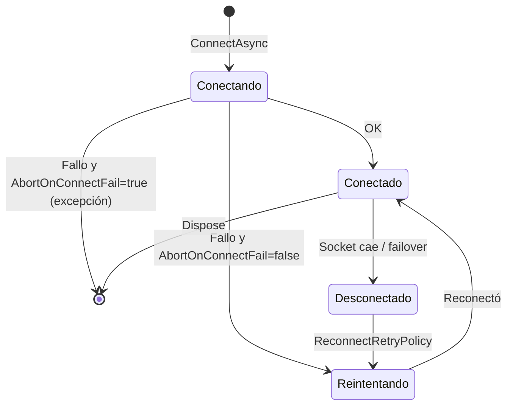

# ConnectionMultiplexer

> [!abstract] En 30 segundos
> - **Qué es:** el objeto central de SE.Redis: gestiona las conexiones, la topología, la reconexión y la multiplexación. **Se crea una vez y se comparte** (singleton).
> - **Para qué:** que miles de peticiones concurrentes viajen por pocas conexiones, con reconexión automática.
> - **Recuerda:** `AbortOnConnectFail=false` en aplicaciones que deben arrancar aunque Redis tarde; **un multiplexer por petición** es el error clásico; y un `RedisTimeoutException` se diagnostica leyendo su mensaje (`qs`, `qu`, `IOCP`, `WORKER`, `POOL`).

> [!info] Lección 4.2 · Nivel 4 — Redis en aplicaciones backend y .NET
> ⬅️ [[StackExchange.Redis]] · ➡️ [[IDatabase y operaciones en StackExchange.Redis]] · 🗺️ [[01 - Redis - Roadmap#Nivel 4 — Redis en aplicaciones backend y .NET|Roadmap]] · 📊 [[03 - Redis - Progreso|Progreso]]
> 🏷️ SE.Redis 3.x. Los valores por defecto proceden de la documentación oficial del cliente; verifícalos en la versión que uses.

## 📌 Definición

`ConnectionMultiplexer` (interfaz `IConnectionMultiplexer`) representa la conexión lógica con tu despliegue de Redis (uno o varios servidores, Sentinel o Cluster). De él obtienes `IDatabase`, `ISubscriber` e `IServer`. Es *thread-safe*, costoso de crear y diseñado para vivir toda la vida del proceso.

## 🎯 ¿Qué problema resuelve?

Abrir una conexión TCP (y TLS) por petición cuesta milisegundos y agota sockets. El multiplexer mantiene conexiones persistentes, detecta caídas, reconecta, redescubre la topología (failover, resharding) y reparte las operaciones.

## 🧠 Conceptos fundamentales

### Opciones principales (`ConfigurationOptions`)

| Opción (cadena) | Por defecto | Qué hace |
|---|---|---|
| `abortConnect` / `AbortOnConnectFail` | `true` (`false` en Azure) | Si es `true`, `Connect` lanza excepción si no logra conectar |
| `connectTimeout` | 5000 ms | Tiempo máximo para conectar |
| `connectRetry` | 3 | Reintentos durante el `Connect` inicial |
| `syncTimeout` | 5000 ms | Tiempo para operaciones síncronas |
| `asyncTimeout` | = `syncTimeout` | Tiempo para operaciones asíncronas |
| `keepAlive` | -1 (≈ 60 s) | Mensajes para mantener vivo el socket |
| `tcpKeepAlive` | `true` | Keep-alive TCP cuando procede |
| `name` / `ClientName` | null | Nombre visible en `CLIENT LIST` |
| `ssl`, `sslHost`, `user`, `password` | — | TLS y autenticación ACL |
| `defaultDatabase` | null | Base de datos por defecto |
| `allowAdmin` | `false` | Habilita comandos de administración |
| `protocol` | RESP3 en 3.x | `Resp2` o `Resp3` |
| `ReconnectRetryPolicy` (solo código) | `ExponentialRetry(ConnectTimeout/2)` | Frecuencia de reconexión |
| `BacklogPolicy` (solo código) | `Default` | Qué pasa con las operaciones durante una desconexión: se encolan o fallan rápido |
| `topologyRefreshSeconds` | 1800 | Relectura periódica de la topología |
| `maintNotifications` | según entorno | Notificaciones de mantenimiento del servidor (3.3+) |

### Ciclo de vida
1. **Crear una vez** (arranque) y registrar como singleton.
2. **Reutilizar** `GetDatabase()` cada vez; es una operación barata.
3. **Cerrar** al apagar la aplicación (`DisposeAsync`).

### Diagnosticar un `RedisTimeoutException`

Ejemplo de mensaje:

```text
Timeout performing GET (5000ms), inst: 2, qu: 0, qs: 6, in: 0,
IOCP: (Busy=6,Free=994,Min=4,Max=1000),
WORKER: (Busy=3,Free=997,Min=4,Max=1000),
POOL: (Threads=8,QueuedItems=0,CompletedItems=42,Timers=10)
```

| Campo | Significado | Qué mirar |
|---|---|---|
| `qu` | Operaciones esperando para **escribirse** | Alto: el cliente no logra enviar (red, CPU, escritor bloqueado) |
| `qs` | Operaciones enviadas **esperando respuesta** | Alto: Redis lento o respuestas grandes retrasando a las demás |
| `in` | Bytes pendientes de leer | Alto: el cliente no lee a tiempo |
| `IOCP` / `WORKER` / `POOL` | Estado del *thread pool* de .NET | `Busy` > `Min` sostenido: *starvation* (a menudo por sync-over-async) |
| `rs`, `ws` | Estado del lector y del escritor | `rs` con `CompletePendingMessage*` repetido: posible «robo de hilo» |

**Causas habituales y comprobaciones**

| Causa | Cómo confirmar | Solución |
|---|---|---|
| Comando lento en el servidor (`KEYS`, `MGET` enorme, Lua largo) | `SLOWLOG GET` | Quitar/trocear el comando |
| Valor enorme que bloquea a los demás | `qs` crece; `--bigkeys` | Dividir el valor; (opcional) pool de multiplexers |
| *Thread pool starvation* | `Busy` > `Min` en el mensaje | Eliminar `.Result`/`.Wait()`; async completo |
| Red o ancho de banda | Latencia con `--latency`, métricas del host | Mover cerca, aumentar ancho de banda |
| CPU alta en cliente o servidor | Métricas de CPU | Escalar o reducir carga |
| Failover en curso | `ConnectionFailed`/`Restored` en el log | Resiliencia ([[Redis con Polly y resiliencia]]) |

> [!tip] Los timeouts se «contagian»
> Con una sola conexión, una respuesta enorme o lenta retrasa a las que van detrás. Es el principal argumento para valores pequeños y para evitar comandos O(N) sobre estructuras grandes ([[Big keys]]).

### Analogía
La **centralita telefónica** de una empresa: una única línea troncal con muchas extensiones. Se instala una vez y se comparte; instalar una centralita por llamada sería absurdo.
**Dónde se rompe:** si una llamada larga ocupa la troncal, las demás esperan y se cortan por tiempo (timeouts).

## ⚙️ Funcionamiento interno



- Durante `Desconectado`, la `BacklogPolicy` decide si las operaciones se encolan hasta reconectar o fallan de inmediato.
- Con Cluster y Sentinel, el multiplexer observa los cambios de topología y reencamina.

## 💻 Ejemplos prácticos

```text
127.0.0.1:6379> CLIENT LIST
id=12 addr=127.0.0.1:50321 name=orders-api-web01 db=0 cmd=get resp=3 ...
127.0.0.1:6379> CLIENT SETNAME probando
OK
```

El `name` identifica a cada aplicación en `CLIENT LIST` y facilita depurar conexiones.

## 🔧 Implementación en .NET

```csharp
using StackExchange.Redis;

public static class RedisConnection
{
    private static readonly Lazy<Task<ConnectionMultiplexer>> Shared = new(ConnectAsync);

    public static Task<ConnectionMultiplexer> GetAsync() => Shared.Value;

    private static async Task<ConnectionMultiplexer> ConnectAsync()
    {
        ConfigurationOptions options = ConfigurationOptions.Parse("localhost:6379");
        options.AbortOnConnectFail = false;          // arrancar aunque Redis aún no responda
        options.ConnectRetry = 5;
        options.ConnectTimeout = 5000;
        options.SyncTimeout = 3000;
        options.AsyncTimeout = 3000;
        options.KeepAlive = 30;
        options.ClientName = $"orders-api-{Environment.MachineName}";
        options.ReconnectRetryPolicy = new ExponentialRetry(deltaBackOffMilliseconds: 5000);

        ConnectionMultiplexer mux = await ConnectionMultiplexer.ConnectAsync(options);

        mux.ConnectionFailed += (_, e) =>
            Console.Error.WriteLine($"Redis desconectado: {e.EndPoint} ({e.FailureType}) {e.Exception?.Message}");
        mux.ConnectionRestored += (_, e) =>
            Console.WriteLine($"Redis reconectado: {e.EndPoint}");
        mux.ErrorMessage += (_, e) =>
            Console.Error.WriteLine($"Error de Redis en {e.EndPoint}: {e.Message}");

        return mux;
    }
}
```

Captura y registra los timeouts con contexto:

```csharp
try
{
    await db.StringGetAsync("clave");
}
catch (RedisTimeoutException ex)
{
    // ex.Message incluye qu/qs/in/IOCP/WORKER/POOL; ex.Commandstatus indica si llegó a enviarse
    logger.LogWarning(ex, "Timeout de Redis");
    throw;
}
```

> [!warning] `Lazy<Task<…>>` y los fallos
> Si `ConnectAsync` lanza una excepción, el `Lazy` guarda la tarea fallida y **nunca reintenta**. Con `AbortOnConnectFail=false` la conexión se devuelve aunque no esté lista y se reintenta sola; si prefieres que falle el arranque, deja el valor por defecto y deja que el orquestador reinicie el proceso.

## 🏗️ Casos de uso en arquitectura

| Escenario | Configuración |
|---|---|
| API web | Singleton, `AbortOnConnectFail=false`, timeouts de 1-3 s |
| Job de arranque (migraciones, carga) | `AbortOnConnectFail=true` para fallar rápido |
| Redis gestionado (Azure) | TLS, `abortConnect=false`, Entra ID o clave |
| Cluster / Sentinel | Lista de endpoints o `serviceName` |

### Cuándo considerar varios multiplexers
- Cargas con valores muy grandes mezclados con operaciones de latencia crítica (una respuesta lenta bloquea las demás en la misma conexión): un *pool* pequeño de multiplexers y elegir el menos cargado. Es una optimización que se mide, no un punto de partida.

### Consideraciones de arquitectura

| Dimensión | Qué pensar |
|---|---|
| Timeouts | Más cortos que el *timeout* de la petición HTTP; coherentes con la política de resiliencia |
| Observabilidad | Eventos de conexión y estadísticas del multiplexer en logs/métricas |
| Seguridad | TLS siempre fuera de localhost; secretos fuera del código |
| Apagado | `DisposeAsync` al cerrar |

## ⚠️ Errores y anti-patterns

| Error | Por qué duele | Cómo evitarlo |
|---|---|---|
| Multiplexer por petición (`using` en cada llamada) | Sockets agotados, handshakes, latencia | Singleton |
| `AbortOnConnectFail=true` en una API que debe degradarse | Tumba el arranque si Redis tarda | `false` + degradación |
| Timeouts de 100 ms «para ir rápido» | Falsos timeouts en picos | Valores realistas medidos |
| `.Result`/`.Wait()` | Starvation del *thread pool* | `async`/`await` |
| Ignorar los eventos de conexión | Sin visibilidad de caídas | Registrar `ConnectionFailed/Restored` |
| Aumentar `SetMinThreads` sin diagnosticar | Oculta el bloqueo real | Corregir el sync-over-async |

## ✅ Buenas prácticas

1. Singleton por proceso; `GetDatabase()` en cada uso.
2. `ClientName` descriptivo.
3. Timeouts realistas y alineados con el resto de la cadena.
4. Eventos de conexión registrados; mensajes de timeout conservados.
5. Pruebas de caída de Redis en integración.

## 🎤 Preguntas de entrevista

> [!question]- 1. ¿Qué pasa si creas un `ConnectionMultiplexer` por petición?
> Cada petición paga la creación de conexión (TCP, TLS, handshake, descubrimiento de topología): latencia alta, sockets en `TIME_WAIT`, presión en el servidor y posible agotamiento de conexiones. Debe ser singleton.

> [!question]- 2. Tienes un `RedisTimeoutException` con `qs` alto y `IOCP Busy > Min`. ¿Qué piensas?
> Muchas operaciones esperando respuesta y el thread pool saturado: sospecho *starvation* por bloqueos síncronos sobre tareas asíncronas, o un comando/valor lento que bloquea la conexión compartida. Reviso `SLOWLOG`, busco `.Result`/`.Wait()` y valoro valores grandes.

> [!question]- 3. ¿Qué hace `AbortOnConnectFail`?
> Con `true`, `Connect` lanza si no logra conectar. Con `false`, devuelve un multiplexer que sigue intentándolo en segundo plano y las operaciones fallan hasta que haya conexión.

## 🧪 Ejercicios

### 🟢 Básicos
1. Implementa el singleton con `Lazy<Task<…>>` y registra los eventos de conexión.

### 🟡 Intermedios
2. Provoca un `RedisTimeoutException`: ejecuta `DEBUG SLEEP 6` desde otra terminal (en un Redis local de laboratorio) mientras tu app hace lecturas; lee el mensaje y explica `qs` e `in`.
3. Detén el contenedor de Redis con tráfico en marcha y observa los eventos y el comportamiento de reconexión.

### 🔴 Reto Senior
4. Tu API tiene timeouts esporádicos cada pocos minutos. `qs` es alto, `IOCP` normal, `SLOWLOG` vacío. Plantea las hipótesis y cómo las descartas.

> [!success]- Soluciones
> **4.** Hipótesis: (a) valores grandes puntuales (`--bigkeys`, `MEMORY USAGE`) que retrasan las respuestas siguientes; (b) pausas del servidor por fork/guardado (`LATENCY`, `INFO persistence`); (c) red (pérdida de paquetes, ancho de banda); (d) GC o CPU del cliente (contadores .NET). Descartar con métricas de cada capa y, si es (a), trocear los valores o separar los multiplexers.

### ✔️ Checklist de dominio
- [ ] Configuro el multiplexer con valores justificados.
- [ ] Interpreto un mensaje de timeout.
- [ ] Sé cuándo (y cuándo no) usar más de un multiplexer.

## 📝 Resumen

- Un `ConnectionMultiplexer` por proceso, compartido y *thread-safe*.
- `AbortOnConnectFail=false` para arrancar sin depender de Redis.
- El mensaje del timeout dice dónde mirar: `qu`, `qs`, `in`, thread pool.
- Nunca bloquees tareas de Redis con `.Result`.

## 🔗 Referencias

- [Configuración](https://stackexchange.github.io/StackExchange.Redis/Configuration)
- [Diagnóstico de timeouts](https://stackexchange.github.io/StackExchange.Redis/Timeouts)
- [Documentación de Azure: buenas prácticas de cliente](https://learn.microsoft.com/azure/redis/best-practices-connection)

## 🔄 Notas relacionadas

- ⬅️ [[StackExchange.Redis]] · ➡️ [[IDatabase y operaciones en StackExchange.Redis]]
- Relacionadas: [[Redis con ASP.NET Core]] · [[Redis con Polly y resiliencia]] · [[SLOWLOG]] · [[Latencia y rendimiento en Redis]]
