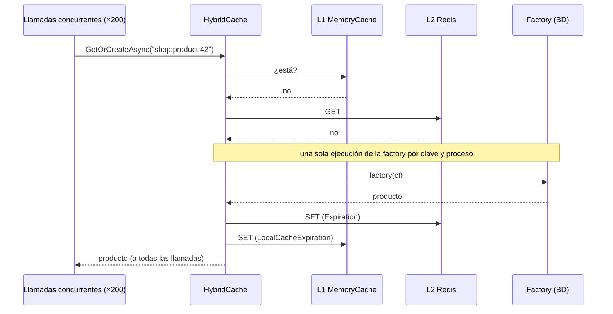

# HybridCache

> [!abstract] En 30 segundos
> - **Qué es:** la caché de .NET que combina **L1 (memoria) + L2 (`IDistributedCache`, p. ej. Redis)** con **single-flight** (anti-stampede), **tags** y serialización configurable.
> - **Para qué:** reemplazar el patrón manual cache-aside + `IDistributedCache` con una sola llamada: `GetOrCreateAsync`.
> - **Recuerda:** el single-flight es **por proceso**; invalidar por clave o tag afecta a L2 y al L1 del **proceso actual**, **no** al L1 de otras instancias (usa TTL de L1 corto); y `RemoveByTagAsync` es una invalidación **lógica**.

> [!info] Lección 4.7 · Nivel 4 — Redis en aplicaciones backend y .NET
> ⬅️ [[IDistributedCache]] · ➡️ [[Redis Output Cache]] · 🗺️ [[01 - Redis - Roadmap#Nivel 4 — Redis en aplicaciones backend y .NET|Roadmap]] · 📊 [[03 - Redis - Progreso|Progreso]]
> 🏷️ Paquete `Microsoft.Extensions.Caching.Hybrid`: desde .NET 9 (el paquete soporta runtimes anteriores hasta .NET Framework 4.7.2 y .NET Standard 2.0).

## 📌 Definición

`HybridCache` es una clase abstracta cuya implementación predeterminada viene con el framework y se registra con `AddHybridCache()`. Su método central es `GetOrCreateAsync(key, factory, options?, tags?, ct)`:

1. Busca en **L1** (`MemoryCache` del proceso).
2. Si no está, busca en **L2** (la `IDistributedCache` registrada, si la hay).
3. Si tampoco, ejecuta la *factory*, guarda en ambas y devuelve.

Otros métodos: `SetAsync`, `RemoveAsync` (una o varias claves) y `RemoveByTagAsync`.

## 🎯 ¿Qué problema resuelve?

Con `IDistributedCache` tienes que serializar, escribir el patrón get-miss-set en cada sitio y protegerte tú del stampede. HybridCache lo trae hecho: una llamada, L1 + L2, **una sola ejecución de la factory por clave** entre llamadas concurrentes del mismo proceso, y tags para invalidar en grupo.

## 🧠 Conceptos fundamentales

1. **Single-flight:** de varias llamadas concurrentes con la misma clave en una instancia, solo una ejecuta la factory; las demás esperan su resultado. Esta coordinación **no se extiende** a otras instancias, aunque compartan el mismo L2. El token de cancelación de la factory se cancela cuando **todos** los que esperan han cancelado.
2. **Opciones por entrada (`HybridCacheEntryOptions`):** `Expiration` (L2) y `LocalCacheExpiration` (L1). Configura valores globales con `DefaultEntryOptions` y sobrescribe por llamada.
3. **Límites:** `MaximumPayloadBytes` (1 MB por defecto: si se supera, no se guarda y se registra) y `MaximumKeyLength` (1024 caracteres por defecto).
4. **Tags:** `RemoveByTagAsync("tag")` establece un «ignora todo lo creado antes de este instante» para el tag; los valores antiguos siguen físicamente en L1/L2 hasta que expiran, pero se tratan como *miss*. `RemoveByTagAsync("*")` invalida todo lo de HybridCache. No hay comodines tipo `foo*`.
5. **Invalidación entre instancias:** una invalidación se aplica en el servidor actual y en L2; el **L1 de otros servidores no se entera**. Mantén `LocalCacheExpiration` corto o añade una señal propia (Pub/Sub).
6. **Serialización:** `string` y `byte[]` internamente; `System.Text.Json` para el resto; puedes añadir serializadores por tipo o por fábrica (`AddSerializer<T,…>`, `AddSerializerFactory<…>`), p. ej. Protobuf o MessagePack.
7. **Reutilización de instancias:** por seguridad cada llamada obtiene su propia copia deserializada. Si el tipo es `sealed` y marcado con `[ImmutableObject(true)]`, HybridCache puede reutilizar la misma instancia (menos CPU).
8. **Claves:** únicas y construidas con identificadores de confianza. **No** uses entrada de usuario sin validar (riesgo de saturar la caché con claves aleatorias). Usa interpolación directamente en la llamada (`$"…"`), que permitirá optimizaciones futuras.
9. **Sin L2:** si no hay `IDistributedCache` fuera de proceso, sigue dando L1 y single-flight. `AddDistributedMemoryCache` no cuenta como L2.
10. **Alternativa:** puedes sustituir la implementación (p. ej. FusionCache implementa la API `HybridCache`).

### Analogía
Un **dependiente** con un cuaderno de apuntes (L1) y acceso al almacén central (L2): si le piden algo que no tiene apuntado, va al almacén; y si varios clientes piden lo mismo a la vez, solo va **una vez**. Si el almacén cambia una etiqueta, el dependiente de otra tienda sigue con su cuaderno hasta que lo renueve.
**Dónde se rompe:** el cuaderno de otra tienda no se actualiza solo (L1 entre instancias).

## ⚙️ Funcionamiento interno



## 💻 Ejemplos prácticos

```text
127.0.0.1:6379> KEYS shop:*      # laboratorio
1) "shop:product:42"
127.0.0.1:6379> TTL shop:product:42
(integer) 541
```

L2 almacena los valores serializados; los tags se gestionan como metadatos del propio HybridCache.

## 🔧 Implementación en .NET

```csharp
// Program.cs — paquetes: Microsoft.Extensions.Caching.Hybrid y Microsoft.Extensions.Caching.StackExchangeRedis
builder.Services.AddStackExchangeRedisCache(o => o.Configuration = builder.Configuration.GetConnectionString("Redis"));

builder.Services.AddHybridCache(o =>
{
    o.MaximumPayloadBytes = 1024 * 1024;
    o.MaximumKeyLength = 1024;
    o.DefaultEntryOptions = new HybridCacheEntryOptions
    {
        Expiration = TimeSpan.FromMinutes(10),           // L2
        LocalCacheExpiration = TimeSpan.FromSeconds(30)  // L1: ventana de divergencia entre instancias
    };
});
```

```csharp
using Microsoft.Extensions.Caching.Hybrid;

public sealed record Product(int Id, string Name, decimal Price);

public interface IProductRepository
{
    Task<Product?> FindAsync(int id, CancellationToken ct);
    Task UpdateAsync(Product product, CancellationToken ct);
}

public class ProductService(HybridCache cache, IProductRepository repo)
{
    public ValueTask<Product?> GetAsync(int id, CancellationToken ct = default) =>
        cache.GetOrCreateAsync(
            $"shop:product:{id}",
            async token => await repo.FindAsync(id, token),
            tags: ["products", $"product:{id}"],
            cancellationToken: ct);

    public async Task UpdateAsync(Product product, CancellationToken ct = default)
    {
        await repo.UpdateAsync(product, ct);                       // fuente primero
        await cache.RemoveAsync($"shop:product:{product.Id}", ct); // luego invalidar
    }

    public ValueTask InvalidateCatalogAsync(CancellationToken ct = default) =>
        cache.RemoveByTagAsync("products", ct);
}
```

Comparación con el patrón manual de [[IDistributedCache]]: desaparecen la serialización, el `if (bytes is null)`, el `SetAsync` y cualquier lógica de stampede.

> [!warning] Estado capturado en la factory
> La sobrecarga sin estado captura variables en la lambda (asignaciones). Para rutas muy calientes existe la sobrecarga con estado (`GetOrCreateAsync(key, state, static (state, ct) => …)`); la documentación recomienda la sencilla salvo que midas un problema.

## 🏗️ Casos de uso en arquitectura

| Caso | Configuración |
|---|---|
| API con varias instancias y datos de catálogo | L1 30-60 s, L2 10-30 min, tags por tipo |
| Datos casi estáticos | L1 y L2 largos + invalidación explícita |
| Datos críticos | No usar L1 largo; `LocalCacheExpiration` mínimo o sin L1 |
| Una sola instancia | Sin L2: solo L1 + stampede |

### Cuándo NO usarlo
- Estructuras nativas de Redis (sorted sets, streams…): `IDatabase`.
- Si necesitas invalidación inmediata en todas las instancias: añade una señal (Pub/Sub o Streams) para vaciar L1 ([[Cache invalidation]]).

### Consideraciones de arquitectura

| Dimensión | Qué pensar |
|---|---|
| Coherencia | Ventana = `LocalCacheExpiration` + retraso |
| Stampede | Solo por proceso: con N instancias, hasta N cargas |
| Memoria | L1 × instancias; fija límites |
| Observabilidad | Mide hits de L1 y L2 y cargas de la factory |
| Resiliencia | Si L2 falla, la llamada puede fallar: Polly o captura ([[Redis con Polly y resiliencia]]) |

## ⚠️ Errores y anti-patterns

| Error | Por qué duele | Cómo evitarlo |
|---|---|---|
| Esperar que `RemoveAsync` limpie L1 de otras instancias | Datos obsoletos hasta el TTL de L1 | TTL de L1 corto o señal de invalidación |
| Claves a partir de entrada de usuario sin validar | Saturación de la caché | Identificadores de confianza |
| Objetos mutables compartidos | Condiciones de carrera | Tipos inmutables y `sealed` |
| Payloads > 1 MB | No se cachean (solo log) | Ajustar el límite o trocear |
| Tags en exceso | Penaliza el rendimiento | Pocos tags significativos |
| Confundir `AddDistributedMemoryCache` con L2 | No se comparte entre servidores | Redis |

## ✅ Buenas prácticas

1. `GetOrCreateAsync` como punto de entrada único; claves con interpolación.
2. `Expiration` y `LocalCacheExpiration` explícitos.
3. Tags por tipo de dato para invalidar en grupo.
4. Tipos inmutables y `sealed` en rutas calientes.
5. Pruebas de integración con Redis y varias instancias.

## 🎤 Preguntas de entrevista

> [!question]- 1. ¿`HybridCache` o `IDistributedCache`?
> HybridCache para código nuevo (.NET 9+): L1+L2, single-flight, tags y serialización integrada. `IDistributedCache` si ya lo usas y no necesitas lo demás, o si el runtime es antiguo; HybridCache sigue usándolo como L2.

> [!question]- 2. ¿Qué protección anti-stampede ofrece y cuál es su límite?
> Una sola ejecución de la factory por clave entre llamadas concurrentes **del mismo proceso**. No coordina entre instancias: con N instancias puede haber N cargas.

> [!question]- 3. ¿Cómo funciona `RemoveByTagAsync`?
> Es lógico: registra que lo creado antes de ahora con ese tag ya no vale; al leerlo se trata como miss y se vuelve a cargar. Los datos antiguos permanecen hasta su expiración natural.

## 🧪 Ejercicios

### 🟢 Básicos
1. Registra HybridCache con Redis como L2 y cachea una consulta con `GetOrCreateAsync`.

### 🟡 Intermedios
2. Lanza 200 llamadas concurrentes por la misma clave y cuenta las ejecuciones de la factory; después usa dos instancias de la app y cuenta de nuevo.

### 🔴 Reto Senior
3. Diseña la invalidación para que, al editar un producto, las 5 instancias dejen de servirlo en menos de 2 s.

> [!success]- Soluciones
> **3.** `RemoveAsync` en la instancia que escribe (L1 propio + L2), `LocalCacheExpiration` ≤ 2 s para acotar el resto, o publicar un mensaje en Pub/Sub para que cada instancia haga `RemoveAsync` de la clave (con el TTL de L1 como red de seguridad).

### ✔️ Checklist de dominio
- [ ] Configuro L1/L2, límites y serialización.
- [ ] Explico el single-flight y su alcance.
- [ ] Diseño la invalidación con tags y entre instancias.

## 📝 Resumen

- HybridCache = L1 + L2 + single-flight + tags + serialización.
- Single-flight por proceso; L1 de otras instancias no se invalida solo.
- `RemoveByTagAsync` es lógico.
- TTLs explícitos; claves de confianza; tipos inmutables.

## 🔗 Referencias

- [HybridCache en ASP.NET Core](https://learn.microsoft.com/aspnet/core/performance/caching/hybrid)
- [Caching overview](https://learn.microsoft.com/aspnet/core/performance/caching/overview)

## 🔄 Notas relacionadas

- ⬅️ [[IDistributedCache]] · ➡️ [[Redis Output Cache]]
- Relacionadas: [[Read-through]] · [[Cache stampede]] · [[Distributed caching]] · [[Proyecto 04 - Caché de consultas]]
