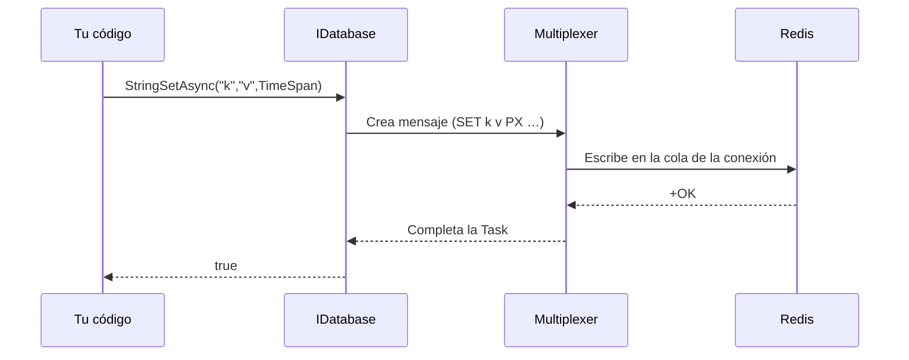

# IDatabase y operaciones en StackExchange.Redis

> [!abstract] En 30 segundos
> - **Qué es:** `IDatabase` es la fachada para ejecutar comandos: un método por comando (`StringSetAsync`, `HashGetAllAsync`…), con tipos `RedisKey`/`RedisValue`.
> - **Para qué:** dominar la API del día a día: flags, lotes, transacciones con condiciones, scripts y comandos ad hoc.
> - **Recuerda:** `GetDatabase()` es barato; los resultados «no existe» son `RedisValue.Null`, **no** `null`; y las transacciones usan **condiciones**, no `WATCH`.

> [!info] Lección 4.3 · Nivel 4 — Redis en aplicaciones backend y .NET
> ⬅️ [[ConnectionMultiplexer]] · ➡️ [[Redis con ASP.NET Core]] · 🗺️ [[01 - Redis - Roadmap#Nivel 4 — Redis en aplicaciones backend y .NET|Roadmap]] · 📊 [[03 - Redis - Progreso|Progreso]]
> 🏷️ SE.Redis 3.x · en 3.x, `StringSetAsync` y similares aceptan `Expiration` (con conversión implícita desde `TimeSpan`, **no** desde `TimeSpan?`).

## 📌 Definición

`IDatabase` (con su mitad asíncrona `IDatabaseAsync`) expone todos los comandos que operan sobre claves, agrupados por tipo de dato.

| Área | Métodos de ejemplo |
|---|---|
| Strings | `StringSetAsync`, `StringGetAsync`, `StringIncrementAsync`, `StringGetSetExpiryAsync` |
| Claves | `KeyExistsAsync`, `KeyDeleteAsync`, `KeyExpireAsync`, `KeyTimeToLiveAsync` |
| Hashes | `HashSetAsync`, `HashGetAllAsync`, `HashIncrementAsync` |
| Listas | `ListLeftPushAsync`, `ListRightPopAsync`, `ListRangeAsync` |
| Sets | `SetAddAsync`, `SetContainsAsync`, `SetMembersAsync` |
| Sorted sets | `SortedSetAddAsync`, `SortedSetRangeByRankWithScoresAsync` |
| Streams | `StreamAddAsync`, `StreamReadGroupAsync`, `StreamAcknowledgeAsync` |
| Scripts | `ScriptEvaluateAsync`, `ScriptEvaluateReadOnlyAsync` |
| Ad hoc | `ExecuteAsync("COMANDO", args…)` |
| Lotes y transacciones | `CreateBatch()`, `CreateTransaction()` |

## 🎯 ¿Qué problema resuelve?

Una API tipada evita construir comandos a mano y gestiona las conversiones, el enrutado por slot y la lectura de las respuestas. Entender sus convenciones evita errores sutiles: valores nulos, expiraciones, réplicas, condiciones.

## 🧠 Conceptos fundamentales

### 1. `RedisKey` y `RedisValue`
- Conversión implícita desde `string`, `byte[]`, `int`, `long`, `double`, `bool`…
- `RedisValue.Null` representa «no existe»; **no es `null`** de .NET: usa `HasValue`, `IsNull`, `IsNullOrEmpty`.
- `(string?)valor` devuelve `null` si no hay valor; `valor.ToString()` devuelve cadena vacía.
- `RedisKey` admite prefijos: `db.WithKeyPrefix("shop:")` antepone un prefijo a todas las claves.

### 2. `CommandFlags`

| Flag | Efecto |
|---|---|
| `None` | Por defecto |
| `FireAndForget` | No espera respuesta; devuelve el valor por defecto de la operación |
| `PreferReplica` | Lee de una réplica si hay; si no, del primario |
| `DemandReplica` | Solo réplica; falla si no hay |
| `DemandPrimary` | Exige primario |
| `NoRedirect` | No sigue redirecciones `MOVED`/`ASK` |
| `NoScriptCache` | Evita la caché de scripts del cliente |

Las lecturas desde réplica pueden devolver datos antiguos (replicación asíncrona).

### 3. Lotes (`IBatch`) y transacciones (`ITransaction`)
- **`IBatch`:** agrupa el envío (pipeline); sin atomicidad.
- **`ITransaction`:** `MULTI`/`EXEC`; con **condiciones** (`AddCondition`) que sustituyen a `WATCH`: si alguna falla, no se ejecuta nada y `ExecuteAsync` devuelve `false`.
- En ambos: **no esperes** las tareas antes de ejecutar el lote.

### 4. Scripts
- `LuaScript.Prepare` con parámetros `@nombre`; `ScriptEvaluateAsync(script, objeto)`.
- `EVAL_RO` mediante `ScriptEvaluateReadOnlyAsync` (3.2+, depende de la versión del servidor).

### 5. Comandos ad hoc
- `ExecuteAsync("OBJECT", "ENCODING", clave)` para lo que no tiene API tipada. Desde 3.0 respeta `AllowAdmin` (un `FLUSHALL` por `Execute` sin permiso lanza excepción en el cliente). En 3.2 aparecen las APIs `ExecuteResp`/`ScriptEvaluateResp` para ejecutarlos con menos asignaciones (consulta la documentación antes de usarlas).

### Analogía
`IDatabase` es el **teclado** de la centralita: cada tecla (método) marca un comando concreto. Los *flags* son los modificadores: «sin esperar respuesta», «solo con la extensión secundaria».
**Dónde se rompe:** una tecla mal pulsada (ignorar `RedisValue.Null`) devuelve un valor que parece válido.

## ⚙️ Funcionamiento interno



## 💻 Ejemplos prácticos

```text
127.0.0.1:6379> SET k v PX 60000
OK
127.0.0.1:6379> EVAL "return redis.call('GET', KEYS[1])" 1 k
"v"
```

## 🔧 Implementación en .NET

```csharp
using StackExchange.Redis;

IDatabase db = mux.GetDatabase();

// --- 1. Strings, expiración y valores nulos ---
await db.StringSetAsync("saludo", "hola", TimeSpan.FromMinutes(5));
RedisValue v = await db.StringGetAsync("saludo");
if (v.HasValue) Console.WriteLine(v.ToString());
string? existe = await db.StringGetAsync("no-existe");     // null si no existe

// --- 2. Prefijo de claves ---
IDatabase tienda = db.WithKeyPrefix("shop:");
await tienda.StringSetAsync("config:iva", "21");           // clave real: shop:config:iva

// --- 3. Flags: lectura desde réplica, escritura sin esperar ---
RedisValue desdeReplica = await db.StringGetAsync("saludo", CommandFlags.PreferReplica);
await db.StringIncrementAsync("visitas", flags: CommandFlags.FireAndForget);

// --- 4. Lote (pipeline) ---
IBatch batch = db.CreateBatch();
Task<bool> t1 = batch.StringSetAsync("a", "1");
Task<bool> t2 = batch.StringSetAsync("b", "2");
batch.Execute();
await Task.WhenAll(t1, t2);

// --- 5. Transacción con condición (sustituye a WATCH) ---
ITransaction tx = db.CreateTransaction();
tx.AddCondition(Condition.StringEqual("estado:pedido:1", "pendiente"));
Task<bool> cambio = tx.StringSetAsync("estado:pedido:1", "pagado");
Task<long> contador = tx.StringIncrementAsync("pedidos:pagados");
bool confirmada = await tx.ExecuteAsync();     // false si la condición falló: no se aplica nada
if (confirmada) Console.WriteLine($"Pagados: {await contador}");

// --- 6. Script con parámetros con nombre ---
LuaScript descontar = LuaScript.Prepare("""
    local s = tonumber(redis.call('GET', @clave) or '0')
    if s >= tonumber(@n) then redis.call('DECRBY', @clave, @n) return 1 end
    return 0
    """);
bool ok = (int)await db.ScriptEvaluateAsync(descontar, new { clave = (RedisKey)"stock:1", n = 2 }) == 1;

// --- 7. Comando sin API tipada ---
RedisResult codificacion = await db.ExecuteAsync("OBJECT", "ENCODING", "saludo");
```

> [!tip] Expiración: `TimeSpan`, `TimeSpan?` y `Expiration`
> `StringSetAsync(clave, valor, TimeSpan)` convierte el `TimeSpan` a `Expiration` de forma implícita. `Expiration` también ofrece `Expiration.Default` (sin expiración al escribir), `Expiration.KeepTtl` (conservar el TTL existente) y `Expiration.Persist` (quitarlo, en lecturas como `GETEX`). Con un `TimeSpan?` no hay conversión implícita: usa la sobrecarga clásica que acepta `TimeSpan?`, o conviértelo tú: `ttl is { } t ? new Expiration(t) : Expiration.Default`.

## 🏗️ Casos de uso en arquitectura

| Necesidad | API |
|---|---|
| Caché de un objeto serializado | `StringSetAsync` con TTL |
| Entidad con campos independientes | `HashSetAsync`/`HashGetAllAsync` |
| Ranking | `SortedSetIncrementAsync` + `SortedSetRangeByRankWithScoresAsync` |
| Operación atómica condicional | `ITransaction` con condiciones o `LuaScript` |
| Carga masiva | `IBatch` o `Task.WhenAll` |

### Cuándo NO usar `IDatabase` directamente
- En la capa de dominio: oculta Redis tras un puerto ([[Redis en Clean Architecture]]).

### Consideraciones de arquitectura

| Dimensión | Qué pensar |
|---|---|
| Lecturas en réplica | Aceptan datos antiguos |
| Cluster | Operaciones multi-clave solo con claves en el mismo slot |
| Atomicidad | Transacciones: sin lógica intermedia; scripts para «leer-decidir-escribir» |
| Pruebas | Oculta `IDatabase` tras interfaces o usa Redis real en integración |

## ⚠️ Errores y anti-patterns

| Error | Por qué duele | Cómo evitarlo |
|---|---|---|
| Comparar `RedisValue` con `null` | Siempre falso | `HasValue` / `IsNull` |
| Esperar tareas dentro del `IBatch` antes de `Execute` | Interbloqueo | Ejecutar y luego esperar |
| Usar `FireAndForget` en escrituras críticas | Pierdes errores | Esperar el resultado |
| Leer de réplica tras escribir | Datos antiguos | Primario para *read-your-writes* |
| Transacciones sin condiciones esperando `WATCH` | Pierdes la protección | `AddCondition` |
| Cadenas de claves construidas sin prefijo | Colisiones entre apps | `WithKeyPrefix` o convención |

## ✅ Buenas prácticas

1. `async` siempre; `Task.WhenAll` para varios comandos independientes.
2. Prefijos de clave por aplicación.
3. `LuaScript.Prepare` estático y reutilizado.
4. Encapsula `IDatabase` en servicios o repositorios del dominio.
5. Pruebas contra Redis real.

## 🎤 Preguntas de entrevista

> [!question]- 1. ¿Cómo implementas «leer-modificar-escribir» de forma segura en .NET?
> Con un script Lua para atomicidad total, o con `ITransaction` y condiciones (`Condition.StringEqual`…) que protegen frente a cambios intermedios; si la condición falla, la transacción no se aplica y se reintenta.

> [!question]- 2. ¿Qué diferencia hay entre `IBatch` y `ITransaction`?
> `IBatch` es pipelining sin atomicidad; `ITransaction` envía `MULTI`/`EXEC` y puede llevar condiciones previas.

> [!question]- 3. ¿Por qué `RedisValue` no es nullable?
> Porque es un `struct` que representa también valores vacíos; «no existe» es `RedisValue.Null` y se consulta con `HasValue`/`IsNull`.

## 🧪 Ejercicios

### 🟢 Básicos
1. Guarda y lee un string, un hash y un sorted set desde .NET.

### 🟡 Intermedios
2. Implementa un contador con límite usando `ITransaction` y condiciones; comprueba con 100 tareas paralelas.

### 🔴 Reto Senior
3. Diseña un puerto `IKeyValueStore` y un adaptador SE.Redis que oculte flags, prefijos y serialización, y pruébalo con Testcontainers.

> [!success]- Soluciones
> **3.** Interfaz mínima (`GetAsync<T>`, `SetAsync<T>`, `RemoveAsync`), adaptador con `JsonSerializer`, prefijo en el constructor con `WithKeyPrefix`, TTL obligatorio, y pruebas de integración que verifiquen serialización, TTL y degradación.

### ✔️ Checklist de dominio
- [ ] Manejo `RedisValue` sin errores de nulos.
- [ ] Uso lotes, transacciones con condiciones y scripts según el caso.
- [ ] Conozco los efectos de `CommandFlags`.

## 📝 Resumen

- `IDatabase` = un método por comando; `GetDatabase()` es barato.
- `RedisValue.Null` ≠ `null`.
- `IBatch` para pipelining, `ITransaction` con condiciones para atomicidad, Lua para lógica en servidor.
- `ExecuteAsync` para lo que no está tipado.

## 🔗 Referencias

- [Basics](https://stackexchange.github.io/StackExchange.Redis/Basics)
- [Transactions](https://stackexchange.github.io/StackExchange.Redis/Transactions)
- [Scripting](https://stackexchange.github.io/StackExchange.Redis/Scripting)
- [Pipelines y multiplexers](https://stackexchange.github.io/StackExchange.Redis/PipelinesMultiplexers)

## 🔄 Notas relacionadas

- ⬅️ [[ConnectionMultiplexer]] · ➡️ [[Redis con ASP.NET Core]]
- Relacionadas: [[Pipelining]] · [[Transacciones con MULTI, EXEC y WATCH]] · [[Lua scripting en Redis]] · [[Redis en Clean Architecture]]
