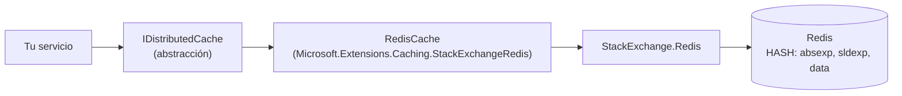

# IDistributedCache

> [!abstract] En 30 segundos
> - **Qué es:** la abstracción de ASP.NET Core para cachés compartidas; su implementación Redis es `Microsoft.Extensions.Caching.StackExchangeRedis`.
> - **Para qué:** cachear `byte[]`/`string` con expiración absoluta o deslizante sin acoplar el código a Redis.
> - **Recuerda:** API **de bytes** (tú serializas), sin tags ni protección contra stampede, y **no sustituye** a `IDatabase` para estructuras (hashes, sorted sets…). Para código nuevo, valora [[HybridCache]].

> [!info] Lección 4.6 · Nivel 4 — Redis en aplicaciones backend y .NET
> ⬅️ [[Redis en Minimal APIs]] · ➡️ [[HybridCache]] · 🗺️ [[01 - Redis - Roadmap#Nivel 4 — Redis en aplicaciones backend y .NET|Roadmap]] · 📊 [[03 - Redis - Progreso|Progreso]]
> 🏷️ Disponible en todas las versiones modernas de .NET.

## 📌 Definición

`IDistributedCache` define operaciones sobre una caché externa:

| Método | Qué hace |
|---|---|
| `GetAsync(key)` / `SetAsync(key, byte[], options)` | Leer y escribir bytes |
| `GetStringAsync` / `SetStringAsync` (extensiones) | Cadenas UTF-8 |
| `RefreshAsync(key)` | Renueva la expiración deslizante |
| `RemoveAsync(key)` | Elimina |

`DistributedCacheEntryOptions`: `AbsoluteExpiration`, `AbsoluteExpirationRelativeToNow`, `SlidingExpiration`.

## 🎯 ¿Qué problema resuelve?

Permite que el código dependa de una abstracción y que la tecnología (Redis, SQL Server, Postgres, memoria) se decida en el arranque. Es también lo que usan internamente sesiones y `HybridCache` (como L2).

## 🧠 Conceptos fundamentales

1. **Registro:** `AddStackExchangeRedisCache(o => { o.Configuration = …; o.InstanceName = "app:"; })`. `InstanceName` se antepone a todas las claves.
2. **Expiración:** absoluta, relativa y deslizante. La implementación Redis guarda los datos y las marcas de expiración en un hash y las gestiona con un script en el servidor; **la expiración deslizante se renueva con `Get`/`Refresh`**.
3. **Solo bytes/strings:** serialización a tu cargo ([[Serialización de datos en Redis]]).
4. **Limitaciones:** sin tags, sin protección contra stampede, sin L1; no usa tipos nativos de Redis (hashes, sets…).
5. **Compartir multiplexer:** por defecto crea su propia conexión desde `Configuration`; puedes pasarle un `ConnectionMultiplexer` existente mediante la factoría de opciones para no duplicar conexiones (`ConnectionMultiplexerFactory`).
6. **`IDistributedCache` en memoria** (`AddDistributedMemoryCache`) es solo para desarrollo o un único servidor: no es realmente distribuida.

### Analogía
Una **taquilla de consigna**: te dan un ticket (clave), guardas una maleta (bytes) y decides cuánto tiempo la dejas. La consigna no sabe qué hay dentro ni agrupa maletas por etiqueta.
**Dónde se rompe:** si dos personas llegan a la vez a por una maleta que no está, ambas tendrán que ir a prepararla (stampede).

## ⚙️ Funcionamiento interno



## 💻 Ejemplos prácticos

```text
127.0.0.1:6379> KEYS app:*            # solo en laboratorio
1) "app:product:42"
127.0.0.1:6379> HGETALL app:product:42
# Campos internos: absexp, sldexp, data
127.0.0.1:6379> TTL app:product:42
```

## 🔧 Implementación en .NET

```csharp
// Program.cs
builder.Services.AddStackExchangeRedisCache(o =>
{
    o.Configuration = builder.Configuration.GetConnectionString("Redis");
    o.InstanceName = "shop:";
});
```

```csharp
using System.Text.Json;
using Microsoft.Extensions.Caching.Distributed;

public record Product(int Id, string Name, decimal Price);

public interface IProductRepository
{
    Task<Product?> FindAsync(int id, CancellationToken ct);
}

public class ProductCache(IDistributedCache cache, IProductRepository repo)
{
    private static readonly DistributedCacheEntryOptions Options = new()
    {
        AbsoluteExpirationRelativeToNow = TimeSpan.FromMinutes(30),   // tope
        SlidingExpiration = TimeSpan.FromMinutes(5)                   // se renueva al leer
    };

    public async Task<Product?> GetAsync(int id, CancellationToken ct = default)
    {
        string key = $"product:{id}";

        byte[]? bytes = await cache.GetAsync(key, ct);
        if (bytes is not null)
            return JsonSerializer.Deserialize<Product>(bytes);

        Product? product = await repo.FindAsync(id, ct);
        if (product is not null)
            await cache.SetAsync(key, JsonSerializer.SerializeToUtf8Bytes(product), Options, ct);

        return product;
    }

    public Task InvalidateAsync(int id, CancellationToken ct = default) =>
        cache.RemoveAsync($"product:{id}", ct);
}
```

> [!tip] Un solo multiplexer
> Si ya registraste `IConnectionMultiplexer` como singleton, evita que la caché abra otra conexión: configura la opción `ConnectionMultiplexerFactory` para devolver el existente. Así tienes una única conexión por proceso ([[ConnectionMultiplexer]]).

## 🏗️ Casos de uso en arquitectura

| Caso | Encaje |
|---|---|
| Código existente basado en `IDistributedCache` | Mantenerlo; migrar a HybridCache si necesitas tags o stampede |
| Sesiones y otros componentes de ASP.NET Core | Usan la abstracción de forma interna |
| Datos sencillos con TTL | Adecuado |
| Estructuras (rankings, sets) | `IDatabase`, no `IDistributedCache` |

### Cuándo NO usarlo
- Cuando necesitas invalidación por grupos o protección contra stampede: [[HybridCache]].
- Cuando necesitas estructuras de datos de Redis.

### Consideraciones de arquitectura

| Dimensión | Qué pensar |
|---|---|
| Serialización | Formato y versión bajo tu control |
| Claves | `InstanceName` evita colisiones entre apps |
| Resiliencia | Un fallo de Redis lanza excepción: captúrala |
| Pruebas | Sustituible por la implementación en memoria en pruebas unitarias |

## ⚠️ Errores y anti-patterns

| Error | Por qué duele | Cómo evitarlo |
|---|---|---|
| Deslizante sin tope absoluto | Datos que no caducan nunca | `AbsoluteExpirationRelativeToNow` |
| Dos conexiones (multiplexer propio + caché) | Más sockets | Reutilizar el multiplexer |
| Serializar con formatos frágiles | Roturas al desplegar | JSON/MessagePack versionado |
| Usar `AddDistributedMemoryCache` en producción multiinstancia | No es compartida | Redis |
| Ignorar excepciones de Redis | La API cae con la caché | `try/catch` y fallback |

## ✅ Buenas prácticas

1. `InstanceName` con prefijo de aplicación.
2. Expiración absoluta + deslizante.
3. Serialización con contexto de source generators.
4. Capturar errores y degradar.
5. Migrar a `HybridCache` en .NET 9+ si necesitas más.

## 🎤 Preguntas de entrevista

> [!question]- 1. ¿Qué limitaciones tiene `IDistributedCache` frente a `HybridCache`?
> Solo bytes, sin tags, sin protección contra stampede y sin L1 en memoria. `HybridCache` aporta todo eso sobre la misma infraestructura (usa `IDistributedCache` como L2).

> [!question]- 2. ¿Cómo funciona la expiración deslizante en Redis?
> La implementación guarda la expiración absoluta y la ventana deslizante junto a los datos y, con cada lectura o `Refresh`, extiende el TTL sin superar la absoluta.

## 🧪 Ejercicios

### 🟢 Básicos
1. Implementa `ProductCache` y comprueba en Redis la estructura de la clave y el TTL.

### 🟡 Intermedios
2. Reutiliza tu `IConnectionMultiplexer` en la caché y verifica con `CLIENT LIST` que solo hay una conexión de la aplicación.

### 🔴 Reto Senior
3. Migra `ProductCache` a `HybridCache` y compara líneas de código, latencia y comportamiento ante 200 peticiones concurrentes.

> [!success]- Soluciones
> **3.** HybridCache elimina la serialización manual, añade L1 y single-flight (una carga por clave y por proceso); la latencia media baja por el L1 y la BD recibe como máximo una consulta por clave y proceso en el stampede.

### ✔️ Checklist de dominio
- [ ] Configuro `IDistributedCache` con Redis.
- [ ] Combino expiración absoluta y deslizante.
- [ ] Conozco sus límites y cuándo pasar a HybridCache.

## 📝 Resumen

- `IDistributedCache` = abstracción de bytes con expiraciones.
- Implementación Redis oficial; `InstanceName` para prefijos.
- Sin tags, sin stampede, sin L1.
- Reutiliza el multiplexer; captura errores.

## 🔗 Referencias

- [Distributed caching en ASP.NET Core](https://learn.microsoft.com/aspnet/core/performance/caching/distributed)
- [`Microsoft.Extensions.Caching.StackExchangeRedis`](https://www.nuget.org/packages/Microsoft.Extensions.Caching.StackExchangeRedis)

## 🔄 Notas relacionadas

- ⬅️ [[Redis en Minimal APIs]] · ➡️ [[HybridCache]]
- Relacionadas: [[Distributed caching]] · [[Sesiones distribuidas con Redis]] · [[StackExchange.Redis]]
