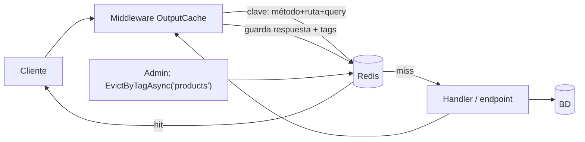

# Redis Output Cache

> [!abstract] En 30 segundos
> - **Qué es:** el middleware de **output caching** de ASP.NET Core con **Redis como almacén**: cachea **respuestas HTTP completas** y las comparte entre instancias.
> - **Para qué:** servir endpoints idénticos para muchos clientes sin ejecutar el handler.
> - **Recuerda:** por defecto solo cachea `GET`/`HEAD` con 200, sin cookies ni autenticación; la clave varía por ruta y query (configurable); y se invalida **por tags** con `IOutputCacheStore`.

> [!info] Lección 4.8 · Nivel 4 — Redis en aplicaciones backend y .NET
> ⬅️ [[HybridCache]] · ➡️ [[Serialización de datos en Redis]] · 🗺️ [[01 - Redis - Roadmap#Nivel 4 — Redis en aplicaciones backend y .NET|Roadmap]] · 📊 [[03 - Redis - Progreso|Progreso]]
> 🏷️ ASP.NET Core ≥ 8 (almacén Redis: paquete `Microsoft.Extensions.Caching.StackExchangeRedis`).

## 📌 Definición

El **output caching** guarda la respuesta HTTP completa de un endpoint y la devuelve para peticiones equivalentes. A diferencia del *response caching* (que se basa en cabeceras del cliente), el servidor controla la política y puede **invalidar** entradas. Por defecto el almacén es memoria del proceso; con `AddStackExchangeRedisOutputCache` se guarda en Redis y se comparte entre instancias.

## 🎯 ¿Qué problema resuelve?

Un listado público que consulta la BD y serializa JSON para 10 000 clientes por minuto hace el mismo trabajo 10 000 veces. Con output cache, solo se ejecuta una vez por periodo y por variante.

## 🧠 Conceptos fundamentales

1. **Qué se cachea por defecto:** respuestas 200 de `GET`/`HEAD`; no cachea respuestas que establecen cookies ni peticiones autenticadas.
2. **Políticas:** base (global), con nombre y por endpoint (`.CacheOutput(...)`): `Expire`, `SetVaryByQuery`, `SetVaryByHeader`, `SetVaryByValue`, `Tag`, `SetLocking`.
3. **Variación:** la clave incluye método, ruta y la query completa por defecto; limita las variaciones a los parámetros que importan para no multiplicar entradas.
4. **Tags:** agrupan entradas para invalidarlas con `IOutputCacheStore.EvictByTagAsync("tag", ct)`.
5. **Bloqueo de recursos (`SetLocking`):** evita que múltiples peticiones concurrentes ejecuten el handler a la vez para la misma entrada (anti-stampede).
6. **Almacén Redis:** todas las instancias comparten respuestas; sobreviven a reinicios de la app.
7. **Cuándo no:** respuestas por usuario (a menos que varíes por identidad de forma segura), con datos sensibles o altamente dinámicas.

| | Output cache | `HybridCache`/`IDistributedCache` |
|---|---|---|
| Qué guarda | La respuesta HTTP | Objetos de aplicación |
| Dónde actúa | Middleware, antes del handler | Dentro del código |
| Invalidación | Tags | Clave/tags |
| Variación por HTTP | Sí | No |

### Analogía
Una **fotocopia del menú** al lado de la puerta: quien entra recibe la copia sin molestar al cocinero. Cuando cambia el menú, el encargado retira las copias antiguas (evict por tag).
**Dónde se rompe:** si fotocopias un menú personalizado para un cliente y se lo das a otro.

## ⚙️ Funcionamiento interno



## 💻 Ejemplos prácticos

```bash
curl -i "http://localhost:5000/products?category=books"   # primera: se ejecuta el handler
curl -i "http://localhost:5000/products?category=books"   # segunda: sale de la caché (Age/latencia menor)
redis-cli KEYS "*"                                         # laboratorio: ver entradas
```

## 🔧 Implementación en .NET

```csharp
// Program.cs
builder.Services.AddStackExchangeRedisOutputCache(o =>
{
    o.Configuration = builder.Configuration.GetConnectionString("Redis");
    o.InstanceName = "shop-output:";
});

builder.Services.AddOutputCache(options =>
{
    options.AddBasePolicy(b => b.Expire(TimeSpan.FromSeconds(10)));             // política global

    options.AddPolicy("Catalog", b => b
        .Expire(TimeSpan.FromMinutes(5))
        .SetVaryByQuery("category", "page")        // solo estos parámetros varían la clave
        .Tag("products")
        .SetLocking(true));                         // una sola ejecución por entrada
});

var app = builder.Build();
app.UseOutputCache();

app.MapGet("/products", async (string? category, int? page, IProductService svc) =>
        TypedResults.Ok(await svc.ListAsync(category, page ?? 1)))
   .CacheOutput("Catalog");

// Invalidar al cambiar un producto
app.MapPost("/products/{id:int}", async (int id, ProductDto dto, IProductService svc,
        IOutputCacheStore store, CancellationToken ct) =>
{
    await svc.UpdateAsync(id, dto);
    await store.EvictByTagAsync("products", ct);
    return TypedResults.NoContent();
});

app.Run();
```

> [!note] Orden del middleware
> `UseOutputCache()` va después de `UseRouting`/`UseCors` y de la autenticación si la usas; el orden afecta a qué respuestas se cachean.

## 🏗️ Casos de uso en arquitectura

| Caso | Política |
|---|---|
| Listados públicos y catálogos | 1-5 min + tag + evict al editar |
| Páginas de contenido semiestático | Expiración larga + evict por evento |
| API de configuración | Expiración corta |
| Endpoints por usuario | No usar, o variar por identidad con cuidado |

### Cuándo NO usarlo
- Datos privados o específicos del usuario sin una variación segura.
- Respuestas con cookies de sesión.

### Consideraciones de arquitectura

| Dimensión | Qué pensar |
|---|---|
| Seguridad | Qué varía la respuesta: usuario, rol, idioma, cabeceras |
| Coherencia | Evict por tags tras cada escritura |
| Cardinalidad | Limitar `SetVaryByQuery` evita explosión de claves |
| Disponibilidad | Si Redis falla, valora el comportamiento del middleware y degrada |

## ⚠️ Errores y anti-patterns

| Error | Por qué duele | Cómo evitarlo |
|---|---|---|
| Cachear respuestas por usuario sin variar por identidad | Fuga entre usuarios | No cachear o variar |
| No limitar la query | Millones de claves distintas | `SetVaryByQuery` explícito |
| Olvidar el evict tras cambios | Datos obsoletos hasta el TTL | `EvictByTagAsync` |
| Cachear respuestas con datos sensibles | Exposición | Excluir endpoints |
| Poner `UseOutputCache` en el sitio equivocado | Políticas que no se aplican | Revisar el orden |

## ✅ Buenas prácticas

1. Políticas con nombre y tags por recurso.
2. Variar solo por lo necesario.
3. Evict por tags desde los endpoints de escritura.
4. `SetLocking` en endpoints caros.
5. Medir hit ratio y tamaño en Redis.

## 🎤 Preguntas de entrevista

> [!question]- 1. ¿Diferencia entre output caching y `HybridCache`?
> Output caching guarda respuestas HTTP completas en un middleware, con variación por parámetros HTTP y tags. `HybridCache` guarda objetos de aplicación dentro del código; se pueden usar juntos.

> [!question]- 2. ¿Cómo invalidas el output cache al editar un recurso?
> Asignando un tag a la política y llamando a `IOutputCacheStore.EvictByTagAsync` desde el endpoint de escritura.

## 🧪 Ejercicios

### 🟢 Básicos
1. Cachea un listado 10 s y comprueba la diferencia de latencia con `curl`.

### 🟡 Intermedios
2. Añade tags y un endpoint de escritura que invalide; comprueba que el listado se refresca.

### 🔴 Reto Senior
3. Un endpoint `/me/orders` cachea con la política global y un usuario ve pedidos de otro. Explica por qué (o por qué no) puede ocurrir y cómo lo evitas.

> [!success]- Soluciones
> **3.** Por defecto no se cachean peticiones autenticadas, pero políticas que lo permitan o una autenticación por cabecera/cookie personalizada pueden saltarse esa regla; la clave debe incluir la identidad (`SetVaryByValue`) o el endpoint debe excluirse de la caché compartida.

### ✔️ Checklist de dominio
- [ ] Configuro Output Cache con Redis, políticas y tags.
- [ ] Invalido por tags.
- [ ] Evito fugas entre usuarios.

## 📝 Resumen

- Output cache = respuestas HTTP completas, con Redis como almacén compartido.
- Políticas, variación y tags; `SetLocking` contra stampede.
- Evict por tags tras escribir.
- No para datos por usuario sin variación segura.

## 🔗 Referencias

- [Output caching middleware](https://learn.microsoft.com/aspnet/core/performance/caching/output)
- [Distributed caching (Redis)](https://learn.microsoft.com/aspnet/core/performance/caching/distributed)

## 🔄 Notas relacionadas

- ⬅️ [[HybridCache]] · ➡️ [[Serialización de datos en Redis]]
- Relacionadas: [[Redis en Minimal APIs]] · [[Cache invalidation]] · [[Cache stampede]]
