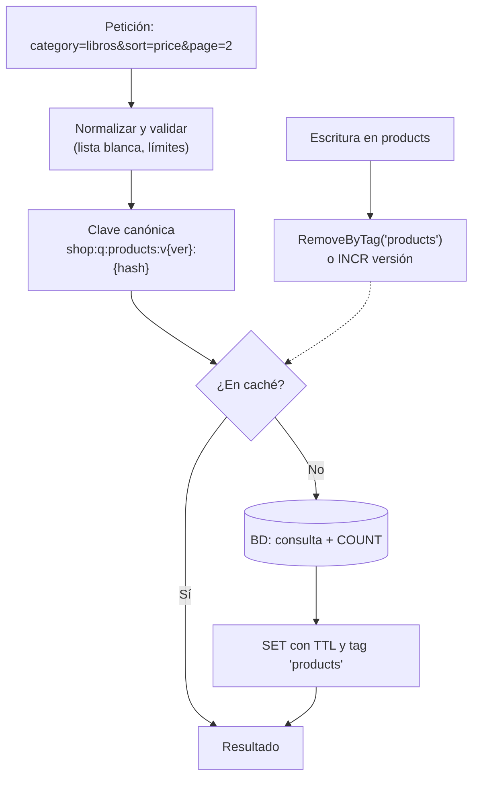

# Redis como caché de consultas

> [!abstract] En 30 segundos
> - **Qué es:** cachear el **resultado de una consulta parametrizada** (filtros, orden, página) con una **clave derivada de sus parámetros**.
> - **Para qué:** listados, búsquedas y agregados que son caros y se repiten.
> - **Recuerda:** normaliza y **limita** los parámetros (explosión de claves), prefiere **paginación por claves (keyset)**, guarda **ids + entidades** por separado si hay solapamiento, y invalida con **tags o versión de espacio**.

> [!info] Lección 4.11 · Nivel 4 — Redis en aplicaciones backend y .NET
> ⬅️ [[Redis con Entity Framework Core]] · ➡️ [[Redis en Clean Architecture]] · 🗺️ [[01 - Redis - Roadmap#Nivel 4 — Redis en aplicaciones backend y .NET|Roadmap]] · 📊 [[03 - Redis - Progreso|Progreso]]
> 🏷️ Patrón de aplicación; apoyado en `HybridCache` (.NET 9+) o `IDatabase`.

## 📌 Definición

Una **caché de consultas** asocia una consulta (con todos sus parámetros) a su resultado. A diferencia de cachear una entidad por id, aquí la **clave se construye** a partir de filtros, orden y paginación:

```text
shop:q:products:cat=libros|sort=price|dir=asc|page=2|size=20
```

## 🎯 ¿Qué problema resuelve?

Un listado con filtros ejecuta `JOIN`, `ORDER BY` y `COUNT` caros. Muchos usuarios piden las mismas combinaciones («libros, página 1, por precio»). Cachearlas descarga la BD, pero introduce tres riesgos: claves infinitas, datos obsoletos y duplicación de entidades.

## 🧠 Conceptos fundamentales

1. **Clave canónica:** mismos parámetros ⇒ misma clave, sin importar el orden en que lleguen (ordena los parámetros, normaliza mayúsculas, elimina valores por defecto).
2. **Lista blanca:** solo los parámetros y valores de orden permitidos; tamaño de página limitado (p. ej. 10/20/50). Sin esto, un cliente puede generar millones de claves.
3. **Hash de la consulta:** si la clave es larga, usa un hash (SHA-256 truncado) **y** un prefijo legible: `shop:q:products:{hash}`.
4. **Paginación:**

| Tipo | Caché | Comentario |
|---|---|---|
| Offset (`page`, `size`) | Páginas distintas = claves distintas; la profundidad es costosa | Limita la profundidad (p. ej. máx. 50 páginas) |
| Keyset (`after=id`) | Claves por cursor; estable ante inserciones | Preferible en listados grandes |

5. **Qué guardar:**
   - **Resultado completo** (lista de DTO): simple; duplica entidades entre consultas.
   - **Ids + entidades por separado:** la consulta guarda `[42, 57, 91]` y cada entidad vive en su propia clave; se leen con `MGET`. Menos duplicación y la edición de una entidad se refleja sin invalidar listados (pero los listados sí cambian si se altera el orden/pertenencia).
6. **Invalidación:** por tags (`products`, `category:libros`) o **versión del espacio** (`INCR shop:ver:products`). Con resultados volátiles, TTL corto (30-120 s).
7. **Totales:** el `COUNT(*)` suele ser lo más caro; cachéalo aparte con TTL más largo o aproxímalo.
8. **Datos por usuario:** no mezcles en la misma clave datos de usuarios distintos; incluye la identidad o no cachees.

### Analogía
Un **catálogo impreso por secciones**: cada combinación («libros, ordenados por precio, página 2») es una hoja ya imprimida. Si el número de combinaciones es ilimitado, imprimes folletos sin fin; por eso se limitan las combinaciones.
**Dónde se rompe:** si el proveedor cambia un precio, hay que reimprimir todas las hojas donde aparece.

## ⚙️ Funcionamiento interno



## 💻 Ejemplos prácticos

```text
127.0.0.1:6379> GET shop:ver:products
"7"
127.0.0.1:6379> GET shop:q:products:v7:3fa9c1d2b04e8a17
"{\"total\":132,\"items\":[...]}"
127.0.0.1:6379> INCR shop:ver:products      # invalida todas las consultas de productos
(integer) 8
```

## 🔧 Implementación en .NET

```csharp
using System.Security.Cryptography;
using System.Text;
using Microsoft.Extensions.Caching.Hybrid;

public sealed record ProductQuery(string? Category, string Sort, bool Desc, int Page, int PageSize)
{
    private static readonly HashSet<string> AllowedSorts = ["name", "price", "created"];
    private static readonly int[] AllowedPageSizes = [10, 20, 50];

    // Normalización: lista blanca y límites
    public ProductQuery Normalize() => new(
        Category?.Trim().ToLowerInvariant(),
        AllowedSorts.Contains(Sort) ? Sort : "name",
        Desc,
        Math.Clamp(Page, 1, 50),
        AllowedPageSizes.Contains(PageSize) ? PageSize : 20);

    // Clave canónica con hash
    public string CacheKey(long version)
    {
        string canonical = $"cat={Category}|sort={Sort}|desc={Desc}|page={Page}|size={PageSize}";
        string hash = Convert.ToHexString(SHA256.HashData(Encoding.UTF8.GetBytes(canonical)))[..16].ToLowerInvariant();
        return $"shop:q:products:v{version}:{hash}";
    }
}

public sealed record PagedResult<T>(int Total, IReadOnlyList<T> Items);
public sealed record ProductDto(int Id, string Name, decimal Price);

public interface IProductSearch
{
    Task<PagedResult<ProductDto>> SearchAsync(ProductQuery query, CancellationToken ct);
}

public class CachedProductSearch(HybridCache cache, IProductSearch inner, StackExchange.Redis.IDatabase redis)
{
    public async ValueTask<PagedResult<ProductDto>> SearchAsync(ProductQuery raw, CancellationToken ct = default)
    {
        ProductQuery query = raw.Normalize();

        // Versión del espacio de nombres: invalidar = incrementar
        long version = (long?)await redis.StringGetAsync("shop:ver:products") ?? 0;

        return await cache.GetOrCreateAsync(
            query.CacheKey(version),
            async token => await inner.SearchAsync(query, token),
            new HybridCacheEntryOptions
            {
                Expiration = TimeSpan.FromSeconds(90),
                LocalCacheExpiration = TimeSpan.FromSeconds(15)
            },
            tags: ["products", $"category:{query.Category ?? "all"}"],
            cancellationToken: ct);
    }

    public Task InvalidateAsync() => redis.StringIncrementAsync("shop:ver:products");
}
```

> [!tip] Tags frente a versión
> Con tags, `RemoveByTagAsync("products")` basta y no necesitas leer la versión. La versión de espacio es útil cuando usas `IDatabase` directamente o necesitas que **todas las instancias** lo vean al instante sin depender de L1; tiene el coste de una lectura extra (puede cachearse unos segundos).

## 🏗️ Casos de uso en arquitectura

| Caso | Diseño |
|---|---|
| Listado con filtros comunes | Clave canónica + TTL 1-2 min |
| Búsqueda de texto | Query Engine ([[Redis Query Engine]]) o BD de búsqueda; caché solo de consultas populares |
| Dashboards agregados | TTL 30-60 s, refresco proactivo |
| Listados enormes con deep paging | Keyset + límite de profundidad |

### Cuándo NO cachear consultas
- Combinaciones casi únicas por usuario (baja tasa de acierto).
- Resultados que deben ser exactos en el instante (stock en el pago).

### Consideraciones de arquitectura

| Dimensión | Qué pensar |
|---|---|
| Cardinalidad | Lista blanca y límites; métrica de claves por prefijo |
| Memoria | `MEMORY USAGE` de resultados típicos; tope de tamaño |
| Coherencia | TTL corto + invalidación por tag/versión |
| Seguridad | Parámetros validados antes de formar la clave |

## ⚠️ Errores y anti-patterns

| Error | Por qué duele | Cómo evitarlo |
|---|---|---|
| Clave con el `QueryString` crudo | Explosión de claves y ataque de saturación | Normalizar y lista blanca |
| Cachear páginas profundas | Casi sin aciertos y mucha memoria | Límite o keyset |
| Mezclar datos de usuarios en una clave | Fuga de información | Identidad en la clave |
| Invalidar con `KEYS` | Bloquea Redis | Tags o versión |
| Sin TTL | Datos obsoletos | TTL siempre |
| Contar con `COUNT(*)` en cada miss | Coste alto | Caché aparte del total |

## ✅ Buenas prácticas

1. Normaliza, valida y limita todos los parámetros.
2. Clave legible + hash; TTL corto.
3. Tags o versión para invalidar.
4. Keyset en listados grandes.
5. Mide la cardinalidad de claves y el hit ratio por consulta.

## 🎤 Preguntas de entrevista

> [!question]- 1. ¿Cómo evitas la explosión de claves en una caché de consultas?
> Con una lista blanca de parámetros y valores, límites en tamaño y profundidad de página, claves canónicas y TTL corto; y midiendo la cardinalidad.

> [!question]- 2. ¿Cómo invalidas todas las consultas de «productos» sin recorrer claves?
> Con un tag («products») en `HybridCache` o con una versión de espacio de nombres en la clave que se incrementa al escribir.

> [!question]- 3. ¿Por qué guardar ids y entidades por separado?
> Reduce la duplicación: una entidad aparece en muchas consultas y se cachea una vez; los listados solo guardan ids que se resuelven con `MGET`.

## 🧪 Ejercicios

### 🟢 Básicos
1. Implementa la clave canónica y comprueba que `?a=1&b=2` y `?b=2&a=1` generan la misma clave.

### 🟡 Intermedios
2. Añade la lista blanca y mide cuántas claves distintas genera un fuzzing de 10 000 peticiones.

### 🔴 Reto Senior
3. Diseña la caché de un buscador de 5 millones de productos con 12 filtros. ¿Qué se cachea y qué no?

> [!success]- Soluciones
> **3.** No se cachea cada combinación: se cachean las consultas más populares (las N primeras por frecuencia), con TTL corto, y la búsqueda general va a un motor adecuado (Query Engine u otro). Se normalizan filtros, se limita la profundidad y se mide la cardinalidad; los ids van en la consulta y las entidades en claves aparte.

### ✔️ Checklist de dominio
- [ ] Construyo claves canónicas y seguras.
- [ ] Controlo la cardinalidad.
- [ ] Invalido por tag o versión.

## 📝 Resumen

- La clave deriva de los parámetros: normaliza y limita.
- Ids + entidades por separado si hay solapamiento.
- Invalida por tags o versión; TTL corto.
- Keyset mejor que offset en listas grandes.

## 🔗 Referencias

- [Paginación en EF Core](https://learn.microsoft.com/ef/core/querying/pagination)
- [HybridCache: claves y tags](https://learn.microsoft.com/aspnet/core/performance/caching/hybrid)

## 🔄 Notas relacionadas

- ⬅️ [[Redis con Entity Framework Core]] · ➡️ [[Redis en Clean Architecture]]
- Relacionadas: [[Cache invalidation]] · [[HybridCache]] · [[Modelado de datos en Redis]] · [[Proyecto 04 - Caché de consultas]]
