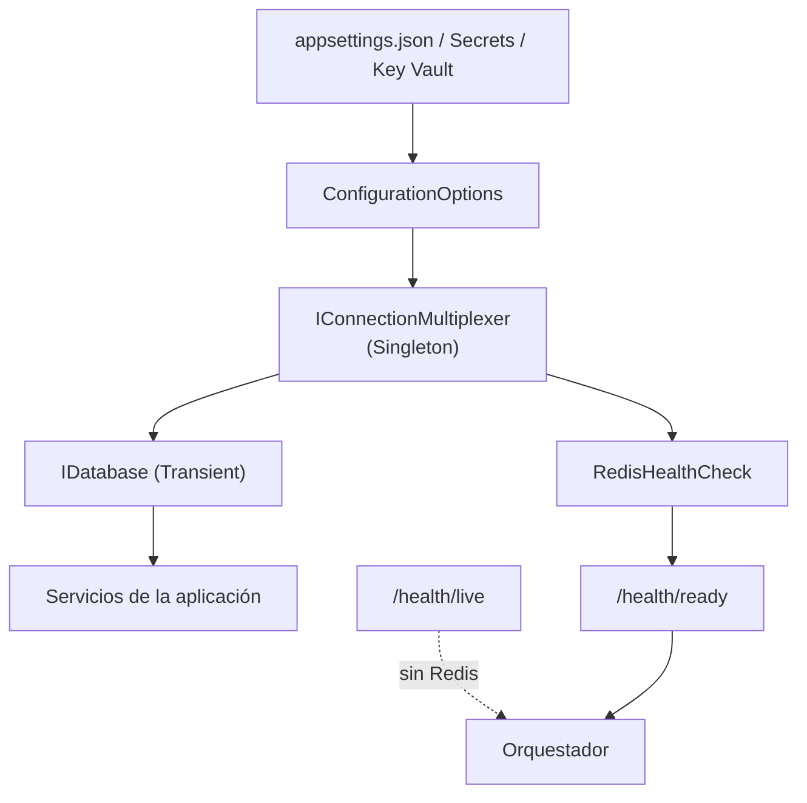

# Redis con ASP.NET Core

> [!abstract] En 30 segundos
> - **Qué es:** integrar Redis en una aplicación ASP.NET Core: registro en **inyección de dependencias**, configuración y **secretos**, **health checks** y ciclo de vida.
> - **Para qué:** tener una única conexión bien configurada, disponible en toda la aplicación y observable.
> - **Recuerda:** `IConnectionMultiplexer` **singleton**; secretos fuera del repositorio; Redis en el *readiness*, **no** en el *liveness*; y la aplicación debe degradarse, no caer, si Redis falla.

> [!info] Lección 4.4 · Nivel 4 — Redis en aplicaciones backend y .NET
> ⬅️ [[IDatabase y operaciones en StackExchange.Redis]] · ➡️ [[Redis en Minimal APIs]] · 🗺️ [[01 - Redis - Roadmap#Nivel 4 — Redis en aplicaciones backend y .NET|Roadmap]] · 📊 [[03 - Redis - Progreso|Progreso]]
> 🏷️ .NET 8+ (los ejemplos usan .NET 9/10 y C# 12+).

## 📌 Definición

Integrar Redis en ASP.NET Core significa:

1. **Registrar** el `IConnectionMultiplexer` como singleton y exponer `IDatabase` (u otras abstracciones) por DI.
2. **Configurar** la conexión desde `appsettings`, variables de entorno o un gestor de secretos.
3. **Exponer la salud** de la dependencia con *health checks*.
4. **Gestionar el ciclo de vida:** conexión al arrancar, cierre al apagar, comportamiento ante fallos.

## 🎯 ¿Qué problema resuelve?

Evita los fallos clásicos: conexiones por petición, cadenas de conexión con contraseñas en el repositorio, arranques que se caen porque Redis aún no está listo, orquestadores que reinician pods sanos porque Redis está caído.

## 🧠 Conceptos fundamentales

### 1. Registro en DI

| Servicio | Vida | Motivo |
|---|---|---|
| `IConnectionMultiplexer` | **Singleton** | Caro, compartido |
| `IDatabase` | Transient o Scoped | Ligero; `GetDatabase()` es barato |
| Servicios que usan Redis | Scoped o Singleton | Según su estado |

### 2. Configuración
- Cadena de conexión en `ConnectionStrings:Redis`; opciones adicionales en una sección tipada (`RedisOptions`).
- **Secretos:** en local, *User Secrets*; en producción, variables de entorno, Azure Key Vault o similar. En Azure, la autenticación con **Microsoft Entra ID** (paquete `Microsoft.Azure.StackExchangeRedis`) evita contraseñas ([[Redis en Azure]]).

### 3. Health checks
- **Liveness** (`/health/live`): «¿el proceso está vivo?». **No** debe depender de Redis.
- **Readiness** (`/health/ready`): «¿puedo recibir tráfico?». Incluye Redis **solo si la aplicación no puede funcionar sin él**; si Redis es una caché, devuelve `Degraded`, no `Unhealthy`.
- Un `Unhealthy` en liveness por culpa de Redis provoca **reinicios en cascada** de pods que no tienen ningún problema.

### 4. Arranque y fallo
- `AbortOnConnectFail=false`: la aplicación arranca aunque Redis tarde.
- Operaciones con `try/catch` y *fallback* a la fuente ([[Redis con Polly y resiliencia]]).

### Analogía
El **cuadro eléctrico** de un edificio: un solo punto de entrada (singleton), con etiquetas (configuración), con un piloto que indica si hay tensión (health check) y diferenciales para que un fallo local no apague todo (degradación).
**Dónde se rompe:** si el piloto de «hay tensión» está enlazado a la alarma de incendios (liveness), un corte eléctrico desencadena una evacuación innecesaria.

## ⚙️ Funcionamiento interno



## 💻 Ejemplos prácticos

```bash
dotnet user-secrets init
dotnet user-secrets set "ConnectionStrings:Redis" "localhost:6379,abortConnect=false"
```

```json
// appsettings.json (sin secretos)
{
  "Redis": {
    "ConnectionString": "localhost:6379",
    "ClientName": "orders-api",
    "SyncTimeoutMs": 3000,
    "AsyncTimeoutMs": 3000
  }
}
```

## 🔧 Implementación en .NET

```csharp
// RedisOptions.cs
public sealed class RedisOptions
{
    public const string Section = "Redis";
    public required string ConnectionString { get; init; }
    public string? ClientName { get; init; }
    public int SyncTimeoutMs { get; init; } = 3000;
    public int AsyncTimeoutMs { get; init; } = 3000;
}
```

```csharp
// Program.cs
using Microsoft.Extensions.Diagnostics.HealthChecks;
using Microsoft.Extensions.Options;
using StackExchange.Redis;

var builder = WebApplication.CreateBuilder(args);

builder.Services
    .AddOptions<RedisOptions>()
    .Bind(builder.Configuration.GetSection(RedisOptions.Section))
    .ValidateDataAnnotations()
    .ValidateOnStart();

builder.Services.AddSingleton<IConnectionMultiplexer>(sp =>
{
    RedisOptions o = sp.GetRequiredService<IOptions<RedisOptions>>().Value;
    ConfigurationOptions cfg = ConfigurationOptions.Parse(o.ConnectionString);
    cfg.AbortOnConnectFail = false;
    cfg.ClientName = o.ClientName ?? Environment.MachineName;
    cfg.SyncTimeout = o.SyncTimeoutMs;
    cfg.AsyncTimeout = o.AsyncTimeoutMs;
    return ConnectionMultiplexer.Connect(cfg);
});

builder.Services.AddTransient<IDatabase>(sp =>
    sp.GetRequiredService<IConnectionMultiplexer>().GetDatabase());

builder.Services.AddHealthChecks()
    .AddCheck<RedisHealthCheck>("redis", failureStatus: HealthStatus.Degraded, tags: ["ready"]);

var app = builder.Build();

app.MapHealthChecks("/health/live", new() { Predicate = _ => false });          // sin dependencias
app.MapHealthChecks("/health/ready", new() { Predicate = r => r.Tags.Contains("ready") });

app.Run();
```

```csharp
// RedisHealthCheck.cs
using Microsoft.Extensions.Diagnostics.HealthChecks;
using StackExchange.Redis;

public sealed class RedisHealthCheck(IConnectionMultiplexer mux) : IHealthCheck
{
    public async Task<HealthCheckResult> CheckHealthAsync(
        HealthCheckContext context, CancellationToken cancellationToken = default)
    {
        if (!mux.IsConnected)
            return new HealthCheckResult(context.Registration.FailureStatus, "Redis no conectado");

        try
        {
            TimeSpan rtt = await mux.GetDatabase().PingAsync();
            return rtt < TimeSpan.FromMilliseconds(200)
                ? HealthCheckResult.Healthy($"PING {rtt.TotalMilliseconds:F1} ms")
                : HealthCheckResult.Degraded($"Latencia alta: {rtt.TotalMilliseconds:F0} ms");
        }
        catch (Exception ex)
        {
            return new HealthCheckResult(context.Registration.FailureStatus, "Redis no responde", ex);
        }
    }
}
```

> [!note] Paquetes de health checks
> Existe el paquete comunitario `AspNetCore.HealthChecks.Redis` (`AddRedis(...)`). Si necesitas control sobre estados y umbrales, un `IHealthCheck` propio como el anterior es suficiente.

## 🏗️ Casos de uso en arquitectura

| Escenario | Configuración |
|---|---|
| Caché opcional | `failureStatus: Degraded`; la API sigue sirviendo |
| Sesiones o carritos en Redis (dato principal) | Redis en *readiness* como `Unhealthy` |
| Kubernetes | Liveness sin Redis; readiness con Redis según el rol |
| Azure | Entra ID + identidad administrada |

### Cuándo NO incluir Redis en readiness
- Cuando la aplicación puede servir (más lenta) sin él: usa `Degraded` y métricas.

### Consideraciones de arquitectura

| Dimensión | Qué pensar |
|---|---|
| Arranque | No bloquees el arranque con `Connect` síncrono lento: usa `AbortOnConnectFail=false` |
| Secretos | Nunca en `appsettings.json` del repositorio |
| Observabilidad | Métricas y trazas con OpenTelemetry |
| Pruebas | `WebApplicationFactory` + Redis en contenedor |

## ⚠️ Errores y anti-patterns

| Error | Por qué duele | Cómo evitarlo |
|---|---|---|
| `AddScoped<IConnectionMultiplexer>` | Un multiplexer por petición | Singleton |
| Contraseña en `appsettings.json` | Fuga en el repositorio | Secrets / Key Vault / Entra ID |
| Redis en liveness | Reinicios en cascada | Solo en readiness (y con criterio) |
| `Connect` síncrono con timeout largo en el arranque | Arranque lento o fallido | `AbortOnConnectFail=false` + `ConnectAsync` |
| Registrar `IDatabase` como singleton con `asyncState` | Estado compartido accidental | Transient/Scoped sin estado |

## ✅ Buenas prácticas

1. `IConnectionMultiplexer` singleton, `IDatabase` transient.
2. Opciones tipadas y validadas al arrancar.
3. Secretos fuera del código; identidades administradas cuando se pueda.
4. Liveness sin dependencias; readiness con criterio.
5. Degradar con elegancia.

## 🎤 Preguntas de entrevista

> [!question]- 1. ¿Con qué vida registras `IConnectionMultiplexer`?
> Singleton: es costoso, *thread-safe* y debe compartirse por todo el proceso.

> [!question]- 2. ¿Redis debe formar parte del liveness probe?
> No. Un fallo de Redis no se arregla reiniciando el pod, y puede provocar reinicios en cascada. Como mucho, aparece en readiness y, si es una caché, como `Degraded`.

> [!question]- 3. ¿Cómo gestionas la contraseña de Redis?
> Fuera del repositorio: User Secrets en local; variables de entorno o un almacén de secretos en producción; en Azure, preferentemente autenticación con Microsoft Entra ID.

## 🧪 Ejercicios

### 🟢 Básicos
1. Registra el multiplexer y expón un endpoint `GET /ping` que devuelva el RTT.

### 🟡 Intermedios
2. Añade los health checks de liveness y readiness y para Redis y comprueba qué ocurre al detenerlo.

### 🔴 Reto Senior
3. En Kubernetes, un despliegue reinicia todos los pods cada vez que Redis tiene un failover. Diagnóstica y corrige.

> [!success]- Soluciones
> **3.** El liveness probe depende de Redis. Quitar Redis del liveness, dejarlo en readiness (o `Degraded` si es caché), y revisar los timeouts de reconexión del cliente.

### ✔️ Checklist de dominio
- [ ] Registro y configuro Redis correctamente en DI.
- [ ] Gestiono secretos con criterio.
- [ ] Distingo liveness de readiness.

## 📝 Resumen

- Singleton para el multiplexer, transient para `IDatabase`.
- Opciones tipadas; secretos fuera del repositorio.
- Health checks: liveness sin Redis; readiness con criterio.
- La aplicación debe degradarse, no caer.

## 🔗 Referencias

- [Health checks en ASP.NET Core](https://learn.microsoft.com/aspnet/core/host-and-deploy/health-checks)
- [Configuration y secretos](https://learn.microsoft.com/aspnet/core/security/app-secrets)
- [Documentación de SE.Redis](https://stackexchange.github.io/StackExchange.Redis/Configuration)

## 🔄 Notas relacionadas

- ⬅️ [[IDatabase y operaciones en StackExchange.Redis]] · ➡️ [[Redis en Minimal APIs]]
- Relacionadas: [[ConnectionMultiplexer]] · [[Redis con Polly y resiliencia]] · [[Redis con Docker Compose]] · [[Redis en Azure]]
