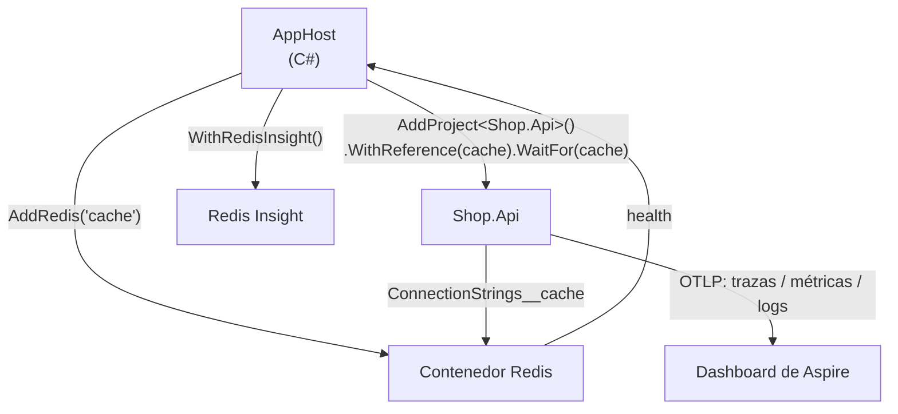

# Redis con Aspire

> [!abstract] En 30 segundos
> - **Qué es:** **Aspire** orquesta tu aplicación distribuida en desarrollo: un *AppHost* en C# declara Redis y tus proyectos, y Aspire gestiona contenedores, **cadenas de conexión**, *service discovery*, **health checks** y **telemetría**.
> - **Para qué:** sustituir al Compose para el desarrollo local .NET, con trazas y métricas listas.
> - **Recuerda:** *opcional* en este curso. El AppHost es para **desarrollo/orquestación**; en producción despliegas con tu plataforma. Las integraciones cliente (`AddRedisClient`) registran el multiplexer, la salud y OpenTelemetry.

> [!info] Lección 4.17 · Nivel 4 — Redis en aplicaciones backend y .NET *(opcional)*
> ⬅️ [[Testing con Redis y Testcontainers]] · ➡️ [[Redis en microservicios]] · 🗺️ [[01 - Redis - Roadmap#Nivel 4 — Redis en aplicaciones backend y .NET|Roadmap]] · 📊 [[03 - Redis - Progreso|Progreso]]
> 🏷️ Paquetes `Aspire.Hosting.Redis` (AppHost) y `Aspire.StackExchange.Redis` (cliente). Los nombres de API pueden variar entre versiones de Aspire: verifica en la documentación de la versión que uses.
> 📌 **Cierra el nivel 4**: continúa con [[Proyecto 04 - Caché de consultas]] y [[Proyecto 05 - Gestión de sesiones]].

## 📌 Definición

Aspire se compone de:

| Pieza | Rol |
|---|---|
| **AppHost** | Proyecto C# que modela la aplicación (recursos y relaciones) |
| **Integraciones de hosting** (`Aspire.Hosting.*`) | Añaden recursos (Redis, Postgres…) al AppHost |
| **Integraciones cliente** (`Aspire.*`) | Registran clientes en tus servicios (SE.Redis, caché distribuida, output cache) |
| **Service defaults** | Resiliencia, telemetría y health checks comunes |
| **Dashboard** | Logs, trazas y métricas de todos los recursos |

## 🎯 ¿Qué problema resuelve?

Con Compose, la cadena de conexión, los puertos y la telemetría los cableas a mano para cada servicio. Aspire **conecta todo desde el código**: tu servicio pide `redis` por nombre y recibe la conexión correcta, con trazas de cada comando en el dashboard.

## 🧠 Conceptos fundamentales

1. **Recurso Redis:** `builder.AddRedis("cache")` crea (en local) un contenedor Redis; puedes añadirle Redis Insight o Redis Commander, volumen de datos y persistencia.
2. **`WithReference(redis)`:** pasa la cadena de conexión al servicio como `ConnectionStrings__cache`.
3. **`WaitFor(redis)`:** el servicio espera a que Redis esté sano antes de arrancar.
4. **Integración cliente:** `builder.AddRedisClient("cache")` registra `IConnectionMultiplexer`, health check y trazas de OpenTelemetry; hay variantes para `IDistributedCache` y *output caching*.
5. **Contraseña:** Aspire genera un parámetro de contraseña para el contenedor y lo inyecta en las referencias; no escribes secretos en el código.
6. **Ciclo de vida del contenedor:** efímero por defecto; `WithLifetime(ContainerLifetime.Persistent)` lo mantiene entre ejecuciones para no perder el estado.
7. **Producción:** Aspire puede generar manifiestos o desplegar con herramientas compatibles, pero el AppHost no es el orquestador de producción.

### Analogía
Un **director de orquesta** que sabe qué instrumento (servicio) necesita qué partitura (conexión) y empieza cuando todos están afinados (health checks).
**Dónde se rompe:** en el concierto real (producción), hay otro director (tu plataforma de despliegue).

## ⚙️ Funcionamiento interno



## 💻 Ejemplos prácticos

```bash
dotnet new aspire-apphost -n Shop.AppHost      # plantilla de AppHost (según la versión de las plantillas instaladas)
dotnet add Shop.AppHost package Aspire.Hosting.Redis
dotnet add Shop.Api package Aspire.StackExchange.Redis
dotnet run --project Shop.AppHost              # abre el dashboard
```

## 🔧 Implementación en .NET

**AppHost**

```csharp
// Shop.AppHost/Program.cs
var builder = DistributedApplication.CreateBuilder(args);

var cache = builder.AddRedis("cache")
                   .WithRedisInsight()                                  // UI de Redis Insight
                   .WithDataVolume()                                    // conserva los datos entre ejecuciones
                   .WithLifetime(ContainerLifetime.Persistent);         // no recrea el contenedor cada vez

builder.AddProject<Projects.Shop_Api>("api")
       .WithReference(cache)
       .WaitFor(cache);

builder.Build().Run();
```

**Servicio (cliente)**

```csharp
// Shop.Api/Program.cs
var builder = WebApplication.CreateBuilder(args);

builder.AddServiceDefaults();               // telemetría, health checks y resiliencia comunes
builder.AddRedisClient("cache");            // IConnectionMultiplexer + health check + OpenTelemetry

// Variantes según lo que uses:
// builder.AddRedisDistributedCache("cache");   // IDistributedCache
// builder.AddRedisOutputCache("cache");        // Output Cache

var app = builder.Build();

app.MapGet("/ping", async (IConnectionMultiplexer mux) =>
    (await mux.GetDatabase().PingAsync()).TotalMilliseconds);

app.MapDefaultEndpoints();                  // /health y /alive en desarrollo
app.Run();
```

> [!tip] Qué ves en el dashboard
> Trazas con **cada comando Redis** como un *span*, métricas del cliente y los logs del contenedor. Es una forma excelente de ver el impacto de la caché y de diagnosticar timeouts durante el desarrollo.

## 🏗️ Casos de uso en arquitectura

| Caso | Uso |
|---|---|
| Desarrollo local de varios servicios + Redis | AppHost como único punto de arranque |
| Pruebas de integración de la aplicación completa | `Aspire.Hosting.Testing` levanta el AppHost en los tests |
| Equipo nuevo | `dotnet run` y todo funciona |
| Demostrar caché y observabilidad | Dashboard con trazas |

### Cuándo NO usarlo
- Si tu equipo no es .NET o ya tiene Compose/Kubernetes maduros para desarrollo.
- Como orquestador de producción.

### Consideraciones de arquitectura

| Dimensión | Qué pensar |
|---|---|
| Paridad con producción | La configuración real (ACL, TLS, HA) no la replica Aspire local |
| Versiones | Alinea la imagen de Redis con producción |
| Dependencia | Atas el desarrollo al ecosistema Aspire |
| Observabilidad | Mantén los mismos nombres de recursos y métricas en producción |

## ⚠️ Errores y anti-patterns

| Error | Por qué duele | Cómo evitarlo |
|---|---|---|
| Suponer que el AppHost es producción | Despliegues improvisados | Pipeline de despliegue propio |
| Olvidar `WaitFor` | Servicio arranca sin Redis listo | `WaitFor(cache)` y cliente tolerante |
| Redis efímero con datos que quieres conservar | Pierdes estado entre ejecuciones | Volumen y vida persistente |
| Imagen de Redis distinta a producción | Resultados diferentes | Fijar la misma versión |

## ✅ Buenas prácticas

1. Nombres de recursos estables (`cache`).
2. `WaitFor` y clientes resilientes.
3. Volumen para datos que importan en desarrollo.
4. Usa las integraciones cliente para telemetría y salud.
5. Pruebas con `Aspire.Hosting.Testing` cuando tengas varios servicios.

## 🎤 Preguntas de entrevista

> [!question]- 1. ¿Qué aporta Aspire frente a Docker Compose en desarrollo?
> Modelado en C#, inyección automática de conexiones, service discovery, health checks y telemetría (dashboard) integrados; a cambio, es específico del ecosistema .NET.

> [!question]- 2. ¿Se usa Aspire para desplegar a producción?
> El AppHost es para orquestación en desarrollo; para producción se usan manifiestos o herramientas de despliegue compatibles, pero la infraestructura (Redis gestionado, Kubernetes) la define tu plataforma.

## 🧪 Ejercicios

### 🟢 Básicos
1. Crea un AppHost con Redis y un servicio que haga `PING`.

### 🟡 Intermedios
2. Añade Redis Insight y un volumen; observa en el dashboard las trazas de los comandos.

### 🔴 Reto Senior
3. Compara el mismo entorno con Compose y con Aspire: líneas de configuración, telemetría disponible y esfuerzo de onboarding.

> [!success]- Soluciones
> **3.** Aspire elimina el cableado de cadenas de conexión y aporta telemetría sin configuración, con menos YAML; Compose es neutro de lenguaje y más cercano a otros entornos. Elige según el equipo y el destino de despliegue.

### ✔️ Checklist de dominio
- [ ] Declaro Redis en un AppHost y lo referencio.
- [ ] Uso la integración cliente con telemetría.
- [ ] Sé qué no es Aspire (producción).

## 📝 Resumen

- Aspire: AppHost + integraciones + dashboard para desarrollo .NET.
- `AddRedis` / `WithReference` / `WaitFor` / `AddRedisClient`.
- Telemetría y salud automáticas.
- No sustituye a tu plataforma de producción.

## 🔗 Referencias

- [Integración Redis de Aspire](https://learn.microsoft.com/dotnet/aspire/caching/stackexchange-redis-integration)
- [Documentación de Aspire](https://learn.microsoft.com/dotnet/aspire/)

## 🔄 Notas relacionadas

- ⬅️ [[Testing con Redis y Testcontainers]] · ➡️ [[Redis en microservicios]]
- Relacionadas: [[Redis con Docker Compose]] · [[Observabilidad de Redis]] · [[Redis con ASP.NET Core]]
