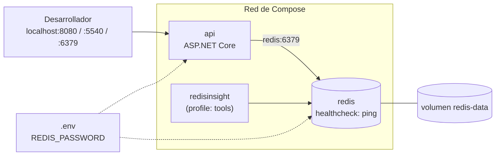

# Redis con Docker Compose

> [!abstract] En 30 segundos
> - **Qué es:** un `compose.yaml` que levanta **tu aplicación .NET + Redis + Redis Insight** con un solo comando, con *healthchecks*, volúmenes y configuración.
> - **Para qué:** entorno local reproducible, igual para todo el equipo y utilizable en CI.
> - **Recuerda:** `depends_on` con `condition: service_healthy`; **contraseña por variable de entorno** (nunca en el repositorio); datos en un **volumen**; publica el puerto de Redis solo en `127.0.0.1`.

> [!info] Lección 4.15 · Nivel 4 — Redis en aplicaciones backend y .NET
> ⬅️ [[Sesiones distribuidas con Redis]] · ➡️ [[Testing con Redis y Testcontainers]] · 🗺️ [[01 - Redis - Roadmap#Nivel 4 — Redis en aplicaciones backend y .NET|Roadmap]] · 📊 [[03 - Redis - Progreso|Progreso]]
> 🏷️ Docker Compose v2 (`docker compose`). Imagen de referencia del curso: `redis:8.10`.

## 📌 Definición

**Docker Compose** describe varios contenedores y su red en un fichero YAML. Para un backend .NET con Redis, el conjunto típico es:

| Servicio | Imagen | Puerto | Rol |
|---|---|---|---|
| `redis` | `redis:8.10` | 6379 | Servidor |
| `api` | Tu imagen (Dockerfile) | 8080 | Aplicación ASP.NET Core |
| `redisinsight` | `redis/redisinsight:latest` | 5540 | Interfaz gráfica (opcional) |

## 🎯 ¿Qué problema resuelve?

«En mi máquina funciona»: versiones distintas de Redis, configuraciones manuales, contraseñas pegadas en notas. Compose deja el entorno **declarado y versionado**, con el mismo comando para desarrollo, pruebas manuales y CI.

## 🧠 Conceptos fundamentales

1. **Red por defecto:** los servicios se alcanzan por **nombre** (`redis:6379`) dentro de la red de Compose; desde tu máquina, por el puerto publicado (`localhost:6379`).
2. **Healthcheck + `depends_on`:** sin ellos, la API arranca antes de que Redis esté listo. Con `condition: service_healthy`, espera. (La aplicación debe seguir siendo tolerante: `AbortOnConnectFail=false`.)
3. **Secretos:** la contraseña viene de un `.env` (fuera de git) o de `secrets`; Compose sustituye `${REDIS_PASSWORD}`.
4. **Volúmenes:** `redis-data:/data` conserva los datos entre reinicios. Si Redis es **solo caché**, puedes prescindir de la persistencia; si guarda sesiones o colas, actívala (`--appendonly yes`).
5. **Límites de memoria:** `--maxmemory` y la política, acordes con el rol (caché → `allkeys-lru`; datos → `noeviction`).
6. **Perfiles (`profiles`):** servicios opcionales (Insight) que solo arrancan con `--profile tools`.
7. **Seguridad local:** publica Redis en `127.0.0.1:6379:6379` para que no sea accesible desde la red; no expongas Redis sin autenticación. Ver [[Seguridad en Redis]].

### Analogía
Una **receta con la lista de ingredientes y el orden de cocción**: cualquiera obtiene el mismo plato, y no se sirve la guarnición (la API) antes de que el guiso (Redis) esté listo.
**Dónde se rompe:** si la receta lleva la contraseña de tu casa escrita, la compartes con todos.

## ⚙️ Funcionamiento interno



## 💻 Ejemplos prácticos

`.env` (no se sube a git; añade `.env` al `.gitignore` y deja un `.env.example`):

```bash
REDIS_PASSWORD=change-me-locally
```

`compose.yaml`:

```yaml
services:
  redis:
    image: redis:8.10
    command:
      - redis-server
      - --appendonly
      - "yes"
      - --maxmemory
      - 256mb
      - --maxmemory-policy
      - noeviction
      - --requirepass
      - ${REDIS_PASSWORD}
    environment:
      REDISCLI_AUTH: ${REDIS_PASSWORD}        # redis-cli lo usa para autenticarse en el healthcheck
    ports:
      - "127.0.0.1:6379:6379"
    volumes:
      - redis-data:/data
    healthcheck:
      test: ["CMD", "redis-cli", "ping"]
      interval: 5s
      timeout: 3s
      retries: 10
    restart: unless-stopped

  api:
    build: .
    depends_on:
      redis:
        condition: service_healthy
    environment:
      ConnectionStrings__Redis: redis:6379,password=${REDIS_PASSWORD},abortConnect=false
      ASPNETCORE_ENVIRONMENT: Development
    ports:
      - "8080:8080"

  redisinsight:
    image: redis/redisinsight:latest
    profiles: ["tools"]
    ports:
      - "127.0.0.1:5540:5540"
    volumes:
      - redisinsight-data:/data

volumes:
  redis-data:
  redisinsight-data:
```

`Dockerfile` de la API (multi-stage):

```dockerfile
FROM mcr.microsoft.com/dotnet/sdk:10.0 AS build
WORKDIR /src
COPY *.csproj .
RUN dotnet restore
COPY . .
RUN dotnet publish -c Release -o /app --no-restore

FROM mcr.microsoft.com/dotnet/aspnet:10.0
WORKDIR /app
COPY --from=build /app .
USER $APP_UID
ENTRYPOINT ["dotnet", "Shop.Api.dll"]
```

Comandos habituales:

```bash
docker compose up -d --build
docker compose ps
docker compose logs -f api
docker compose --profile tools up -d redisinsight
docker compose exec redis redis-cli INFO memory
docker compose down            # conserva el volumen
docker compose down -v         # borra también los datos (¡cuidado!)
```

## 🔧 Implementación en .NET

La API toma la cadena de conexión de `ConnectionStrings:Redis`; el doble guion bajo en `ConnectionStrings__Redis` es la forma de expresar la jerarquía en variables de entorno:

```csharp
// Program.cs (fragmento)
string connection = builder.Configuration.GetConnectionString("Redis")
    ?? throw new InvalidOperationException("Falta ConnectionStrings:Redis");

builder.Services.AddSingleton<IConnectionMultiplexer>(
    ConnectionMultiplexer.Connect(ConfigurationOptions.Parse(connection)));
```

Desde tu máquina (fuera de Compose), usa `localhost:6379,password=...` (con User Secrets). Dentro de Compose, el host es `redis`.

> [!tip] Redis Insight
> Con `docker compose --profile tools up -d redisinsight`, abre `http://localhost:5540` y añade la base con host `redis`, puerto `6379` (al estar en la misma red de Compose) y la contraseña.

## 🏗️ Casos de uso en arquitectura

| Caso | Configuración |
|---|---|
| Desarrollo local | Compose con la API, Redis e Insight |
| CI | Compose (o Testcontainers) con healthchecks |
| Caché pura | Sin volumen ni AOF; `allkeys-lru` |
| Sesiones/colas | Volumen + AOF + `noeviction` |
| Réplicas, Sentinel o Cluster locales | Ver [[Laboratorio 06 - Failover con Sentinel y .NET]] y [[Laboratorio 07 - Redis Cluster local]] |

### Cuándo NO usar Compose
- Producción real: usa un orquestador o un servicio gestionado ([[Redis en Kubernetes]], [[Redis en Azure]]).

### Consideraciones de arquitectura

| Dimensión | Qué pensar |
|---|---|
| Secretos | `.env` fuera de git; en CI, secretos del pipeline |
| Versiones | Fija la etiqueta (`8.10`), no `latest`, para reproducibilidad |
| Red | Publicar solo en `127.0.0.1`; sin Redis abierto a la red |
| Recursos | Límites de CPU/memoria del contenedor coherentes con `maxmemory` |

## ⚠️ Errores y anti-patterns

| Error | Por qué duele | Cómo evitarlo |
|---|---|---|
| `redis:latest` | Cambios inesperados | Etiqueta fija |
| Contraseña en `compose.yaml` | Fuga en el repositorio | `.env`/secrets |
| Redis publicado en `0.0.0.0` sin contraseña | Acceso externo | `127.0.0.1` + autenticación |
| Sin healthcheck | La API arranca antes de tiempo | `service_healthy` |
| `down -v` por costumbre | Pierdes los datos | Solo cuando quieres limpiar |
| `maxmemory` mayor que el límite del contenedor | El contenedor muere por OOM | Dejar margen |

## ✅ Buenas prácticas

1. Versión de imagen fija; `.env.example` versionado.
2. Healthchecks y `depends_on` por salud.
3. Volumen solo si hay datos que conservar.
4. `maxmemory` y política según el rol.
5. Insight en un perfil opcional.

## 🎤 Preguntas de entrevista

> [!question]- 1. ¿Cómo se conecta la API a Redis dentro de Compose?
> Por el nombre del servicio (`redis:6379`) en la red interna; desde el host, por el puerto publicado (`localhost:6379`).

> [!question]- 2. ¿Para qué sirve `condition: service_healthy`?
> Para que un servicio espere a que su dependencia supere el healthcheck antes de arrancar; sin ello, `depends_on` solo ordena el inicio, no la disponibilidad.

> [!question]- 3. ¿Cómo gestionas la contraseña?
> Con variables de entorno de un `.env` no versionado (o secretos de Docker), nunca en el YAML.

## 🧪 Ejercicios

### 🟢 Básicos
1. Levanta Redis con Compose y comprueba `docker compose ps` (healthy).

### 🟡 Intermedios
2. Añade la API y comprueba que arranca tras Redis; detén Redis y observa el comportamiento de la API.
3. Añade Redis Insight con un perfil y conéctate.

### 🔴 Reto Senior
4. Adapta el Compose para una **instancia de caché** y otra de **datos** (sesiones). Define memoria, política y persistencia de cada una.

> [!success]- Soluciones
> **4.** `redis-cache`: sin AOF, `maxmemory 512mb`, `allkeys-lfu`. `redis-data`: AOF activado, volumen, `maxmemory 256mb` con `noeviction`, contraseña y alertas de memoria. La API recibe dos cadenas de conexión.

### ✔️ Checklist de dominio
- [ ] Escribo un Compose con healthchecks y secretos.
- [ ] Publico Redis de forma segura.
- [ ] Distingo caché y datos en la configuración.

## 📝 Resumen

- Compose = API + Redis + Insight reproducibles.
- Healthcheck y `service_healthy`; versión fija; secretos en `.env`.
- Volumen y AOF solo si hay datos que conservar.
- Redis en `127.0.0.1` y con contraseña.

## 🔗 Referencias

- [Docker Compose](https://docs.docker.com/compose/)
- [Redis en Docker](https://redis.io/docs/latest/operate/oss_and_stack/install/install-stack/docker/)
- [Contenedores .NET](https://learn.microsoft.com/dotnet/core/docker/build-container)

## 🔄 Notas relacionadas

- ⬅️ [[Sesiones distribuidas con Redis]] · ➡️ [[Testing con Redis y Testcontainers]]
- Relacionadas: [[Instalación de Redis con Docker]] · [[Redis en Kubernetes]] · [[Laboratorio 00 - Entorno Redis y .NET]]
