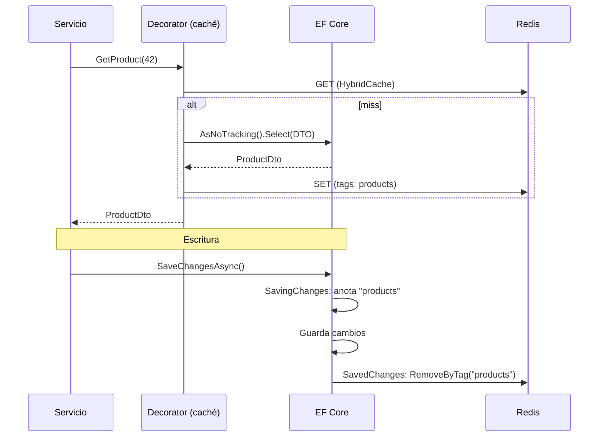

# Redis con Entity Framework Core

> [!abstract] En 30 segundos
> - **Qué es:** combinar EF Core con una caché Redis: **cachear DTO/proyecciones** (no entidades rastreadas) y **invalidar al guardar** con un interceptor o un decorator.
> - **Para qué:** quitar lecturas repetidas de la BD sin servir datos obsoletos ni romper el *change tracking*.
> - **Recuerda:** EF Core **no trae caché de segundo nivel**; cachea resultados de lectura (`AsNoTracking` → DTO), invalida **tras el commit**, y cuidado con el estado compartido en interceptores (son singleton).

> [!info] Lección 4.10 · Nivel 4 — Redis en aplicaciones backend y .NET
> ⬅️ [[Serialización de datos en Redis]] · ➡️ [[Redis como caché de consultas]] · 🗺️ [[01 - Redis - Roadmap#Nivel 4 — Redis en aplicaciones backend y .NET|Roadmap]] · 📊 [[03 - Redis - Progreso|Progreso]]
> 🏷️ EF Core 8+ · `HybridCache` .NET 9+. Existen librerías de terceros de caché de segundo nivel para EF Core: evalúa su mantenimiento y semántica antes de adoptarlas.

## 📌 Definición

EF Core mantiene un *change tracker* por `DbContext` (vida corta) pero no cachea resultados entre contextos. Para cachear con Redis tienes tres piezas:

| Pieza | Rol |
|---|---|
| **Proyección a DTO** | Lo que se guarda en caché: datos de lectura, sin entidades rastreadas |
| **Decorator de repositorio / servicio de consultas** | Lee de caché y, si falla, delega en EF Core |
| **`SaveChangesInterceptor`** | Detecta qué cambió y **invalida** tras confirmar |

## 🎯 ¿Qué problema resuelve?

Las lecturas repetidas de catálogos, configuraciones o perfiles saturan la BD. Pero cachear entidades de EF directamente trae problemas: ciclos, *lazy loading* y proxies, datos de más, y objetos «pegados» a un contexto ya cerrado.

## 🧠 Conceptos fundamentales

1. **Cachea DTO, no entidades:** `Select(p => new ProductDto(...))` + `AsNoTracking()`; es serializable, pequeño y estable.
2. **Lectura:** consulta con `HybridCache.GetOrCreateAsync` (factory = consulta EF).
3. **Escritura:** `SaveChanges` → **después del commit** → invalidar claves o tags afectados.
4. **Interceptor:** `SaveChangesInterceptor` expone `SavingChanges` (antes) y `SavedChanges` (después). Recoge las entidades modificadas **antes** y las invalida **después**.
5. **Interceptores son singleton:** se registran una vez y los usan todos los `DbContext` concurrentes; no guardes estado en campos compartidos. Guarda lo pendiente **por contexto** (por ejemplo, con `ContextId.InstanceId`).
6. **Transacciones explícitas:** `SavedChanges` se dispara cuando se guardan los cambios, que en una transacción explícita ocurre **antes del commit**. Si invalidas ahí, un lector puede recargar el dato antiguo antes de que se confirme. Para garantías fuertes, usa *outbox* o invalida tras el `Commit` ([[Cache consistency]]).
7. **Tags por tipo de entidad:** `products`, `categories`… permiten invalidar listados al cambiar un registro.

### Analogía
Los **informes mensuales** (DTO en caché) se archivan en una carpeta; cada vez que contabilidad cierra un asiento (SaveChanges), una **alarma** (interceptor) avisa de qué informes ya no valen. Pero la alarma debe sonar **tras** cerrar el asiento, no antes.
**Dónde se rompe:** si suena antes del cierre, alguien puede rehacer el informe con datos antiguos.

## ⚙️ Funcionamiento interno



## 💻 Ejemplos prácticos

Qué ocurre en Redis al cambiar un producto:

```text
GET shop:product:42      → hit
UPDATE products SET …    → (BD)
RemoveByTag("products")  → lo creado antes de ahora con ese tag deja de valer
GET shop:product:42      → miss → recarga desde la BD
```

## 🔧 Implementación en .NET

**1. Lectura: DTO + AsNoTracking + HybridCache**

```csharp
using Microsoft.EntityFrameworkCore;
using Microsoft.Extensions.Caching.Hybrid;

public sealed record ProductDto(int Id, string Name, decimal Price);

public class Product { public int Id { get; set; } public string Name { get; set; } = ""; public decimal Price { get; set; } }

public class ShopDbContext(DbContextOptions<ShopDbContext> options) : DbContext(options)
{
    public DbSet<Product> Products => Set<Product>();
}

public interface IProductQueries
{
    ValueTask<ProductDto?> GetAsync(int id, CancellationToken ct);
}

public class ProductQueries(ShopDbContext db) : IProductQueries
{
    public async ValueTask<ProductDto?> GetAsync(int id, CancellationToken ct) =>
        await db.Products.AsNoTracking()
            .Where(p => p.Id == id)
            .Select(p => new ProductDto(p.Id, p.Name, p.Price))
            .FirstOrDefaultAsync(ct);
}

// Decorator: la caché envuelve la consulta real
public class CachedProductQueries(IProductQueries inner, HybridCache cache) : IProductQueries
{
    public ValueTask<ProductDto?> GetAsync(int id, CancellationToken ct) =>
        cache.GetOrCreateAsync(
            $"shop:product:{id}",
            async token => await inner.GetAsync(id, token),
            tags: ["products"],
            cancellationToken: ct);
}
```

**2. Invalidación tras guardar con un interceptor (estado por contexto)**

```csharp
using System.Collections.Concurrent;
using Microsoft.EntityFrameworkCore;
using Microsoft.EntityFrameworkCore.Diagnostics;
using Microsoft.Extensions.Caching.Hybrid;

public sealed class CacheInvalidationInterceptor(HybridCache cache) : SaveChangesInterceptor
{
    // Un interceptor es singleton: el estado pendiente se guarda por contexto
    private readonly ConcurrentDictionary<Guid, HashSet<string>> _pending = new();

    public override ValueTask<InterceptionResult<int>> SavingChangesAsync(
        DbContextEventData data, InterceptionResult<int> result, CancellationToken ct = default)
    {
        if (data.Context is { } ctx)
        {
            var tags = ctx.ChangeTracker.Entries()
                .Where(e => e.State is EntityState.Added or EntityState.Modified or EntityState.Deleted)
                .Select(e => e.Metadata.ClrType.Name.ToLowerInvariant() + "s")   // Product -> products
                .ToHashSet();
            if (tags.Count > 0) _pending[ctx.ContextId.InstanceId] = tags;
        }
        return base.SavingChangesAsync(data, result, ct);
    }

    public override async ValueTask<int> SavedChangesAsync(
        SaveChangesCompletedEventData data, int result, CancellationToken ct = default)
    {
        if (data.Context is { } ctx && _pending.TryRemove(ctx.ContextId.InstanceId, out var tags))
            foreach (string tag in tags)
                await cache.RemoveByTagAsync(tag, ct);

        return await base.SavedChangesAsync(data, result, ct);
    }

    public override Task SaveChangesFailedAsync(
        DbContextErrorEventData data, CancellationToken ct = default)
    {
        if (data.Context is { } ctx) _pending.TryRemove(ctx.ContextId.InstanceId, out _);
        return base.SaveChangesFailedAsync(data, ct);
    }
}
```

```csharp
// Program.cs
builder.Services.AddSingleton<CacheInvalidationInterceptor>();
builder.Services.AddDbContext<ShopDbContext>((sp, options) => options
    .UseSqlServer(builder.Configuration.GetConnectionString("Shop"))
    .AddInterceptors(sp.GetRequiredService<CacheInvalidationInterceptor>()));

builder.Services.AddScoped<ProductQueries>();
builder.Services.AddScoped<IProductQueries>(sp =>
    new CachedProductQueries(sp.GetRequiredService<ProductQueries>(), sp.GetRequiredService<HybridCache>()));
```

> [!warning] Transacciones explícitas
> Con `BeginTransactionAsync`, el `SavedChanges` llega **antes** del `Commit`. Si necesitas garantía fuerte, publica la invalidación tras el commit (evento de outbox o `DbTransaction` ligado a un callback) y mantén el TTL como red de seguridad.

## 🏗️ Casos de uso en arquitectura

| Caso | Diseño |
|---|---|
| Catálogo y datos de referencia | Decorator de consultas + tags por entidad |
| Perfil de usuario | Clave por usuario; invalidar en el comando de edición |
| Informes agregados | Caché con TTL corto, invalidación por tag |
| Lecturas muy dinámicas | No cachear; optimizar la consulta |

### Cuándo NO cachear
- Entidades que vas a modificar en la misma petición (necesitas el *tracking*).
- Datos que cambian en cada petición.

### Consideraciones de arquitectura

| Dimensión | Qué pensar |
|---|---|
| Separación | Lecturas (DTO) y escrituras (entidades) separadas: CQRS ligero |
| Consistencia | Invalidar tras commit; TTL como seguridad |
| Multi-instancia | L1 de otras instancias: TTL corto ([[HybridCache]]) |
| Pruebas | Integración con BD real y Redis real |

## ⚠️ Errores y anti-patterns

| Error | Por qué duele | Cómo evitarlo |
|---|---|---|
| Cachear entidades rastreadas | Ciclos, proxies, estado inconsistente | DTO + `AsNoTracking` |
| Estado compartido en un interceptor singleton | Invalidaciones cruzadas entre peticiones | Estado por contexto |
| Invalidar antes del commit | Recarga del dato antiguo | Tras commit / outbox |
| Invalidar con `KEYS` | Bloquea Redis | Tags / versiones |
| Olvidar escrituras masivas (`ExecuteUpdate`/`ExecuteDelete`) | El interceptor de SaveChanges **no** las ve | Invalidar explícitamente |

## ✅ Buenas prácticas

1. Cachea proyecciones, no entidades.
2. Interceptor sin estado compartido; invalida tras el guardado.
3. Invalidación explícita para `ExecuteUpdate`/`ExecuteDelete` y SQL crudo.
4. TTL siempre.
5. Pruebas de integración de la invalidación.

## 🎤 Preguntas de entrevista

> [!question]- 1. ¿Cómo cachearías consultas EF sin servir datos obsoletos?
> DTO en `HybridCache` con tags por entidad, y un `SaveChangesInterceptor` que invalida esos tags tras guardar; TTL corto como red de seguridad; y para operaciones masivas, invalidación explícita.

> [!question]- 2. ¿Por qué un interceptor no debe guardar estado en campos?
> Porque se registra como singleton y lo comparten todos los `DbContext` concurrentes; el estado debe asociarse al contexto (`ContextId`).

> [!question]- 3. ¿Qué no detecta el interceptor de `SaveChanges`?
> Los cambios hechos con `ExecuteUpdate`/`ExecuteDelete` o SQL directo, que no pasan por el *change tracker*.

## 🧪 Ejercicios

### 🟢 Básicos
1. Implementa `CachedProductQueries` y comprueba con logs de EF que el segundo acceso no llega a la BD.

### 🟡 Intermedios
2. Implementa el interceptor y escribe un test que verifique que, tras `SaveChanges`, la lectura devuelve el valor nuevo.

### 🔴 Reto Senior
3. Demuestra con un test el fallo de invalidar dentro de una transacción explícita y propón la solución.

> [!success]- Soluciones
> **3.** Dentro de la transacción: actualizar, `SaveChanges` (invalida), otra tarea lee y recarga el valor antiguo (no hay commit), y luego haces `Commit`: la caché queda obsoleta. Solución: invalidar tras `Commit` (outbox/evento) y mantener TTL.

### ✔️ Checklist de dominio
- [ ] Cacheo DTO y no entidades.
- [ ] Invalido tras el commit con estado por contexto.
- [ ] Contemplo operaciones masivas.

## 📝 Resumen

- EF Core no tiene caché de segundo nivel: cachea proyecciones.
- Decorator para leer; interceptor para invalidar.
- Estado por contexto y tras commit.
- `ExecuteUpdate`/`ExecuteDelete` requieren invalidación explícita.

## 🔗 Referencias

- [Interceptores de EF Core](https://learn.microsoft.com/ef/core/logging-events-diagnostics/interceptors)
- [HybridCache](https://learn.microsoft.com/aspnet/core/performance/caching/hybrid)

## 🔄 Notas relacionadas

- ⬅️ [[Serialización de datos en Redis]] · ➡️ [[Redis como caché de consultas]]
- Relacionadas: [[HybridCache]] · [[Cache invalidation]] · [[Cache consistency]] · [[Proyecto 04 - Caché de consultas]]
