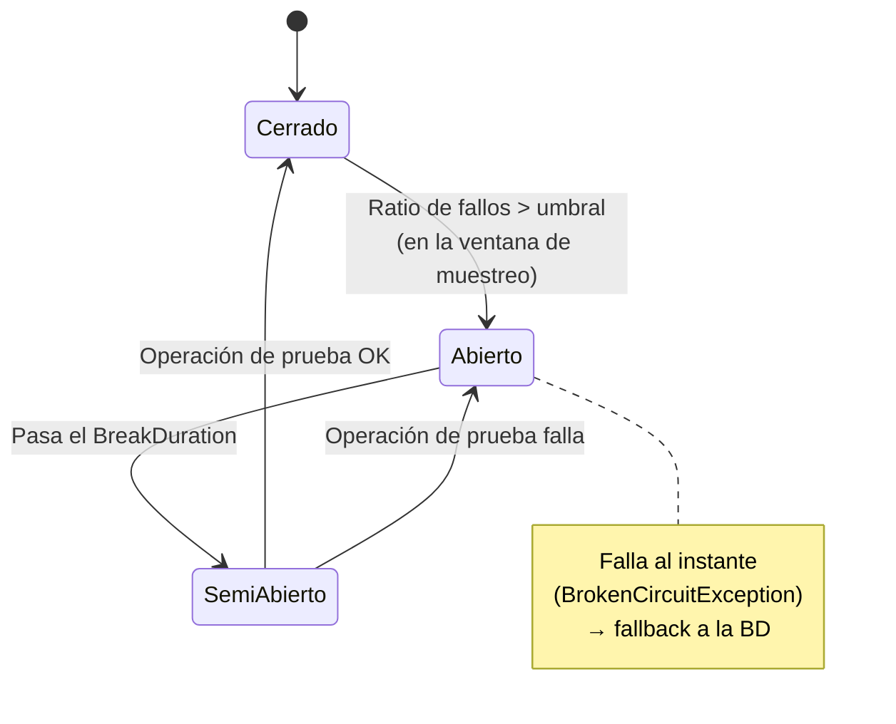
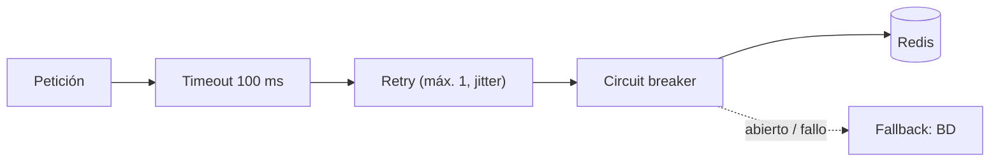

# Redis con Polly y resiliencia

> [!abstract] En 30 segundos
> - **Qué es:** proteger tu aplicación de los fallos de Redis con **timeouts, reintentos prudentes, circuit breaker y *fallback* a la fuente** (Polly v8, `ResiliencePipeline`).
> - **Para qué:** que Redis caído o lento **degrade** el servicio en vez de tumbarlo.
> - **Recuerda:** un timeout **corto**; reintentos **pocos, con jitter y solo en operaciones idempotentes** (reintentar amplifica la carga); circuit breaker para **dejar de llamar** cuando Redis está mal; y el *fallback* de una caché es **ir a la fuente**.

> [!info] Lección 4.13 · Nivel 4 — Redis en aplicaciones backend y .NET
> ⬅️ [[Redis en Clean Architecture]] · ➡️ [[Sesiones distribuidas con Redis]] · 🗺️ [[01 - Redis - Roadmap#Nivel 4 — Redis en aplicaciones backend y .NET|Roadmap]] · 📊 [[03 - Redis - Progreso|Progreso]]
> 🏷️ Polly v8 (`Polly.Core`); integrable con `Microsoft.Extensions.Resilience`.

## 📌 Definición

**Polly** es la librería de resiliencia de .NET. En la versión 8 se construyen **pipelines** (`ResiliencePipeline`) combinando estrategias:

| Estrategia | Qué hace | Para Redis |
|---|---|---|
| **Timeout** | Cancela si tarda demasiado | Obligatorio: 50-200 ms para caché |
| **Retry** | Reintenta con espera | Pocos (1-2), con *backoff* y jitter |
| **Circuit breaker** | Abre el circuito tras muchos fallos: falla rápido | Evita saturar un Redis enfermo |
| **Fallback** | Valor alternativo | Ir a la BD o devolver un valor por defecto |
| **Bulkhead / limitador** | Limita concurrencia | Protege la BD cuando la caché falla |

## 🎯 ¿Qué problema resuelve?

Sin protección, cuando Redis se cae o responde lento, cada petición espera hasta el timeout del cliente (3-5 s), se acumulan hilos y tareas, y la API entera se degrada. Con resiliencia, la caída de la caché es un incidente menor.

## 🧠 Conceptos fundamentales

1. **Caché = optimización:** si falla, se **degrada**, no se rompe. El *fallback* es la fuente de verdad.
2. **Timeouts cortos por operación:** de caché, 50-200 ms es mucho; mejor tratar «lento» como «miss» que esperar. Debe ser menor que el timeout de la petición HTTP y coherente con los del cliente SE.Redis ([[ConnectionMultiplexer]]).
3. **Reintentos con cuidado:**
   - Solo en operaciones **idempotentes** (lecturas, `SET`; no `INCR`).
   - 1-2 intentos, *backoff* exponencial y **jitter**.
   - Los reintentos multiplican la carga en un Redis ya débil.
   - Si el fallo es de la aplicación (`RedisServerException`, p. ej. `OOM`, `WRONGTYPE`), no tiene sentido reintentar.
4. **Circuit breaker:** tras *X %* de fallos en una ventana, **abre** y falla inmediatamente durante un tiempo; luego deja pasar pruebas (**half-open**). Evita encolar miles de operaciones contra un Redis caído.
5. **Excepciones de SE.Redis:** `RedisConnectionException` (sin conexión), `RedisTimeoutException`, `RedisServerException` (error del servidor: no transitorio), `RedisException` (base).
6. **Operaciones críticas:** una escritura obligatoria (sesión, lock) no puede «degradar»: define comportamiento explícito (error controlado).

### Analogía
El **cuadro eléctrico**: el diferencial (circuit breaker) salta cuando hay un cortocircuito para proteger el edificio; no sigues intentando encender una y otra vez.
**Dónde se rompe:** un diferencial demasiado sensible apaga la casa por nada (umbrales muy bajos).

## ⚙️ Funcionamiento interno





## 💻 Ejemplos prácticos

Simula una caída de Redis en laboratorio:

```bash
docker pause redis        # las operaciones se cuelgan → timeouts
docker unpause redis
docker stop redis         # conexión rechazada → RedisConnectionException
docker start redis
```

Observa en los logs: primeros timeouts → circuito abierto → llamadas que fallan al instante → recuperación.

## 🔧 Implementación en .NET

```csharp
using Polly;
using Polly.CircuitBreaker;
using Polly.Retry;
using Polly.Timeout;
using StackExchange.Redis;

public static class RedisResilience
{
    public static ResiliencePipeline Create() =>
        new ResiliencePipelineBuilder()
            // Orden: de fuera hacia dentro. Circuit breaker fuera del retry para contar los fallos reales.
            .AddCircuitBreaker(new CircuitBreakerStrategyOptions
            {
                FailureRatio = 0.5,
                SamplingDuration = TimeSpan.FromSeconds(20),
                MinimumThroughput = 10,
                BreakDuration = TimeSpan.FromSeconds(15),
                ShouldHandle = new PredicateBuilder()
                    .Handle<RedisConnectionException>()
                    .Handle<RedisTimeoutException>()
                    .Handle<TimeoutRejectedException>()
            })
            .AddRetry(new RetryStrategyOptions
            {
                MaxRetryAttempts = 1,
                Delay = TimeSpan.FromMilliseconds(30),
                BackoffType = DelayBackoffType.Exponential,
                UseJitter = true,
                ShouldHandle = new PredicateBuilder()
                    .Handle<RedisConnectionException>()
                    .Handle<RedisTimeoutException>()
            })
            .AddTimeout(TimeSpan.FromMilliseconds(100))   // por intento
            .Build();
}
```

```csharp
using System.Text.Json;
using Polly;
using Polly.CircuitBreaker;
using StackExchange.Redis;

public record Product(int Id, string Name, decimal Price);

public interface IProductRepository
{
    Task<Product?> FindAsync(int id, CancellationToken ct);
}

public class ResilientProductCache(IDatabase redis, IProductRepository repo)
{
    private static readonly ResiliencePipeline Pipeline = RedisResilience.Create();

    public async Task<Product?> GetAsync(int id, CancellationToken ct)
    {
        string key = $"shop:product:{id}";

        // 1. Intentar la caché con resiliencia; cualquier fallo = miss
        string? cached = null;
        try
        {
            cached = await Pipeline.ExecuteAsync(
                async token => (string?)await redis.StringGetAsync(key), ct);
        }
        catch (Exception ex) when (ex is BrokenCircuitException
                                       or RedisException
                                       or Polly.Timeout.TimeoutRejectedException)
        {
            // Redis degradado: seguimos con la fuente
        }

        if (cached is not null) return JsonSerializer.Deserialize<Product>(cached);

        // 2. Fuente de verdad
        Product? product = await repo.FindAsync(id, ct);

        // 3. Rellenar la caché sin hacer esperar al usuario (best effort)
        if (product is not null)
        {
            try
            {
                await Pipeline.ExecuteAsync(async token =>
                    await redis.StringSetAsync(key, JsonSerializer.Serialize(product), TimeSpan.FromMinutes(10)), ct);
            }
            catch (Exception) { /* no es crítico */ }
        }
        return product;
    }
}
```

> [!tip] Con `Microsoft.Extensions.Resilience`
> Puedes registrar el pipeline por nombre (`services.AddResiliencePipeline("redis", b => …)`) y obtenerlo con `ResiliencePipelineProvider<string>`, con telemetría integrada y configuración centralizada.

> [!warning] No reintentes lo que no es idempotente
> Reintentar un `INCR` por un timeout puede contar dos veces (el primero pudo ejecutarse). Para esas operaciones, usa claves de idempotencia o acepta el error ([[Idempotencia con Redis]]).

## 🏗️ Casos de uso en arquitectura

| Escenario | Estrategia |
|---|---|
| Caché de lectura | Timeout corto + circuit breaker + fallback a la BD |
| Rate limiter | Fail-open o fail-closed según el endpoint |
| Sesiones | Error controlado (no hay alternativa); alta disponibilidad de Redis |
| Locks | Timeout y reintento acotado; sin lock, no se hace la operación |

### Cuándo NO reintentar
- Errores del servidor (`OOM`, `WRONGTYPE`, `READONLY`).
- Operaciones no idempotentes sin protección.

### Consideraciones de arquitectura

| Dimensión | Qué pensar |
|---|---|
| Umbrales | Ajústalos con pruebas de caos, no por intuición |
| Observabilidad | Métricas de estado del circuito, tasas de fallback |
| Capacidad | La BD debe aguantar el fallback (bulkhead) |
| Coherencia de timeouts | Polly < cliente SE.Redis < petición HTTP |

## ⚠️ Errores y anti-patterns

| Error | Por qué duele | Cómo evitarlo |
|---|---|---|
| Reintentos agresivos | Tormenta de reintentos sobre Redis | 1-2, jitter |
| Sin timeout propio | La petición espera 5 s por una caché | 50-200 ms |
| Reintentar errores no transitorios | Pérdida de tiempo | Filtrar con `ShouldHandle` |
| Circuit breaker sin fallback | Errores directos al usuario | Fallback a la fuente |
| No probar la caída | Descubrirlo en producción | Chaos con `docker pause/stop` |

## ✅ Buenas prácticas

1. Caché degradable: «lento» = «miss».
2. Timeout corto, retry mínimo, circuit breaker y fallback.
3. Reintenta solo operaciones idempotentes.
4. Pipelines con nombre y telemetría.
5. Prueba la caída de Redis en integración.

## 🎤 Preguntas de entrevista

> [!question]- 1. ¿Qué pasa en tu API si Redis se cae?
> Debe degradarse: timeouts cortos, circuit breaker para fallar rápido y fallback a la BD (protegida por un límite de concurrencia). Las operaciones críticas (sesión, lock) devuelven un error controlado.

> [!question]- 2. ¿Por qué cuidado con los reintentos?
> Multiplican la carga sobre un servicio ya degradado y, si la operación no es idempotente, pueden duplicar efectos.

> [!question]- 3. ¿Qué hace un circuit breaker?
> Tras un porcentaje de fallos en una ventana, abre el circuito y falla al instante durante un tiempo; luego permite pruebas (half-open) y se cierra si funcionan.

## 🧪 Ejercicios

### 🟢 Básicos
1. Implementa el pipeline y úsalo en una lectura de caché.

### 🟡 Intermedios
2. Con `docker pause redis`, mide la latencia de la API con y sin circuit breaker.

### 🔴 Reto Senior
3. Tras un failover de Redis de 30 s, tu API devuelve 500 durante 2 minutos. Analiza las causas posibles (timeouts, reintentos, circuito, BD saturada) y corrígelo.

> [!success]- Soluciones
> **3.** Revisa: ¿timeouts largos que acumulan peticiones?, ¿reintentos que saturan?, ¿circuito que tarda en cerrar (BreakDuration alto)?, ¿BD sin bulkhead al recibir el fallback? Ajusta timeouts, limita reintentos, reduce `BreakDuration`, añade límite de concurrencia a la BD y degradación.

### ✔️ Checklist de dominio
- [ ] Configuro timeout, retry, circuit breaker y fallback.
- [ ] Distingo errores transitorios y no transitorios.
- [ ] Pruebo la caída de Redis.

## 📝 Resumen

- Caché degradable: fallo = miss.
- Timeout corto, retry mínimo e idempotente, circuit breaker y fallback.
- Protege la BD durante el fallback.
- Prueba con caos.

## 🔗 Referencias

- [Polly v8](https://www.pollydocs.org/)
- [Resiliencia en .NET](https://learn.microsoft.com/dotnet/core/resilience/)

## 🔄 Notas relacionadas

- ⬅️ [[Redis en Clean Architecture]] · ➡️ [[Sesiones distribuidas con Redis]]
- Relacionadas: [[ConnectionMultiplexer]] · [[Cache avalanche]] · [[Alta disponibilidad en Redis]] · [[Proyecto 04 - Caché de consultas]]
