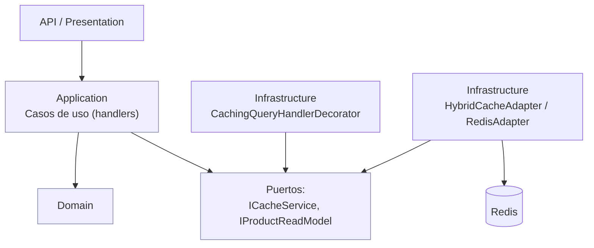

# Redis en Clean Architecture

> [!abstract] En 30 segundos
> - **Qué es:** ubicar Redis en una arquitectura por capas **sin filtrar detalles de infraestructura al dominio**: puertos en *Application*, adaptadores en *Infrastructure* y **decorators** o *pipeline behaviors* para la caché transversal.
> - **Para qué:** poder cambiar de tecnología de caché, probar sin Redis y mantener el dominio limpio.
> - **Recuerda:** la **regla de dependencia** (hacia dentro); el dominio no conoce `IDatabase`; la caché de consultas es un decorator del handler/repositorio, no código dentro del caso de uso.

> [!info] Lección 4.12 · Nivel 4 — Redis en aplicaciones backend y .NET
> ⬅️ [[Redis como caché de consultas]] · ➡️ [[Redis con Polly y resiliencia]] · 🗺️ [[01 - Redis - Roadmap#Nivel 4 — Redis en aplicaciones backend y .NET|Roadmap]] · 📊 [[03 - Redis - Progreso|Progreso]]
> 🏷️ Patrón de arquitectura; ejemplos con `HybridCache` (.NET 9+).

## 📌 Definición

En **Clean Architecture** (o arquitectura hexagonal) las dependencias apuntan hacia el dominio:

| Capa | Contiene | ¿Conoce Redis? |
|---|---|---|
| **Domain** | Entidades, reglas | No |
| **Application** | Casos de uso, **puertos** (interfaces) | No (solo abstracciones) |
| **Infrastructure** | **Adaptadores**: SE.Redis, HybridCache, EF Core | **Sí** |
| **Presentation / API** | Endpoints, DI | Solo para el registro |

## 🎯 ¿Qué problema resuelve?

Cuando `IDatabase` se usa en handlers y entidades, cambiar la caché, probar sin Redis o aplicar políticas transversales (TTL, métricas, resiliencia) exige tocar todo. Con puertos y decorators, la caché es un detalle intercambiable.

## 🧠 Conceptos fundamentales

1. **Puertos según la intención**, no según la tecnología:
   - Caché genérica: `ICacheService` (get/set/remove con TTL y tags).
   - Específicos de negocio: `IProductReadModel`, `IRateLimiter`, `IDistributedLock`, `IIdempotencyStore`. Estos son mejores: expresan lo que hace el sistema.
2. **Decorator:** una clase que implementa la misma interfaz que el servicio real y lo envuelve añadiendo caché. La composición se hace en el registro de DI.
3. **Pipeline behavior / decorator de handlers (CQRS):** las **consultas** marcadas como cacheables (`ICacheableQuery`) pasan por un decorator que usa la caché; los **comandos** invalidan.
4. **Dónde invalidar:** en el **handler de comandos** o mediante **eventos de dominio** (`ProductUpdated`) que un manejador en Infrastructure usa para invalidar.
5. **Errores de infraestructura:** el adaptador captura las excepciones de Redis y las convierte (o degrada) para que Application no vea `RedisException`.
6. **Pruebas:** el puerto se sustituye por un *fake* en memoria en pruebas unitarias; la integración real se prueba aparte con Testcontainers.

### Analogía
Los **enchufes estándar** de un edificio: los aparatos (casos de uso) solo conocen el enchufe (puerto); la compañía eléctrica (Redis/HybridCache) puede cambiar sin tocar los aparatos.
**Dónde se rompe:** si un aparato lleva el cable de la central soldado (uso directo de `IDatabase`), no puedes cambiar de proveedor.

## ⚙️ Funcionamiento interno



## 💻 Ejemplos prácticos

Estructura de la solución:

```text
src/
  Shop.Domain/               (sin dependencias)
  Shop.Application/          (puertos + casos de uso)
      Abstractions/ICacheService.cs
      Products/GetProduct/GetProductQuery.cs
  Shop.Infrastructure/       (adaptadores)
      Caching/HybridCacheService.cs
      Caching/CachingQueryHandlerDecorator.cs
  Shop.Api/                  (endpoints + composición)
```

## 🔧 Implementación en .NET

**Application: puertos y consultas cacheables**

```csharp
// Shop.Application
public interface ICacheService
{
    ValueTask<T> GetOrCreateAsync<T>(string key, Func<CancellationToken, ValueTask<T>> factory,
        TimeSpan? ttl = null, IEnumerable<string>? tags = null, CancellationToken ct = default);
    ValueTask RemoveByTagAsync(string tag, CancellationToken ct = default);
}

public interface IQueryHandler<in TQuery, TResult>
{
    Task<TResult> HandleAsync(TQuery query, CancellationToken ct);
}

// Marca las consultas que pueden cachearse y cómo
public interface ICacheableQuery
{
    string CacheKey { get; }
    TimeSpan? Ttl => null;
    IReadOnlyCollection<string> Tags => [];
}

public sealed record ProductDto(int Id, string Name, decimal Price);

public sealed record GetProductQuery(int Id) : ICacheableQuery
{
    public string CacheKey => $"shop:product:{Id}";
    public TimeSpan? Ttl => TimeSpan.FromMinutes(10);
    public IReadOnlyCollection<string> Tags => ["products"];
}
```

**Infrastructure: adaptador y decorator**

```csharp
// Shop.Infrastructure
using Microsoft.Extensions.Caching.Hybrid;

public sealed class HybridCacheService(HybridCache cache) : ICacheService
{
    public ValueTask<T> GetOrCreateAsync<T>(string key, Func<CancellationToken, ValueTask<T>> factory,
        TimeSpan? ttl = null, IEnumerable<string>? tags = null, CancellationToken ct = default) =>
        cache.GetOrCreateAsync(key, factory,
            ttl is { } t ? new HybridCacheEntryOptions { Expiration = t } : null,
            tags, ct);

    public ValueTask RemoveByTagAsync(string tag, CancellationToken ct = default) =>
        cache.RemoveByTagAsync(tag, ct);
}

public sealed class CachingQueryHandlerDecorator<TQuery, TResult>(
    IQueryHandler<TQuery, TResult> inner, ICacheService cache) : IQueryHandler<TQuery, TResult>
    where TQuery : ICacheableQuery
{
    public async Task<TResult> HandleAsync(TQuery query, CancellationToken ct) =>
        await cache.GetOrCreateAsync(
            query.CacheKey,
            async token => await inner.HandleAsync(query, token),
            query.Ttl, query.Tags, ct);
}
```

**Composición (API)**

```csharp
// Registro manual del decorator (sin librerías de terceros)
builder.Services.AddScoped<GetProductQueryHandler>();
builder.Services.AddScoped<IQueryHandler<GetProductQuery, ProductDto?>>(sp =>
    new CachingQueryHandlerDecorator<GetProductQuery, ProductDto?>(
        sp.GetRequiredService<GetProductQueryHandler>(),
        sp.GetRequiredService<ICacheService>()));
builder.Services.AddSingleton<ICacheService, HybridCacheService>();
```

> [!note] Librerías
> Para registrar decorators de forma genérica puedes usar *Scrutor* (`services.Decorate(...)`), y para pipelines, MediatR u otro mediador (revisa el modelo de licencia vigente) o un pipeline propio como el anterior.

**Invalidación desde el comando**

```csharp
public sealed class UpdateProductHandler(IProductRepository repo, ICacheService cache)
{
    public async Task HandleAsync(UpdateProductCommand cmd, CancellationToken ct)
    {
        await repo.UpdateAsync(cmd.Id, cmd.Name, cmd.Price, ct);
        await cache.RemoveByTagAsync("products", ct);     // tras la escritura
    }
}

public sealed record UpdateProductCommand(int Id, string Name, decimal Price);

public interface IProductRepository
{
    Task UpdateAsync(int id, string name, decimal price, CancellationToken ct);
}
```

## 🏗️ Casos de uso en arquitectura

| Necesidad | Puerto |
|---|---|
| Caché de lecturas | `ICacheService` + decorator de consultas |
| Límite de peticiones | `IRateLimiter` |
| Bloqueo distribuido | `IDistributedLock` |
| Idempotencia | `IIdempotencyStore` |
| Colas | `IMessageQueue` |

### Cuándo NO abstraer
- Si usas estructuras de Redis muy específicas (sorted sets para un ranking) y no habrá otro proveedor: crea un puerto **de negocio** (`ILeaderboard`) en lugar de una abstracción genérica de Redis.

### Consideraciones de arquitectura

| Dimensión | Qué pensar |
|---|---|
| Fugas | Ningún tipo `StackExchange.Redis.*` en Domain/Application |
| Resiliencia | Los adaptadores traducen/absorben errores de Redis |
| Pruebas | Fakes en unitarias; Testcontainers en integración |
| Cohesión | Puertos por intención de negocio, no «RedisService» genérico |

## ⚠️ Errores y anti-patterns

| Error | Por qué duele | Cómo evitarlo |
|---|---|---|
| `IDatabase` en handlers y entidades | Acoplamiento; pruebas difíciles | Puertos |
| Un `IRedisService` genérico que expone todo | Abstracción que no abstrae | Puertos de negocio |
| Caché dentro de la entidad de dominio | Mezcla de responsabilidades | Decorator en Infrastructure |
| Invalidación olvidada en nuevos comandos | Datos obsoletos | Eventos de dominio o convención por tag |
| Capturar excepciones de Redis en Application | Fuga de infraestructura | En el adaptador |

## ✅ Buenas prácticas

1. Puertos por intención; adaptadores en Infrastructure.
2. Decorator para consultas, invalidación en comandos o eventos.
3. Sin tipos de Redis fuera de Infrastructure (compruébalo con tests de arquitectura).
4. Fakes en memoria para unitarias.
5. Integración real con Testcontainers.

## 🎤 Preguntas de entrevista

> [!question]- 1. ¿Dónde pondrías el código de caché en Clean Architecture?
> En Infrastructure, como adaptador de un puerto definido en Application, y aplicado a las consultas mediante un decorator o pipeline behavior; el dominio no lo conoce.

> [!question]- 2. ¿Por qué un `IRedisService` genérico es mala idea?
> Porque abstrae la tecnología, no la intención de negocio, y acaba exponiendo la API de Redis. Es mejor un puerto como `ILeaderboard` o `IIdempotencyStore`.

> [!question]- 3. ¿Cómo compruebas que no se filtra Redis a Application?
> Con tests de arquitectura (NetArchTest, ArchUnitNET) que verifican que Application no referencia `StackExchange.Redis`.

## 🧪 Ejercicios

### 🟢 Básicos
1. Define `ICacheService` y un adaptador con `HybridCache`.

### 🟡 Intermedios
2. Implementa el decorator para consultas y comprueba con un fake que el handler real se invoca una vez.

### 🔴 Reto Senior
3. Escribe un test de arquitectura que falle si Domain o Application referencian `StackExchange.Redis`.

> [!success]- Soluciones
> **3.** Con NetArchTest: `Types.InAssembly(applicationAssembly).ShouldNot().HaveDependencyOn("StackExchange.Redis").GetResult().IsSuccessful`.

### ✔️ Checklist de dominio
- [ ] Defino puertos por intención.
- [ ] Aplico decorators para la caché.
- [ ] Verifico que no hay fugas de infraestructura.

## 📝 Resumen

- Redis vive en Infrastructure tras puertos definidos en Application.
- Decorator/pipeline para consultas; invalidación en comandos o eventos.
- Puertos de negocio mejor que abstracciones genéricas.
- Tests de arquitectura y fakes.

## 🔗 Referencias

- [Arquitecturas comunes en aplicaciones web (Microsoft)](https://learn.microsoft.com/dotnet/architecture/modern-web-apps-azure/common-web-application-architectures)
- [Decorator pattern](https://learn.microsoft.com/dotnet/architecture/microservices/microservice-ddd-cqrs-patterns/)

## 🔄 Notas relacionadas

- ⬅️ [[Redis como caché de consultas]] · ➡️ [[Redis con Polly y resiliencia]]
- Relacionadas: [[HybridCache]] · [[Testing con Redis y Testcontainers]] · [[Idempotencia con Redis]]
