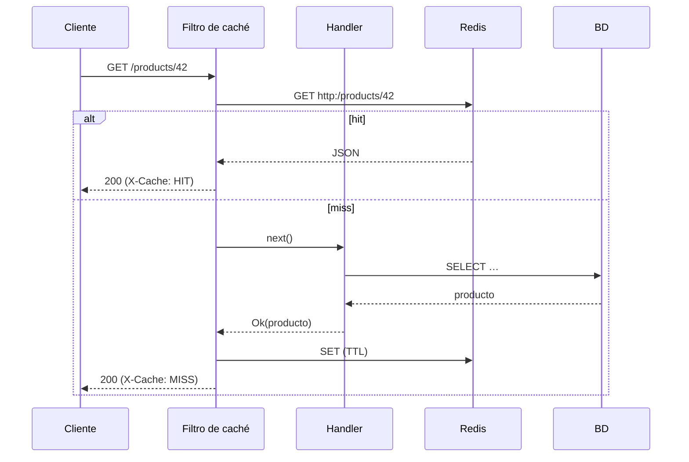

# Redis en Minimal APIs

> [!abstract] En 30 segundos
> - **Qué es:** usar Redis en endpoints de **Minimal APIs**: cache-aside en el handler, **filtros de endpoint** reutilizables y resultados tipados.
> - **Para qué:** endpoints rápidos y delgados, con la caché fuera de la lógica de negocio y con métricas de hit/miss.
> - **Recuerda:** el handler recibe servicios por inyección; un `IEndpointFilter` evita repetir la lógica de caché; y para respuestas HTTP completas existe [[Redis Output Cache]].

> [!info] Lección 4.5 · Nivel 4 — Redis en aplicaciones backend y .NET
> ⬅️ [[Redis con ASP.NET Core]] · ➡️ [[IDistributedCache]] · 🗺️ [[01 - Redis - Roadmap#Nivel 4 — Redis en aplicaciones backend y .NET|Roadmap]] · 📊 [[03 - Redis - Progreso|Progreso]]
> 🏷️ .NET 8+ (`IEndpointFilter`, `TypedResults`).

## 📌 Definición

Las **Minimal APIs** definen endpoints con `MapGet`, `MapPost`… y lambdas. Se integran con Redis de tres formas:

| Forma | Dónde vive la caché | Cuándo |
|---|---|---|
| Servicio inyectado (cache-aside) | En un servicio que el handler llama | Lo normal: control total de claves y TTL |
| `IEndpointFilter` | Un filtro envuelve el handler | Misma política en muchos endpoints |
| `OutputCache` | Middleware de respuesta completa | Respuestas idénticas para muchos clientes ([[Redis Output Cache]]) |

## 🎯 ¿Qué problema resuelve?

Sin estructura, cada endpoint repite «mirar caché → llamar a la BD → guardar». Con un servicio y filtros, los handlers quedan en una línea y la política de caché es coherente y medible.

## 🧠 Conceptos fundamentales

1. **Inyección en el handler:** los parámetros que son servicios (`ProductService`, `IDatabase`) se resuelven por DI.
2. **Resultados tipados:** `TypedResults.Ok(x)`, `TypedResults.NotFound()` y `Results<Ok<T>, NotFound>` documentan las respuestas y mejoran OpenAPI.
3. **Filtros de endpoint:** reciben `EndpointFilterInvocationContext` y `next`; pueden cortocircuitar devolviendo un resultado desde la caché.
4. **Cabeceras de diagnóstico:** `X-Cache: HIT|MISS` ayuda a comprobar el comportamiento (no la expongas si no quieres filtrar detalles internos).
5. **Claves seguras:** nunca uses datos de usuario sin validar como parte de la clave ([[Cache penetration]]); la guía de HybridCache lo recuerda también.

### Analogía
El **mostrador** de una tienda (endpoint) atiende rápido porque el **encargado** (servicio) tiene a mano lo más pedido. El **cartel «últimas existencias»** (filtro) se coloca una vez y sirve para todos los mostradores.
**Dónde se rompe:** un cartel desactualizado (TTL mal elegido) provoca discusiones con los clientes.

## ⚙️ Funcionamiento interno



## 💻 Ejemplos prácticos

```bash
curl -i http://localhost:5000/products/42     # X-Cache: MISS
curl -i http://localhost:5000/products/42     # X-Cache: HIT
redis-cli GET "http:/products/42"
redis-cli TTL "http:/products/42"
```

## 🔧 Implementación en .NET

**1. Cache-aside en un servicio y handler tipado**

```csharp
using System.Text.Json;
using Microsoft.AspNetCore.Http.HttpResults;
using StackExchange.Redis;

public record Product(int Id, string Name, decimal Price);

public interface IProductRepository
{
    Task<Product?> FindAsync(int id, CancellationToken ct);
}

public class ProductService(IDatabase redis, IProductRepository repo)
{
    public async Task<Product?> GetAsync(int id, CancellationToken ct)
    {
        string key = $"shop:product:{id}";
        RedisValue cached = await redis.StringGetAsync(key);
        if (cached.HasValue) return JsonSerializer.Deserialize<Product>(cached.ToString());

        Product? p = await repo.FindAsync(id, ct);
        if (p is not null)
            await redis.StringSetAsync(key, JsonSerializer.Serialize(p), TimeSpan.FromMinutes(10));
        return p;
    }
}

public static class ProductEndpoints
{
    public static void MapProducts(this IEndpointRouteBuilder app)
    {
        var group = app.MapGroup("/products");

        group.MapGet("/{id:int}", async Task<Results<Ok<Product>, NotFound>> (
            int id, ProductService service, CancellationToken ct) =>
            await service.GetAsync(id, ct) is { } p ? TypedResults.Ok(p) : TypedResults.NotFound());
    }
}
```

**2. Filtro de endpoint reutilizable (cachea respuestas `Ok<T>`)**

```csharp
using System.Text.Json;
using StackExchange.Redis;

public sealed class RedisResponseCacheFilter(IDatabase redis) : IEndpointFilter
{
    private static readonly TimeSpan Ttl = TimeSpan.FromSeconds(30);

    public async ValueTask<object?> InvokeAsync(EndpointFilterInvocationContext ctx, EndpointFilterDelegate next)
    {
        HttpContext http = ctx.HttpContext;
        if (!HttpMethods.IsGet(http.Request.Method)) return await next(ctx);

        string key = $"http:{http.Request.Path}{http.Request.QueryString}";

        RedisValue cached = await redis.StringGetAsync(key);
        if (cached.HasValue)
        {
            http.Response.Headers["X-Cache"] = "HIT";
            return Results.Content(cached.ToString(), "application/json");
        }

        object? result = await next(ctx);
        if (result is IValueHttpResult { Value: not null } ok)
            await redis.StringSetAsync(key, JsonSerializer.Serialize(ok.Value), Ttl);

        http.Response.Headers["X-Cache"] = "MISS";
        return result;
    }
}

// Uso: group.MapGet("/{id:int}", handler).AddEndpointFilter<RedisResponseCacheFilter>();
```

> [!warning] Cuidado con las respuestas por usuario
> Este filtro usa la ruta y la query como clave: **no lo apliques** a endpoints cuya respuesta dependa del usuario autenticado, o añade su identidad a la clave. Para políticas HTTP completas (variación por cabeceras, autenticación, tags), usa Output Cache.

## 🏗️ Casos de uso en arquitectura

| Caso | Solución |
|---|---|
| Detalle de recurso muy leído | Servicio con cache-aside |
| Listados públicos | Filtro o Output Cache con TTL corto |
| Endpoint con datos por usuario | Clave con el id del usuario o sin caché compartida |
| Métricas de caché | Contadores hit/miss ([[Fundamentos de caching]]) |

### Cuándo NO usar un filtro genérico
- Cuando la invalidación debe ser fina (por entidad): el servicio conoce las claves.

### Consideraciones de arquitectura

| Dimensión | Qué pensar |
|---|---|
| Seguridad | Claves sin datos sin validar; no cachear respuestas con datos privados compartidos |
| Rendimiento | Evita serializar dos veces; guarda JSON ya listo |
| Mantenimiento | Políticas en un solo lugar |
| Pruebas | `WebApplicationFactory` con Redis en contenedor |

## ⚠️ Errores y anti-patterns

| Error | Por qué duele | Cómo evitarlo |
|---|---|---|
| Cachear respuestas dependientes del usuario con clave compartida | Fuga de datos entre usuarios | Incluir identidad o no cachear |
| Cachear también los errores | Fallos «pegados» | Solo respuestas 200 |
| Sin TTL | Datos obsoletos | TTL siempre |
| Lógica de caché en cada lambda | Duplicación | Servicio o filtro |
| Claves con `QueryString` sin normalizar | Explosión de claves | Normalizar y limitar parámetros |

## ✅ Buenas prácticas

1. Handlers delgados; servicios con la lógica.
2. `TypedResults` y `Results<…>`.
3. Filtros solo para políticas homogéneas.
4. Medir hit ratio.
5. Revisar qué endpoints son por usuario.

## 🎤 Preguntas de entrevista

> [!question]- 1. ¿Cómo evitas repetir la lógica de caché en muchos endpoints?
> Con un servicio de caché reutilizable, o con un `IEndpointFilter`/Output Cache que aplique la política de forma declarativa.

> [!question]- 2. ¿Qué riesgo tiene cachear por ruta y query?
> Si la respuesta depende del usuario, un usuario podría recibir la respuesta de otro. La clave debe incluir todo lo que hace variar la respuesta.

## 🧪 Ejercicios

### 🟢 Básicos
1. Crea `GET /products/{id}` con cache-aside y comprueba el TTL en Redis.

### 🟡 Intermedios
2. Aplica el filtro a un listado y mide la diferencia de latencia con `curl -w`.

### 🔴 Reto Senior
3. Detecta y corrige un filtro que está sirviendo la respuesta de un usuario a otro.

> [!success]- Soluciones
> **3.** Añadir el identificador del usuario (o el *tenant*) a la clave, o excluir ese endpoint del filtro y usar una política de Output Cache con variación adecuada y `Vary`.

### ✔️ Checklist de dominio
- [ ] Integro Redis en Minimal APIs de forma limpia.
- [ ] Escribo un `IEndpointFilter` de caché.
- [ ] Evito fugas entre usuarios.

## 📝 Resumen

- Servicio con cache-aside + handlers tipados.
- Filtros para políticas repetidas; Output Cache para respuestas completas.
- La clave debe reflejar todo lo que varía la respuesta.
- Mide hit/miss.

## 🔗 Referencias

- [Minimal APIs: filtros](https://learn.microsoft.com/aspnet/core/fundamentals/minimal-apis/min-api-filters)
- [TypedResults](https://learn.microsoft.com/aspnet/core/fundamentals/minimal-apis/responses)

## 🔄 Notas relacionadas

- ⬅️ [[Redis con ASP.NET Core]] · ➡️ [[IDistributedCache]]
- Relacionadas: [[Cache-aside]] · [[Redis Output Cache]] · [[Serialización de datos en Redis]]
