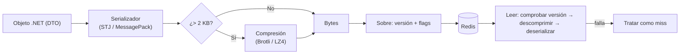

# Serialización de datos en Redis

> [!abstract] En 30 segundos
> - **Qué es:** convertir objetos .NET en bytes para guardarlos en Redis y recuperarlos, con el formato, la compresión y el versionado adecuados.
> - **Para qué:** menos memoria, menos CPU, menos ancho de banda y despliegues sin romper la caché.
> - **Recuerda:** **JSON con source generators** es el valor seguro; **MessagePack** si el tamaño/velocidad importan; **comprime solo valores grandes**; y **versiona** el formato (en la clave o en el sobre) porque la caché sobrevive a tus despliegues.

> [!info] Lección 4.9 · Nivel 4 — Redis en aplicaciones backend y .NET
> ⬅️ [[Redis Output Cache]] · ➡️ [[Redis con Entity Framework Core]] · 🗺️ [[01 - Redis - Roadmap#Nivel 4 — Redis en aplicaciones backend y .NET|Roadmap]] · 📊 [[03 - Redis - Progreso|Progreso]]
> 🏷️ Conceptos generales; `HybridCache` admite serializadores por tipo.

## 📌 Definición

Redis guarda bytes. La **serialización** es el contrato entre las versiones de tu aplicación y los datos que ya están en la caché. Elegir mal el formato provoca memoria derrochada, CPU gastada y, sobre todo, **errores tras un despliegue** que cambia el modelo.

## 🎯 ¿Qué problema resuelve?

- **Memoria:** 1 millón de objetos de 1 KB en JSON ocupan ~1 GB; en un formato binario o comprimido, bastante menos.
- **CPU y latencia:** serializar/deserializar en cada petición cuesta.
- **Compatibilidad:** al añadir, renombrar o quitar propiedades, la caché con datos del formato antiguo no debe tumbar la aplicación nueva.

## 🧠 Conceptos fundamentales

| Formato | Pros | Contras | Cuándo |
|---|---|---|---|
| **JSON (`System.Text.Json`)** | Legible, depurable en `redis-cli`, interoperable | Más grande y lento que binario | Por defecto |
| **JSON con *source generators*** | Sin reflexión: más rápido, compatible con Native AOT/trimming | Declarar los tipos | Recomendado con JSON |
| **MessagePack** | Compacto y muy rápido | No legible; requiere atributos o resolver | Valores grandes/muchos |
| **Protobuf** | Compacto, esquema explícito, multi-lenguaje | Definir esquemas | Servicios heterogéneos |
| **`BinaryFormatter`** | — | **Obsoleto e inseguro**: nunca | Nunca |

### Compresión
- Útil en valores **grandes** (≥ 1-2 KB de texto/JSON): GZip/Brotli, o LZ4 con MessagePack.
- Para valores pequeños, cuesta más CPU de lo que ahorra memoria.
- Marca los bytes comprimidos (cabecera o sobre) para saber cómo leerlos.

### Versionado del esquema

| Estrategia | Cómo | Cuándo |
|---|---|---|
| **Versión en la clave** | `shop:v2:product:42` | Cambios incompatibles: la caché «se limpia» sola por TTL |
| **Sobre con versión** | `{ "v": 2, "data": … }` | Leer varias versiones y migrar al vuelo |
| **Lector tolerante** | Propiedades opcionales con valores por defecto | Cambios aditivos |
| **Tratar el fallo como *miss*** | Si la deserialización falla, recargar de la fuente | Siempre, como red de seguridad |

### Reglas
1. **Cambios aditivos** (propiedad nueva opcional) son seguros; renombrar/quitar/cambiar tipo, no.
2. **Nunca** confíes en que la caché contiene tu formato actual: una deserialización fallida es un *miss*.
3. No serialices tipos con ciclos, `Stream`, ni entidades de EF con proxies; usa DTO.
4. Seguridad: deserializar datos de una caché compartida es una frontera de confianza; evita formatos que instancien tipos arbitrarios.

### Analogía
Una **biblioteca que cambia de sistema de clasificación**: si etiquetas cada libro con la versión del sistema (versión del formato), puedes convivir con los antiguos; si no, el catálogo nuevo no encuentra nada y hay que volver a catalogar (miss).
**Dónde se rompe:** mezclar libros de dos sistemas sin etiqueta provoca errores difíciles de ver.

## ⚙️ Funcionamiento interno



## 💻 Ejemplos prácticos

```text
127.0.0.1:6379> SET shop:v2:product:42 "{\"id\":42,\"name\":\"Teclado\"}"
OK
127.0.0.1:6379> STRLEN shop:v2:product:42
(integer) 27
127.0.0.1:6379> MEMORY USAGE shop:v2:product:42
(integer) 72
```

Con `MEMORY USAGE` comparas lo que realmente ocupa cada formato.

## 🔧 Implementación en .NET

**1. System.Text.Json con source generators**

```csharp
using System.Text.Json;
using System.Text.Json.Serialization;

public sealed record Product(int Id, string Name, decimal Price);

[JsonSourceGenerationOptions(PropertyNamingPolicy = JsonKnownNamingPolicy.CamelCase)]
[JsonSerializable(typeof(Product))]
public partial class CacheJsonContext : JsonSerializerContext { }

public static class ProductSerializer
{
    public static byte[] Serialize(Product p) =>
        JsonSerializer.SerializeToUtf8Bytes(p, CacheJsonContext.Default.Product);

    public static Product? Deserialize(byte[] bytes) =>
        JsonSerializer.Deserialize(bytes, CacheJsonContext.Default.Product);
}
```

**2. MessagePack con compresión LZ4**

```csharp
using MessagePack;

[MessagePackObject]
public sealed class ProductDocument
{
    [Key(0)] public int Id { get; set; }
    [Key(1)] public string Name { get; set; } = "";
    [Key(2)] public decimal Price { get; set; }
    // Nuevo campo opcional (cambio aditivo): usa la siguiente clave libre
    [Key(3)] public string? Category { get; set; }
}

public static class MessagePackCodec
{
    private static readonly MessagePackSerializerOptions Options =
        MessagePackSerializerOptions.Standard.WithCompression(MessagePackCompression.Lz4BlockArray);

    public static byte[] Serialize(ProductDocument d) => MessagePackSerializer.Serialize(d, Options);
    public static ProductDocument Deserialize(byte[] b) => MessagePackSerializer.Deserialize<ProductDocument>(b, Options);
}
```

**3. Compresión Brotli para valores grandes y sobre con versión**

```csharp
using System.IO.Compression;

public static class CacheEnvelope
{
    private const byte Version = 2;
    private const int CompressionThreshold = 2048;

    public static byte[] Pack(byte[] payload)
    {
        bool compress = payload.Length >= CompressionThreshold;
        byte[] body = compress ? Brotli(payload) : payload;

        byte[] result = new byte[body.Length + 2];
        result[0] = Version;
        result[1] = (byte)(compress ? 1 : 0);          // flag de compresión
        Buffer.BlockCopy(body, 0, result, 2, body.Length);
        return result;
    }

    public static byte[]? Unpack(byte[] data)
    {
        if (data.Length < 2 || data[0] != Version) return null;   // versión desconocida => miss
        byte[] body = data.AsSpan(2).ToArray();
        return data[1] == 1 ? Unbrotli(body) : body;
    }

    private static byte[] Brotli(byte[] input)
    {
        using var output = new MemoryStream();
        using (var brotli = new BrotliStream(output, CompressionLevel.Fastest, leaveOpen: true))
            brotli.Write(input);
        return output.ToArray();
    }

    private static byte[] Unbrotli(byte[] input)
    {
        using var source = new MemoryStream(input);
        using var brotli = new BrotliStream(source, CompressionMode.Decompress);
        using var output = new MemoryStream();
        brotli.CopyTo(output);
        return output.ToArray();
    }
}
```

**4. Deserialización defensiva (fallo = miss)**

```csharp
public async Task<Product?> GetAsync(IDatabase db, int id)
{
    RedisValue raw = await db.StringGetAsync($"shop:v2:product:{id}");
    if (!raw.HasValue) return null;
    try
    {
        byte[]? payload = CacheEnvelope.Unpack((byte[]?)raw ?? []);
        return payload is null ? null : ProductSerializer.Deserialize(payload);
    }
    catch (Exception ex) when (ex is JsonException or MessagePackSerializationException or InvalidDataException)
    {
        return null;     // formato antiguo o corrupto: se trata como miss y se recarga
    }
}
```

> [!tip] En `HybridCache`
> Se puede configurar un serializador por tipo (`AddSerializer<T, TSerializer>()`) o una fábrica general; por defecto usa `System.Text.Json` (y trata `string` y `byte[]` de forma nativa).

## 🏗️ Casos de uso en arquitectura

| Caso | Formato |
|---|---|
| Caché de DTO pequeños, depuración frecuente | JSON con source generators |
| Millones de entradas, memoria ajustada | MessagePack (+ LZ4) |
| Documentos grandes (listados completos) | JSON/MessagePack + compresión |
| Varios lenguajes leen la misma caché | JSON o Protobuf |
| Mensajes entre servicios | Contrato explícito versionado |

### Cuándo NO comprimir
- Valores de pocos cientos de bytes: el coste de CPU supera el ahorro.

### Consideraciones de arquitectura

| Dimensión | Qué pensar |
|---|---|
| Despliegues | Versión de formato y *rolling update*: la v1 y la v2 conviven |
| Observabilidad | Contador de fallos de deserialización (indicador de incompatibilidad) |
| Seguridad | Sin deserialización polimórfica de datos no confiables |
| Costes | `MEMORY USAGE`, tamaño medio por tipo |

## ⚠️ Errores y anti-patterns

| Error | Por qué duele | Cómo evitarlo |
|---|---|---|
| `BinaryFormatter` | Inseguro y obsoleto | JSON/MessagePack/Protobuf |
| Renombrar propiedades sin versionar | Todo se deserializa mal | Versión en clave o compatibilidad |
| Serializar entidades de EF | Ciclos, proxies, datos de más | DTO |
| Comprimir todo | CPU desperdiciada | Umbral |
| Dejar que un fallo de deserialización lance a la API | Errores 500 tras desplegar | Tratar como miss |
| Medir por intuición | Optimización prematura | `MEMORY USAGE` y benchmarks |

## ✅ Buenas prácticas

1. JSON con source generators por defecto; binario cuando lo midas necesario.
2. DTO específicos de caché.
3. Versión en la clave (`v2`) para cambios incompatibles.
4. Fallos de deserialización = miss + métrica.
5. Comprime con umbral.

## 🎤 Preguntas de entrevista

> [!question]- 1. ¿Cómo evitas que un despliegue rompa los datos de la caché?
> Con versión en la clave o en un sobre, cambios aditivos en el modelo y tratando cualquier fallo de deserialización como *miss*, de modo que la aplicación recarga desde la fuente.

> [!question]- 2. ¿JSON o MessagePack?
> JSON por defecto (depuración, interoperabilidad, source generators). MessagePack cuando el volumen o la latencia lo justifican y lo has medido.

> [!question]- 3. ¿Cuándo comprimir?
> Solo valores grandes (algunos KB), y con una marca que indique la compresión.

## 🧪 Ejercicios

### 🟢 Básicos
1. Serializa un DTO con JSON y con MessagePack y compara el `STRLEN`.

### 🟡 Intermedios
2. Añade un campo nuevo, despliega «v2» y comprueba que las entradas «v1» se tratan como miss sin errores.

### 🔴 Reto Senior
3. Tienes 20 millones de entradas de 800 bytes y la memoria es el límite. Evalúa opciones y estima el ahorro.

> [!success]- Soluciones
> **3.** Medir con `MEMORY USAGE` una muestra de cada formato; MessagePack suele reducir el tamaño de forma notable frente a JSON; la compresión puede no compensar con 800 B; valora otro modelo (hashes con campos numéricos compactos) y la política de desalojo. Decide con medidas, no con estimaciones genéricas.

### ✔️ Checklist de dominio
- [ ] Elijo el formato con criterios medibles.
- [ ] Versiono el esquema y trato los fallos como miss.
- [ ] Aplico compresión con umbral.

## 📝 Resumen

- Formato por defecto: JSON con source generators; binario si lo mides.
- Comprime solo lo grande y márcalo.
- Versiona (clave o sobre); un fallo de lectura es un miss.
- Nada de `BinaryFormatter`.

## 🔗 Referencias

- [Source generation en System.Text.Json](https://learn.microsoft.com/dotnet/standard/serialization/system-text-json/source-generation)
- [MessagePack para C#](https://github.com/MessagePack-CSharp/MessagePack-CSharp)
- [Serialización en HybridCache](https://learn.microsoft.com/aspnet/core/performance/caching/hybrid)

## 🔄 Notas relacionadas

- ⬅️ [[Redis Output Cache]] · ➡️ [[Redis con Entity Framework Core]]
- Relacionadas: [[HybridCache]] · [[IDistributedCache]] · [[Optimización de memoria en Redis]]
