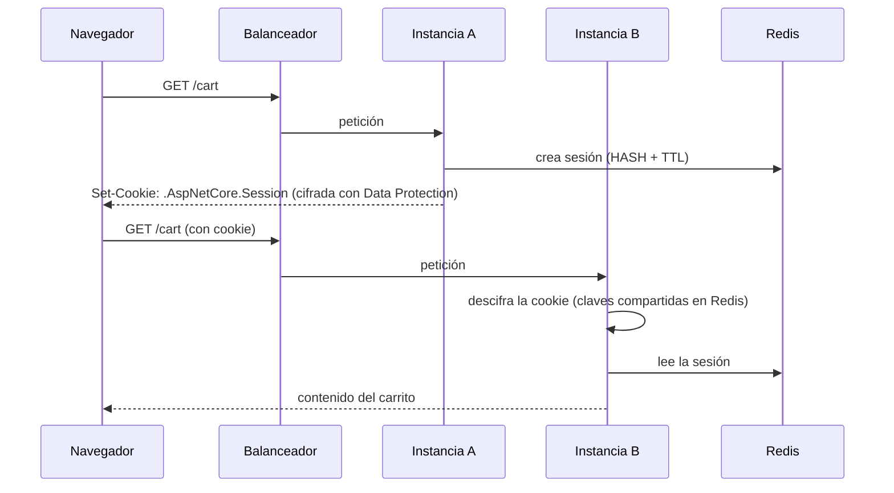

# Sesiones distribuidas con Redis

> [!abstract] En 30 segundos
> - **Qué es:** guardar la **sesión de ASP.NET Core** en Redis para que cualquier instancia la lea, y compartir las **claves de Data Protection** para que cookies y *antiforgery* valgan en todas.
> - **Para qué:** escalar horizontalmente sin *sticky sessions*.
> - **Recuerda:** la sesión **no bloquea** (última escritura gana); llama a `LoadAsync`/`CommitAsync` para evitar IO síncrono; **Data Protection necesita claves compartidas** (y protegidas en reposo); y una sesión es un dato **crítico**: instancia con `noeviction` y persistencia.

> [!info] Lección 4.14 · Nivel 4 — Redis en aplicaciones backend y .NET
> ⬅️ [[Redis con Polly y resiliencia]] · ➡️ [[Redis con Docker Compose]] · 🗺️ [[01 - Redis - Roadmap#Nivel 4 — Redis en aplicaciones backend y .NET|Roadmap]] · 📊 [[03 - Redis - Progreso|Progreso]]
> 🏷️ Paquetes `Microsoft.Extensions.Caching.StackExchangeRedis` y `Microsoft.AspNetCore.DataProtection.StackExchangeRedis`.
> 🧩 Proyecto asociado: [[Proyecto 05 - Gestión de sesiones]].

## 📌 Definición

El **estado de sesión** de ASP.NET Core guarda datos del usuario entre peticiones. Una cookie contiene solo el **identificador** de sesión; los datos viven en el servidor (un `IDistributedCache`). Con varias instancias, ese almacén debe ser compartido: Redis.

| Pieza | Rol |
|---|---|
| `AddStackExchangeRedisCache` | Almacén de la sesión |
| `AddSession` / `UseSession` | Middleware y opciones de la sesión |
| **Data Protection** | Cifra la cookie de sesión, las cookies de autenticación y los tokens *antiforgery* |
| `PersistKeysToStackExchangeRedis` | Comparte las claves de Data Protection entre instancias |

## 🎯 ¿Qué problema resuelve?

Con dos instancias detrás de un balanceador, la sesión en memoria del proceso se «pierde» cuando el siguiente request cae en la otra. Las *sticky sessions* lo evitan, pero atan al usuario a una instancia (peor reparto, pérdida al reiniciar). Y sin claves de Data Protection compartidas, la instancia B no puede descifrar la cookie que emitió la A.

## 🧠 Conceptos fundamentales

1. **Sticky vs distribuida vs sin estado:**

| Opción | Pros | Contras |
|---|---|---|
| Sticky sessions (memoria local) | Simple | Desequilibrio, pérdida al reiniciar, sin autoescalado limpio |
| **Sesión distribuida (Redis)** | Cualquier instancia sirve | Dependencia de Redis; latencia por petición |
| Sin estado (JWT / cookie con datos) | Escala sin almacén | Tamaño, revocación, datos sensibles en el cliente |

2. **Opciones de sesión:** `IdleTimeout` (20 min por defecto), `Cookie.HttpOnly`, `Cookie.IsEssential`, `Cookie.SecurePolicy`.
3. **No bloquea:** si dos peticiones del mismo usuario modifican la sesión a la vez, **gana la última**. Diseña pensando en eso (no pongas contadores críticos en sesión).
4. **Carga asíncrona:** por defecto la sesión se carga de forma síncrona al primer acceso, lo que bloquea un hilo; llama a `await HttpContext.Session.LoadAsync()` y `CommitAsync()`.
5. **Data Protection compartido:** todas las instancias deben usar el mismo `ApplicationName` y el mismo anillo de claves. `PersistKeysToStackExchangeRedis(mux, "DataProtection-Keys")` guarda el anillo en Redis. Las claves se guardan **sin cifrar** por defecto: protégelas con un certificado o Key Vault (`ProtectKeysWith…`).
6. **Datos mínimos:** guarda identificadores y poco más; los objetos grandes pertenecen a su propia caché/BD.
7. **Persistencia y desalojo:** perder la sesión cierra la sesión del usuario. Usa una instancia (o BD) separada de la caché desechable, con `noeviction` y persistencia ([[Eviction policies]], [[Persistencia AOF]]).

### Analogía
Un **guardarropa de teatro** con ticket numérico: da igual por qué puerta entres, entregas el ticket (cookie) y el guardarropa central (Redis) te devuelve tu abrigo (sesión). Pero las **cerraduras** (claves de Data Protection) deben abrirse con la misma llave en todas las puertas.
**Dónde se rompe:** si cada puerta tiene su propia llave, el ticket de una no vale en otra.

## ⚙️ Funcionamiento interno



## 💻 Ejemplos prácticos

```text
127.0.0.1:6379> KEYS session:*            # laboratorio
1) "session:7f4a…"
127.0.0.1:6379> TTL session:7f4a…
(integer) 1180
127.0.0.1:6379> KEYS DataProtection-Keys
1) "DataProtection-Keys"
127.0.0.1:6379> LRANGE DataProtection-Keys 0 -1    # el anillo de claves (XML)
```

## 🔧 Implementación en .NET

```csharp
// Program.cs
using Microsoft.AspNetCore.DataProtection;
using StackExchange.Redis;

var builder = WebApplication.CreateBuilder(args);

IConnectionMultiplexer mux = await ConnectionMultiplexer.ConnectAsync(
    builder.Configuration.GetConnectionString("Redis")!);
builder.Services.AddSingleton(mux);

// 1. Almacén de la sesión
builder.Services.AddStackExchangeRedisCache(o =>
{
    o.ConnectionMultiplexerFactory = () => Task.FromResult(mux);
    o.InstanceName = "session:";
});

// 2. Data Protection compartido entre instancias
builder.Services.AddDataProtection()
    .SetApplicationName("shop-web")                                   // igual en todas las instancias
    .PersistKeysToStackExchangeRedis(mux, "DataProtection-Keys");
    // .ProtectKeysWithCertificate(...)  ← en producción, protege el anillo en reposo

// 3. Sesión
builder.Services.AddSession(o =>
{
    o.IdleTimeout = TimeSpan.FromMinutes(20);
    o.Cookie.HttpOnly = true;
    o.Cookie.IsEssential = true;
    o.Cookie.SecurePolicy = CookieSecurePolicy.Always;
    o.Cookie.SameSite = SameSiteMode.Lax;
});

var app = builder.Build();
app.UseSession();

app.MapPost("/cart/{sku}", async (HttpContext ctx, string sku) =>
{
    await ctx.Session.LoadAsync();                           // carga asíncrona
    int count = ctx.Session.GetInt32("items") ?? 0;
    ctx.Session.SetInt32("items", count + 1);
    ctx.Session.SetString("last-sku", sku);
    await ctx.Session.CommitAsync();                         // guardado asíncrono
    return Results.Ok(new { items = count + 1 });
});

app.Run();
```

> [!warning] Sin claves compartidas, todo falla de forma confusa
> Síntomas: sesiones que «se pierden» al cambiar de instancia, errores `The antiforgery token could not be decrypted` o `Unable to unprotect the message`, usuarios cerrados al reiniciar. Revisa `SetApplicationName`, el anillo compartido y que todas las instancias usan el mismo Redis.

## 🏗️ Casos de uso en arquitectura

| Caso | Diseño |
|---|---|
| Aplicación web con carrito en sesión | Sesión en Redis + Data Protection compartido |
| API con tokens | Sin sesión (JWT); Redis solo para listas de revocación |
| Autoescalado en Kubernetes | Sesión distribuida; sin sticky |
| Multi-región | Valorar replicación o sesión sin estado |

### Cuándo NO usar sesión
- APIs sin estado: usa tokens.
- Datos grandes o críticos de negocio: guárdalos en su sistema, no en la sesión.

### Consideraciones de arquitectura

| Dimensión | Qué pensar |
|---|---|
| Disponibilidad | Si Redis cae, nadie tiene sesión: HA ([[Alta disponibilidad en Redis]]) |
| Seguridad | Cookie `HttpOnly`, `Secure`; claves de Data Protection cifradas; TLS a Redis |
| Rendimiento | Una lectura/escritura de Redis por petición con sesión |
| Privacidad | La cookie de sesión es esencial; revisa el consentimiento aplicable |

## ⚠️ Errores y anti-patterns

| Error | Por qué duele | Cómo evitarlo |
|---|---|---|
| No compartir claves de Data Protection | Cookies ilegibles entre instancias | Persistir el anillo en Redis |
| Anillo de claves sin cifrar en Redis | Quien lea Redis compromete las cookies | `ProtectKeysWith…` |
| Sesión en una instancia con `allkeys-lru` | Sesiones desalojadas | Instancia de datos con `noeviction` |
| Acceso síncrono a la sesión | Bloquea hilos | `LoadAsync`/`CommitAsync` |
| Datos grandes en sesión | Latencia y memoria | Solo ids |
| Esperar que sea transaccional | Última escritura gana | No usar para contadores críticos |

## ✅ Buenas prácticas

1. Mismo `ApplicationName` y anillo compartido y cifrado.
2. Sesión en una instancia de datos (no la caché desechable).
3. `IdleTimeout` razonable; cookies seguras.
4. Datos mínimos; carga/commit asíncronos.
5. Prueba con dos instancias detrás de un proxy (como en el proyecto).

## 🎤 Preguntas de entrevista

> [!question]- 1. ¿Por qué hacen falta claves de Data Protection compartidas?
> Porque cada instancia genera las suyas por defecto; una cookie cifrada por A no se puede descifrar en B. Compartiendo el anillo, todas las instancias entienden las mismas cookies y tokens.

> [!question]- 2. ¿Sticky sessions o sesión distribuida?
> Sticky es simple pero desequilibra y pierde sesiones al reiniciar; la distribuida permite cualquier instancia a costa de depender de Redis (que debe ser HA). Si se puede, un diseño sin estado es aún más escalable.

> [!question]- 3. ¿Qué pasa si dos peticiones modifican la sesión a la vez?
> La sesión de ASP.NET Core no bloquea: gana la última escritura; hay que diseñar para ello.

## 🧪 Ejercicios

### 🟢 Básicos
1. Configura sesión en Redis y comprueba la clave y el TTL con `redis-cli`.

### 🟡 Intermedios
2. Levanta dos instancias detrás de un proxy y verifica que el carrito persiste al alternar entre ellas; luego quita las claves compartidas y observa el fallo.

### 🔴 Reto Senior
3. Diseña la sesión para 2 millones de usuarios activos con sesiones de 2 KB y alta disponibilidad. Calcula memoria y elige topología.

> [!success]- Soluciones
> **3.** ~2 M × (2 KB + overhead ≈ 300-500 B) ≈ 5 GB; con réplica, ~10 GB totales. Instancia de datos con `noeviction`, AOF y réplica con failover (Sentinel/Cluster), TLS, y monitorización de memoria. Medir con `MEMORY USAGE` en una muestra real.

### ✔️ Checklist de dominio
- [ ] Configuro sesión en Redis y Data Protection compartido.
- [ ] Elijo entre sticky, distribuida y sin estado.
- [ ] Protejo las claves y la disponibilidad.

## 📝 Resumen

- Sesión en Redis + Data Protection compartido = escalado sin sticky.
- La sesión no bloquea; carga y commit asíncronos.
- Instancia de datos (`noeviction`, persistencia); claves cifradas.
- Alternativa: diseño sin estado.

## 🔗 Referencias

- [Estado de sesión en ASP.NET Core](https://learn.microsoft.com/aspnet/core/fundamentals/app-state)
- [Data Protection: proveedores de almacén de claves](https://learn.microsoft.com/aspnet/core/security/data-protection/implementation/key-storage-providers)
- [Hospedar en una web farm](https://learn.microsoft.com/aspnet/core/host-and-deploy/web-farm)

## 🔄 Notas relacionadas

- ⬅️ [[Redis con Polly y resiliencia]] · ➡️ [[Redis con Docker Compose]]
- Relacionadas: [[IDistributedCache]] · [[Eviction policies]] · [[Proyecto 05 - Gestión de sesiones]]
