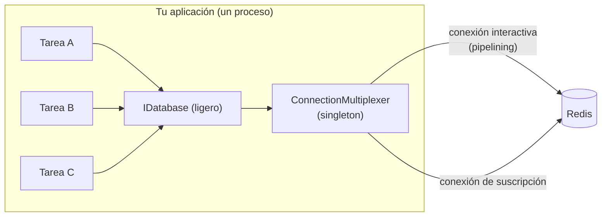

# StackExchange.Redis

> [!abstract] En 30 segundos
> - **Qué es:** el cliente Redis estándar de .NET: una conexión **multiplexada** y *thread-safe* por servidor, con API asíncrona y pipelining automático.
> - **Para qué:** hablar con Redis desde ASP.NET Core con rendimiento y resiliencia.
> - **Recuerda:** el `ConnectionMultiplexer` es **caro y único** (singleton); `IDatabase` es **barato**. No ofrece comandos **bloqueantes** (`BLPOP`, `XREAD BLOCK`). **NRedisStack** añade JSON, Query Engine, Bloom, TimeSeries y vectores.

> [!info] Lección 4.1 · Nivel 4 — Redis en aplicaciones backend y .NET
> ⬅️ [[Distributed caching]] · ➡️ [[ConnectionMultiplexer]] · 🗺️ [[01 - Redis - Roadmap#Nivel 4 — Redis en aplicaciones backend y .NET|Roadmap]] · 📊 [[03 - Redis - Progreso|Progreso]]
> 🏷️ **3.x** (versión de referencia del curso: 3.4.x; RESP3 por defecto). Comprueba la última en NuGet: el cliente evoluciona rápido.

## 📌 Definición

**StackExchange.Redis** (SE.Redis) es el cliente de código abierto creado por Stack Overflow, con licencia MIT. Es el cliente en el que se apoyan `Microsoft.Extensions.Caching.StackExchangeRedis` (`IDistributedCache`, `HybridCache`, Output Cache), las claves de Data Protection y la mayoría de las librerías .NET que hablan con Redis.

| Paquete | Para qué |
|---|---|
| `StackExchange.Redis` | Comandos de núcleo: strings, hashes, listas, sets, sorted sets, streams, geo, bitmaps, Pub/Sub, scripts, vector sets |
| `NRedisStack` | Cliente oficial de Redis para JSON, Query Engine (`FT.*`), Bloom/Cuckoo/CMS/Top-K/t-digest, TimeSeries |
| `Microsoft.Extensions.Caching.StackExchangeRedis` | `IDistributedCache` sobre Redis |
| `Microsoft.Azure.StackExchangeRedis` | Extensión para Azure (autenticación con Microsoft Entra ID) |

## 🎯 ¿Qué problema resuelve?

Hablar RESP por sockets a mano es incómodo y propenso a errores. SE.Redis resuelve la conexión, el protocolo, el pipelining, la reconexión, la topología (Standalone, Sentinel, Cluster, réplicas), el enrutado por *hash slot* y los eventos de mantenimiento del servidor, con una API tipada.

## 🧠 Conceptos fundamentales

1. **Multiplexación:** todas las operaciones concurrentes de tu proceso comparten **una conexión «interactiva»** por servidor (más una dedicada a suscripciones). Se escribe sin esperar las respuestas anteriores (pipelining), y las respuestas se casan por orden.
2. **Asíncrono por diseño:** usa `…Async` siempre. Las variantes síncronas existen, pero bloquean un hilo mientras esperan: causa típica de *thread pool starvation*.
3. **Tipos clave:** `RedisKey`, `RedisValue`, `RedisChannel`, `HashEntry`, `SortedSetEntry`, `StreamEntry`, `RedisResult`. Tienen conversiones implícitas desde `string`, `byte[]`, números…
4. **No hay comandos bloqueantes** (`BLPOP`, `BRPOP`, `XREAD BLOCK`, `BLMOVE`…): bloquearían la conexión compartida y a todos los demás. Para consumir colas usa sondeo con pausa, Pub/Sub o Streams con lecturas no bloqueantes.
5. **Protocolo:** desde la 3.0 usa **RESP3 por defecto** (si el servidor lo soporta; si no, RESP2). Puede forzarse con `Protocol`.
6. **Historia reciente:**

| Versión | Novedad principal |
|---|---|
| 2.13.x | Soporte de Redis 8.x, arrays 8.8, `INCREX`, RESP3 por defecto solo en Azure Managed Redis |
| **3.0** (jun. 2026) | Núcleo de IO reescrito (sin `Pipelines.Sockets.Unofficial`, lector propio): mayor rendimiento con respuestas grandes; **RESP3 por defecto**; `Execute` respeta los comandos de administración (`AllowAdmin`); `SocketManager` queda obsoleto y sin efecto |
| 3.1 | *Failover* geográfico en el cliente |
| 3.2 | Sin .NET 6 como TFM, `BITFIELD`, `EVAL_RO`/`EVALSHA_RO`, APIs `ExecuteResp`/`ScriptEvaluateResp` para comandos ad hoc más eficientes, enrutado con `CLUSTER SLOTS` |
| 3.3 | Notificaciones de mantenimiento del servidor (*smart client handoffs*), opt-in |
| 3.4 | *Handoffs* activados por defecto en Redis Enterprise y Azure Managed Redis; conexión de Pub/Sub dedicada en RESP3 |
| 4.0 (alfa) | En desarrollo; incluye trabajo en *client-side caching* |

7. **Soporte de módulos:** los comandos de JSON, Query Engine, TimeSeries o Bloom no están en SE.Redis, sino en NRedisStack (o con `ExecuteAsync`). Con RESP3, revisa las notas de compatibilidad si ejecutas comandos ad hoc: algunas respuestas cambian de estructura.

### Analogía
Una **cinta transportadora única** hacia la cocina: todos los pedidos (peticiones) van por la misma cinta, uno detrás de otro, y los platos (respuestas) vuelven en el mismo orden. Muy eficiente, pero si pones un pedido enorme en la cinta, retrasa a los demás.
**Dónde se rompe:** si un cocinero se detiene a esperar un plato concreto (comando bloqueante), toda la cinta se para.

## ⚙️ Funcionamiento interno



- Cada operación crea un mensaje, entra en una cola de escritura, se envía por el socket y se registra como «esperando respuesta». Cuando llega la respuesta, completa la `Task` correspondiente.
- Si la conexión cae, el cliente reconecta solo y, según la política de *backlog*, encola o rechaza las operaciones durante el corte ([[ConnectionMultiplexer]]).

## 💻 Ejemplos prácticos

```bash
dotnet new console -n RedisDemo
cd RedisDemo
dotnet add package StackExchange.Redis
dotnet add package NRedisStack
```

```csharp
using StackExchange.Redis;

await using ConnectionMultiplexer mux = await ConnectionMultiplexer.ConnectAsync("localhost:6379");
IDatabase db = mux.GetDatabase();

await db.StringSetAsync("saludo", "hola", TimeSpan.FromMinutes(5));
string? valor = await db.StringGetAsync("saludo");
Console.WriteLine(valor);                       // hola
Console.WriteLine(await db.PingAsync());        // latencia de ida y vuelta
```

## 🔧 Implementación en .NET

SE.Redis y NRedisStack se complementan, comparten el mismo `IDatabase`:

```csharp
using NRedisStack;
using NRedisStack.RedisStackCommands;
using StackExchange.Redis;

IDatabase db = mux.GetDatabase();

// Comando de núcleo (SE.Redis)
await db.HashSetAsync("producto:42", new HashEntry[] { new("nombre", "Teclado"), new("precio", 59.9) });

// Módulo (NRedisStack): JSON
await db.JSON().SetAsync("pedido:1", "$", new { Id = 1, Total = 120.5, Lineas = new[] { "a", "b" } });

// Comando sin API tipada: ExecuteAsync
RedisResult resultado = await db.ExecuteAsync("OBJECT", "ENCODING", "producto:42");
Console.WriteLine(resultado);
```

> [!warning] Lo que **no** vas a encontrar
> `BLPOP`, `BRPOP`, `BLMOVE`, `XREAD … BLOCK`, `XREADGROUP … BLOCK`, `MONITOR` y `SUBSCRIBE` dentro de `IDatabase`. Las suscripciones van por `ISubscriber`; el resto, por diseño, no se exponen (la conexión es compartida). Más en [[Colas con Redis]] y [[Redis Pub-Sub]].

## 🏗️ Casos de uso en arquitectura

| Necesidad | Qué usar |
|---|---|
| Caché distribuida | `IDistributedCache` / `HybridCache` (sobre SE.Redis) |
| Acceso directo a estructuras (hashes, sorted sets, streams) | `IDatabase` |
| Búsqueda, JSON, TimeSeries, Bloom | NRedisStack |
| Pub/Sub | `ISubscriber` |
| Azure | `Microsoft.Azure.StackExchangeRedis` + Entra ID |

### Cuándo NO usarlo
- Si necesitas comandos bloqueantes por naturaleza (workers de cola clásicos con `BRPOP`): diseña con Streams y sondeo, o usa otra librería para ese caso (con cuidado) o un broker.

### Consideraciones de arquitectura

| Dimensión | Qué pensar |
|---|---|
| Versionado | Fija la versión mayor y lee las notas de versión antes de actualizar |
| Compatibilidad de servidor | Algunas APIs requieren servidor ≥ cierta versión (el cliente comprueba y falla con un error claro) |
| Observabilidad | OpenTelemetry (`OpenTelemetry.Instrumentation.StackExchangeRedis`) para trazas |
| Rendimiento | Un multiplexer por proceso; evita sync-over-async |

## ⚠️ Errores y anti-patterns

| Error | Por qué duele | Cómo evitarlo |
|---|---|---|
| Crear un `ConnectionMultiplexer` por petición | Agota sockets, TLS y latencia | Singleton ([[ConnectionMultiplexer]]) |
| `.Result` / `.Wait()` sobre tareas de Redis | Starvation del *thread pool* y timeouts | `await` en toda la cadena |
| Esperar `BLPOP` | No existe | Diseño alternativo |
| Tratar `RedisValue` null como cadena vacía | Bugs sutiles | Usa `HasValue` / `IsNull` |
| Ignorar el cambio a RESP3 con scripts o `Execute` | Estructuras de respuesta distintas | Revisar el procesamiento |
| Dejar `AllowAdmin` activado en producción por comodidad | Comandos peligrosos al alcance | Solo donde haga falta |

## ✅ Buenas prácticas

1. Un `ConnectionMultiplexer` singleton por proceso y servidor/clúster.
2. Async de extremo a extremo.
3. Fija la versión y actualiza con pruebas de integración ([[Testing con Redis y Testcontainers]]).
4. Usa NRedisStack para módulos en lugar de `Execute` a mano.
5. Registra eventos de conexión y expón la salud ([[Redis con ASP.NET Core]]).

## 🎤 Preguntas de entrevista

> [!question]- 1. ¿Por qué SE.Redis usa una sola conexión por servidor?
> Porque Redis procesa los comandos en orden por conexión y responde en el mismo orden; con *pipelining* una conexión sostiene un throughput altísimo y es más eficiente que abrir muchas. Cada operación se escribe sin esperar las anteriores.

> [!question]- 2. ¿Por qué no soporta comandos bloqueantes?
> Porque bloquearían la conexión compartida y, con ella, a todos los demás usuarios del multiplexer.

> [!question]- 3. ¿Qué cambió en la versión 3?
> Un nuevo núcleo de IO con lector propio (más rendimiento con respuestas grandes), RESP3 por defecto, y `Execute` que respeta `AllowAdmin`; además de funcionalidades de las 3.x como el failover geográfico y las notificaciones de mantenimiento.

## 🧪 Ejercicios

### 🟢 Básicos
1. Crea la app de consola, conecta, guarda y lee una clave y muestra el `PingAsync`.

### 🟡 Intermedios
2. Añade NRedisStack y guarda un documento JSON; léelo con `JSON().GetAsync`.
3. Comprueba con `HELLO` en `redis-cli`/`CLIENT LIST` qué protocolo negocia tu aplicación (`resp=3`).

### 🔴 Reto Senior
4. Un equipo migra de SE.Redis 2.x a 3.x. Elabora la lista de comprobaciones previas.

> [!success]- Soluciones
> **4.** Leer las notas de versión; revisar el procesamiento de `Execute`/`ScriptEvaluate` por el cambio a RESP3; revisar el uso de `SocketManager` (obsoleto); comprobar que los comandos de administración usados con `Execute` tienen `AllowAdmin`; verificar las librerías que dependen de SE.Redis (NRedisStack, cachés, Data Protection) y su compatibilidad; pruebas de carga y de failover antes de producción.

### ✔️ Checklist de dominio
- [ ] Explico la multiplexación y sus límites.
- [ ] Sé qué cubre SE.Redis y qué cubre NRedisStack.
- [ ] Conozco las novedades de la rama 3.x.

## 📝 Resumen

- SE.Redis: cliente multiplexado, asíncrono y *thread-safe*; 3.x trae núcleo de IO nuevo y RESP3 por defecto.
- Un multiplexer por proceso; `IDatabase` barato.
- Sin comandos bloqueantes; NRedisStack para módulos.
- Async de extremo a extremo.

## 🔗 Referencias

- [StackExchange.Redis (documentación)](https://stackexchange.github.io/StackExchange.Redis/)
- [Notas de versión](https://github.com/StackExchange/StackExchange.Redis/releases)
- [NRedisStack](https://github.com/redis/NRedisStack)
- [RESP3 en SE.Redis](https://stackexchange.github.io/StackExchange.Redis/Resp3)

## 🔄 Notas relacionadas

- ⬅️ [[Distributed caching]] · ➡️ [[ConnectionMultiplexer]]
- Relacionadas: [[IDatabase y operaciones en StackExchange.Redis]] · [[Redis con ASP.NET Core]] · [[Redis JSON]] · [[Redis Query Engine]]
