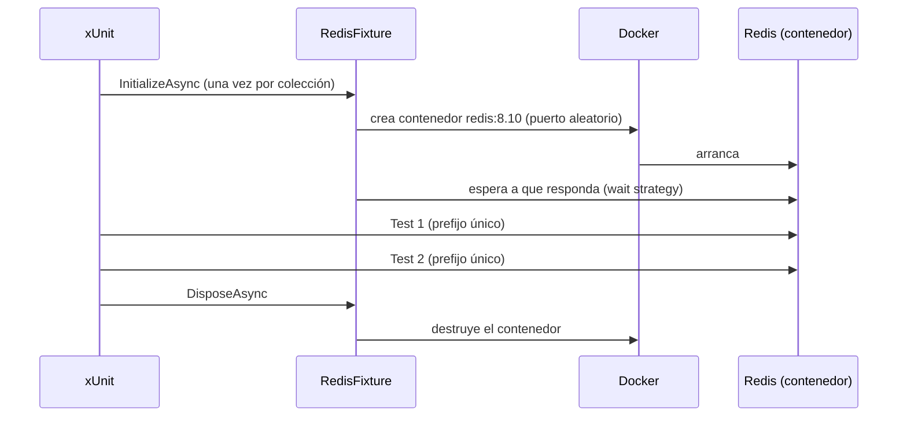

# Testing con Redis y Testcontainers

> [!abstract] En 30 segundos
> - **Qué es:** probar tu código con un **Redis real y efímero** levantado por **Testcontainers** (un contenedor por ejecución de tests), en lugar de mocks de `IDatabase`.
> - **Para qué:** verificar de verdad TTL, scripts Lua, transacciones, invalidación y degradación, que los mocks no reproducen.
> - **Recuerda:** una instancia **compartida por colección** de tests (arranca una vez), **claves únicas por test** (en vez de `FLUSHALL`), el **mismo tag de imagen** que producción, y Docker disponible en CI.

> [!info] Lección 4.16 · Nivel 4 — Redis en aplicaciones backend y .NET
> ⬅️ [[Redis con Docker Compose]] · ➡️ [[Redis con Aspire]] · 🗺️ [[01 - Redis - Roadmap#Nivel 4 — Redis en aplicaciones backend y .NET|Roadmap]] · 📊 [[03 - Redis - Progreso|Progreso]]
> 🏷️ Paquete `Testcontainers.Redis`; ejemplos con xUnit (v2: `IAsyncLifetime` con `Task`; en xUnit v3 los métodos devuelven `ValueTask`).

## 📌 Definición

**Testcontainers** es una librería que arranca contenedores Docker desde el código de las pruebas, espera a que estén listos y los destruye al terminar. `Testcontainers.Redis` ofrece un `RedisBuilder` preparado para Redis.

| Tipo de prueba | Redis | Qué comprueba |
|---|---|---|
| Unitaria | Un *fake* detrás de un puerto ([[Redis en Clean Architecture]]) | Lógica de negocio |
| **Integración** | **Testcontainers** | Serialización, TTL, Lua, transacciones, invalidación |
| Resiliencia | Testcontainers + parar/pausar el contenedor | Degradación, reconexión |
| End-to-end | Compose o entorno de pruebas | Flujo completo |

## 🎯 ¿Qué problema resuelve?

Los mocks de `IDatabase` verifican que *llamas* a un método, no que *funcione*: no saben de expiraciones, scripts, `WRONGTYPE`, atomicidad ni RESP3. Un Redis real y desechable da certeza sin ensuciar entornos compartidos.

## 🧠 Conceptos fundamentales

1. **Ciclo:** `StartAsync` (crea y espera) → pruebas → `DisposeAsync` (destruye).
2. **Compartir la instancia:** arrancar un contenedor por test es lento (segundos). Usa una **fixture de colección** (un contenedor para varias clases de test).
3. **Aislamiento entre tests:**
   - **Prefijo único por test** (`$"{Guid.NewGuid():N}:"`) → permite paralelismo.
   - `FLUSHALL` entre tests exige `AllowAdmin` y serializar la ejecución.
4. **Misma versión que producción:** `WithImage("redis:8.10")` (o la que uses); si producción es Valkey o un servicio gestionado, ajusta la imagen y las pruebas.
5. **Probar el tiempo:** TTLs de 1-2 s con esperas reales son lentos y frágiles; inyecta un `TimeProvider` o usa TTL mínimos y `PTTL` para comprobar el valor.
6. **Pruebas de caos:** `StopAsync()` / `PauseAsync()` del contenedor para verificar la degradación y la reconexión.
7. **CI:** requiere Docker (runner de GitHub Actions Linux lo trae; en agentes sin Docker, no funcionará).
8. **Integración con `WebApplicationFactory`:** sustituye la cadena de conexión por la del contenedor para probar la API completa.

### Analogía
Un **banco de pruebas de un motor**: en lugar de simular el motor con un dibujo (mock), lo enciendes de verdad en un taller aislado, lo pruebas y lo apagas.
**Dónde se rompe:** si el taller usa un motor distinto al del coche real (otra versión de Redis), los resultados no valen.

## ⚙️ Funcionamiento interno



## 💻 Ejemplos prácticos

```bash
dotnet add package Testcontainers.Redis
dotnet add package xunit
dotnet add package Microsoft.AspNetCore.Mvc.Testing    # para pruebas de la API
dotnet test
```

## 🔧 Implementación en .NET

**Fixture compartida**

```csharp
using StackExchange.Redis;
using Testcontainers.Redis;
using Xunit;

public sealed class RedisFixture : IAsyncLifetime
{
    private readonly RedisContainer _container = new RedisBuilder()
        .WithImage("redis:8.10")
        .Build();

    public IConnectionMultiplexer Mux { get; private set; } = default!;
    public string ConnectionString => _container.GetConnectionString();
    public RedisContainer Container => _container;

    public async Task InitializeAsync()
    {
        await _container.StartAsync();
        Mux = await ConnectionMultiplexer.ConnectAsync(ConnectionString);
    }

    public async Task DisposeAsync()
    {
        await Mux.DisposeAsync();
        await _container.DisposeAsync();
    }
}

[CollectionDefinition("redis")]
public class RedisCollection : ICollectionFixture<RedisFixture>;
```

**Pruebas con aislamiento por prefijo**

```csharp
using StackExchange.Redis;
using Xunit;

[Collection("redis")]
public class StockTests(RedisFixture redis)
{
    private readonly IDatabase _db = redis.Mux.GetDatabase();
    private readonly string _p = $"{Guid.NewGuid():N}:";      // aislamiento por test

    private static readonly LuaScript Reserve = LuaScript.Prepare("""
        local s = tonumber(redis.call('GET', @key) or '0')
        if s >= tonumber(@n) then redis.call('DECRBY', @key, @n) return 1 end
        return 0
        """);

    [Fact]
    public async Task Stock_never_goes_negative_under_concurrency()
    {
        RedisKey key = _p + "stock";
        await _db.StringSetAsync(key, 10);

        // 100 tareas intentan reservar 1 unidad cada una
        int[] results = await Task.WhenAll(Enumerable.Range(0, 100).Select(async _ =>
            (int)await _db.ScriptEvaluateAsync(Reserve, new { key, n = 1 })));

        Assert.Equal(10, results.Sum());                         // solo 10 éxitos
        Assert.Equal(0, (long)await _db.StringGetAsync(key));   // stock final = 0, nunca negativo
    }

    [Fact]
    public async Task Ttl_is_set_and_cannot_be_overwritten_by_a_plain_set()
    {
        RedisKey key = _p + "k";
        await _db.StringSetAsync(key, "v", TimeSpan.FromMinutes(5));

        TimeSpan? ttl = await _db.KeyTimeToLiveAsync(key);
        Assert.NotNull(ttl);
        Assert.InRange(ttl!.Value.TotalSeconds, 250, 300);
    }
}
```

**Prueba de la API completa con `WebApplicationFactory`**

```csharp
using Microsoft.AspNetCore.Mvc.Testing;
using Xunit;

[Collection("redis")]
public class ApiTests(RedisFixture redis)
{
    [Fact]
    public async Task Get_product_is_served_from_cache_the_second_time()
    {
        await using var factory = new WebApplicationFactory<Program>().WithWebHostBuilder(b =>
            b.UseSetting("ConnectionStrings:Redis", redis.ConnectionString));
        HttpClient client = factory.CreateClient();

        HttpResponseMessage first = await client.GetAsync("/products/42");
        HttpResponseMessage second = await client.GetAsync("/products/42");

        Assert.True(first.IsSuccessStatusCode);
        Assert.Equal("HIT", second.Headers.GetValues("X-Cache").Single());
    }
}
```

**Prueba de degradación (Redis caído)**

```csharp
[Fact]
public async Task Api_keeps_working_when_redis_is_down()
{
    await using var factory = new WebApplicationFactory<Program>().WithWebHostBuilder(b =>
        b.UseSetting("ConnectionStrings:Redis", redis.ConnectionString + ",abortConnect=false,connectTimeout=500"));
    HttpClient client = factory.CreateClient();

    await redis.Container.StopAsync();            // simulamos la caída
    try
    {
        HttpResponseMessage response = await client.GetAsync("/products/42");
        Assert.True(response.IsSuccessStatusCode);   // degradado: sirve desde la fuente
    }
    finally
    {
        await redis.Container.StartAsync();          // restaurar para el resto de tests
    }
}
```

> [!warning] Parar el contenedor afecta a los demás tests
> Detener la instancia compartida interfiere con tests en paralelo. Aísla las pruebas de caos en **otra colección** con su propia fixture (su propio contenedor).

## 🏗️ Casos de uso en arquitectura

| Prueba | Valor |
|---|---|
| Scripts Lua y transacciones con concurrencia | Garantía de atomicidad |
| Invalidación de caché tras escribir | Evita regresiones de coherencia |
| Serialización y versionado | Compatibilidad entre versiones |
| Degradación (parar/pausar) | Demuestra la resiliencia |
| Rate limiter | Precisión del algoritmo |

### Cuándo NO usar un contenedor
- Pruebas unitarias de lógica de negocio: usa un fake (más rápidas).

### Consideraciones de arquitectura

| Dimensión | Qué pensar |
|---|---|
| Velocidad | Un contenedor por colección, no por test |
| Fiabilidad | Esperas con `PTTL`/relojes inyectados, no `Task.Delay` largos |
| CI | Docker disponible; imágenes en caché del runner |
| Paridad | Misma imagen/versión que producción |

## ⚠️ Errores y anti-patterns

| Error | Por qué duele | Cómo evitarlo |
|---|---|---|
| Mock de `IDatabase` para probar Lua o TTL | No prueba nada real | Redis real |
| Un contenedor por test | Suite lentísima | Fixture compartida |
| Compartir claves entre tests | Interferencias y *flaky tests* | Prefijo único |
| `FLUSHALL` con tests en paralelo | Borra datos de otros tests | Prefijos |
| Imagen distinta a producción | Resultados engañosos | Misma versión |
| Esperas largas por TTL | Suite lenta | Relojes inyectables, TTLs cortos |

## ✅ Buenas prácticas

1. Integración con Testcontainers; unitarias con fakes.
2. Fixture por colección, prefijo único por test.
3. Misma versión de Redis que producción.
4. Pruebas de concurrencia y de caída.
5. Ejecuta la misma suite en CI.

## 🎤 Preguntas de entrevista

> [!question]- 1. ¿Por qué no basta con mockear `IDatabase`?
> Porque un mock no reproduce el comportamiento del servidor: expiraciones, scripts, atomicidad, errores reales. Solo comprueba que se invocó un método.

> [!question]- 2. ¿Cómo aíslas los tests que comparten un Redis?
> Con un prefijo de clave único por test (permite paralelismo) en lugar de vaciar la base de datos entre pruebas.

> [!question]- 3. ¿Cómo pruebas que la API sobrevive a la caída de Redis?
> Con una fixture dedicada que detiene o pausa el contenedor durante la prueba y verifica que la API responde (degradada) y se recupera al reiniciarlo.

## 🧪 Ejercicios

### 🟢 Básicos
1. Crea la fixture y un test que haga `SET`/`GET`.

### 🟡 Intermedios
2. Prueba el script de reserva de stock con 100 tareas concurrentes.
3. Prueba que la actualización de un producto invalida la caché.

### 🔴 Reto Senior
4. Diseña la suite de la capa de caché de un servicio: unitarias, integración, concurrencia y caos. ¿Qué cubre cada nivel y cuánto tarda?

> [!success]- Soluciones
> **4.** Unitarias (milisegundos) con fake del puerto; integración con Testcontainers (segundos, una fixture) para serialización, TTL, invalidación, Lua; concurrencia con 50-100 tareas; caos en una colección aparte con contenedor propio (parar/pausar). Total típico de unos pocos segundos a decenas de segundos.

### ✔️ Checklist de dominio
- [ ] Levanto Redis con Testcontainers y lo comparto entre tests.
- [ ] Aíslo los tests con prefijos.
- [ ] Pruebo concurrencia y degradación.

## 📝 Resumen

- Redis real y efímero con Testcontainers para pruebas de integración.
- Fixture por colección; prefijo único por test.
- Misma versión que producción; Docker en CI.
- Pruebas de concurrencia y de caída.

## 🔗 Referencias

- [Testcontainers para .NET: Redis](https://dotnet.testcontainers.org/modules/redis/)
- [Pruebas de integración en ASP.NET Core](https://learn.microsoft.com/aspnet/core/test/integration-tests)

## 🔄 Notas relacionadas

- ⬅️ [[Redis con Docker Compose]] · ➡️ [[Redis con Aspire]]
- Relacionadas: [[Redis con Polly y resiliencia]] · [[Lua scripting en Redis]] · [[Redis en Clean Architecture]]
