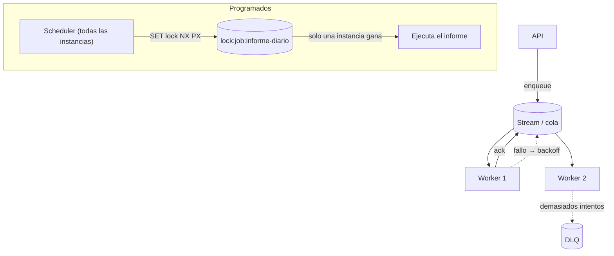

# Background jobs con Redis

> [!abstract] En 30 segundos
> - **Qué es:** ejecutar trabajo fuera de la petición HTTP: **workers** (`BackgroundService`) que consumen una cola o un stream, y **tareas programadas** que deben ejecutarse **una sola vez** aunque haya varias instancias.
> - **Para qué:** emails, informes, importaciones, recálculos, sincronizaciones.
> - **Recuerda:** diseña para **at-least-once** (idempotencia), **reintentos con backoff**, **apagado ordenado** y **ejecución única** de las tareas programadas con un lock distribuido. Hangfire (con almacenamiento Redis) es una alternativa si quieres dashboard, cron y reintentos listos.

> [!info] Lección 5.7 · Nivel 5 — Redis en arquitecturas de microservicios
> ⬅️ [[Colas con Redis]] · ➡️ [[Distributed locks con Redis]] · 🗺️ [[01 - Redis - Roadmap#Nivel 5 — Redis en arquitecturas de microservicios|Roadmap]] · 📊 [[03 - Redis - Progreso|Progreso]]
> 🏷️ .NET 8+ · el almacenamiento Redis de Hangfire lo aportan paquetes de terceros o de pago: revisa licencia y mantenimiento.

## 📌 Definición

Un **background job** es una unidad de trabajo ejecutada de forma asíncrona respecto a quien la pidió. Tipos:

| Tipo | Ejemplo | Mecanismo |
|---|---|---|
| **Fire-and-forget** | Enviar un email | Cola/Stream + worker |
| **Diferido** | Recordatorio en 24 h | Sorted Set / scheduler |
| **Recurrente (cron)** | Informe diario | Scheduler + lock de ejecución única |
| **Larga duración** | Importar 1 M de filas | Worker con progreso, *checkpoints* |

## 🎯 ¿Qué problema resuelve?

Hacer trabajo pesado dentro de la petición HTTP bloquea al usuario y se pierde si el proceso se reinicia. Un sistema de jobs mueve ese trabajo a procesos propios, con reintentos, escalado independiente y observabilidad.

## 🧠 Conceptos fundamentales

1. **`BackgroundService`:** servicio hospedado de ASP.NET Core / Worker Service con `ExecuteAsync(CancellationToken)`; ideal para consumir una cola o un stream.
2. **At-least-once:** un job puede ejecutarse más de una vez (reintento, worker caído tras terminar pero antes de confirmar). Diseña **idempotente** ([[Idempotencia con Redis]]).
3. **Reintentos:** número máximo, *backoff* exponencial con jitter, distinción entre errores transitorios y definitivos, DLQ.
4. **Ejecución única de tareas programadas:** con N instancias, un cron en cada una ejecutaría el trabajo N veces. Soluciones: un **lock distribuido** por ejecución ([[Distributed locks con Redis]]), un scheduler con elección de líder, o un único proceso programador.
5. **Concurrencia por worker:** limita con `SemaphoreSlim` o `Channel<T>` para no saturar recursos.
6. **Apagado ordenado:** respeta el `CancellationToken`; termina el job en curso o devuélvelo a la cola (`XNACK` ≥8.8) para que otro lo tome.
7. **Visibilidad:** métricas (en cola, en proceso, fallidos, duración), logs con `jobId`/`correlationId`, dashboard.
8. **Hangfire:** librería de jobs de .NET con dashboard, cron, reintentos y continuaciones. Soporta SQL Server y otros almacenes; hay almacenamiento Redis mediante paquetes de la comunidad o comerciales. Evalúa si necesitas todo eso antes de añadir la dependencia.
9. **Dónde correr los workers:** proceso aparte (Worker Service) o contenedor propio, para escalarlos y desplegarlos sin afectar a la API.

### Analogía
Una **cocina** (workers) separada del salón (API): el camarero deja la comanda (job) y vuelve a atender; la cocina decide el ritmo, repite platos que salen mal y avisa si algo no se puede hacer.
**Dónde se rompe:** si dos cocineros hacen el mismo plato, se sirve doble (idempotencia).

## ⚙️ Funcionamiento interno



## 💻 Ejemplos prácticos

```text
# Un lock por ejecución programada: el valor es el token del ganador
127.0.0.1:6379> SET lock:job:informe-diario:2026-11-03 instancia-A NX EX 3600
OK
127.0.0.1:6379> SET lock:job:informe-diario:2026-11-03 instancia-B NX EX 3600
(nil)
```

La clave incluye la **fecha de la ejecución**: así el lock identifica «el informe de hoy», y una segunda instancia que despierte con retraso no lo repite.

## 🔧 Implementación en .NET

**Worker concurrente sobre un Stream (esquema)**

```csharp
using System.Threading.Channels;
using StackExchange.Redis;

public sealed class JobWorker(IDatabase db, IJobHandler handler, ILogger<JobWorker> logger) : BackgroundService
{
    private const string Stream = "jobs";
    private const string Group = "workers";
    private readonly string _consumer = $"{Environment.MachineName}-{Environment.ProcessId}";
    private const int Concurrency = 4;

    protected override async Task ExecuteAsync(CancellationToken ct)
    {
        try { await db.StreamCreateConsumerGroupAsync(Stream, Group, "$", createStream: true); }
        catch (RedisServerException ex) when (ex.Message.StartsWith("BUSYGROUP")) { }

        var channel = Channel.CreateBounded<StreamEntry>(new BoundedChannelOptions(Concurrency * 2)
        {
            FullMode = BoundedChannelFullMode.Wait
        });

        // Productor: lee del stream y alimenta el canal (el canal aplica contrapresión)
        Task producer = Task.Run(async () =>
        {
            while (!ct.IsCancellationRequested)
            {
                StreamEntry[] entries = await db.StreamReadGroupAsync(Stream, Group, _consumer, ">", count: Concurrency);
                if (entries.Length == 0) { await Task.Delay(200, ct); continue; }
                foreach (var e in entries) await channel.Writer.WriteAsync(e, ct);
            }
            channel.Writer.Complete();
        }, ct);

        // Consumidores: N tareas procesan en paralelo
        Task[] workers = Enumerable.Range(0, Concurrency).Select(_ => Task.Run(async () =>
        {
            await foreach (StreamEntry entry in channel.Reader.ReadAllAsync(CancellationToken.None))
            {
                try
                {
                    await handler.HandleAsync(entry, ct);                        // idempotente
                    await db.StreamAcknowledgeAsync(Stream, Group, entry.Id);
                }
                catch (OperationCanceledException) { /* apagado: queda pendiente y otro lo reclamará */ }
                catch (Exception ex)
                {
                    logger.LogWarning(ex, "Job {Id} falló; se reintentará", entry.Id);
                }
            }
        })).ToArray();

        try { await producer; } catch (OperationCanceledException) { }
        await Task.WhenAll(workers);
    }
}

public interface IJobHandler { Task HandleAsync(StreamEntry entry, CancellationToken ct); }
```

**Tarea programada con ejecución única entre instancias**

```csharp
public sealed class DailyReportJob(IDatabase db, IReportService reports, ILogger<DailyReportJob> logger)
    : BackgroundService
{
    protected override async Task ExecuteAsync(CancellationToken ct)
    {
        using var timer = new PeriodicTimer(TimeSpan.FromMinutes(1));
        while (await timer.WaitForNextTickAsync(ct))
        {
            DateTime now = DateTime.UtcNow;
            if (now.Hour != 3) continue;                          // ventana de ejecución: 03:00 UTC

            string lockKey = $"lock:job:daily-report:{now:yyyy-MM-dd}";
            string me = $"{Environment.MachineName}-{Environment.ProcessId}";

            // Solo una instancia obtiene el lock de HOY; caduca por seguridad
            if (!await db.StringSetAsync(lockKey, me, TimeSpan.FromHours(2), When.NotExists))
                continue;

            try { await reports.GenerateAsync(now.Date, ct); }    // idempotente: reintentar no duplica
            catch (Exception ex) { logger.LogError(ex, "Informe diario fallido"); }
        }
    }
}

public interface IReportService { Task GenerateAsync(DateTime day, CancellationToken ct); }
```

> [!note] Hangfire
> Si necesitas dashboard, cron avanzado, continuaciones y reintentos listos, valora Hangfire. Con `Hangfire.Pro.Redis` (comercial) o paquetes de la comunidad puedes usar Redis como almacén; con SQL Server o PostgreSQL tienes opciones sin dependencia extra. Compara coste, licencia y mantenimiento.

## 🏗️ Casos de uso en arquitectura

| Caso | Diseño |
|---|---|
| Envío de emails/notificaciones | Stream + worker + DLQ |
| Informe nocturno | Cron + lock por fecha |
| Importación masiva | Job largo con *checkpoints* y reanudación |
| Recálculo de cachés | Job programado con jitter |

### Cuándo NO hacerlo en la misma API
- Trabajo pesado o largo: proceso/contendor de workers propio.

### Consideraciones de arquitectura

| Dimensión | Qué pensar |
|---|---|
| Escalado | Workers escalan por lag de la cola, no por CPU de la API |
| Despliegue | Apagado ordenado con tiempo suficiente |
| Observabilidad | Profundidad, edad del más antiguo, duración y fallos |
| Seguridad | Los jobs usan credenciales mínimas |
| Idempotencia | Imprescindible |

## ⚠️ Errores y anti-patterns

| Error | Por qué duele | Cómo evitarlo |
|---|---|---|
| Cron en cada instancia sin lock | Trabajo N veces | Lock por ejecución |
| Jobs no idempotentes | Duplicados en reintentos | Claves de idempotencia |
| `Task.Run` fire-and-forget en la petición | Se pierde al reiniciar | Cola persistente |
| Sin tope de reintentos | Venenosos en bucle | Máximo + DLQ |
| Ignorar el `CancellationToken` | Cierres que cortan trabajo | Apagado ordenado |
| Mezclar workers y API en el mismo escalado | Desajuste de recursos | Despliegue separado |

## ✅ Buenas prácticas

1. Cola persistente + workers separados.
2. Idempotencia y reintentos con backoff y DLQ.
3. Lock de ejecución única por fecha/clave.
4. Métricas y alertas de lag.
5. Apagado ordenado.

## 🎤 Preguntas de entrevista

> [!question]- 1. ¿Cómo garantizas que un cron se ejecute una sola vez con varias instancias?
> Con un lock distribuido por ejecución (clave con la fecha) obtenido con `SET NX` y TTL; solo la instancia que lo obtiene corre el job, y el job es idempotente por si el lock expira a mitad.

> [!question]- 2. ¿Por qué no usar `Task.Run` desde el endpoint?
> El trabajo vive solo en memoria del proceso: se pierde al reiniciar o escalar, sin reintentos ni visibilidad. Una cola persistente con workers lo resuelve.

## 🧪 Ejercicios

### 🟢 Básicos
1. Crea un `BackgroundService` que consuma un stream y confirme tras procesar.

### 🟡 Intermedios
2. Añade concurrencia con un `Channel` acotado y comprueba la contrapresión.
3. Ejecuta tres instancias de un cron con lock y verifica que solo una ejecuta el job.

### 🔴 Reto Senior
4. El job de informe tarda 3 h pero el lock dura 2 h. Explica el riesgo y la solución.

> [!success]- Soluciones
> **4.** El lock expira durante la ejecución y otra instancia lo lanza en paralelo. Soluciones: lock con renovación periódica (solo si el token es el mío), TTL mayor al peor caso, o idempotencia y *fencing* para que dos ejecuciones no se corrompan ([[Distributed locks con Redis]]).

### ✔️ Checklist de dominio
- [ ] Implemento workers fiables con ack y reintentos.
- [ ] Ejecuto crons una sola vez entre instancias.
- [ ] Diseño para apagado ordenado e idempotencia.

## 📝 Resumen

- Jobs fuera de la petición: cola persistente + workers.
- At-least-once → idempotencia; reintentos con backoff y DLQ.
- Cron único con lock por fecha.
- Hangfire como alternativa «con baterías».

## 🔗 Referencias

- [Tareas en segundo plano con servicios hospedados](https://learn.microsoft.com/aspnet/core/fundamentals/host/hosted-services)
- [Hangfire](https://www.hangfire.io/)
- [Channels en .NET](https://learn.microsoft.com/dotnet/core/extensions/channels)

## 🔄 Notas relacionadas

- ⬅️ [[Colas con Redis]] · ➡️ [[Distributed locks con Redis]]
- Relacionadas: [[Consumer Groups en Redis Streams]] · [[Idempotencia con Redis]] · [[Proyecto 07 - Sistema de colas]]
