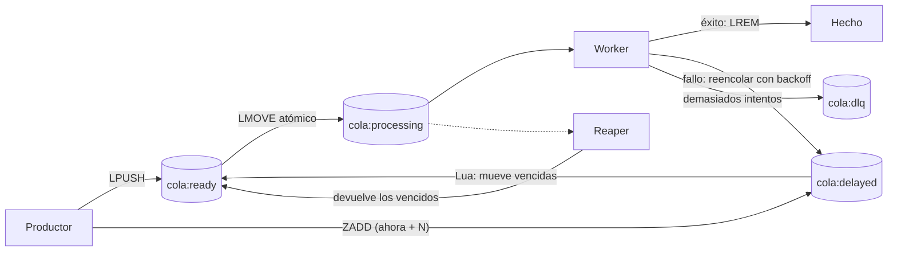

# Colas con Redis

> [!abstract] En 30 segundos
> - **Qué es:** implementar colas de trabajo con **Lists** (`LPUSH`/`LMOVE`), **Sorted Sets** (colas diferidas/prioridad) o **Streams** (cola fiable con grupos).
> - **Para qué:** repartir trabajo entre workers, aplazar ejecuciones y reintentar fallos.
> - **Recuerda:** una cola con `LPUSH` + `RPOP` **pierde** el mensaje si el worker cae. La versión fiable mueve el elemento a una lista de «en proceso» (`LMOVE`) y lo confirma al terminar. **Para colas nuevas, Streams con consumer groups ya trae esto.**

> [!info] Lección 5.6 · Nivel 5 — Redis en arquitecturas de microservicios
> ⬅️ [[Event-driven architecture con Redis]] · ➡️ [[Background jobs con Redis]] · 🗺️ [[01 - Redis - Roadmap#Nivel 5 — Redis en arquitecturas de microservicios|Roadmap]] · 📊 [[03 - Redis - Progreso|Progreso]]
> 🏷️ Core · `LMOVE` ≥6.2 · `LMOVEM`/`BLMOVEM` (mover varios elementos) ≥8.10 · SE.Redis no expone comandos bloqueantes: se sondea.
> 🧩 Proyecto asociado: [[Proyecto 07 - Sistema de colas]].

## 📌 Definición

| Patrón | Estructura | Garantía |
|---|---|---|
| Cola simple | List: `LPUSH` + `RPOP` | At-most-once (se pierde si el worker cae) |
| **Cola fiable** | List + lista de procesamiento: `LMOVE` + `LREM` | At-least-once |
| **Cola diferida** | Sorted Set (score = instante de ejecución) | Ejecución a partir de una hora |
| **Cola con prioridad** | Varias Lists o Sorted Set (score = prioridad) | Orden por prioridad |
| **Cola de grupo** | Stream + consumer group | At-least-once con PEL y reclamación |

## 🎯 ¿Qué problema resuelve?

Desacoplar quien genera trabajo (API) de quien lo ejecuta (workers), con reintentos, aplazamientos («envía en 10 minutos») y prioridades, sin añadir un broker si Redis ya está en tu plataforma y las necesidades son moderadas.

## 🧠 Conceptos fundamentales

1. **Cola simple (peligrosa):** `RPOP` saca el elemento; si el worker falla, el trabajo desaparece.
2. **Cola fiable con `LMOVE`:**
   - `LMOVE cola procesando RIGHT LEFT` mueve **atómicamente** el siguiente elemento a la lista «en proceso».
   - Al terminar: `LREM procesando 1 elemento` (confirmación).
   - Un *reaper* revisa los elementos que llevan mucho tiempo en «procesando» y los devuelve a la cola.
   - Para el tiempo de visibilidad (*visibility timeout*) se guarda una marca de inicio (Sorted Set `procesando:deadline`).
3. **Cola diferida:** `ZADD cola:retrasados <ahora+N ms> tarea`; un *poller* mueve las tareas vencidas a la cola lista **atómicamente** (Lua) para que dos pollers no tomen la misma.
4. **Reintentos con *backoff*:** al fallar, reencola en la cola diferida con `ahora + base × 2^intentos` y cuenta los intentos; pasado el máximo, **DLQ** (otra lista).
5. **Prioridad:** varias listas (`alta`, `media`, `baja`) consultadas por orden, o un Sorted Set con score de prioridad (con cuidado de la inanición).
6. **Lecturas bloqueantes:** `BLMOVE`/`BRPOP` existen, pero **SE.Redis no los expone**; sondea con una pausa corta (50-500 ms) o usa Streams.
7. **Cluster:** las claves que toca un script deben compartir *slot*: usa *hash tags* (`{emails}:ready`, `{emails}:delayed`).
8. **Streams como cola:** consumer groups dan PEL, reclamación, contador de entregas y ack sin construir nada: **primera opción** para colas nuevas ([[Consumer Groups en Redis Streams]]). Las listas siguen siendo útiles para colas muy simples y de bajo riesgo.

### Analogía
Una **barra de bar con comandas**: la comanda va de «pendientes» a «en preparación» (LMOVE) y se tira al servir (LREM). Si el cocinero se va, el encargado devuelve a pendientes las comandas que llevan demasiado en preparación (reaper).
**Dónde se rompe:** sin la zona de «en preparación», la comanda que el cocinero se llevó al irse se pierde.

## ⚙️ Funcionamiento interno



## 💻 Ejemplos prácticos

```text
# Cola fiable
127.0.0.1:6379> LPUSH cola:ready "tarea-1" "tarea-2"
(integer) 2
127.0.0.1:6379> LMOVE cola:ready cola:processing RIGHT LEFT
"tarea-1"
127.0.0.1:6379> LREM cola:processing 1 "tarea-1"      # confirmar
(integer) 1

# Cola diferida: ejecutar en 10 s
127.0.0.1:6379> ZADD cola:delayed 1793664010000 "tarea-3"
(integer) 1
127.0.0.1:6379> ZRANGEBYSCORE cola:delayed -inf 1793664010000 LIMIT 0 100
1) "tarea-3"
```

Script Lua para mover tareas vencidas (atómico):

```lua
-- KEYS[1] = delayed (zset) · KEYS[2] = ready (list) · ARGV[1] = ahora (ms) · ARGV[2] = límite
local due = redis.call('ZRANGEBYSCORE', KEYS[1], '-inf', ARGV[1], 'LIMIT', 0, ARGV[2])
for _, id in ipairs(due) do
  redis.call('ZREM', KEYS[1], id)
  redis.call('LPUSH', KEYS[2], id)
end
return #due
```

## 🔧 Implementación en .NET

```csharp
using StackExchange.Redis;

public sealed class RedisQueue(IDatabase db, string name)
{
    // Claves con hash tag: en Cluster caen en el mismo slot y el script Lua puede tocarlas juntas
    private RedisKey Ready => $"{{{name}}}:ready";
    private RedisKey Processing => $"{{{name}}}:processing";
    private RedisKey Delayed => $"{{{name}}}:delayed";
    private RedisKey Dead => $"{{{name}}}:dlq";

    private static readonly LuaScript MoveDue = LuaScript.Prepare("""
        local due = redis.call('ZRANGEBYSCORE', @delayed, '-inf', @now, 'LIMIT', 0, @limit)
        for _, id in ipairs(due) do
            redis.call('ZREM', @delayed, id)
            redis.call('LPUSH', @ready, id)
        end
        return #due
        """);

    public Task EnqueueAsync(string job) => db.ListLeftPushAsync(Ready, job);

    public Task EnqueueInAsync(string job, TimeSpan delay) =>
        db.SortedSetAddAsync(Delayed, job, DateTimeOffset.UtcNow.Add(delay).ToUnixTimeMilliseconds());

    // Sondeo: SE.Redis no expone BLMOVE
    public async Task<string?> DequeueAsync()
    {
        await db.ScriptEvaluateAsync(MoveDue, new
        {
            delayed = Delayed, ready = Ready,
            now = DateTimeOffset.UtcNow.ToUnixTimeMilliseconds(), limit = 100
        });

        RedisValue job = await db.ListMoveAsync(Ready, Processing, ListSide.Right, ListSide.Left);
        return job.HasValue ? job.ToString() : null;
    }

    public Task AckAsync(string job) => db.ListRemoveAsync(Processing, job, 1);

    public async Task RetryAsync(string job, int attempt, int maxAttempts = 5)
    {
        await db.ListRemoveAsync(Processing, job, 1);
        if (attempt >= maxAttempts)
            await db.ListLeftPushAsync(Dead, job);                              // DLQ
        else
            await EnqueueInAsync(job, TimeSpan.FromSeconds(Math.Pow(2, attempt)));   // backoff exponencial
    }
}
```

```csharp
public sealed class QueueWorker(RedisQueue queue, ILogger<QueueWorker> logger) : BackgroundService
{
    protected override async Task ExecuteAsync(CancellationToken ct)
    {
        while (!ct.IsCancellationRequested)
        {
            string? job = await queue.DequeueAsync();
            if (job is null) { await Task.Delay(200, ct); continue; }

            try
            {
                await HandleAsync(job, ct);       // idempotente
                await queue.AckAsync(job);
            }
            catch (Exception ex)
            {
                logger.LogWarning(ex, "Fallo en {Job}", job);
                await queue.RetryAsync(job, attempt: 1);   // en la práctica, el nº de intentos va dentro del mensaje
            }
        }
    }

    private static Task HandleAsync(string job, CancellationToken ct) => Task.CompletedTask;
}
```

> [!warning] Lo que falta en esta cola de listas
> Faltan el *reaper* de elementos atascados en «procesando», el contador de intentos dentro del mensaje y la gestión de duplicados. **Cada una de esas piezas ya existe en un Stream con consumer group** (PEL, `XAUTOCLAIM`, contador de entregas). Reserva las listas para colas simples o para aprender el patrón.

## 🏗️ Casos de uso en arquitectura

| Caso | Elección |
|---|---|
| Envío de emails, generación de PDFs | Stream con grupo (o lista fiable si es simple) |
| Tareas con retraso («recordatorio en 24 h») | Sorted Set diferido |
| Trabajos con prioridad | Varias colas o Sorted Set |
| Procesamiento de eventos | Streams |

### Cuándo NO usar colas en Redis
- Necesitas durabilidad estricta, enrutado complejo o DLQ/TTL nativos: un broker dedicado ([[Event-driven architecture con Redis]]).
- Trabajos muy pesados y de larga duración con requisitos de seguimiento: un sistema de jobs ([[Background jobs con Redis]]).

### Consideraciones de arquitectura

| Dimensión | Qué pensar |
|---|---|
| Durabilidad | AOF y réplicas; una caída puede perder mensajes recientes |
| Idempotencia | At-least-once: el trabajo puede ejecutarse dos veces |
| Capacidad | Colas largas consumen RAM: límites y alertas de profundidad |
| Observabilidad | Longitud de cola, edad del más antiguo, ratio de reintentos y DLQ |
| Instancia | Datos (`noeviction`), nunca la caché con desalojo |

## ⚠️ Errores y anti-patterns

| Error | Por qué duele | Cómo evitarlo |
|---|---|---|
| `RPOP` directo como cola | Pierde trabajo si el worker cae | `LMOVE` + confirmación o Streams |
| Instancia con `allkeys-lru` | Desaloja tareas | `noeviction` |
| Reintentos sin límite ni backoff | Bucle infinito y saturación | Máximo + DLQ |
| Pollers sin atomicidad | Tareas duplicadas | Script Lua |
| Claves de cola en slots distintos en Cluster | `CROSSSLOT` | Hash tags |
| Sin métricas de profundidad | Colas que crecen sin que nadie lo vea | Alertas |

## ✅ Buenas prácticas

1. Streams con consumer groups para colas nuevas.
2. Si usas listas: `LMOVE`, reaper y DLQ.
3. Idempotencia en los trabajos.
4. Instancia de datos con persistencia.
5. Métricas de profundidad, edad y fallos.

## 🎤 Preguntas de entrevista

> [!question]- 1. ¿Cómo haces una cola fiable con listas?
> Moviendo atómicamente el elemento a una lista de «en proceso» con `LMOVE`, confirmando con `LREM` al terminar y con un reaper que devuelve a la cola lo que lleva demasiado tiempo en proceso.

> [!question]- 2. ¿Cómo implementas una cola con retraso?
> Con un Sorted Set cuyo score es el instante de ejecución y un poller atómico (Lua) que mueve las tareas vencidas a la cola de trabajo.

> [!question]- 3. ¿Por qué hoy preferirías Streams?
> Porque incorporan consumer groups, PEL, reclamación y contador de entregas, que en las listas hay que construir a mano.

## 🧪 Ejercicios

### 🟢 Básicos
1. Implementa la cola simple y demuestra la pérdida al matar el worker a mitad.

### 🟡 Intermedios
2. Pasa a cola fiable con `LMOVE` y vuelve a matar el worker; ¿qué recuperas y cómo?
3. Añade la cola diferida con el script Lua.

### 🔴 Reto Senior
4. Implementa el reaper con visibility timeout y compáralo en líneas de código y garantías con la versión en Streams.

> [!success]- Soluciones
> **4.** El reaper necesita un Sorted Set de deadlines, un script que mueva los vencidos de «procesando» a «ready» y el conteo de intentos; con Streams, `XAUTOCLAIM` y el contador de entregas lo resuelven con unas pocas líneas.

### ✔️ Checklist de dominio
- [ ] Distingo cola simple y fiable.
- [ ] Implemento cola diferida y reintentos con DLQ.
- [ ] Sé cuándo pasar a Streams o a un broker.

## 📝 Resumen

- Lists: simples; `LMOVE` + `LREM` para fiabilidad; Sorted Sets para diferidas/prioridad.
- Reintentos con backoff y DLQ; trabajos idempotentes.
- Streams + grupos son la opción por defecto en colas nuevas.
- Hash tags en Cluster; instancia con `noeviction`.

## 🔗 Referencias

- [LMOVE](https://redis.io/docs/latest/commands/lmove/)
- [Patrón de cola fiable (Redis)](https://redis.io/docs/latest/develop/data-types/lists/)
- [Redis Streams](https://redis.io/docs/latest/develop/data-types/streams/)

## 🔄 Notas relacionadas

- ⬅️ [[Event-driven architecture con Redis]] · ➡️ [[Background jobs con Redis]]
- Relacionadas: [[Redis Lists]] · [[Redis Sorted Sets]] · [[Consumer Groups en Redis Streams]] · [[Proyecto 07 - Sistema de colas]]
