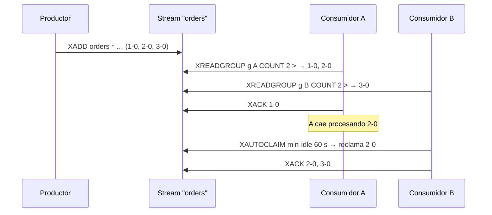

# Consumer Groups en Redis Streams

> [!abstract] En 30 segundos
> - **Qué es:** un **grupo de consumidores** reparte los mensajes de un Stream entre varios workers, **recordando qué se entregó a quién** (PEL) hasta recibir el `XACK`.
> - **Para qué:** procesamiento **at-least-once** escalable, con recuperación de mensajes de workers caídos (`XAUTOCLAIM`) y control de reintentos.
> - **Recuerda:** el mensaje **no se borra** al leerlo: queda **pendiente** hasta el `XACK`. Procesa → **confirma**. Si el worker muere, otro lo reclama. Como puede repetirse, el consumidor debe ser **idempotente**.

> [!info] Lección 5.4 · Nivel 5 — Redis en arquitecturas de microservicios
> ⬅️ [[Keyspace notifications]] · ➡️ [[Event-driven architecture con Redis]] · 🗺️ [[01 - Redis - Roadmap#Nivel 5 — Redis en arquitecturas de microservicios|Roadmap]] · 📊 [[03 - Redis - Progreso|Progreso]]
> 🏷️ Core (≥5.0) · `XAUTOCLAIM` ≥6.2 · `XREADGROUP … CLAIM` ≥8.4 · `XNACK` ≥8.8 (no disponible aún en Redis Software/Cloud según su tabla de compatibilidad) · `MAXCOUNT`/`MAXSIZE` ≥8.10.
> 🧩 Proyecto asociado: [[Proyecto 08 - Procesamiento de eventos con Redis Streams]].

## 📌 Definición

Un **consumer group** es un estado asociado a un Stream que:

- reparte entradas nuevas entre sus consumidores (cada entrada, a **uno** solo del grupo);
- guarda para cada consumidor su **PEL** (*Pending Entries List*): IDs entregados y no confirmados;
- permite **reclamar** entradas pendientes de consumidores inactivos.

| Comando | Qué hace |
|---|---|
| `XGROUP CREATE stream grupo id [MKSTREAM]` | Crea el grupo (`$` = solo nuevos; `0` = desde el principio) |
| `XREADGROUP GROUP g c [COUNT n] [BLOCK ms] STREAMS stream >` | Lee **nuevos** (`>`); con un ID concreto o `0`, relee **los pendientes de ese consumidor** |
| `XACK stream grupo id…` | Confirma: quita de la PEL |
| `XPENDING stream grupo [- + n [consumidor]]` | Resumen y detalle de pendientes (idle, nº de entregas) |
| `XCLAIM` / `XAUTOCLAIM stream grupo consumidor min-idle inicio [COUNT n]` | Reclama pendientes inactivos para otro consumidor |
| `XNACK stream grupo SILENT\|FAIL\|FATAL IDS n id…` | (≥8.8) Devuelve mensajes al grupo **sin confirmarlos** |
| `XINFO GROUPS/CONSUMERS` | Estado, `lag`, pendientes |

## 🎯 ¿Qué problema resuelve?

Con `XREAD` simple, todos los lectores reciben todo y nadie «cierra» el trabajo. Con grupos, escalas el procesamiento horizontalmente y no pierdes trabajo si un worker cae a mitad: el mensaje sigue pendiente y otro lo toma.

## 🧠 Conceptos fundamentales

1. **Entrega y confirmación:** `XREADGROUP … >` entrega nuevos y los añade a la PEL del consumidor. `XACK` los elimina. **Sin `XACK` el mensaje se queda pendiente** (y se puede reclamar).
2. **Contador de entregas y `idle`:** cada entrega incrementa el contador; `XPENDING` muestra cuánto tiempo lleva «inactivo» cada pendiente. Un contador alto suele indicar un **mensaje venenoso**.
3. **Recuperación tras fallo:**
   - Al arrancar, un consumidor lee su **propia PEL** con ID `0` y procesa lo pendiente.
   - Otros consumidores o un *reaper* ejecutan `XAUTOCLAIM` con un `min-idle` (p. ej., 60 s) para recuperar mensajes de consumidores muertos.
4. **≥8.4 — `CLAIM` en `XREADGROUP`:** `XREADGROUP … CLAIM min-idle STREAMS s >` entrega primero los pendientes inactivos (más antiguos primero; los liberados por `XNACK` antes) y luego los nuevos, en una sola llamada. La respuesta de los reclamados incluye el tiempo desde la última entrega y el número de entregas.
5. **≥8.8 — `XNACK`:** devuelve mensajes a la PEL **sin propietario y reclamables al instante**, con tres modos:

| Modo | Efecto en el contador de entregas | Uso |
|---|---|---|
| `SILENT` | Lo decrementa (la entrega «no cuenta») | Apagado ordenado, fallo interno del consumidor |
| `FAIL` | Lo mantiene | Fallo al procesar (causa incierta): que lo pruebe otro |
| `FATAL` | Lo pone al máximo | Mensaje inválido o malicioso: marcado como fallido permanente |

6. **Dead-letter queue (DLQ):** Redis no la implementa: tú mueves a otro stream (`XADD dlq …` + `XACK`) los mensajes cuyo contador supere N.
7. **Borrado de entradas:** `XACK` no borra la entrada del stream; se recorta con `XTRIM`/`MAXLEN`/`MINID`. Desde 8.2 existen `XACKDEL`/`XDELEX` para confirmar/borrar respetando referencias de grupos. Si borras una entrada aún pendiente, la PEL conserva el ID y la lectura devuelve `nil` en lugar de los datos.
8. **Lecturas bloqueantes:** `BLOCK` existe en el servidor, pero **SE.Redis no expone comandos bloqueantes**: sondea con una pausa corta.
9. **Acotar lecturas multi-stream (≥8.10):** `MAXCOUNT` y `MAXSIZE` limitan el total de entradas o bytes de la respuesta.
10. **Orden:** dentro de una entrada de stream el orden es el de `XADD`; con varios consumidores en paralelo, el *procesamiento* no conserva el orden global. Si necesitas orden por entidad, particiona (varios streams por clave hash) o procesa por clave.

### Analogía
Un **taller con tablón de encargos**: el jefe reparte fichas (mensajes) a los operarios y apunta quién tiene cada una (PEL). Cuando el operario termina, tacha la ficha (XACK). Si un operario no vuelve, tras un tiempo otro recoge sus fichas (XAUTOCLAIM). Una ficha que «explota» en manos de todos se aparta a la caja de problemas (DLQ).
**Dónde se rompe:** si dos operarios terminan la misma ficha, el trabajo se hace dos veces (idempotencia).

## ⚙️ Funcionamiento interno



## 💻 Ejemplos prácticos

```text
127.0.0.1:6379> XGROUP CREATE orders workers $ MKSTREAM
OK
127.0.0.1:6379> XADD orders * order 1001 total 59.9
"1793664000123-0"
127.0.0.1:6379> XREADGROUP GROUP workers w1 COUNT 10 STREAMS orders >
1) 1) "orders"
   2) 1) 1) "1793664000123-0"
         2) 1) "order" 2) "1001" 3) "total" 4) "59.9"
127.0.0.1:6379> XPENDING orders workers
1) (integer) 1                       # pendientes
2) "1793664000123-0"                 # primero
3) "1793664000123-0"                 # último
4) 1) 1) "w1" 2) "1"                 # consumidor → nº pendientes
127.0.0.1:6379> XACK orders workers 1793664000123-0
(integer) 1

# Recuperar pendientes inactivos (≥ 60 s) para w2
127.0.0.1:6379> XAUTOCLAIM orders workers w2 60000 0-0 COUNT 10
1) "0-0"                              # cursor para la siguiente llamada
2) (lista de entradas reclamadas)
3) (IDs que ya no existen en el stream, ≥7.0)

# Estado del grupo
127.0.0.1:6379> XINFO GROUPS orders
```

## 🔧 Implementación en .NET

```csharp
using StackExchange.Redis;

public sealed class OrderConsumer(IDatabase db, ILogger<OrderConsumer> logger, IOrderProcessor processor)
    : BackgroundService
{
    private const string Stream = "orders";
    private const string Dlq = "orders.dlq";
    private const string Group = "workers";
    private const int MaxDeliveries = 5;
    private readonly string _consumer = $"{Environment.MachineName}-{Environment.ProcessId}";

    protected override async Task ExecuteAsync(CancellationToken ct)
    {
        try { await db.StreamCreateConsumerGroupAsync(Stream, Group, "$", createStream: true); }
        catch (RedisServerException ex) when (ex.Message.StartsWith("BUSYGROUP")) { }

        // 1. Al arrancar: procesar mis propios pendientes (ID "0")
        await ProcessAsync(await db.StreamReadGroupAsync(Stream, Group, _consumer, "0", count: 50), ct);

        DateTime lastReap = DateTime.UtcNow;
        while (!ct.IsCancellationRequested)
        {
            // 2. Nuevos mensajes (SE.Redis no expone BLOCK: sondeo con pausa corta)
            StreamEntry[] entries = await db.StreamReadGroupAsync(Stream, Group, _consumer, ">", count: 50);
            if (entries.Length == 0) await Task.Delay(200, ct);
            else await ProcessAsync(entries, ct);

            // 3. Cada 30 s, reclamar pendientes de consumidores caídos (inactivos ≥ 60 s)
            if (DateTime.UtcNow - lastReap > TimeSpan.FromSeconds(30))
            {
                var claimed = await db.StreamAutoClaimAsync(Stream, Group, _consumer,
                    minIdleTimeInMs: 60_000, startAtId: "0-0", count: 50);
                await ProcessAsync(claimed.ClaimedEntries, ct);
                lastReap = DateTime.UtcNow;
            }
        }
    }

    private async Task ProcessAsync(StreamEntry[] entries, CancellationToken ct)
    {
        foreach (StreamEntry entry in entries)
        {
            if (entry.IsNull) continue;      // entrada borrada del stream pero aún en la PEL

            // Contador de entregas de este mensaje
            StreamPendingMessageInfo[] info = await db.StreamPendingMessagesAsync(
                Stream, Group, count: 1, consumerName: RedisValue.Null, minId: entry.Id, maxId: entry.Id);

            if (info.Length > 0 && info[0].DeliveryCount > MaxDeliveries)
            {
                // Mensaje venenoso: a la DLQ y confirmar
                await db.StreamAddAsync(Dlq, entry.Values);
                await db.StreamAcknowledgeAsync(Stream, Group, entry.Id);
                logger.LogError("Mensaje {Id} movido a la DLQ", entry.Id);
                continue;
            }

            try
            {
                await processor.ProcessAsync(entry, ct);                    // debe ser idempotente
                await db.StreamAcknowledgeAsync(Stream, Group, entry.Id);   // confirmar tras éxito
            }
            catch (Exception ex)
            {
                logger.LogWarning(ex, "Fallo al procesar {Id}: queda pendiente", entry.Id);
                // Opcional (≥8.8): devolverlo ya al grupo para que otro lo reintente sin esperar el min-idle
                // await db.StreamNegativeAcknowledgeAsync(Stream, Group, StreamNackMode.Fail, entry.Id);
            }
        }
    }
}

public interface IOrderProcessor
{
    Task ProcessAsync(StreamEntry entry, CancellationToken ct);
}
```

> [!tip] Apagado ordenado
> Al recibir la señal de parada, deja de leer, termina el mensaje en curso y, con Redis ≥8.8, devuelve al grupo los que no hayas empezado con `XNACK … SILENT` para que otros los tomen sin esperar el `min-idle`.

## 🏗️ Casos de uso en arquitectura

| Caso | Diseño |
|---|---|
| Procesar pedidos con N workers | Un grupo; `XACK` tras el commit |
| Varios servicios reaccionan al mismo evento | **Un grupo por servicio** sobre el mismo stream (cada grupo recibe todo) |
| Reintentos y DLQ | Contador de entregas + stream de DLQ |
| Escalar por clave | Varios streams (`orders:0..N`) o procesar por clave |

### Cuándo NO usarlo
- Entrega garantizada a todos los suscriptores efímeros: Pub/Sub.
- Retención masiva (TB) y *replay* de largo plazo: un log dedicado como Kafka.

### Consideraciones de arquitectura

| Dimensión | Qué pensar |
|---|---|
| Memoria | El stream vive en RAM: recorta (`MAXLEN ~`, `MINID`) y vigila el lag |
| Durabilidad | AOF + réplicas; `WAIT`/`WAITAOF` para garantías más fuertes |
| Observabilidad | `XINFO GROUPS` (`lag`, `pending`), edad del pendiente más antiguo |
| Cluster | Un stream vive en un solo shard |
| Idempotencia | Obligatoria: at-least-once significa «puede repetirse» ([[Idempotencia con Redis]]) |

## ⚠️ Errores y anti-patterns

| Error | Por qué duele | Cómo evitarlo |
|---|---|---|
| `XACK` antes de procesar | Pérdida si el worker cae | Confirmar tras el éxito |
| No reclamar pendientes | Mensajes huérfanos para siempre | `XAUTOCLAIM` periódico |
| Sin límite de reintentos | Mensaje venenoso en bucle | Contador + DLQ |
| Stream sin recorte | Memoria sin límite | `MAXLEN ~` / `MINID` |
| Mismo nombre de consumidor en dos procesos | PEL compartida y confusión | Nombre único por proceso |
| Consumo no idempotente | Efectos duplicados | Claves de idempotencia |
| `NOACK` en datos importantes | Sin recuperación | Solo para lo prescindible |

## ✅ Buenas prácticas

1. `XACK` tras el efecto; consumidores idempotentes.
2. Reaper con `XAUTOCLAIM` y DLQ con umbral de entregas.
3. Un grupo por servicio consumidor.
4. Recorte y alertas de lag y de edad de pendientes.
5. Nombres de consumidor únicos y estables.

## 🎤 Preguntas de entrevista

> [!question]- 1. ¿Qué garantías da un consumer group?
> At-least-once: cada mensaje se entrega a un consumidor del grupo y se mantiene pendiente hasta el `XACK`; si el consumidor falla, otro puede reclamarlo. Por eso puede procesarse más de una vez y el consumidor debe ser idempotente.

> [!question]- 2. ¿Cómo recuperas los mensajes de un consumidor caído?
> Con `XAUTOCLAIM` (o `XCLAIM`) usando un `min-idle` mayor que el tiempo de proceso normal; en ≥8.4, también con `XREADGROUP … CLAIM`.

> [!question]- 3. ¿Cómo implementas una DLQ?
> Redis no la trae: se mira el contador de entregas (`XPENDING`/respuesta de `CLAIM`) y, al superar el umbral, se copia el mensaje a otro stream y se confirma en el original.

> [!question]- 4. ¿Para qué sirve `XNACK`?
> Para devolver mensajes al grupo sin confirmarlos y sin esperar al `min-idle`, con tres modos que ajustan el contador de entregas (`SILENT`, `FAIL`, `FATAL`).

## 🧪 Ejercicios

### 🟢 Básicos
1. Crea un grupo, lee con dos consumidores y observa el reparto; confirma y mira `XPENDING`.

### 🟡 Intermedios
2. Mata un consumidor a mitad de proceso y recupera sus mensajes con `XAUTOCLAIM`.
3. Implementa el límite de entregas y la DLQ con un mensaje que siempre falla.

### 🔴 Reto Senior
4. Diseña el procesamiento de eventos de pedidos con orden por cliente, 8 workers y garantía de no procesar dos veces el efecto. ¿Streams particionados o un solo stream?

> [!success]- Soluciones
> **4.** Particionar por `hash(clienteId) % N` en `orders:0..N-1` y asignar particiones a workers (un consumidor por partición a la vez) para conservar el orden por cliente. Idempotencia con una clave `processed:{eventId}` (o restricción única en la BD) para que una repetición no duplique el efecto.

### ✔️ Checklist de dominio
- [ ] Implemento lectura, ACK, recuperación y DLQ.
- [ ] Explico at-least-once e idempotencia.
- [ ] Monitorizo lag y pendientes.

## 📝 Resumen

- Grupo = reparto + PEL + confirmación.
- `XACK` tras procesar; `XAUTOCLAIM` para recuperar; DLQ por contador de entregas.
- ≥8.4 `CLAIM` en `XREADGROUP`; ≥8.8 `XNACK`.
- At-least-once → consumidores idempotentes.

## 🔗 Referencias

- [Redis Streams](https://redis.io/docs/latest/develop/data-types/streams/)
- [XREADGROUP](https://redis.io/docs/latest/commands/xreadgroup/)
- [XNACK](https://redis.io/docs/latest/commands/xnack/)
- [XAUTOCLAIM](https://redis.io/docs/latest/commands/xautoclaim/)

## 🔄 Notas relacionadas

- ⬅️ [[Keyspace notifications]] · ➡️ [[Event-driven architecture con Redis]]
- Relacionadas: [[Redis Streams]] · [[Colas con Redis]] · [[Background jobs con Redis]] · [[Idempotencia con Redis]]
