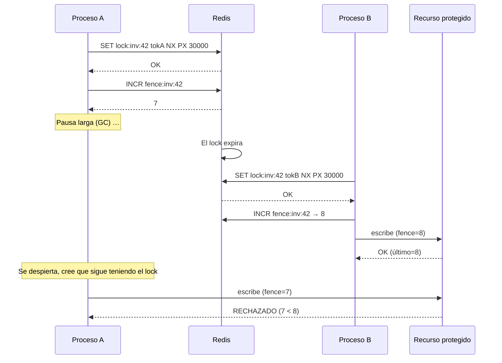

# Distributed locks con Redis

> [!abstract] En 30 segundos
> - **Qué es:** exclusión mutua entre procesos con una clave: `SET lock token NX PX ttl` para tomarlo y **«compara y borra»** para soltarlo.
> - **Para qué:** **eficiencia** (evitar que dos instancias repitan el mismo trabajo caro). Para **corrección** (que dos no escriban a la vez), necesita **fencing tokens**.
> - **Recuerda:** el lock **caduca** (TTL) — si tu trabajo tarda más o el proceso se pausa, otro entra y tienes **dos titulares**. Suelta solo si el token es **tuyo** (`DELEX … IFEQ` ≥8.4, o Lua), y protege el recurso real con un **fencing token** o con idempotencia.

> [!info] Lección 5.8 · Nivel 5 — Redis en arquitecturas de microservicios
> ⬅️ [[Background jobs con Redis]] · ➡️ [[Redlock y sus limitaciones]] · 🗺️ [[01 - Redis - Roadmap#Nivel 5 — Redis en arquitecturas de microservicios|Roadmap]] · 📊 [[03 - Redis - Progreso|Progreso]]
> 🏷️ Core · `SET … IFEQ` y `DELEX … IFEQ` ≥8.4 (Redis Open Source; comprueba tu servicio gestionado) · en versiones anteriores y en Valkey, Lua.

## 📌 Definición

Un **lock distribuido** coordina a varios procesos para que solo uno ejecute una sección crítica a la vez, usando un almacén compartido. Con Redis (una instancia):

| Operación | Comando |
|---|---|
| **Adquirir** | `SET lock:{recurso} {token} NX PX {ttl}` |
| **Renovar** (solo si es mío) | `SET lock:{recurso} {token} PX {ttl} IFEQ {token}` (≥8.4) o Lua |
| **Liberar** (solo si es mío) | `DELEX lock:{recurso} IFEQ {token}` (≥8.4) o Lua |
| **Fencing token** | `INCR fence:{recurso}` al adquirir |

## 🎯 ¿Qué problema resuelve?

- **Eficiencia:** que solo una instancia ejecute el informe, recalcule la caché o llame al servicio caro. Si el lock falla y se ejecuta dos veces, **solo se desperdicia trabajo**.
- **Corrección:** evitar que dos procesos modifiquen el mismo recurso a la vez. Aquí un lock con TTL **no basta** por sí solo.

## 🧠 Conceptos fundamentales

1. **`SET … NX PX`:** atómico; `NX` = solo si no existe; `PX` = expira solo (sin TTL, un proceso caído bloquea para siempre).
2. **El valor es un token único** (GUID) del titular: sirve para **liberar solo el propio lock**.
3. **Liberar con comparación:**
   - Lua clásico: `if GET == token then DEL`.
   - Redis ≥8.4: `DELEX clave IFEQ token`, nativo y atómico. En SE.Redis: `StringDeleteAsync(clave, ValueCondition.Equal(token))`.
   - `DEL` a ciegas puede borrar el lock **de otro** (si el tuyo expiró y alguien lo tomó).
4. **Renovación (*watchdog*):** mientras trabajas, extiende el TTL periódicamente **solo si el token sigue siendo tuyo** (`SET … PX ttl IFEQ token` ≥8.4, o Lua). Si falla la renovación, **has perdido el lock**: aborta.
5. **El problema fundamental:** el lock es un **contrato basado en tiempo**. Dos titulares simultáneos son posibles si:
   - tu trabajo supera el TTL;
   - tu proceso se pausa (GC, CPU, red) y el lock expira;
   - hay un *failover* con replicación asíncrona y la réplica no tenía el lock.
6. **Fencing token:** un número **monótono creciente** obtenido al adquirir (`INCR`). Se envía al recurso protegido (BD, API), que **rechaza** escrituras con un token menor que el último visto. Así, un titular «zombi» no corrompe nada aunque crea tener el lock.
7. **Alternativas para corrección:** restricciones únicas y concurrencia optimista en la BD (`rowversion`/ETag), bloqueos de la propia BD (`SELECT … FOR UPDATE`, *advisory locks*), un servicio de consenso (etcd, ZooKeeper).
8. **Reglas prácticas:** secciones críticas **cortas**; TTL ≥ 10× la duración típica; reintentos de adquisición con espera y jitter; claves por recurso (`lock:invoice:42`); en Cluster, el lock de una clave está en un solo nodo.

| Uso | ¿Basta un lock Redis con TTL? |
|---|---|
| Evitar trabajo duplicado (eficiencia) | **Sí**, aceptando duplicados raros |
| Exclusión estricta (corrección) | **No** sin fencing o BD con restricciones |

### Analogía
Una **llave de la sala de reuniones** con una etiqueta que caduca: si te quedas dormido dentro más del tiempo, otro entra con una llave nueva. Si dentro hay una caja fuerte que comprueba el número de turno (fencing), el dormido no puede abrirla aunque siga allí.
**Dónde se rompe:** sin el control de la caja fuerte, dos personas manipulan la misma documentación.

## ⚙️ Funcionamiento interno



## 💻 Ejemplos prácticos

```text
127.0.0.1:6379> SET lock:invoice:42 6a1f... NX PX 30000
OK
127.0.0.1:6379> SET lock:invoice:42 b2c9... NX PX 30000
(nil)
127.0.0.1:6379> INCR fence:invoice:42
(integer) 7

# Renovar solo si es mío (≥8.4)
127.0.0.1:6379> SET lock:invoice:42 6a1f... PX 30000 IFEQ 6a1f...
OK
# Liberar solo si es mío (≥8.4)
127.0.0.1:6379> DELEX lock:invoice:42 IFEQ 6a1f...
(integer) 1
```

Equivalente en Lua para versiones anteriores:

```lua
-- Liberar
if redis.call('GET', KEYS[1]) == ARGV[1] then return redis.call('DEL', KEYS[1]) end
return 0
-- Renovar
if redis.call('GET', KEYS[1]) == ARGV[1] then return redis.call('PEXPIRE', KEYS[1], ARGV[2]) end
return 0
```

## 🔧 Implementación en .NET

```csharp
using StackExchange.Redis;

public sealed class RedisLock : IAsyncDisposable
{
    private readonly IDatabase _db;
    private readonly RedisKey _key;
    private readonly RedisValue _token = Guid.NewGuid().ToString("N");
    private readonly TimeSpan _ttl;
    private readonly CancellationTokenSource _cts = new();
    private Task? _renewal;

    public long FencingToken { get; private set; }
    public bool Acquired { get; private set; }
    public CancellationToken Lost => _cts.Token;       // se cancela si se pierde el lock

    private RedisLock(IDatabase db, string resource, TimeSpan ttl)
    {
        _db = db; _key = $"lock:{resource}"; _ttl = ttl;
    }

    public static async Task<RedisLock> AcquireAsync(IDatabase db, string resource,
        TimeSpan ttl, TimeSpan wait, CancellationToken ct = default)
    {
        var l = new RedisLock(db, resource, ttl);
        DateTime deadline = DateTime.UtcNow + wait;

        while (true)
        {
            if (await db.StringSetAsync(l._key, l._token, ttl, When.NotExists))
            {
                l.Acquired = true;
                l.FencingToken = await db.StringIncrementAsync($"fence:{resource}");
                l._renewal = l.RenewLoopAsync();
                return l;
            }
            if (DateTime.UtcNow >= deadline) return l;                      // no adquirido
            await Task.Delay(Random.Shared.Next(50, 150), ct);              // espera con jitter
        }
    }

    private async Task RenewLoopAsync()
    {
        using var timer = new PeriodicTimer(_ttl / 3);
        try
        {
            while (await timer.WaitForNextTickAsync(_cts.Token))
            {
                // ≥8.4: SET … PX ttl IFEQ token (solo renueva si sigue siendo mío)
                bool renewed = await _db.StringSetAsync(_key, _token, _ttl, ValueCondition.Equal(_token));
                if (!renewed) { Acquired = false; _cts.Cancel(); return; }    // lo perdí: avisar
            }
        }
        catch (OperationCanceledException) { }
    }

    public async ValueTask DisposeAsync()
    {
        _cts.Cancel();
        if (_renewal is not null) await _renewal;
        if (Acquired)
            await _db.StringDeleteAsync(_key, ValueCondition.Equal(_token));   // DELEX … IFEQ (≥8.4)
        _cts.Dispose();
    }
}
```

Uso con fencing token hacia la base de datos (la comprobación vive en el recurso protegido):

```csharp
await using RedisLock lk = await RedisLock.AcquireAsync(db, "invoice:42",
    ttl: TimeSpan.FromSeconds(30), wait: TimeSpan.FromSeconds(5));

if (!lk.Acquired) return;                    // otro lo está haciendo: salir o reintentar

// El recurso protegido rechaza tokens antiguos (aquí, SQL con condición sobre el token)
int rows = await sql.ExecuteAsync(
    "UPDATE Invoices SET Total = @t, LastFence = @f WHERE Id = 42 AND LastFence < @f",
    new { t = 120m, f = lk.FencingToken });

if (rows == 0) throw new InvalidOperationException("Escritura rechazada: token obsoleto");
```

> [!note] `LockTakeAsync`/`LockReleaseAsync`
> SE.Redis incluye `LockTakeAsync`, `LockExtendAsync` y `LockReleaseAsync` (con el mismo esquema token + `NX PX`). Cubren lo básico; el ejemplo anterior añade renovación automática y fencing.

> [!warning] Con Redis anterior a 8.4 o Valkey
> `ValueCondition` requiere `SET IFEQ`/`DELEX` (≥8.4). En servidores anteriores, usa los scripts Lua de arriba con `LuaScript`.

## 🏗️ Casos de uso en arquitectura

| Caso | Lock + garantías |
|---|---|
| Un solo recalculador de una caché | Lock de eficiencia ([[Cache stampede]]) |
| Cron en varias instancias | Lock por fecha ([[Background jobs con Redis]]) |
| Migración de datos | Lock + idempotencia |
| Escritura exclusiva de un recurso crítico | Fencing o restricción en la BD |
| Contabilidad / dinero | **Nada de depender del lock**: transacciones y restricciones de la BD |

### Cuándo NO usarlo
- Para corrección sin fencing ni respaldo en la BD.
- Cuando una restricción única o concurrencia optimista resuelve el problema sin locks.

### Consideraciones de arquitectura

| Dimensión | Qué pensar |
|---|---|
| Disponibilidad | Si Redis cae, nadie obtiene el lock: decide fail-open/closed |
| Failover | La replicación asíncrona puede perder el lock ([[Replicación en Redis]]) |
| Contención | Alta contención = cola de espera: replantea el diseño |
| Observabilidad | Duración de los locks, esperas, pérdidas de lock |

## ⚠️ Errores y anti-patterns

| Error | Por qué duele | Cómo evitarlo |
|---|---|---|
| `SETNX` y luego `EXPIRE` | Si cae entre ambos, lock eterno | `SET NX PX` atómico |
| Liberar con `DEL` a ciegas | Borras el lock de otro | Comparar token |
| Valor fijo en vez de token | No distingues titulares | GUID por adquisición |
| Sección crítica más larga que el TTL sin renovar | Dos titulares | Renovación o TTL mayor |
| Suponer exclusión absoluta | Pausas y failover | Fencing, idempotencia, BD |
| Locks por un recurso gigante («global») | Cuello de botella | Granularidad fina |

## ✅ Buenas prácticas

1. `SET NX PX` + token; liberar y renovar con comparación.
2. Secciones críticas cortas; TTL generoso; renovación con detección de pérdida.
3. Fencing token hacia el recurso protegido.
4. Idempotencia en lo que protege el lock.
5. Para dinero/inventario, restricciones y transacciones de la BD.

## 🎤 Preguntas de entrevista

> [!question]- 1. ¿Cómo implementas un lock distribuido con Redis?
> `SET lock token NX PX ttl` para adquirir; liberar solo si el valor es mi token (Lua o `DELEX IFEQ`); renovación periódica comprobando el token; y, si protege un recurso crítico, un fencing token.

> [!question]- 2. ¿Por qué un lock con TTL no es seguro para corrección?
> Porque es un contrato de tiempo: un proceso pausado o lento puede perder el lock sin enterarse y otro entrar; el recurso necesita un fencing token o restricciones propias para rechazar al «zombi».

> [!question]- 3. ¿Qué es un fencing token?
> Un número monótono creciente que se obtiene al adquirir el lock y se envía con cada operación; el recurso rechaza tokens menores que el último visto.

## 🧪 Ejercicios

### 🟢 Básicos
1. Adquiere el lock desde dos terminales y comprueba que solo una lo logra; suéltalo con comparación.

### 🟡 Intermedios
2. Implementa `RedisLock` con renovación y prueba que, al matar el proceso, otro lo adquiere tras el TTL.
3. Simula la pérdida del lock (borra la clave a mano) y verifica que `Lost` se cancela.

### 🔴 Reto Senior
4. Simula una pausa de GC más larga que el TTL (con `Thread.Sleep` en el titular) y demuestra la doble ejecución; después añade un fencing token y demuestra que el recurso rechaza al zombi.

> [!success]- Soluciones
> **4.** A toma el lock (fence=7) y duerme 40 s con TTL de 30 s; B toma el lock (fence=8) y escribe; A despierta y escribe con fence=7: la condición `LastFence < @f` falla (`rows == 0`) y A aborta.

### ✔️ Checklist de dominio
- [ ] Implemento adquisición, renovación y liberación seguras.
- [ ] Distingo locks de eficiencia y de corrección.
- [ ] Aplico fencing tokens.

## 📝 Resumen

- `SET NX PX` + token; liberar/renovar solo si es mío.
- Lock = contrato de tiempo: pausas y failover rompen la exclusión.
- Corrección ⇒ fencing o restricciones en la BD.
- Secciones cortas, TTL generoso, idempotencia.

## 🔗 Referencias

- [Distributed locks con Redis](https://redis.io/docs/latest/develop/clients/patterns/distributed-locks/)
- [SET](https://redis.io/docs/latest/commands/set/)
- [DELEX](https://redis.io/docs/latest/commands/delex/)
- [How to do distributed locking (M. Kleppmann)](https://martin.kleppmann.com/2016/02/08/how-to-do-distributed-locking.html)

## 🔄 Notas relacionadas

- ⬅️ [[Background jobs con Redis]] · ➡️ [[Redlock y sus limitaciones]]
- Relacionadas: [[Cache stampede]] · [[Lua scripting en Redis]] · [[Idempotencia con Redis]] · [[Control de concurrencia con Redis]]
