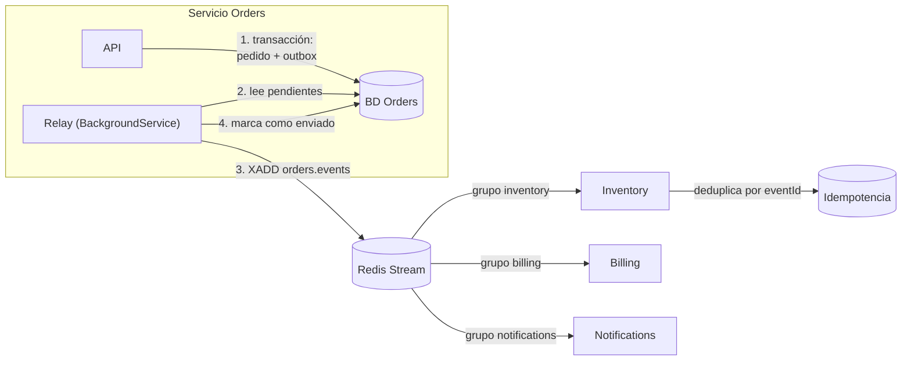

# Event-driven architecture con Redis

> [!abstract] En 30 segundos
> - **Qué es:** coordinar servicios mediante **eventos** («pedido creado») en lugar de llamadas síncronas, usando Redis (Streams) o un broker dedicado.
> - **Para qué:** desacoplar, absorber picos y permitir que varios servicios reaccionen al mismo hecho.
> - **Recuerda:** elige por **garantías**, no por moda. Redis Streams: baja latencia, ya lo tienes, retención en **RAM**. Para retención larga, *replay* masivo, enrutado complejo o garantías de durabilidad fuertes, valora **Kafka, RabbitMQ o Azure Service Bus**. Y publica con **outbox** para no perder eventos entre la BD y el bus.

> [!info] Lección 5.5 · Nivel 5 — Redis en arquitecturas de microservicios
> ⬅️ [[Consumer Groups en Redis Streams]] · ➡️ [[Colas con Redis]] · 🗺️ [[01 - Redis - Roadmap#Nivel 5 — Redis en arquitecturas de microservicios|Roadmap]] · 📊 [[03 - Redis - Progreso|Progreso]]
> 🏷️ Conceptos de arquitectura; `XADD … IDMP` (deduplicación de productor) ≥8.6.

## 📌 Definición

En una **arquitectura orientada a eventos** un servicio publica **hechos** que ya ocurrieron (`OrderPlaced`), y otros se suscriben sin que el productor los conozca. Tipos de mensaje:

| Tipo | Significado | Ejemplo |
|---|---|---|
| **Evento** | Algo ocurrió (pasado) | `OrderPlaced` |
| **Comando** | Pide que se haga algo | `ReserveStock` |
| **Mensaje de consulta/respuesta** | Petición asíncrona | `GetPrice` |

## 🎯 ¿Qué problema resuelve?

La llamada síncrona encadena disponibilidad y latencia: si `Inventory` está caído, `Orders` falla. Con eventos, `Orders` publica y sigue; `Inventory` lo procesa cuando puede. También permite añadir consumidores nuevos sin tocar al productor.

## 🧠 Conceptos fundamentales

### Comparativa de tecnologías

| | **Redis Pub/Sub** | **Redis Streams** | **Kafka** | **RabbitMQ** | **Azure Service Bus** |
|---|---|---|---|---|---|
| Modelo | Difusión | Log + consumer groups | Log particionado | Colas/exchanges | Colas/temas |
| Entrega | At-most-once | At-least-once | At-least-once (exactly-once en ciertos flujos) | At-least-once | At-least-once (+ detección de duplicados) |
| Persistencia | No | En RAM (+AOF/RDB) | En disco, larga | Disco (colas durables) | Gestionada, durable |
| Retención / replay | No | Limitada por RAM | Larga, *replay* | Hasta consumir | TTL y DLQ |
| Orden | Por canal | Por stream | Por partición | Por cola | Sesiones |
| Enrutado | Patrones | Streams/grupos | Temas/particiones | Flexible (exchanges) | Temas y suscripciones con filtros |
| DLQ nativa | No | No (manual) | No (patrón) | Sí | Sí |
| Operación | Muy simple | Simple | Compleja (o gestionada) | Media | Gestionada |
| Latencia | Mínima | Muy baja | Baja | Baja | Media |

### Cuándo Redis Streams es suficiente
- Volúmenes moderados, **retención corta** (horas/días) y mensajes pequeños.
- Ya operas Redis con HA y persistencia, y quieres evitar otra pieza.
- Latencia muy baja y consumer groups sencillos.

### Cuándo valorar otro broker
- Retención de días/meses y *replay* masivo, miles de consumidores o particionado muy alto (Kafka).
- Enrutado complejo, prioridades, TTL por mensaje y DLQ nativa (RabbitMQ / Service Bus).
- Garantías de durabilidad estrictas: Redis replica **de forma asíncrona**, así que un *failover* puede perder escrituras confirmadas (se mitiga con AOF, `WAIT`/`WAITAOF` y réplicas, sin eliminar el riesgo).
- Integración con ecosistemas gestionados (Azure Service Bus en Azure, conectores de Kafka).

### Garantías y orden
1. **At-least-once + idempotencia** es el modelo práctico: «exactamente una vez» se consigue con **efecto idempotente**, no con el transporte.
2. **Orden:** global casi nunca es posible a escala; se garantiza **por clave** (partición/stream por clave).
3. **Esquema del evento:** versionado, con `eventId`, `type`, `version`, `occurredAt`, `correlationId` y el contenido mínimo.

### Outbox transaccional
Problema: ¿cómo asegurar que «guardar el pedido» y «publicar el evento» ocurren ambos o ninguno? Una escritura en la BD y otra en Redis no comparten transacción.

**Solución:** en la **misma transacción** de la BD guardas el pedido **y** una fila en la tabla `outbox`. Un *relay* publica las filas pendientes al bus y las marca como enviadas. El productor es **at-least-once**; los consumidores deduplican por `eventId`.

### Analogía
Un **boletín interno**: la dirección pega un aviso (evento) en el tablón; cada departamento lo lee cuando puede. El **buzón de salida con copia** (outbox) garantiza que si la dirección anota una decisión, el aviso saldrá aunque se vaya la luz.
**Dónde se rompe:** si el aviso sale dos veces (reintento), cada departamento debe reconocerlo (idempotencia).

## ⚙️ Funcionamiento interno



## 💻 Ejemplos prácticos

```text
# Un stream, varios grupos: cada grupo recibe todos los eventos
127.0.0.1:6379> XGROUP CREATE orders.events inventory $ MKSTREAM
127.0.0.1:6379> XGROUP CREATE orders.events billing $
127.0.0.1:6379> XADD orders.events * eventId 7f3a type OrderPlaced version 1 orderId 1001 total 59.9
"1793664000123-0"
127.0.0.1:6379> XREADGROUP GROUP inventory w1 STREAMS orders.events >
127.0.0.1:6379> XREADGROUP GROUP billing w1 STREAMS orders.events >
# Ambos reciben el mismo evento
```

## 🔧 Implementación en .NET

**Relay de la outbox hacia Redis Streams**

```csharp
using Microsoft.EntityFrameworkCore;
using StackExchange.Redis;

public class OutboxMessage
{
    public Guid Id { get; set; } = Guid.NewGuid();
    public string Type { get; set; } = "";
    public string Payload { get; set; } = "";
    public DateTime OccurredAt { get; set; } = DateTime.UtcNow;
    public DateTime? PublishedAt { get; set; }
}

public class ShopDbContext(DbContextOptions<ShopDbContext> options) : DbContext(options)
{
    public DbSet<OutboxMessage> Outbox => Set<OutboxMessage>();
}

public sealed class OutboxRelay(IServiceScopeFactory scopes, IDatabase redis, ILogger<OutboxRelay> logger)
    : BackgroundService
{
    protected override async Task ExecuteAsync(CancellationToken ct)
    {
        using var timer = new PeriodicTimer(TimeSpan.FromMilliseconds(500));
        while (await timer.WaitForNextTickAsync(ct))
        {
            try
            {
                using IServiceScope scope = scopes.CreateScope();
                ShopDbContext db = scope.ServiceProvider.GetRequiredService<ShopDbContext>();

                List<OutboxMessage> pending = await db.Outbox
                    .Where(m => m.PublishedAt == null)
                    .OrderBy(m => m.OccurredAt)
                    .Take(100)
                    .ToListAsync(ct);

                foreach (OutboxMessage m in pending)
                {
                    await redis.StreamAddAsync("orders.events", new NameValueEntry[]
                    {
                        new("eventId", m.Id.ToString()),
                        new("type", m.Type),
                        new("version", 1),
                        new("occurredAt", m.OccurredAt.ToString("O")),
                        new("payload", m.Payload)
                    }, maxLength: 100_000, useApproximateMaxLength: true);   // recorte aproximado (MAXLEN ~)

                    m.PublishedAt = DateTime.UtcNow;      // si cae aquí: se republica (at-least-once)
                }
                await db.SaveChangesAsync(ct);
            }
            catch (Exception ex) when (ex is not OperationCanceledException)
            {
                logger.LogWarning(ex, "Fallo en el relay de la outbox; se reintentará");
            }
        }
    }
}
```

**Productor con la escritura atómica (pedido + outbox)**

```csharp
public class Order { public Guid Id { get; set; } public decimal Total { get; set; } }

public async Task PlaceOrderAsync(ShopDbContext db, Order order, CancellationToken ct)
{
    db.Add(order);
    db.Outbox.Add(new OutboxMessage
    {
        Type = "OrderPlaced",
        Payload = System.Text.Json.JsonSerializer.Serialize(new { order.Id, order.Total })
    });
    await db.SaveChangesAsync(ct);     // una sola transacción local: pedido y evento, o nada
}
```

> [!note] Deduplicación de productor (≥8.6)
> Redis 8.6 añade a `XADD` la **idempotencia del productor** (`IDMP`/`IDMPAUTO`): reintentar el mismo `XADD` con el mismo identificador no duplica la entrada. SE.Redis lo soporta mediante `StreamIdempotentId`. Úsalo para que el relay no duplique entradas tras un reintento; los consumidores siguen necesitando ser idempotentes.

## 🏗️ Casos de uso en arquitectura

| Caso | Diseño |
|---|---|
| Notificar a varios servicios un hecho | Un stream, un grupo por servicio |
| Integrar con otros sistemas | Outbox + broker del ecosistema (Service Bus, Kafka) |
| Picos de pedidos | El stream amortigua; los workers escalan |
| Auditoría larga | No en Redis: BD/Data Lake con consumidor de archivo |

### Cuándo NO usar eventos
- Operaciones que necesitan **respuesta inmediata** y consistencia fuerte: llamada síncrona.
- Equipos que no pueden operar la complejidad extra (trazabilidad, idempotencia, versionado).

### Consideraciones de arquitectura

| Dimensión | Qué pensar |
|---|---|
| Contratos | Esquema versionado y compatible hacia atrás |
| Observabilidad | `correlationId`, trazas de extremo a extremo, lag por grupo |
| Fallos | DLQ, reintentos con *backoff*, alertas |
| Durabilidad | AOF, réplicas, `WAIT`; RPO/RTO explícitos |
| Capacidad | Retención en RAM: dimensionar y recortar |

## ⚠️ Errores y anti-patterns

| Error | Por qué duele | Cómo evitarlo |
|---|---|---|
| Publicar en el bus y luego guardar en la BD (o viceversa) sin outbox | Eventos fantasma o perdidos | Outbox transaccional |
| Eventos con todo el estado interno | Acoplamiento al modelo del productor | Contrato público mínimo |
| Esperar orden global | No escala | Orden por clave |
| Consumidores no idempotentes | Duplicados | Claves de idempotencia |
| Usar Pub/Sub para eventos críticos | Pérdidas | Streams |
| Usar Redis como archivo histórico | Memoria agotada | Recortar y archivar |

## ✅ Buenas prácticas

1. Outbox + relay; consumidores idempotentes.
2. Eventos pequeños, versionados, con `eventId` y `correlationId`.
3. Un grupo por servicio; DLQ por servicio.
4. Recorte y alertas de capacidad.
5. Decide la tecnología por garantías y retención.

## 🎤 Preguntas de entrevista

> [!question]- 1. ¿Streams, Pub/Sub, Kafka, RabbitMQ o Service Bus?
> Pub/Sub para señales efímeras; Streams para eventos con baja latencia y retención corta si ya tienes Redis; Kafka para retención larga, replay y alto volumen; RabbitMQ para enrutado y colas de trabajo con DLQ nativa; Service Bus si estás en Azure y quieres gestión, sesiones y DLQ. Decide por entrega, retención, orden, operación y coste.

> [!question]- 2. ¿Cómo garantizas que un evento se publica si y solo si se guardó el pedido?
> Con el patrón outbox: pedido y evento en la misma transacción de BD; un relay publica y marca. Los consumidores deduplican por `eventId`.

> [!question]- 3. ¿Cómo consigues «exactamente una vez»?
> No con el transporte: se logra con entrega at-least-once más un efecto idempotente (clave de idempotencia o restricción única).

## 🧪 Ejercicios

### 🟢 Básicos
1. Crea dos grupos sobre el mismo stream y comprueba que cada uno recibe todos los eventos.

### 🟡 Intermedios
2. Implementa la outbox y el relay; mata el relay entre el `XADD` y el marcado y comprueba que el evento se duplica y el consumidor lo deduplica.

### 🔴 Reto Senior
3. Una plataforma procesa 50 000 eventos/s y necesita retener 30 días y poder reprocesar. ¿Streams? Justifica con cálculos de memoria.

> [!success]- Soluciones
> **3.** 50 000/s × 86 400 s × 30 días ≈ 130 000 M de eventos; incluso a 200 B/evento son ≈ 26 TB: no es viable en RAM. Usa un log en disco (Kafka o equivalente gestionado); Redis Streams puede servir de buffer de corta duración delante.

### ✔️ Checklist de dominio
- [ ] Elijo tecnología por garantías y retención.
- [ ] Implemento outbox + consumidor idempotente.
- [ ] Diseño contratos de eventos versionados.

## 📝 Resumen

- Eventos desacoplan; la garantía real es at-least-once + idempotencia.
- Redis Streams: baja latencia y simplicidad, retención en RAM.
- Outbox para consistencia BD ↔ bus.
- Orden por clave; contratos versionados.

## 🔗 Referencias

- [Transactional outbox](https://learn.microsoft.com/azure/architecture/best-practices/transactional-outbox-cosmos)
- [Event-driven architecture style](https://learn.microsoft.com/azure/architecture/guide/architecture-styles/event-driven)
- [Redis Streams](https://redis.io/docs/latest/develop/data-types/streams/)

## 🔄 Notas relacionadas

- ⬅️ [[Consumer Groups en Redis Streams]] · ➡️ [[Colas con Redis]]
- Relacionadas: [[Idempotencia con Redis]] · [[Redis Pub-Sub]] · [[Persistencia AOF]] · [[Proyecto 08 - Procesamiento de eventos con Redis Streams]]
