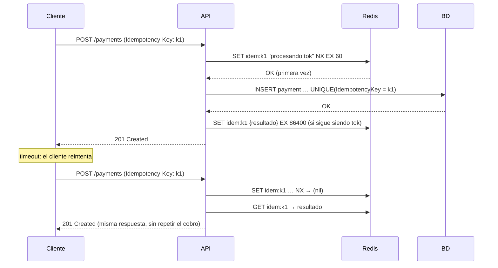

# Idempotencia con Redis

> [!abstract] En 30 segundos
> - **Qué es:** garantizar que repetir una operación (reintento HTTP, mensaje duplicado) **produce el mismo efecto que hacerla una vez**.
> - **Para qué:** pagos, pedidos, consumidores de eventos: en un mundo at-least-once, los duplicados **van a ocurrir**.
> - **Recuerda:** con Redis reservas la clave con **`SET NX EX`** (solo uno gana), guardas el **resultado** y lo reutilizas. Pero Redis **no es transaccional con tu BD**: el efecto real debe protegerse también con una **restricción única** o una *inbox* en la BD.

> [!info] Lección 5.10 · Nivel 5 — Redis en arquitecturas de microservicios
> ⬅️ [[Redlock y sus limitaciones]] · ➡️ [[Persistencia en Redis]] · 🗺️ [[01 - Redis - Roadmap#Nivel 5 — Redis en arquitecturas de microservicios|Roadmap]] · 📊 [[03 - Redis - Progreso|Progreso]]
> 🏷️ Core · `SET … IFEQ` ≥8.4 para completar la reserva de forma segura (si no, Lua).
> 📌 **Cierra el nivel 5**: continúa con los proyectos [[Proyecto 06 - Distribución de eventos]], [[Proyecto 07 - Sistema de colas]] y [[Proyecto 08 - Procesamiento de eventos con Redis Streams]].

## 📌 Definición

Una operación es **idempotente** si ejecutarla N veces tiene el mismo efecto que ejecutarla una. `GET`, `PUT` y `DELETE` lo son por diseño; `POST` («crear pedido», «cobrar») **no**, y necesita ayuda: una **clave de idempotencia** enviada por el cliente (cabecera `Idempotency-Key`) o un **identificador de evento** en mensajería.

## 🎯 ¿Qué problema resuelve?

- El cliente no recibe la respuesta (timeout) y **reintenta** el pago.
- Un balanceador o proxy reintenta la petición.
- El broker entrega el mensaje dos veces (at-least-once) o un consumidor reinicia tras procesar pero antes de confirmar.
- Dos pestañas envían el mismo formulario.

Sin idempotencia: doble cobro, doble pedido, doble email.

## 🧠 Conceptos fundamentales

1. **Clave de idempotencia:** identificador único generado por el **cliente** por operación lógica (GUID). La misma clave = la misma operación.
2. **Reserva atómica:** `SET idem:{clave} "procesando:{token}" NX EX 60`. Solo una petición lo consigue; las demás ven que existe.
3. **Estados de la clave:**

| Estado | Significado | Respuesta a un duplicado |
|---|---|---|
| No existe | Primera vez | Procesar |
| `procesando` | En curso | `409 Conflict` (o esperar y reintentar) |
| `completado` + resultado | Ya hecho | **Devolver la misma respuesta guardada** |

4. **Huella de la petición:** guarda un hash del cuerpo con la clave; si llega la misma clave con **otro cuerpo**, responde `422` (mal uso).
5. **TTL de la reserva:** si el proceso cae durante «procesando», la reserva **caduca** y se puede reintentar; el TTL de «completado» define la **ventana de deduplicación** (24 h-7 días).
6. **Completar sin pisar:** al terminar, sustituye `procesando:{token}` por el resultado **solo si sigue siendo tu token** (`SET … IFEQ token` ≥8.4, o Lua), para no sobrescribir si tu reserva expiró y otro la tomó.
7. **Límite de Redis (importante):** reserva en Redis y efecto en la BD **no son atómicos**. Casos:
   - Efecto hecho, Redis cae antes de guardar «completado» → el reintento repite el efecto. **Protege el efecto** con restricción única (p. ej., `UNIQUE (IdempotencyKey)` en la tabla de pagos) o una **tabla *inbox*** en la misma transacción.
   - Así Redis actúa como **atajo rápido** y la BD como garantía.
8. **Idempotencia de consumidores:**
   - `SET processed:{eventId} 1 NX EX 7d`: si devuelve `OK`, procesa; si no, ya se procesó.
   - Mejor aún: *inbox* en la BD con la misma transacción que el efecto.
9. **Operaciones naturalmente idempotentes:** `SET`, `HSET` de un valor, «establecer estado = pagado» (no «incrementar saldo»): diseña así siempre que puedas.

### Analogía
El **resguardo numerado** de una tintorería: si vuelves a pedir el mismo resguardo, no te cobran otra vez, te devuelven la misma prenda. Y el libro de la tienda (BD) no admite dos veces el mismo número (restricción única).
**Dónde se rompe:** si el resguardo se pierde y el libro no comprueba duplicados, se cobra dos veces.

## ⚙️ Funcionamiento interno



## 💻 Ejemplos prácticos

```text
# Reserva (primera vez)
127.0.0.1:6379> SET idem:payments:k1 "procesando:6a1f" NX EX 60
OK
# Duplicado concurrente
127.0.0.1:6379> SET idem:payments:k1 "procesando:b2c9" NX EX 60
(nil)
# Completar solo si la reserva sigue siendo mía (≥8.4)
127.0.0.1:6379> SET idem:payments:k1 "{\"status\":201,\"body\":{\"id\":77}}" EX 86400 IFEQ "procesando:6a1f"
OK

# Consumidor de eventos
127.0.0.1:6379> SET processed:7f3a 1 NX EX 604800
OK            # procesar
127.0.0.1:6379> SET processed:7f3a 1 NX EX 604800
(nil)         # duplicado: ignorar
```

## 🔧 Implementación en .NET

**Filtro de idempotencia para endpoints `POST`**

```csharp
using System.Text.Json;
using StackExchange.Redis;

public sealed record StoredResponse(int Status, string Body);

public sealed class IdempotencyFilter(IDatabase db) : IEndpointFilter
{
    private static readonly TimeSpan InProgressTtl = TimeSpan.FromSeconds(60);
    private static readonly TimeSpan ResultTtl = TimeSpan.FromHours(24);

    public async ValueTask<object?> InvokeAsync(EndpointFilterInvocationContext ctx, EndpointFilterDelegate next)
    {
        HttpContext http = ctx.HttpContext;

        if (!http.Request.Headers.TryGetValue("Idempotency-Key", out var header) ||
            string.IsNullOrWhiteSpace(header))
            return Results.Problem("Falta la cabecera Idempotency-Key", statusCode: 400);

        // El ámbito incluye la ruta y el usuario para que dos clientes no choquen
        string user = http.User.Identity?.Name ?? "anon";
        RedisKey key = $"idem:{user}:{http.Request.Path}:{header}";
        string token = Guid.NewGuid().ToString("N");

        // 1. Reservar: solo una petición con esta clave lo consigue
        bool reserved = await db.StringSetAsync(key, $"processing:{token}", InProgressTtl, When.NotExists);
        if (!reserved)
        {
            string existing = (await db.StringGetAsync(key)).ToString();
            if (existing.StartsWith("processing:"))
                return Results.Problem("Hay otra petición idéntica en curso", statusCode: 409);

            StoredResponse stored = JsonSerializer.Deserialize<StoredResponse>(existing)!;
            http.Response.Headers["Idempotent-Replayed"] = "true";
            return Results.Content(stored.Body, "application/json", null, stored.Status);
        }

        try
        {
            object? result = await next(ctx);

            // 2. Guardar el resultado (si la reserva sigue siendo mía: SET … IFEQ, ≥8.4)
            if (result is IValueHttpResult { Value: not null } value and IStatusCodeHttpResult status)
            {
                var stored = new StoredResponse(status.StatusCode ?? 200, JsonSerializer.Serialize(value.Value));
                await db.StringSetAsync(key, JsonSerializer.Serialize(stored), ResultTtl,
                    ValueCondition.Equal($"processing:{token}"));
            }
            return result;
        }
        catch
        {
            // Fallo: liberar la reserva (solo si es mía) para permitir el reintento
            await db.StringDeleteAsync(key, ValueCondition.Equal($"processing:{token}"));
            throw;
        }
    }
}

// app.MapPost("/payments", handler).AddEndpointFilter<IdempotencyFilter>();
```

**Consumidor idempotente de eventos**

```csharp
public sealed class IdempotentConsumer(IDatabase db)
{
    // true => primera vez: procesar; false => duplicado: ignorar
    public Task<bool> TryBeginAsync(string eventId) =>
        db.StringSetAsync($"processed:{eventId}", "1", TimeSpan.FromDays(7), When.NotExists);

    // Si el procesamiento falla, libera la marca para que el reintento pueda ejecutarse
    public Task ReleaseAsync(string eventId) => db.KeyDeleteAsync($"processed:{eventId}");
}
```

> [!warning] Redis no sustituye a la restricción de la BD
> El filtro reduce duplicados y devuelve respuestas guardadas, pero Redis y la BD son sistemas distintos. Para que el **efecto** sea realmente único, aplica también `UNIQUE (IdempotencyKey)` o una tabla *inbox* en la misma transacción que el efecto. Así, aunque Redis pierda la reserva (fallo, desalojo, failover), la BD rechaza el duplicado.

> [!note] Instancia de datos
> Las claves de idempotencia deben vivir en una instancia **sin desalojo** (`noeviction`) y con persistencia/HA, no en la caché desechable: si se desaloja la clave, el duplicado se procesa ([[Eviction policies]]).

## 🏗️ Casos de uso en arquitectura

| Caso | Diseño |
|---|---|
| API de pagos | `Idempotency-Key` + BD con restricción única |
| Webhooks entrantes (el emisor reintenta) | `eventId` del emisor con `SET NX` |
| Consumidores de Streams | `processed:{eventId}` o inbox en BD |
| Envío de emails | Clave por (usuario, plantilla, referencia) con ventana |
| Reintentos del cliente móvil | Clave generada al abrir la pantalla |

### Cuándo NO necesitas Redis para esto
- Cuando la BD ya puede garantizarlo (restricción única) y la latencia extra no importa.
- Operaciones naturalmente idempotentes (`PUT`, «poner estado»).

### Consideraciones de arquitectura

| Dimensión | Qué pensar |
|---|---|
| Ventana | Cuánto tiempo recuerdas las claves (24 h-7 d) y su coste en memoria |
| Persistencia | Instancia de datos con AOF y réplica |
| Alcance de la clave | Por usuario, ruta y operación |
| Respuesta guardada | Tamaño máximo; no guardar datos sensibles innecesarios |
| Observabilidad | Tasa de repeticiones y conflictos 409 |

## ⚠️ Errores y anti-patterns

| Error | Por qué duele | Cómo evitarlo |
|---|---|---|
| Comprobar con `GET` y luego `SET` | Carrera: ambos pasan | `SET NX` atómico |
| Sin TTL en `procesando` | Un fallo bloquea la clave para siempre | TTL corto |
| Sobrescribir el resultado sin comprobar el token | Pisas la reserva de otro | `IFEQ`/Lua |
| Confiar solo en Redis para dinero | Desalojo o failover → duplicados | Restricción única en la BD |
| Clave de idempotencia generada por el servidor | No sirve para reintentos del cliente | La genera el cliente |
| Misma clave, distinto cuerpo, aceptada | Resultados incoherentes | Huella y `422` |
| Claves en la caché con `allkeys-lru` | Se pierden y se duplican efectos | `noeviction` |

## ✅ Buenas prácticas

1. Clave generada por el cliente; reserva con `SET NX EX`.
2. Guarda y devuelve el resultado; valida la huella del cuerpo.
3. Completa solo si la reserva es tuya.
4. Restricción única o *inbox* en la BD.
5. Instancia de datos con persistencia y `noeviction`.

## 🎤 Preguntas de entrevista

> [!question]- 1. ¿Cómo garantizas que un evento produce su efecto una sola vez?
> At-least-once en el transporte más un efecto idempotente: una marca `SET NX` por `eventId` (o una inbox en la BD en la misma transacción que el efecto) para ignorar duplicados. La garantía fuerte la da la BD (restricción única).

> [!question]- 2. ¿Cómo diseñas la idempotencia de un endpoint de pagos con concurrencia real?
> `Idempotency-Key` del cliente; reserva atómica `SET NX EX`; estados procesando/completado; respuesta guardada para repetir; huella del cuerpo; y `UNIQUE` en la BD para que el cobro sea único aunque Redis falle.

> [!question]- 3. ¿Por qué no basta con comprobar `GET` y luego `SET`?
> Dos peticiones concurrentes pueden ver «no existe» y ejecutar ambas. `SET NX` hace la comprobación y la reserva en una operación atómica.

## 🧪 Ejercicios

### 🟢 Básicos
1. Reserva una clave con `SET NX EX` desde dos terminales y comprueba que solo una gana.

### 🟡 Intermedios
2. Implementa el filtro y prueba 50 peticiones concurrentes con la misma clave: solo un efecto, el resto 409 o la respuesta guardada.
3. Implementa un consumidor idempotente y demuestra que procesar dos veces el mismo mensaje no duplica efectos.

### 🔴 Reto Senior
4. Redis pierde las claves por un failover justo después del cobro y antes de guardar el resultado. ¿Qué ocurre y cómo lo haces seguro?

> [!success]- Soluciones
> **4.** Sin más defensas, el reintento volvería a cobrar. Con una restricción única `(IdempotencyKey)` en la BD (o inbox en la misma transacción), el segundo cobro falla de forma controlada y se devuelve el resultado existente leyéndolo de la BD.

### ✔️ Checklist de dominio
- [ ] Diseño claves de idempotencia y estados.
- [ ] Combino Redis (atajo) con restricciones de BD (garantía).
- [ ] Implemento consumidores idempotentes.

## 📝 Resumen

- Idempotencia = repetir no cambia el resultado.
- `SET NX EX` reserva; guarda y repite la respuesta; completa con el token.
- La garantía fuerte vive en la BD (restricción única/inbox).
- Instancia de datos sin desalojo.

## 🔗 Referencias

- [Idempotency-Key HTTP header (IETF draft)](https://datatracker.ietf.org/doc/draft-ietf-httpapi-idempotency-key-header/)
- [SET](https://redis.io/docs/latest/commands/set/)
- [Patrón Idempotent Consumer](https://microservices.io/patterns/communication-style/idempotent-consumer.html)

## 🔄 Notas relacionadas

- ⬅️ [[Redlock y sus limitaciones]] · ➡️ [[Persistencia en Redis]]
- Relacionadas: [[Consumer Groups en Redis Streams]] · [[Event-driven architecture con Redis]] · [[Distributed locks con Redis]] · [[Proyecto 08 - Procesamiento de eventos con Redis Streams]]
