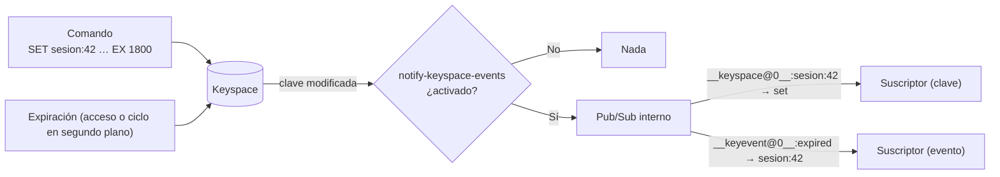

# Keyspace notifications

> [!abstract] En 30 segundos
> - **Qué es:** Redis publica por Pub/Sub un **evento cada vez que cambia una clave** (se crea, se modifica, expira, se desaloja…). Desactivado por defecto: `notify-keyspace-events`.
> - **Para qué:** reaccionar a expiraciones (liberar recursos), invalidar cachés, auditar cambios.
> - **Recuerda:** es **fire-and-forget** (se pierde si no estás suscrito), los eventos `expired` **no llegan en el instante exacto** del TTL, y en **Cluster** los eventos son **por nodo**: hay que suscribirse a cada primario. Redis 8.8 añade notificaciones por **campo de hash** (subkeys).

> [!info] Lección 5.3 · Nivel 5 — Redis en arquitecturas de microservicios
> ⬅️ [[Redis Pub-Sub]] · ➡️ [[Consumer Groups en Redis Streams]] · 🗺️ [[01 - Redis - Roadmap#Nivel 5 — Redis en arquitecturas de microservicios|Roadmap]] · 📊 [[03 - Redis - Progreso|Progreso]]
> 🏷️ Core · evento `new` ≥7.0 · eventos de «miss» ≥6.0 · **notificaciones de subkey (campos de hash) ≥8.8**.

## 📌 Definición

Con las notificaciones activadas, cada operación sobre una clave genera **dos** mensajes de Pub/Sub:

```text
PUBLISH __keyspace@0__:mykey del      # canal por clave; el mensaje es el evento
PUBLISH __keyevent@0__:del mykey      # canal por evento; el mensaje es la clave
```

| Tipo | Canal | Mensaje | Útil para |
|---|---|---|---|
| **Keyspace** (`K`) | `__keyspace@<db>__:<clave>` | nombre del evento | Observar una clave concreta |
| **Keyevent** (`E`) | `__keyevent@<db>__:<evento>` | nombre de la clave | Observar un tipo de evento (p. ej. `expired`) |

## 🎯 ¿Qué problema resuelve?

Reaccionar a lo que ocurre en los datos sin sondear: «cuando expire la reserva del asiento, libéralo», «cuando cambie esta clave de configuración, recárgala», «auditar escrituras en estas claves». Sin esto, tendrías que consultar periódicamente.

## 🧠 Conceptos fundamentales

### Configuración (`notify-keyspace-events`)

Vacío (por defecto) = desactivado. Debe incluir `K` o `E` (o ambos) más las clases de eventos:

| Carácter | Significado |
|---|---|
| `K` / `E` | Publicar eventos keyspace / keyevent |
| `g` | Genéricos (`DEL`, `EXPIRE`, `RENAME`…) |
| `$` | Strings |
| `l` `s` `h` `z` | Listas, sets, hashes, sorted sets |
| `t` | Streams |
| `a` | Arrays (8.8) |
| `d` | Eventos de tipos de módulos |
| `x` | **Expirados** |
| `e` | **Desalojados** por `maxmemory` |
| `m` | *Miss* (acceso a clave inexistente); no incluido en `A` |
| `n` | Clave **nueva**; no incluido en `A` |
| `o` | Clave sobrescrita; no incluido en `A` |
| `c` | Cambio de tipo; no incluido en `A` |
| `A` | Alias de `g$lshztdxea`: «todo» salvo `m`, `n`, `o`, `c` |

Ejemplos: `Ex` (eventos de expiración por keyevent), `KEA` (casi todo).

### Notificaciones de subkey (≥8.8)
Añaden **qué campo** cambió (hashes por ahora; el diseño contempla otros tipos). Cuatro formatos y sus flags, **independientes** de `K`/`E`:

| Flag | Canal | Mensaje |
|---|---|---|
| `S` | `__subkeyspace@<db>__:<clave>` | `<evento>\|<len>:<subclave>[,…]` |
| `T` | `__subkeyevent@<db>__:<evento>` | `<len_clave>:<clave>\|<len>:<subclave>[,…]` |
| `I` | `__subkeyspaceitem@<db>__:<clave>\n<subclave>` | `<evento>` |
| `V` | `__subkeyspaceevent@<db>__:<evento>\|<clave>` | `<len>:<subclave>[,…]` |

Eventos de hash que generan subkey: `hset`, `hdel`, `hincrby`, `hincrbyfloat`, `hexpire`, `hpersist`, `hexpired` (campos expirados, agrupados en un solo mensaje).

### Reglas clave
1. **Solo si la clave cambia de verdad:** un `SREM` de un miembro inexistente no genera evento.
2. **`expired` no es puntual:** se genera cuando Redis **borra** la clave (al accederla o en la limpieza incremental en segundo plano), no cuando el TTL llega a 0; puede haber retraso notable si hay muchas claves con TTL.
3. **Fire-and-forget:** sin suscriptor conectado, el evento se pierde.
4. **Cluster:** cada nodo emite eventos sobre **sus** claves y **no se difunden** al resto; el cliente debe suscribirse a **todos los primarios**.
5. **Coste:** consume CPU; activa solo las clases necesarias.
6. **Un evento no incluye el valor:** solo clave y tipo de evento (en subkey, también los campos).

### Analogía
Un **sensor de puerta** en cada archivador: avisa de que alguien abrió o cerró (evento), pero no de qué había dentro; y si nadie escucha en ese instante, el aviso se pierde. Los caducados se retiran en la ronda del conserje, no al segundo exacto.
**Dónde se rompe:** esperar un aviso exacto de caducidad: el conserje pasa cuando puede.

## ⚙️ Funcionamiento interno



## 💻 Ejemplos prácticos

```text
127.0.0.1:6379> CONFIG SET notify-keyspace-events KEA
OK
$ redis-cli --csv psubscribe '__key*__:*'
"pmessage","__key*__:*","__keyspace@0__:foo","set"
"pmessage","__key*__:*","__keyevent@0__:set","foo"

# Solo expiraciones
127.0.0.1:6379> CONFIG SET notify-keyspace-events Ex
$ redis-cli psubscribe '__keyevent@0__:expired'
127.0.0.1:6379> SET reserva:asiento:12A ocupado PX 2000
# ~2 s después (no exactamente):
"pmessage","__keyevent@0__:expired","__keyevent@0__:expired","reserva:asiento:12A"

# Subkeys de hash (≥8.8)
127.0.0.1:6379> CONFIG SET notify-keyspace-events ST
$ redis-cli --csv psubscribe '__subkey*'
127.0.0.1:6379> HSET myhash field1 val1 field2 val2
"pmessage","__subkey*","__subkeyspace@0__:myhash","hset|<len>:field1,<len>:field2"
"pmessage","__subkey*","__subkeyevent@0__:hset","<len>:myhash|<len>:field1,<len>:field2"
```

*(`<len>` es la longitud prefijada de cada nombre, para que los nombres binarios o con separadores no sean ambiguos; consulta el formato exacto en la documentación de tu versión.)*

## 🔧 Implementación en .NET

SE.Redis ofrece una API tipada (`KeyNotification`) que unifica los formatos keyspace y keyevent y gestiona Cluster por ti:

```csharp
using StackExchange.Redis;

ISubscriber sub = mux.GetSubscriber();

// Suscripción a todas las claves con un prefijo (en Cluster se suscribe a cada primario)
RedisChannel channel = RedisChannel.KeySpacePrefix(prefix: "reserva:"u8, database: 0);

ChannelMessageQueue queue = await sub.SubscribeAsync(channel);
_ = Task.Run(async () =>
{
    await foreach (ChannelMessage msg in queue)
    {
        if (msg.TryParseKeyNotification(out var notification))
        {
            Console.WriteLine($"Clave: {notification.GetKey()}");
            Console.WriteLine($"Evento: {notification.Type}");
            Console.WriteLine($"Base de datos: {notification.Database}");
        }
    }
});
```

Habilitar la configuración en el servidor (requiere permisos de administración; en servicios gestionados suele hacerse desde su configuración):

```csharp
IServer server = mux.GetServer(mux.GetEndPoints()[0]);
await server.ConfigSetAsync("notify-keyspace-events", "Ex");     // AllowAdmin=true
```

> [!warning] No construyas lógica crítica sobre `expired`
> Si perder un evento de expiración tiene consecuencias (liberar un recurso, cobrar), no te bases solo en la notificación: guarda también el estado en una estructura consultable (por ejemplo, un Sorted Set `reservas` con score = instante de caducidad) y reconcilia con un proceso periódico. La notificación es una **optimización**, no la fuente de verdad.

## 🏗️ Casos de uso en arquitectura

| Caso | Encaje |
|---|---|
| Liberar una reserva al expirar | Notificación + reconciliación con Sorted Set |
| Recargar configuración al cambiar | Notificación de la clave de configuración + TTL |
| Auditoría de cambios en claves concretas | Con cautela: no es un log duradero (Streams) |
| Invalidar cachés | Mejor un evento explícito de negocio |
| Reaccionar a campos de hash (≥8.8) | Notificaciones de subkey |

### Cuándo NO usarlo
- Cuando necesitas entrega garantizada o *replay*: usa Streams con un evento explícito.
- Con volúmenes enormes y todas las clases activadas: coste de CPU.

### Consideraciones de arquitectura

| Dimensión | Qué pensar |
|---|---|
| Fiabilidad | Pierde eventos si el suscriptor cae; reconciliar |
| Cluster | Suscribirse a todos los primarios (la API de SE.Redis lo hace) |
| Servicios gestionados | Comprueba si se permite configurar `notify-keyspace-events` |
| Rendimiento | Activar solo lo necesario (`Ex`, no `KEA`) |
| Seguridad | Los nombres de claves viajan en los mensajes: no pongas datos sensibles en las claves |

## ⚠️ Errores y anti-patterns

| Error | Por qué duele | Cómo evitarlo |
|---|---|---|
| Esperar `expired` puntual | Retrasos | Tolerarlos o reconciliar |
| Activar `KEA` «por si acaso» | CPU y ruido | Solo lo necesario |
| Suscribirse a un solo nodo en Cluster | Pierdes eventos de otros shards | Todos los primarios |
| Lógica crítica solo con notificaciones | Pérdida de eventos | Estado consultable + reconciliación |
| Olvidar `K` o `E` | No llega ningún evento | Incluir al menos uno |
| Poner datos personales en el nombre de la clave | Aparecen en los eventos | Identificadores opacos |

## ✅ Buenas prácticas

1. Activa solo las clases de eventos que usas.
2. Usa la API de SE.Redis (`KeySpacePrefix`, `KeyEvent`).
3. Diseña la reconciliación.
4. Pruebas con retrasos y desconexiones.
5. Documenta el contrato de las claves observadas.

## 🎤 Preguntas de entrevista

> [!question]- 1. ¿Se puede confiar en `expired` para liberar un recurso a tiempo?
> No de forma exacta ni garantizada: el evento se emite cuando Redis elimina la clave (acceso o limpieza en segundo plano) y se pierde si no hay suscriptor. Debe haber reconciliación.

> [!question]- 2. ¿Qué diferencia hay entre keyspace y keyevent?
> Keyspace: canal por clave, mensaje = evento. Keyevent: canal por evento, mensaje = clave.

> [!question]- 3. ¿Cómo funcionan las notificaciones en Cluster?
> Cada nodo emite eventos de sus claves y no se difunden; el cliente debe suscribirse a todos los primarios.

## 🧪 Ejercicios

### 🟢 Básicos
1. Activa `KEA`, suscríbete a `__key*__:*` y observa los eventos de `SET`, `EXPIRE` y `DEL`.

### 🟡 Intermedios
2. Activa `Ex`, crea 100 000 claves con TTL cortos y mide el retraso entre el TTL y el evento.
3. Implementa en .NET la suscripción a un prefijo con `KeySpacePrefix`.

### 🔴 Reto Senior
4. Diseña la liberación de reservas de asientos al expirar con garantía de que ninguna queda bloqueada.

> [!success]- Soluciones
> **4.** Reserva = clave con TTL + miembro en un Sorted Set (score = caducidad). La notificación `expired` libera rápido; un proceso periódico revisa `ZRANGEBYSCORE reservas -inf ahora` y libera las que se hayan escapado. La liberación es idempotente.

### ✔️ Checklist de dominio
- [ ] Configuro `notify-keyspace-events` con las clases mínimas.
- [ ] Explico los límites de `expired` y de Cluster.
- [ ] Diseño reconciliación.

## 📝 Resumen

- Eventos de clave por Pub/Sub, desactivados por defecto.
- Keyspace vs keyevent; `x` (expired), `e` (evicted), `n` (new)…
- No puntual ni garantizado; por nodo en Cluster.
- ≥8.8: notificaciones por campo de hash (`S`, `T`, `I`, `V`).

## 🔗 Referencias

- [Keyspace notifications](https://redis.io/docs/latest/develop/pubsub/keyspace-notifications/)
- [Subkey notifications](https://redis.io/docs/latest/develop/pubsub/subkeyspace-notifications)
- [Keyspace notifications en SE.Redis](https://stackexchange.github.io/StackExchange.Redis/KeyspaceNotifications)

## 🔄 Notas relacionadas

- ⬅️ [[Redis Pub-Sub]] · ➡️ [[Consumer Groups en Redis Streams]]
- Relacionadas: [[Expiración y TTL]] · [[Redis Hashes]] · [[Cache invalidation]]
