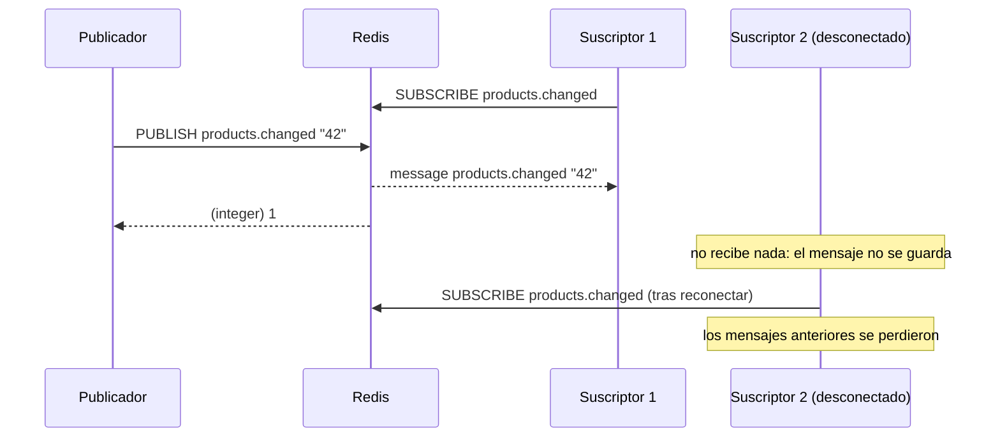

# Redis Pub-Sub

> [!abstract] En 30 segundos
> - **Qué es:** mensajería **fire-and-forget**: `PUBLISH` envía a los **suscriptores conectados en ese instante**; no hay almacenamiento, confirmación ni reintento (**at-most-once**).
> - **Para qué:** notificaciones efímeras: invalidar cachés L1, avisar a clientes en tiempo real, *backplane* de SignalR.
> - **Recuerda:** si el suscriptor está desconectado, **pierde el mensaje**. Para entrega fiable usa **Streams**. En Cluster, `PUBLISH` clásico se difunde a todos los nodos; **sharded Pub/Sub** (≥7.0) lo limita al shard.

> [!info] Lección 5.2 · Nivel 5 — Redis en arquitecturas de microservicios
> ⬅️ [[Redis en microservicios]] · ➡️ [[Keyspace notifications]] · 🗺️ [[01 - Redis - Roadmap#Nivel 5 — Redis en arquitecturas de microservicios|Roadmap]] · 📊 [[03 - Redis - Progreso|Progreso]]
> 🏷️ Core · sharded (`SPUBLISH`/`SSUBSCRIBE`) ≥7.0.
> 🧩 Proyecto asociado: [[Proyecto 06 - Distribución de eventos]].

## 📌 Definición

| Comando | Qué hace |
|---|---|
| `SUBSCRIBE canal…` / `UNSUBSCRIBE` | Se suscribe/desuscribe a canales exactos |
| `PSUBSCRIBE patrón…` / `PUNSUBSCRIBE` | Suscripción por patrón glob (`orders.*`) |
| `PUBLISH canal mensaje` | Publica; devuelve el número de suscriptores que lo recibieron |
| `SSUBSCRIBE` / `SPUBLISH` / `SUNSUBSCRIBE` | **Sharded** Pub/Sub (≥7.0): el canal pertenece a un slot |
| `PUBSUB CHANNELS` / `NUMSUB` / `NUMPAT` / `SHARDCHANNELS` / `SHARDNUMSUB` | Inspección |

Los canales **no se crean ni se almacenan**: existen mientras haya suscriptores. No tienen relación con el *keyspace* ni con las bases de datos numeradas.

## 🎯 ¿Qué problema resuelve?

Avisar a muchos procesos «algo pasó» con latencia mínima y sin infraestructura extra: «el producto 42 cambió; borra tu L1», «hay un mensaje nuevo en el chat», «terminó el informe». No hay que guardar nada ni gestionar consumidores.

## 🧠 Conceptos fundamentales

1. **At-most-once:** cada mensaje se entrega **como máximo una vez** a cada suscriptor conectado. Si no hay suscriptores, `PUBLISH` devuelve `0` y el mensaje se descarta. Un suscriptor que se reconecta **no recupera** lo que se perdió.
2. **Fan-out:** todos los suscriptores de un canal reciben **todos** los mensajes (no se reparten como en una cola).
3. **Patrones:** `PSUBSCRIBE` evalúa cada publicación contra todos los patrones; con muchos patrones, el coste crece. Prefiere canales exactos.
4. **Suscriptores lentos:** el servidor guarda en un búfer de salida lo que el cliente no lee; con el límite por defecto de la clase `pubsub` (`client-output-buffer-limit pubsub 32mb 8mb 60`), **desconecta** al cliente que se retrasa demasiado.
5. **Conexión dedicada:** en RESP2, una conexión suscrita solo puede ejecutar comandos de Pub/Sub y `PING`; en RESP3 puede compartir la conexión. SE.Redis usa por defecto una **conexión de suscripción dedicada**, incluso en RESP3.
6. **Cluster:**
   - `PUBLISH`/`SUBSCRIBE` clásicos se **difunden por el bus del clúster a todos los nodos**: a gran escala es costoso.
   - **Sharded Pub/Sub** (`SPUBLISH`/`SSUBSCRIBE`): el canal se asigna a un *hash slot*; el mensaje solo viaja dentro del shard que lo posee.
7. **Orden y concurrencia en SE.Redis:**
   - **Secuencial** (cola con `OnMessage`/`await foreach`): preserva el orden; un mensaje lento retrasa a los demás.
   - **Concurrente** (callback `Subscribe(canal, handler)`): sin garantía de orden y más rápido/escalable; recomendado cuando los mensajes son independientes.
8. **Seguridad:** las ACL restringen canales (`&patrón`).

| | Pub/Sub | Streams |
|---|---|---|
| Entrega | At-most-once | At-least-once (con ACK) |
| Persistencia | Ninguna | Sí (log) |
| Reconexión | Pierde mensajes | Retoma por ID |
| Consumo | Todos reciben todo | Consumer groups reparten |
| Ideal para | Señales efímeras | Eventos y trabajo fiable |

### Analogía
Una **megafonía** de un aeropuerto: quien está cerca la oye; quien está en otra sala o fuera, no. No se repite ni se graba.
**Dónde se rompe:** si necesitas que el pasajero ausente se entere después, necesitas un tablón (Streams).

## ⚙️ Funcionamiento interno



## 💻 Ejemplos prácticos

```text
# Terminal A
127.0.0.1:6379> SUBSCRIBE products.changed
1) "subscribe"
2) "products.changed"
3) (integer) 1

# Terminal B
127.0.0.1:6379> PUBLISH products.changed 42
(integer) 1
127.0.0.1:6379> PUBLISH nadie-escucha hola
(integer) 0

127.0.0.1:6379> PUBSUB NUMSUB products.changed
1) "products.changed"
2) (integer) 1

# Sharded (Cluster ≥7.0)
127.0.0.1:7000> SSUBSCRIBE {orders}.eu
127.0.0.1:7000> SPUBLISH {orders}.eu "pedido 7"
```

## 🔧 Implementación en .NET

```csharp
using StackExchange.Redis;

ISubscriber sub = mux.GetSubscriber();
RedisChannel channel = RedisChannel.Literal("shop:products.changed");

// 1. Publicar
long receivers = await sub.PublishAsync(channel, "42");

// 2. Suscripción concurrente (callback): rápida, sin garantía de orden
await sub.SubscribeAsync(channel, (ch, message) =>
{
    Console.WriteLine($"Producto cambiado: {message}");
});

// 3. Suscripción secuencial (cola): preserva el orden; un mensaje lento retrasa a los demás
ChannelMessageQueue queue = await sub.SubscribeAsync(RedisChannel.Literal("shop:notifications"));
queue.OnMessage(async msg =>
{
    await Task.Delay(10);                       // trabajo asíncrono por mensaje
    Console.WriteLine($"Notificación: {msg.Message}");
});

// 4. Patrón: RedisChannel.Pattern evalúa todos los patrones por publicación (úsalo con moderación)
await sub.SubscribeAsync(RedisChannel.Pattern("shop:orders.*"), (ch, message) =>
    Console.WriteLine($"{ch}: {message}"));

// 5. Reconexión: tras una caída, SE.Redis reanuda las suscripciones, pero los mensajes perdidos no vuelven
mux.ConnectionRestored += (_, _) => Console.WriteLine("Reconectado: reconcilia el estado (p. ej., vacía L1)");
```

**Backplane de SignalR con Redis** (varias instancias de la app comparten mensajes a clientes WebSocket):

```csharp
// Paquete: Microsoft.AspNetCore.SignalR.StackExchangeRedis
builder.Services.AddSignalR().AddStackExchangeRedis(
    builder.Configuration.GetConnectionString("Redis")!,
    options => options.Configuration.ChannelPrefix = RedisChannel.Literal("MyApp"));
```

> [!warning] Reconciliación tras reconexión
> Si tu lógica depende de los mensajes (invalidación de L1), añade siempre un TTL corto y **reconcilia el estado al reconectar** (vaciar L1, releer). Pub/Sub nunca debe ser la única red de seguridad de una invalidación.

## 🏗️ Casos de uso en arquitectura

| Caso | Encaje |
|---|---|
| Invalidación de L1 entre instancias | Sí, con TTL de seguridad ([[Distributed caching]]) |
| Notificaciones en tiempo real (chat, presencia) | Sí |
| Backplane de SignalR | Sí (paquete oficial) |
| Eventos de negocio que no se pueden perder | **No**: Streams ([[Consumer Groups en Redis Streams]]) |
| Trabajo repartido entre workers | **No**: colas o Streams |

### Cuándo NO usarlo
- Cuando cada mensaje debe procesarse sí o sí.
- Cuando necesitas reintentos, histórico o *replay*.

### Consideraciones de arquitectura

| Dimensión | Qué pensar |
|---|---|
| Fiabilidad | Ninguna garantía: diseña la reconciliación |
| Escala en Cluster | Sharded Pub/Sub para evitar difusión global |
| Volumen | Cuidado con suscriptores lentos y búferes de salida |
| Seguridad | ACL de canales; nada sensible sin cifrar en el mensaje |

## ⚠️ Errores y anti-patterns

| Error | Por qué duele | Cómo evitarlo |
|---|---|---|
| Usar Pub/Sub como cola de trabajo | Se pierden mensajes y no se reparten | Streams/colas |
| Suscripción por patrón con muchos patrones | CPU en cada publicación | Canales exactos |
| Suscriptor lento sin control | Desconexión por límite de búfer | Procesar rápido; desacoplar con cola interna |
| Mensajes grandes | Búferes y latencia | Mensaje = identificador; el dato se lee aparte |
| Confiar en que `PUBLISH` devuelve «entregado» | Solo indica suscriptores en ese momento | No es un ACK |

## ✅ Buenas prácticas

1. Mensajes pequeños (ids), idempotentes.
2. TTL y reconciliación como red de seguridad.
3. Callback concurrente salvo que necesites orden.
4. Sharded Pub/Sub en Cluster con mucho tráfico.
5. Métricas: `PUBSUB NUMSUB`, desconexiones.

## 🎤 Preguntas de entrevista

> [!question]- 1. ¿Pub/Sub o Streams?
> Pub/Sub para señales efímeras con latencia mínima donde perder alguna es tolerable; Streams cuando cada mensaje importa, quieres reintentos, reparto entre workers, histórico o *replay*.

> [!question]- 2. ¿Qué pasa con los mensajes si el suscriptor se desconecta?
> Se pierden: Redis no los guarda. Al reconectar, solo recibe los nuevos.

> [!question]- 3. ¿Qué ventaja da el sharded Pub/Sub en Cluster?
> Evita que cada mensaje se difunda a todos los nodos: se queda en el shard dueño del slot del canal, mejorando la escalabilidad.

## 🧪 Ejercicios

### 🟢 Básicos
1. Suscribe una terminal, publica desde otra y comprueba `PUBSUB NUMSUB`.

### 🟡 Intermedios
2. Desconecta un suscriptor, publica 10 mensajes y reconéctalo: ¿cuántos recibe? Repite con un Stream y explica la diferencia.

### 🔴 Reto Senior
3. Diseña la invalidación de L1 para 30 instancias usando Pub/Sub con garantías razonables. ¿Qué haces si una instancia pierde la suscripción 20 s?

> [!success]- Soluciones
> **3.** Mensaje con la clave a invalidar, TTL de L1 corto (30-60 s) como red de seguridad, y vaciar L1 (o marcar la época) al detectar la reconexión. Opcionalmente, un contador de versión en Redis que cada instancia compare periódicamente.

### ✔️ Checklist de dominio
- [ ] Explico at-most-once y sus consecuencias.
- [ ] Elijo entre Pub/Sub, Streams y colas.
- [ ] Diseño reconciliación tras desconexión.

## 📝 Resumen

- Pub/Sub = difusión efímera, at-most-once, sin persistencia.
- Callback concurrente vs cola secuencial en SE.Redis.
- Sharded Pub/Sub para Cluster.
- Para fiabilidad: Streams.

## 🔗 Referencias

- [Redis Pub/Sub](https://redis.io/docs/latest/develop/pubsub/)
- [Pub/Sub en SE.Redis y orden de mensajes](https://stackexchange.github.io/StackExchange.Redis/PubSubOrder)
- [Backplane de SignalR con Redis](https://learn.microsoft.com/aspnet/core/signalr/redis-backplane)

## 🔄 Notas relacionadas

- ⬅️ [[Redis en microservicios]] · ➡️ [[Keyspace notifications]]
- Relacionadas: [[Redis Streams]] · [[Distributed caching]] · [[Cache invalidation]] · [[Proyecto 06 - Distribución de eventos]]
