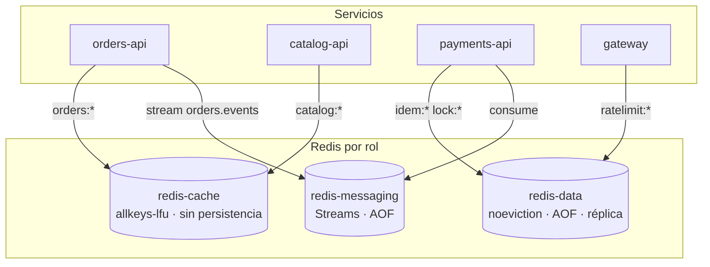

# Redis en microservicios

> [!abstract] En 30 segundos
> - **Qué es:** decidir **qué papel juega Redis** en una plataforma de servicios (caché, sesión, límite de tasa, locks, mensajería, colas) y **quién es dueño de cada dato**.
> - **Para qué:** aprovechar Redis sin convertirlo en una **base de datos compartida** que acople a todos los equipos.
> - **Recuerda:** Redis es **de un solo hilo**: una instancia compartida es un **destino compartido** (un servicio con `KEYS *` o una clave enorme frena a todos). Un servicio, un espacio de nombres (y, mejor, una instancia o ACL) por rol.

> [!info] Lección 5.1 · Nivel 5 — Redis en arquitecturas de microservicios
> ⬅️ [[Redis con Aspire]] · ➡️ [[Redis Pub-Sub]] · 🗺️ [[01 - Redis - Roadmap#Nivel 5 — Redis en arquitecturas de microservicios|Roadmap]] · 📊 [[03 - Redis - Progreso|Progreso]]
> 🏷️ Conceptos de arquitectura; las ACL se estudian en [[Redis ACL]].

## 📌 Definición

En una arquitectura de microservicios, cada servicio es dueño de sus datos y los demás acceden a ellos **a través de su API o de eventos**, no leyendo su almacenamiento. Redis encaja de varias formas:

| Rol | Ejemplos | Naturaleza |
|---|---|---|
| **Caché** | Productos, resultados | Desechable |
| **Estado compartido de infraestructura** | Sesiones, rate limiting, idempotencia, locks | Importante, pero acotado en el tiempo |
| **Mensajería** | Pub/Sub, Streams, colas | Entrega y retención con garantías propias |
| **Datos de aplicación** | Rankings, contadores, carritos | Datos del servicio: dueño claro |

## 🎯 ¿Qué problema resuelve?

Redis es tan cómodo que acaba usándose como «lugar donde dejar cosas» entre servicios: un servicio escribe una clave y otro la lee. Eso crea **acoplamiento oculto** (formato, nombres, TTL, ciclo de vida), y un único punto de fallo y de contención. Esta lección establece las reglas para evitarlo.

## 🧠 Conceptos fundamentales

1. **Propiedad de los datos:** cada clave tiene **un servicio dueño**, que es el único que la escribe y define su formato. Los demás consumen mediante API o evento.
2. **El anti-pattern de la BD compartida:** varios servicios leyendo/escribiendo las mismas claves = integración por base de datos. Cambias el formato y rompes a otros equipos sin saberlo.
3. **Espacios de nombres:** prefijo por servicio (`orders:…`, `catalog:…`) y, si procede, por entorno o tenant (`t:{tenant}:…`). Las ACL pueden **forzar** el prefijo (`~orders:*`).
4. **Bases de datos numeradas (`SELECT 1`) no son aislamiento:** no se pueden usar en Cluster (solo db 0), comparten el mismo hilo, memoria y ACL de instancia; evítalas como mecanismo de separación.
5. **Un solo hilo, destino compartido:** una instancia compartida agrupa a todos los servicios en la misma cola de comandos. Un comando lento o una clave gigante de un servicio retrasa a todos (*noisy neighbor*).
6. **Separar por rol:**

| Opción | Cuándo | Contra |
|---|---|---|
| **Instancia por rol** (caché / datos / mensajería) | Casi siempre en producción | Más instancias que operar |
| Instancia compartida con **ACL y prefijos** | Entornos pequeños o de desarrollo | Fallos y carga compartidos |
| Instancia por servicio | Servicios críticos o con carga muy distinta | Coste y operación |

7. **Multi-tenant:** prefijo por tenant + ACL por tenant (si hay pocos) o instancias por tenant grande; evita que un tenant pueda enumerar claves de otro.
8. **Contratos:** los eventos y mensajes (streams, canales) son una **API pública**: versiónalos y documentalos.
9. **Ownership operativo:** alguien es responsable de Redis como plataforma (versiones, parches, HA, capacidad, alertas).

### Analogía
Un **edificio de oficinas con una sola sala de archivos**: es cómodo hasta que un inquilino mete todo el papel y bloquea el pasillo, o abre el archivador de otro. Mejor, cada empresa su archivador con llave (ACL), y el archivo del edificio reservado para lo realmente común.
**Dónde se rompe:** una sola sala con un solo bibliotecario (un hilo) atiende a todos por turnos.

## ⚙️ Funcionamiento interno



## 💻 Ejemplos prácticos

ACL que confina a un servicio a su espacio de nombres:

```text
127.0.0.1:6379> ACL SETUSER orders-svc on >S3cretLocal ~orders:* &orders:* +@read +@write +@stream +@pubsub -@dangerous
OK
127.0.0.1:6379> AUTH orders-svc S3cretLocal
OK
127.0.0.1:6379> SET orders:1 x
OK
127.0.0.1:6379> SET catalog:1 x
(error) NOPERM No permissions to access a key
```

`~patrón` limita las claves y `&patrón` los canales de Pub/Sub; `-@dangerous` bloquea comandos como `KEYS`, `FLUSHALL` o `CONFIG`.

## 🔧 Implementación en .NET

```csharp
using StackExchange.Redis;

// Un constructor de claves por servicio: nadie escribe cadenas «a mano»
public sealed class OrdersKeys(string environment = "prod")
{
    private readonly string _p = $"{environment}:orders:";

    public RedisKey Order(Guid id) => $"{_p}{id:N}";
    public RedisKey ByCustomer(Guid customerId) => $"{_p}by-customer:{customerId:N}";
    public RedisKey Events => $"{_p}events";           // stream propio
    public RedisChannel Notifications => RedisChannel.Literal($"{_p}notifications");
}

// Opción más simple para aislar: prefijo automático en IDatabase
IDatabase db = mux.GetDatabase().WithKeyPrefix("prod:orders:");
```

Cada servicio recibe **su** cadena de conexión y su usuario ACL; la cadena de la instancia de caché y la de datos son diferentes:

```json
{
  "ConnectionStrings": {
    "RedisCache": "redis-cache:6379,user=orders-svc,abortConnect=false",
    "RedisData": "redis-data:6379,user=orders-svc,abortConnect=false"
  }
}
```

## 🏗️ Casos de uso en arquitectura

| Escenario | Decisión |
|---|---|
| Caché de catálogo usada solo por `catalog-api` | Caché propia del servicio |
| Datos de otro servicio que necesito leer | Su API o un evento; **nunca** su clave |
| Rate limiting en el gateway | Instancia de datos o de infraestructura |
| Idempotencia de pagos | Instancia de datos (no desalojable) |
| Eventos entre servicios | Streams en una instancia de mensajería ([[Event-driven architecture con Redis]]) |

### Cuándo compartir una instancia es aceptable
- Desarrollo y entornos pequeños, con prefijos y ACL.
- Capacidades de plataforma explícitas (gateway de rate limiting) con un dueño claro y un contrato.

### Consideraciones de arquitectura

| Dimensión | Qué pensar |
|---|---|
| Blast radius | Qué servicios caen si cae esa instancia |
| Capacidad | Presupuesto de memoria por rol y por servicio |
| Seguridad | ACL por servicio, TLS, sin `default` abierto ([[Seguridad en Redis]]) |
| Gobernanza | Convención de claves, versiones y TTL documentadas |
| Observabilidad | Métricas por prefijo (tamaño, claves) |

## ⚠️ Errores y anti-patterns

| Error | Por qué duele | Cómo evitarlo |
|---|---|---|
| Servicios leyendo claves de otros servicios | Acoplamiento y roturas silenciosas | API o eventos |
| Una instancia para todo | Un vecino ruidoso afecta a todos | Instancias por rol |
| Usar `SELECT n` como aislamiento | No aísla ni funciona en Cluster | Prefijos/ACL/instancias |
| Sin convención de claves | Colisiones | Constructor de claves por servicio |
| Mezclar caché con datos en la misma instancia | La eviction borra lo importante | Roles separados |
| Contraseña/usuario compartido por todos | Sin trazabilidad ni límites | ACL por servicio |

## ✅ Buenas prácticas

1. Un dueño por clave; contratos para lo que se comparte.
2. Instancias separadas por rol (caché, datos, mensajería).
3. ACL por servicio con prefijos forzados.
4. Constructor de claves y revisión de código.
5. Presupuestos de memoria y alertas por instancia.

## 🎤 Preguntas de entrevista

> [!question]- 1. ¿Por qué es un anti-pattern compartir Redis como base de datos entre servicios?
> Porque crea acoplamiento por formato y nombres de clave sin contrato, impide evolucionar un servicio sin coordinar a los demás y comparte el mismo hilo, memoria y fallos. La integración debe ser por API o eventos.

> [!question]- 2. ¿Cuándo es aceptable una instancia compartida?
> En desarrollo, en entornos pequeños, o para una capacidad de plataforma con dueño y contrato claros (p. ej., rate limiting en el gateway), siempre con prefijos y ACL.

> [!question]- 3. ¿Cómo evitas que un servicio acceda a las claves de otro?
> Con ACL por servicio con patrones de clave (`~orders:*`) y canales (`&orders:*`), además del prefijo en el código.

## 🧪 Ejercicios

### 🟢 Básicos
1. Crea un usuario ACL restringido a un prefijo y comprueba el `NOPERM`.

### 🟡 Intermedios
2. Implementa el constructor de claves y un test que asegure que ningún código usa literales de clave.

### 🔴 Reto Senior
3. Una plataforma con 12 servicios usa un único Redis de 8 GB. Un día `catalog-api` ejecuta un `KEYS *` y todos tienen timeouts. Propón la arquitectura objetivo y el plan de migración.

> [!success]- Soluciones
> **3.** Separar por rol: `redis-cache` (catalog, productos), `redis-data` (sesiones, idempotencia, locks, rate limiting), `redis-messaging` (streams). ACL por servicio con `-@dangerous`; presupuestos de memoria; migración gradual por servicio con doble lectura y retirada de las claves antiguas; alertas de latencia por instancia.

### ✔️ Checklist de dominio
- [ ] Defino roles de Redis y propiedad de datos.
- [ ] Explico el anti-pattern de BD compartida.
- [ ] Aíslo servicios con prefijos, ACL e instancias.

## 📝 Resumen

- Redis = piezas de infraestructura con dueño claro, no «base de datos común».
- Un servicio, un espacio de nombres; instancias por rol.
- ACL con patrones de claves y canales.
- Un hilo compartido = destino compartido.

## 🔗 Referencias

- [Redis ACL](https://redis.io/docs/latest/operate/oss_and_stack/management/security/acl/)
- [Microservices data patterns](https://learn.microsoft.com/azure/architecture/microservices/design/data-considerations)

## 🔄 Notas relacionadas

- ⬅️ [[Redis con Aspire]] · ➡️ [[Redis Pub-Sub]]
- Relacionadas: [[Redis ACL]] · [[Eviction policies]] · [[Modelado de datos en Redis]] · [[Proyecto 11 - Arquitectura de microservicios con Redis]]
