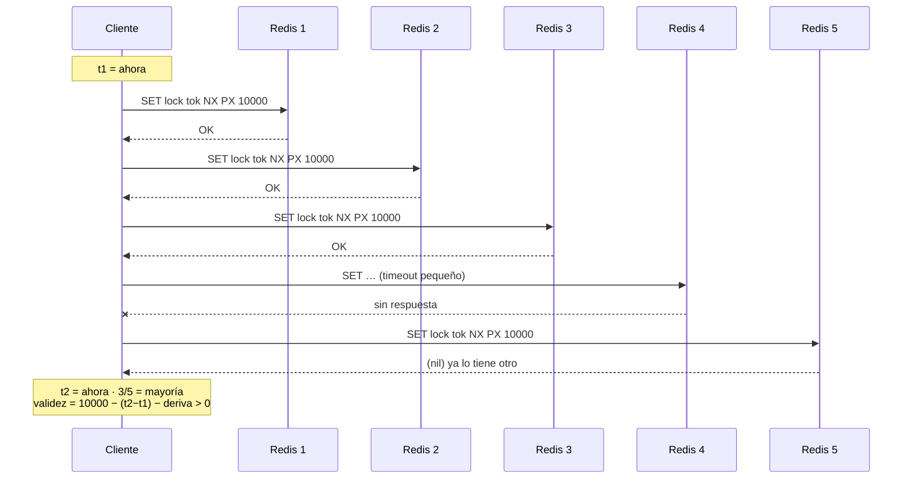

# Redlock y sus limitaciones

> [!abstract] En 30 segundos
> - **Qué es:** un algoritmo que adquiere el lock en **N instancias Redis independientes** (típicamente 5) y exige **mayoría**, para tolerar la caída de algunas.
> - **Para qué:** mejorar la disponibilidad del lock frente a un único nodo Redis.
> - **Recuerda:** no elimina el problema de fondo: sigue siendo un lock **basado en tiempo**. Críticos como Martin Kleppmann sostienen que **no es seguro para corrección** (pausas, relojes, sin fencing); el autor de Redis (antirez) lo defiende bajo supuestos de tiempo. **Decide con el modelo de fallos delante** y, si importa la corrección, usa fencing, la BD o un sistema de consenso.

> [!info] Lección 5.9 · Nivel 5 — Redis en arquitecturas de microservicios
> ⬅️ [[Distributed locks con Redis]] · ➡️ [[Idempotencia con Redis]] · 🗺️ [[01 - Redis - Roadmap#Nivel 5 — Redis en arquitecturas de microservicios|Roadmap]] · 📊 [[03 - Redis - Progreso|Progreso]]
> 🏷️ Algoritmo (no un comando). Esta lección usa una idea del Nivel 6: la replicación asíncrona puede perder un lock en un failover ([[Replicación en Redis]]).

## 📌 Definición

**Redlock** es el algoritmo propuesto por Salvatore Sanfilippo (antirez) para locks distribuidos con **N masters independientes** (sin réplicas entre sí):

1. Anota el instante `t1`.
2. Intenta adquirir en **cada** instancia, en secuencia, con `SET lock token NX PX ttl` y un *timeout* pequeño por instancia.
3. Anota `t2`. El **tiempo de validez** es `ttl − (t2 − t1) − deriva_de_reloj`.
4. El lock se considera **adquirido** si lo lograste en **mayoría** (≥ N/2 + 1) y la validez es positiva.
5. Si no, **libera** en todas las instancias (incluso en las que falló).

## 🎯 ¿Qué problema resuelve?

Un lock en un **único** Redis tiene dos debilidades: es un punto único de fallo y, con réplica asíncrona, un *failover* puede perder el lock (la réplica promovida no lo tenía y otro cliente lo adquiere). Redlock reparte la decisión entre varias instancias independientes.

## 🧠 Conceptos fundamentales

### Supuestos de Redlock
- Los relojes de los nodos avanzan **aproximadamente al mismo ritmo** (deriva acotada).
- Los retrasos de red y las pausas de los procesos son **mucho menores** que el TTL.
- Los nodos son **independientes** (no réplicas entre sí).

### El debate (resumido)

| Argumento | Quién | Idea |
|---|---|---|
| **Redlock no es seguro para corrección** | Martin Kleppmann | (1) Un cliente puede **pausarse** (GC, red) después de adquirir y actuar con el lock **ya caducado**. (2) Los **saltos de reloj** (NTP) pueden hacer expirar el lock antes. (3) Redlock **no genera un fencing token** monótono: sin él, el recurso no puede rechazar a un titular obsoleto. Conclusión: úsalo (o un lock simple) solo para eficiencia; para corrección, consenso + fencing. |
| **Redlock es razonable bajo sus supuestos** | antirez | Los supuestos de tiempo son comunes en sistemas reales; las pausas largas se pueden detectar comparando el tiempo transcurrido tras adquirir; se puede obtener un token único para *compare-and-set* en el recurso. |

La conclusión práctica de la comunidad es matizada: **ningún lock con TTL protege por sí solo un recurso frente a un titular pausado**; lo que cambia es el coste y la disponibilidad que consigues.

### Qué añade Redlock y qué no

| | Lock en un nodo (+ réplica) | Redlock (5 nodos) |
|---|---|---|
| Tolera caída de 1-2 nodos | No (punto único) | Sí |
| Evita pérdida del lock por *failover* asíncrono | No | Sí (si los nodos son independientes) |
| Protege frente a pausas del cliente | No | **No** |
| Protege frente a saltos de reloj | No | **No del todo** |
| Fencing token | Hay que añadirlo | Hay que añadirlo |
| Coste operativo | 1 instancia | 5 instancias independientes |

### Alternativas

| Necesidad | Opción |
|---|---|
| **Corrección** sobre datos en BD | Restricciones únicas, concurrencia optimista (`rowversion`/ETag), `SELECT … FOR UPDATE`, *advisory locks* |
| Exclusión con consenso | etcd (leases), ZooKeeper, Consul |
| Azure | *Leases* de Blob Storage |
| Eficiencia (evitar duplicados) | Lock simple en Redis + idempotencia |
| Nada de locks | Diseño idempotente y particionado (un único consumidor por clave) |

### Cómo decidir
1. ¿Qué pasa si **dos** procesos entran a la vez? Si es «trabajo repetido», un lock simple basta. Si es «corrupción o dinero», **no confíes en un lock con TTL**.
2. ¿Puede el **recurso protegido** comprobar un token (fencing) o aplicar una restricción? Si sí, el lock es solo una optimización.
3. ¿Aceptas operar 5 instancias independientes? Si no, Redlock no compensa.

### Analogía
Cinco **porteros** independientes con una libreta: el lock es válido si tres te dan paso a la vez. Pero si te dan paso, te duermes en el pasillo una hora y la validez expira, entras con un pase caducado; los porteros no pueden saberlo. Solo la caja fuerte que comprueba un número de turno (fencing) lo evitaría.
**Dónde se rompe:** más porteros no arreglan que tú te duermas.

## ⚙️ Funcionamiento interno



## 💻 Ejemplos prácticos

Cada instancia es un Redis **independiente** (no réplicas):

```bash
docker run -d --name r1 -p 6381:6379 redis:8.10
docker run -d --name r2 -p 6382:6379 redis:8.10
docker run -d --name r3 -p 6383:6379 redis:8.10
```

```text
# El cliente ejecuta en cada una:
SET lock:resource tok NX PX 10000
```

## 🔧 Implementación en .NET

La implementación del algoritmo no es trivial; en .NET se usa normalmente una librería comunitaria (por ejemplo, **RedLock.net**). Esquema de uso (verifica la API de la versión que instales):

```csharp
// Paquete: RedLock.net
using RedLockNet.SERedis;
using RedLockNet.SERedis.Configuration;
using StackExchange.Redis;

var multiplexers = new List<RedLockMultiplexer>
{
    ConnectionMultiplexer.Connect("localhost:6381"),
    ConnectionMultiplexer.Connect("localhost:6382"),
    ConnectionMultiplexer.Connect("localhost:6383"),
};

using RedLockFactory factory = RedLockFactory.Create(multiplexers);

await using var redLock = await factory.CreateLockAsync(
    resource: "invoice:42",
    expiryTime: TimeSpan.FromSeconds(30),
    waitTime: TimeSpan.FromSeconds(10),
    retryTime: TimeSpan.FromMilliseconds(500));

if (redLock.IsAcquired)
{
    // Sección crítica CORTA. Si la corrección importa, añade fencing/idempotencia fuera del lock.
}
```

> [!warning] La librería no te da fencing
> Aunque el lock tenga mayoría, nada impide que tu proceso se pause. Para recursos críticos, **añade un fencing token propio** (contador monótono en una fuente fiable) y haz que el recurso lo valide, o apóyate en las restricciones de la BD.

## 🏗️ Casos de uso en arquitectura

| Caso | Recomendación |
|---|---|
| Evitar trabajo duplicado, alta disponibilidad del lock | Lock simple + réplica, o Redlock si ya operas 5 nodos |
| Exclusión sobre datos críticos | BD (restricciones/transacciones) o consenso + fencing |
| Líder único de un servicio | etcd/Consul/Kubernetes leases |
| Cron entre instancias | Lock por fecha + idempotencia ([[Background jobs con Redis]]) |

### Cuándo NO usar Redlock
- Si necesitas **corrección** y no puedes validar un token en el recurso.
- Si no quieres operar 5 instancias independientes.

### Consideraciones de arquitectura

| Dimensión | Qué pensar |
|---|---|
| Independencia | Nodos sin replicación entre sí y en dominios de fallo distintos |
| Relojes | NTP estable; monotónicos para medir tiempo transcurrido |
| Coste | 5 instancias y 5 round-trips por adquisición |
| Alternativas | Muchas veces, una restricción en la BD es más simple y más segura |

## ⚠️ Errores y anti-patterns

| Error | Por qué duele | Cómo evitarlo |
|---|---|---|
| Redlock sobre **réplicas** del mismo master | No son independientes | Instancias independientes |
| Creer que «mayoría» = exclusión absoluta | Pausas y relojes | Fencing/BD |
| Secciones críticas largas | Superan la validez | Cortas + renovación cuidadosa |
| Usar Redlock cuando una restricción única bastaría | Complejidad innecesaria | Restricción en la BD |
| Ignorar el tiempo de adquisición | Validez menor de la esperada | Calcularla como en el algoritmo |

## ✅ Buenas prácticas

1. Decide por el modelo de fallos, no por popularidad.
2. Corrección ⇒ fencing o BD; eficiencia ⇒ lock simple.
3. Secciones críticas cortas e idempotentes.
4. Observa pérdidas de lock y esperas.
5. Revisa los argumentos originales (Kleppmann y antirez) antes de adoptar.

## 🎤 Preguntas de entrevista

> [!question]- 1. ¿Es seguro Redlock?
> Para eficiencia, razonable. Para corrección estricta, no por sí solo: depende de supuestos de tiempo (pausas, relojes) y no da fencing token. Si importa la corrección, se necesita un fencing token validado por el recurso, restricciones en la BD o un sistema de consenso.

> [!question]- 2. ¿Qué problema de un lock simple resuelve Redlock?
> La pérdida del lock en un *failover* con replicación asíncrona y el punto único de fallo, al repartir la decisión entre varias instancias independientes.

> [!question]- 3. ¿Qué alternativas hay?
> Restricciones y concurrencia optimista en la BD, `SELECT … FOR UPDATE` o *advisory locks*, etcd/ZooKeeper/Consul, leases de Azure Blob; o un diseño idempotente que no necesite lock.

## 🧪 Ejercicios

### 🟢 Básicos
1. Levanta 3 Redis independientes y adquiere el lock a mano con `SET NX PX` en cada uno; calcula la validez.

### 🟡 Intermedios
2. Escribe el cálculo de validez (`ttl − transcurrido − deriva`) y prueba con tiempos de red simulados.

### 🔴 Reto Senior
3. Un equipo quiere Redlock para no cobrar dos veces un pedido. Argumenta una alternativa más segura.

> [!success]- Soluciones
> **3.** Clave de idempotencia por pedido y restricción única en la BD (o transacción con `rowversion`): aunque dos procesos intenten cobrar, solo uno tiene éxito, y no se depende de tiempos.

### ✔️ Checklist de dominio
- [ ] Describo el algoritmo y sus supuestos.
- [ ] Resumo el debate Kleppmann vs antirez.
- [ ] Elijo entre lock simple, Redlock, BD o consenso según el modelo de fallos.

## 📝 Resumen

- Redlock: mayoría de N instancias independientes con validez calculada.
- Mejora disponibilidad, no elimina pausas ni saltos de reloj.
- Corrección ⇒ fencing o restricciones; eficiencia ⇒ lock simple.
- Considera siempre la alternativa de la BD.

## 🔗 Referencias

- [Distributed locks con Redis (Redlock)](https://redis.io/docs/latest/develop/clients/patterns/distributed-locks/)
- [How to do distributed locking (Kleppmann, 2016)](https://martin.kleppmann.com/2016/02/08/how-to-do-distributed-locking.html)
- [Is Redlock safe? (antirez)](http://antirez.com/news/101)
- [RedLock.net](https://github.com/samcook/RedLock.net)

## 🔄 Notas relacionadas

- ⬅️ [[Distributed locks con Redis]] · ➡️ [[Idempotencia con Redis]]
- Relacionadas: [[Replicación en Redis]] · [[Control de concurrencia con Redis]] · [[Alta disponibilidad en Redis]]
